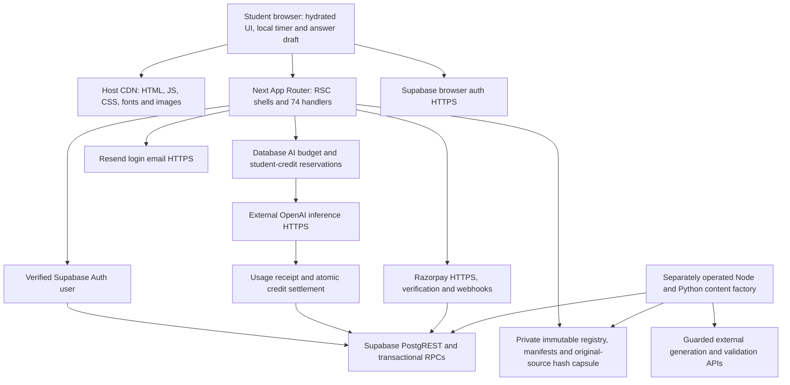

# MockMob — Cloudflare Migration Readiness Audit

Audit date: **11 October 2026, IST**. Repository: `C:\Users\atish\Desktop\mockmob copy\mockmob copy`.

Scope: current dirty working tree, not just committed HEAD and not a verified copy of production. Existing changes were preserved. No deployment, purchase, DNS change, production migration, live load test, paid model request or real database write was performed. New diagnostic files are under `tmp/cloudflare-audit/`; an isolated source snapshot uses dummy credentials. Official provider documentation was checked at execution time. Prices exclude taxes and exchange/card spreads.

Evidence labels used throughout: **measured local** = executed on this Windows machine; **source-derived** = observed code behavior; **model** = explicit arithmetic assumptions; **unverified** = requires account access or isolated cloud staging. None of these labels implies production capacity.

## 1. Executive Verdict

**CONDITIONAL GO for Cloudflare Workers Paid + existing Supabase + existing external AI/payment/email providers. Do not cut production over yet.**

This is a feasible hosting direction, but a moderate engineering migration rather than a $5 configuration switch. Keep Vercel serving production until the gates below pass. I would choose Workers for the eventual web host if its pinned adapter and real Supabase staging tests pass; I would keep the existing separately operated content factory outside the web host. A new separate student API service is not presently justified.

The most consequential findings are application issues that exist on any host:

1. **Durable exams autosave the full accumulated event log every 1.5 seconds, even unchanged.** For 1,000 active durable exams the upper steady-state model is approximately **667 application requests/s**, **2,667 database gateway calls/s plus 667 Auth calls/s** with `PERSISTENT_LIMITS_ENABLED=true`, before launches/submissions. Without that persistent rate-limit RPC, the modeled database rate is about 2,000 calls/s. These rates assume saves finish before the next tick; the client's busy guard reduces request rate when saves take longer, at the cost of acknowledgement lag. This is not a proven sustainable Supabase workload.
2. **Publication eligibility repeatedly reads/parses 4.9 MB of JSON per candidate.** A measured local primitive averaged **32.8 ms CPU** per registry+manifest read/parse pair. Multiplying by 1,000 candidates extrapolates 32.8 CPU seconds before other work. This is not measured Worker CPU, but it invalidates the assumption that every current question launch is a cheap few-millisecond request.
3. **Original-source hash validation depends on actual repository files.** A 118-file historical capsule includes `next.config.mjs` and `package-lock.json`. Adding hosting dependencies can correctly invalidate it. Preserve authentic immutable bytes/provenance and current release authority; never weaken gates or regenerate historical hashes just to pass deployment.
4. **Recent unsynchronized answers can be omitted at the deadline.** Durable submission after expiry scores only already acknowledged server events; local-storage failures are silently ignored. This needs explicit preservation tests and a final-flush/deadline design.
5. **Unbounded question/history/leaderboard scans, isolate-local caches/rate limits, no runtime AI concurrency queue, and a global USD25/month AI cap constrain scale.** Workers scaling does not raise database throughput or model quotas.

**1,000 simultaneously active users are not certified by this audit.** Low-intensity browsing/device-ticket practice is much lighter than 1,000 durable exams or 1,000 simultaneous AI requests. After the identified changes, 1,000 active users is a credible target to validate; 5,000–10,000 requires measured database and upstream-provider capacity. No host can establish that from a local public-page test.

**Cost:** $5/month is a Worker compute floor. A low-request deployment can remain near it. The illustrative current-code mixed model is $9.80 compute at 1,000 DAU; exam-heavy use is $141.80. Sustained 1,000 durable exams replacing one another all month is about **$1,556.60 compute at an assumed 30 ms mean CPU**, plus database, logs and other services. These are workload projections, not current bills.

## 2. Architecture Findings

### Technologies and coverage

Static discovery found **74 route-handler files**, 130 page/layout/route entries and 405 conservatively reachable local files. The successful isolated build has 133 App Router path entries, including metadata routes. Regex reachability includes conditional/preview code; it is not an emitted bundle measurement. Complete route-by-route inventory, environment names and transitive graph: [architecture inventory](tmp/cloudflare-audit/architecture-inventory.json); [architecture findings](tmp/cloudflare-audit/architecture-findings.md). Detailed backend source references: [backend findings](tmp/cloudflare-audit/backend-findings.md).

| Technology | Locked implementation / role |
| --- | --- |
| Next / React | Next.js **16.2.4** App Router; React and ReactDOM **19.2.4** |
| Source/config | JS, JSX, ESM/MJS, one runtime TS auth module; CSS/JSON; SQL migrations; Python offline tools. `jsconfig.json` defines `@/*`; no root tsconfig initially. |
| Styling/interaction | Tailwind 4.2.3, Motion 12.38.0, lucide-react, Chart.js 4.5.1/react-chartjs-2 5.3.1, ts-fsrs 5.4.2 |
| Identity/data | Supabase JS 2.104.0/SSR 0.10.2 over HTTPS; legacy NextAuth 5.0.0-beta.31 handlers remain |
| AI SDKs | OpenAI 6.34.0, Anthropic 0.90.0, Gemini 0.24.1; default student runtime uses GPT-6 Luna. Installed package does not establish active use. |
| Commerce/email | Razorpay 2.9.6; Resend 6.12.2 |
| Native/transitive | Next SWC/build tooling, optional Sharp/image tooling; Axios through Razorpay; Supabase realtime/WS packages; PGlite dev SQL tests. Native installation is distinct from production request-time requirements. |
| Offline factory | Node/Python, filesystem, persistent SQLite receipts/budget ledger, batch provider operations and supervisory processes. Already separate from student HTTP routes. |



### Rendering and real workloads

Public marketing and SEO pages are statically rendered, including `/` and six subject hubs. Signed-in route shells are dynamic: `src/app/(app)/layout.js:17` awaits `connection()`, then the browser performs protected API reads. Client test navigation does not invoke SSR per question. There are no current `use server` actions, explicit ISR/revalidation APIs or Cache Components usage found in `src`; RSC/framework streaming is supported by the framework, whereas student AI returns complete JSON rather than streaming tokens.

No custom WebSocket, EventSource/SSE, app ReadableStream, Supabase channel subscription, direct Postgres TCP driver or persistent server-side student process was found. AI Battle/Rival is a deterministic shadow benchmark, not multiplayer matchmaking. There is no live student question-generation service corresponding to the long-running offline factory.

`middleware.js` exists at root with referral/auth logic. **The measured build's middleware manifest is empty**, and unauthenticated `/dashboard` returns a 200 UI shell. Thus source presence is not proof middleware currently runs. Protected APIs still use custom Supabase `auth()`; this observation is not proof of a data-authentication bypass. Verify the intended middleware location/behavior before relying on it in either host.

`data/db.js` and server modules use service-role Supabase HTTP calls, not direct TCP pools. Keep server-only imports and owner authorization before service-role access. Browser auth uses public keys and cookies; secret keys must remain outside client bundles. Migration does not move Supabase data or require Hyperdrive/D1.

The admin client deliberately bypasses RLS (`src/lib/supabase.js:5–8`), so route ownership checks remain a primary security boundary. Connected-learning tables enable RLS and revoke public/anon/authenticated access in `supabase/migrations/20261002120000_connected_learning.sql:28–37`; credit reservations do the same in `20261002130000_prepos_credit_reservations.sql:42–44`. Runtime-budget RPCs grant execution only to service_role (`20261004120000_runtime_ai_monthly_cap.sql:69–70`). Local SQL tests exercise these restrictions. Applied production policies, grants and all legacy-table permissions were not remotely verified; a host migration must not be treated as a completed database security audit.

### Test-session lifecycle

- Launch loads the complete selected paper into browser memory. Navigation, selecting/marking answers, and the 250 ms display timer are local (`TestPageClient.jsx:264–300,360–378`). Current full/NTA modes are **50 questions / 60 minutes**, not configured 1–3 hour papers (`data/test_modes.js:53–91`). Several hours of browser use consists of short HTTP requests.
- **Durable mode**, selected by `LEARNING_SESSIONS_ENABLED`, creates an owned row with private question snapshot, authoritative deadline and event sequence. Starts/debits and finishes/progress are transactional. Every 1.5 seconds after events exist the client uploads its whole log. Server restore can resume from the ID across devices; concurrent-device conflicts are not acceptance-tested here.
- **Device-ticket fallback** carries an encrypted/compressed server-issued snapshot; public questions and answers stay in localStorage. There are no interval server autosaves. Refresh can restore the same device within the deadline/grace; cross-device answer recovery is not promised. Preserve the ticket secret across both hosts and rollback until outstanding tickets expire.
- A two-minute submission grace exists. Durable late submission ignores unacknowledged client answers/events after expiry; ticket mode can upload within grace. Offline for hours past grace is not supported. The service worker caches only the public offline shell/icons, not the authenticated app or answers.
- Durable finish uses a row lock and stable attempt ID to return repeat submissions once. Ticket-mode attempts are idempotent, but derived question-progress writes happen separately and can fail or lose concurrent increments. A thousand 50-question submissions mean roughly 50,000 progress row upserts inside about 1,000 durable finish RPC transactions, plus other writes; this is not 50,000 HTTP database calls. Ticket-mode counter writes use a separate batched path.

### Storage, assets, deployment and secrets

Questions are uploaded as JSON text/options, not binary files. No production object-store requirement was found. Fonts build through `next/font/google` and are served locally afterward. Mascot images use `next/image`; OG generation reads a local PNG and uses ImageResponse. Native Sharp cannot be assumed usable as a Worker optimizer.

No Vercel SDK, Blob/KV/Postgres client, root vercel config or checked-in hosting cron was found. Vercel currently supplies external GitHub deploy integration, domains, rollbacks and Next defaults. Account settings/billing/regions are unverified. Credit-expiry recovery RPC exists, but its actual schedule is unverified.

Migrate **names/roles**, never paste secret values into reports: Supabase public URL/anon key at build time; service key at runtime; site/callback URLs; NextAuth/Google secrets if retained; Razorpay key/secret/webhook/plan ID; Resend key; AI key/model/feature flags; ticket/session signing secret; persistent-limit and session-mode flags; preview/admin/shared-header secrets. Environment inventory is in the diagnostic JSON. Presence is not proof a production setting is enabled/applied.

## 3. Compatibility Matrix

Classification distinguishes a documented runtime feature from a successfully exercised MockMob integration. No Cloudflare account/staging deployment was available.

| Component | Classification | Required verification/change; complexity and behavior risk |
| --- | --- | --- |
| App Router/RSC/SSR/SSG | Compatible with configuration; app unverified on Workers | Pinned adapter build + workerd + production-like staging. Medium; routing/caching regressions possible. |
| Middleware/auth redirects | Unverified; configuration/code likely | Root middleware absent from emitted manifest; establish intended placement. OpenNext documents Node middleware unsupported; don't introduce that mode blindly. Medium. |
| Server Actions / ISR / streaming | Supported adapter features; not current app dependencies | Do not provision mutable caches merely for unused features; add targeted tests if introduced. |
| Supabase CRUD/RPC | Compatible with configuration | Same HTTPS API/schema, runtime keys, region latency and throughput. No DB migration. Low-medium. |
| Auth/cookies/OAuth/email | Compatible with configuration/code verification | Secure cookie/site URLs/callback allowlists, refresh over long sessions, private response isolation; stage Resend separately. Medium. |
| Node crypto/Buffer/zlib tickets | Compatible in principle; unverified operations | AES-GCM/HMAC/timing-safe signatures, zlib limits, old ticket decode across deployments. Medium. |
| Runtime evidence/JSON/source hashing | Compatible with code and packaging changes; blocks safe unmodified cutover | Ship exact private data/original bytes, adapt VFS paths, preserve immutable capsule and current gates. Medium-high. |
| Razorpay/Axios | Compatible in principle; SDK unverified | Mock HTTP adapters; signed raw-body webhook, captured payment verification, test-mode duplicates. Medium. |
| OpenAI/Anthropic/Resend SDKs | Compatible in principle; app runtime unverified | Mock fetch in workerd; deadlines/cancellation/receipts/budget protection. Medium. |
| Runtime AI waits | Compatible with code/operational changes | Mostly external I/O; no need for separate backend solely for waiting. Burst admission and expiry recovery needed. Medium. |
| Native Sharp image optimizer | Separate managed transform or build-time replacement | Use supported image binding/loader or generated responsive assets. Preserve visuals/CLS; transformations billed. Medium. |
| OG image/file reads | Compatible with packaging or code changes | Package PNG and verify WASM/ImageResponse, or pre-render immutable card. Low-medium. |
| Public files/fonts/service worker | Compatible with configuration | Assets bypass Worker where possible; ensure sw.js no-store and correct mutable asset versioning. Low. |
| Isolate-global caches/rate limits | Compatible syntax; inadequate global semantics | Persistent/edge enforcement, trusted ingress IP, shared aggregate cache; don't cache private content. Medium. |
| Autosave/history/bank scans | Runtime-compatible; capacity blocker at target scale | Dirty/delta ACK saves, bounded projections and request-snapshot reuse with gates preserved. Medium-high. |
| Filesystem/SQLite/Python content factory | Separate service required if moved | Leave existing independently run factory where it is. A persistent CLI is not an HTTP Worker invocation. High if ported. |
| Scheduled reservation recovery | Separate schedule/config; actual schedule unverified | Existing database RPC via Supabase cron or minimal authenticated Worker schedule. Low-medium. |
| GitHub deploys/previews/secrets/logging | Compatible with configuration | Independent production/staging bindings, branch protections and rollback acceptance. Medium. |

Cloudflare currently recommends **vinext**, explicitly beta, on its [Next.js guide](https://developers.cloudflare.com/workers/framework-guides/web-apps/nextjs/). Its API-compatible Vite runtime is a materially broader change than adapting actual Next output. [OpenNext](https://developers.cloudflare.com/workers/framework-guides/web-apps/opennext/) remains documented; the [adapter project](https://opennext.js.org/cloudflare) supports Next 16 and warns that full Windows support is not guaranteed. I would first evaluate OpenNext in Linux CI for this pinned Next app, then compare vinext only if it resolves measured blockers. This is an engineering inference, not a claim both builds passed.

The current [Workers limits](https://developers.cloudflare.com/workers/platform/limits/) specify 128 MB per isolate (shared across concurrent requests), one-second startup, 64 MiB uncompressed bundle, six simultaneous outbound connections/request, 10,000 Paid subrequests and 30-second default CPU configurable to five minutes. Free has 10 ms CPU and 100K dynamic requests/day. These October limits supersede older OpenNext pages stating 3/10 MB compressed bundles. HTTP wall duration while connected is distinct from CPU; disconnected background completion is bounded. Set a deliberate resource limit; raising it does not cure expensive scans.

[Node compatibility](https://developers.cloudflare.com/workers/runtime-apis/nodejs/) is automatic for recent compatibility dates (from 2026-08-04). [Filesystem support](https://developers.cloudflare.com/workers/runtime-apis/nodejs/fs/) means read-only included bytes under `/bundle` and temporary `/tmp`, not a persistent repository checkout. Importable process/native stubs do not guarantee package behavior. Build-time fs imports in next.config alone are harmless; request-time path/byte availability needs proof.

## 4. Performance Benchmark Results

### Build and bundle: measured local

The original `.next`, `.next-dev`, `.next-staging` and production source/config remained untouched. `prepare-snapshot.ps1` copies source/data/scripts/shared/public and top-level config into `tmp/cloudflare-audit/snapshot`, uses dummy Supabase secrets and writes only diagnostic build output. Snapshot Turbopack root is adjusted; this is a hosting diagnostic, not a qualified academic release.

The isolated **Next 16.2.4 production Webpack build passed in 139.73 seconds**, compilation 80 seconds, static generation 5.6 seconds/67 entries. It emitted 133 App Router paths and 135 file-trace manifests. Original-default Turbopack attempt did not complete in the bounded diagnostic run and was interrupted; a `--use-system-ca` invocation initially hit `ERR_WORKER_INVALID_EXEC_ARGV`. Webpack is explicitly supported in the installed Next CLI guide. Therefore this is a successful alternate production build, not proof that the original default CI build was reproduced.

Total emitted browser JS across **all** routes: **2,710,468 raw bytes / 892,619 individually gzipped bytes**, 180 JS files. This is neither homepage payload nor one student's full transfer. Largest shared chunk ~222 KB raw/61 KB gzip; homepage chunk ~99 KB raw/31 KB gzip. Existing prior Turbopack production assets were separately inspected (2.90 MB total JS/917 KB gzip); development output was excluded. No emitted Worker bundle size can be inferred from either figure.

Build warnings report invalid string numeric sizes in generated OG image markup (height 280/width 235). Image/OG visual acceptance remains necessary. Source-tree data is 1.56 GB because it includes offline research; **do not upload that entire tree**. The historical traced capsule is 6.30 MB, plus calibration manifest and actual app dependencies. Public assets total about 1.34 MB before built fonts/images.

### Local HTTP progressive load

Target: isolated Node `next start` on `127.0.0.1:4317`, dummy service URL/keys, one local server, concurrent client and background tooling on the same desktop. Each step sends `5 × concurrency` requests, no think time, reads response body, 15-second timeout, manual redirects. Synthetic forwarding headers vary only to avoid one artificial local-IP limit bucket. This is not a trusted-ingress security test. No real Supabase/AI traffic.

| Path / in-flight requests | Requests | Observed RPS | p50 ms | p95 ms | p99 ms | Status / transport errors |
| --- | ---: | ---: | ---: | ---: | ---: | --- |
| `/` /1 | 5 | 10.3 | 53.5 | 288.1 | 288.1 | 200 /0 |
| `/` /10 | 50 | 55.4 | 155.7 | 305.5 | 306.5 | 200 /0 |
| `/` /50 | 250 | 125.8 | 396.4 | 508.7 | 656.9 | 200 /0 |
| `/` /100 | 500 | 99.3 | 666.0 | 2,484.0 | 2,548.9 | 200 /0 |
| `/api/subjects` /1 | 5 | 21.3 | 26.7 | 124.5 | 124.5 | 200 /0 |
| `/api/subjects` /10 | 50 | 125.7 | 71.8 | 120.4 | 122.8 | 200 /0 |
| `/api/subjects` /50 | 250 | 96.0 | 516.3 | 668.3 | 737.0 | 200 /0 |
| `/api/subjects` /100 | 500 | 127.1 | 634.8 | 1,185.0 | 1,691.2 | 200 /0 |
| `/api/auth/me` /1 | 5 | 63.3 | 10.6 | 36.1 | 36.1 | expected 401 /0 |
| `/api/auth/me` /10 | 50 | 146.8 | 42.1 | 176.5 | 179.8 | expected 401 /0 |
| `/api/auth/me` /50 | 250 | 186.2 | 236.4 | 360.1 | 370.2 | expected 401 /0 |
| `/api/auth/me` /100 | 500 | 228.0 | 403.5 | 488.8 | 772.3 | expected 401 /0 |
| `/dashboard` shell /1 | 5 | 18.3 | 29.1 | 161.5 | 161.5 | 200 /0 |
| `/dashboard` shell /10 | 50 | 75.7 | 110.8 | 185.8 | 186.7 | 200 /0 |
| `/dashboard` shell /50 | 250 | 108.8 | 455.8 | 652.6 | 777.5 | 200 /0 |
| `/dashboard` shell /100 | 500 | 54.1 | 1,852.7 | 2,766.2 | 2,936.2 | 200 /0 |

These short bursts are evidence that local routes respond, not sustained maximum throughput. Auth results are denied requests, dashboard is a shell, and subjects is static catalogue logic. There are **no measured authenticated production/staging DB endpoint latency percentiles**. It would be misleading to call 3,220 successful/expected responses a 1,000-student load pass.

### Offline backend tests and primitive benchmarks

**190/190 tests passed:** recovery 40, learning 84, study 11, question-selection/payment/answer-integrity 55. Tests use pure modules, fake model adapters, temporary ledgers and local PGlite; they verify integrity, transactional/idempotency cases and budget failures, not deployed migrations or provider throughput.

Measured synthetic 50-question event validation is cheap compared with repeated evidence parsing: about 0.1–0.9 ms CPU for 100–5,000 events. The measured registry+calibration read/parse pair is 32.8 ms mean CPU, p50 39.75 ms wall/p95 60.02 ms across 20 iterations. Node process RSS in the registry-only benchmark reached ~222 MB; **Node RSS is not Worker isolate memory**. Each repeated candidate parse allocates again; actual workerd heap/CPU remain unmeasured.

The synthetic full-log replay model measures 7,420 bytes at 100 final events and **9.02 MB uploaded/user/hour**; at 500 events, 37,297 bytes/44.68 MB. These are fixture payload measurements plus replay arithmetic, not observed student logs. Full-rich question/ticket limits and final answer transport must be sampled separately.

### Browser measurements and adapter execution

The landing page was exercised in fresh headless Chrome contexts against the successful production Node build. All nonlocal requests were blocked; locally built assets/fonts remained available. Each profile is one lab run, not a repeated-run confidence interval or a production field percentile.

| Lab measurement | Desktop, 1440×900 | Mobile emulation, 360×800 |
| --- | ---: | ---: |
| Throttling | None | 4× CPU slowdown, 150 ms configured network latency, 1.6 Mbps download |
| LCP | 1,852 ms | 2,340 ms |
| Observed CLS | 0.000091 | 0 |
| DOMContentLoaded | 1,279 ms | 8,025 ms |
| Load event | 1,404 ms | 8,030 ms |
| Decoded JS fetched in the sample | 840,792 bytes | 802,095 bytes |
| JavaScript wire bytes, including per-resource transfer overhead | 253,608 bytes | 239,341 bytes |
| Resource wire bytes, excluding document | 809,263 bytes | 751,035 bytes |
| JS heap before / after 12-second scrolling sample | 8.56 / 7.68 MB | 8.00 / 6.92 MB |
| DOM elements | 1,847 | 1,834 |
| Long tasks before scrolling | 2, totaling 263 ms | 13, totaling 1,541 ms |
| Browser TaskDuration increase during 12 seconds of scripted scrolling | 5.36 seconds | 8.78 seconds |
| Sampled Event Timing interaction durations | 112 ms | 256 ms |
| Uncaught page errors | 0 | 0 |

Resource accounting includes the deliberately exercised drill and may differ by responsive branches. The HTML document adds approximately 37 KB wire bytes in the desktop run. Both measured document widths equaled the viewport, with no horizontal overflow. **LCP is not time to full interactivity:** the mobile page paints its main content before all scripts finish. Event Timing samples are not field INP, and a click wall-time measurement that includes an explicit 800 ms wait is not TTI. TaskDuration includes browser work; it does not isolate animation CPU or GPU utilization. Full script download, 13 long tasks and the slow mobile load event warrant optimization even though this single LCP sample is relatively quick. The saved screenshots were visually inspected. Field CWV, real budget Android GPU/thermal behavior and real multi-hour authenticated sessions remain **unmeasured**.

Provider-independent frontend priorities:

1. `src/app/page.js:10–27` eagerly imports numerous interactive landing sections. Profile and defer below-fold client islands such as FeatureTour, MistakeLab and CreatorReels with stable placeholders; retain SEO text and the playable first experience. All-route gzip totals must not be mistaken for an initial-route budget.
2. The measured landing DOM is about 1,800 elements. Reduce inactive tour/demo markup and avoid simultaneous heavy painting where profiling confirms it. CDN proximity can improve transfer/TTFB; it cannot remove hydration, paint or main-thread long tasks.
3. The exam runner sets React state every 250 ms (`TestPageClient.jsx:369–377`). Isolate the clock from the question/palette tree and update its visible seconds only when necessary, while preserving authoritative deadline calculation and visibility resynchronization. Measure before adding memoization everywhere.
4. Existing animation controls are valuable: MorphWord, RadarField and FeatureTour use visibility/reduced-motion controls; exam timers/listeners have cleanup. Preserve those controls. The inspected patterns and short heap sample do not prove an absence of all leaks.
5. Fonts use `display: swap` and build-time Next font loading (`src/app/layout.js:10–29`). Verify actual font payloads/fallbacks and preloads; keep responsive image dimensions stable. Razorpay loads on payment action and Instagram embeds on activation, so their third-party costs need their own checkout/embed measurements.

The isolated **OpenNext 1.20.10 / AWS adapter 4.1.9 build was executed**, using the installed Next 16.2.4 output and dummy credentials. The adapter warns that Windows is not fully supported. A skip-build attempt first lacked standalone output. A full adapter build then successfully ran Next compilation/static generation but **failed while bundling the OpenNext server with 55 unresolved relative imports from Next's `next-server.js`**, including `./node-environment` and `../shared/lib/utils`. See `tmp/cloudflare-audit/adapter-full-build.log`. This establishes a failed diagnostic on this Windows/ancestor-dependency snapshot; it does not prove the same failure on a clean Linux installation, nor identify a single application package as its cause. No usable Worker artifact, workerd preview, final Worker size/startup/heap measurement or cloud deployment was accepted.

Resolve this in an isolated clean Linux build with locally installed pinned dependencies and aligned tracing roots, preserving the raw academic capsule. Only then proceed to Wrangler dry-run and workerd tests. The installed adapter mentions experimental, unmaintained Node middleware support while Cloudflare's OpenNext feature table lists it unsupported; treat that discrepancy as a gate and avoid relying on this mode.

An additional **three-minute exam fixture run** exercised the real mobile test component through its existing development-only preview, with 50 fixture questions, 24 answer/navigation actions, a network disconnect and a reconnect/reload. The first answer restored successfully, the final draft contained 24 answered questions, and there were zero uncaught page errors. Seven samples showed about 395–396 DOM elements and JS heap ranging from 33.61 to 56.40 MB, with collection between samples rather than monotonic growth. Browser TaskDuration increased 10.33 seconds over approximately 182 seconds after reload. This is an unthrottled development-mode fixture, **not** production memory, authenticated persistence, final-submission correctness, a three-hour leak test or offline availability of the full app. The initial harness attempts used a missing generation key and a hidden desktop palette; those were harness errors corrected to the visible mobile Next control. Screenshot and `exam-browser-results.json` preserve the final measured run.

### Reproducible commands

Run from the repository, except where specified. Diagnostic scripts refuse nonlocal load/browser targets. Do not replace their target with production.

```powershell
./tmp/cloudflare-audit/prepare-snapshot.ps1  # refuses existing snapshot
# Inside tmp/cloudflare-audit/snapshot:
$env:NODE_USE_SYSTEM_CA='1'; $env:NEXT_TELEMETRY_DISABLED='1'
node ../../../node_modules/next/dist/bin/next build --webpack
node ../../../node_modules/next/dist/bin/next start -H 127.0.0.1 -p 4317
# From repository:
node tmp/cloudflare-audit/load-local.mjs
node tmp/cloudflare-audit/bundle-analysis.mjs tmp/cloudflare-audit/snapshot/.next
node tmp/cloudflare-audit/browser-local.mjs
node tmp/cloudflare-audit/backend-diagnostics.mjs
node tmp/cloudflare-audit/registry_parse_benchmark.mjs
node tmp/cloudflare-audit/cost-model.mjs
npm.cmd run test:recovery
npm.cmd run test:learning
npm.cmd run test:study
node --test data/tests/nta_question_selector.test.mjs data/tests/mock_question_selector.test.mjs data/tests/payment_entitlements.test.mjs data/tests/answer_integrity.test.mjs
```

Snapshot preparation now also copies capsule-listed files outside the usual source directories, with containment checks; the first diagnostic copied its artifact reference explicitly. The CLI/browser tests depend on the bundled Playwright path documented in scripts. Full logs/configurations/results are alongside them. For the development-only exam fixture use a separate `next dev --webpack` process on port 4318 and run `node tmp/cloudflare-audit/exam-browser-local.mjs`; this does not exercise durable database saves.

## 5. Scalability Assessment

### Four distinct request models

All CPU, latency and memory assumptions in this subsection are **planning models, not measured Worker results**. Concurrency means active people, not open TCP requests. A 30-day month has 2,592,000 seconds. `RPS = concurrentUsers × requestsPerUserSecond`; `monthlyRequests = RPS × activeSeconds`; `monthlyCPUms = requests × meanCPUms`. Little's Law estimates in-flight requests as `RPS × elapsedLatencySeconds`, which is distinct from the number of active people.

| Scenario | Per-user activity assumption | CPU class / upstream work | Expected bottleneck and latency risk |
| --- | --- | --- | --- |
| A — normal browsing | One dynamic call per minute; static assets bypass the Worker. | Assumed 30 ms average CPU; 2 DB reads and 1 Auth call per request. Cold aggregates can be much heavier. | DB-region and Auth round trips, unbounded history and cache stampedes. Local public-page tests do not establish signed-in p95 latency. |
| B — long mock, current durable mode | One full-log PUT every 1.5 seconds after the first event, including while idle; upper rate assumes completion before the next tick. | Illustrative 30 ms CPU; 4 DB gateway calls (2 reads and 2 RPCs) and 1 Auth call per PUT with persistent limits, or 3 DB calls without them. The record RPC updates even unchanged logs. | DB gateway/Auth throughput, row locks, WAL and accumulated JSON; bursts at the deadline. Device-ticket mode has no interval saves. |
| C — AI-intensive use | One model operation per user every 5 minutes. | Illustrative 50 ms local CPU; assumed 8 DB operations and 1 Auth call per request, plus 1–3 external inference calls. Repair can add checks. | Provider RPM/TPM, network waits, global budget-row contention and the USD 25 cap. At 20 seconds elapsed latency, even modest RPS keeps many invocations open; the app has no queue. |
| D — sudden launch spike | Everyone launches over 10 seconds; the monthly sustained equivalent is modeled separately. | Assumed 2,000 ms CPU per request **after optimization**; 6 DB gateway calls and 1 Auth call as placeholders. Current scans may exceed this by orders of magnitude. | Repeated bank reads/hashes, Worker heap, Auth quota and selection/debit locks. A later burst of 1,000 submissions can trigger approximately 50,000 progress row upserts inside durable transactions. |

| Active users | A RPS | B RPS | C RPS | D launch RPS | B database gateway calls/s + Auth calls/s, persistent limits enabled |
| ---: | ---: | ---: | ---: | ---: | --- |
| 100 | 1.67 | 66.67 | 0.33 | 10 | 267 + 67 |
| 500 | 8.33 | 333.33 | 1.67 | 50 | 1,333 + 333 |
| 1,000 | 16.67 | 666.67 | 3.33 | 100 | 2,667 + 667 |
| 5,000 | 83.33 | 3,333.33 | 16.67 | 500 | 13,333 + 3,333 |
| 10,000 | 166.67 | 6,666.67 | 33.33 | 1,000 | 26,667 + 6,667 |

At 1,000 users, the **24×7 sustained equivalents** are: A, 43.2 million requests and 1.296 billion CPU ms; B, 1.728 billion requests and 51.84 billion CPU ms; C, 8.64 million requests and 432 million CPU ms; D, 259.2 million requests and 518.4 billion CPU ms. D normally represents a 10-second event. Its monthly sustained equivalent is intentionally extreme, not a realistic monthly forecast. Monthly request, CPU, DB and Auth numbers for all five capacity levels and every scenario are in [cost-results.json](tmp/cloudflare-audit/cost-results.json). For C, the external call range is 1–3 times the request count; 8.64 million model operations would exceed the unchanged funded AI allowance long before completion.

For the steady C example, 3.33 operations/s with an assumed 20-second upstream response keeps about 67 requests in flight. A different event—1,000 users each invoking AI during the same ten-second window—can leave roughly 1,000 external requests outstanding before the first assumed 20-second responses arrive. The source has no admission queue to smooth that burst; provider RPM/TPM, budget-row serialization and graceful refusal become the controlling limits. The cap bounds funded spending, not service availability. Likewise, synchronized logins and seven fixed-delay auth retries can multiply peak Auth traffic; no real provider quota or login-burst capacity was measured.

Measure memory as **base isolate heap + overlapping request objects/parsed pools + VFS/WASM**, not 128 MB per user. The 4.9 MB of raw evidence text expands into JavaScript objects and is repeatedly allocated; whole-bank arrays and history add to it. No exact live bank cardinality or heap bound is available. The six-outbound-connection limit applies per invocation, not per global user count. Most inspected upstream calls are sequential; reduce unnecessary queries and consume response bodies.

### Capacity decision by level

| Level | Assessment |
| --- | --- |
| 100 active | A low-intensity workload is plausible. Even 100 durable exams generate about 67 RPS and 333 upstream operations/s. Staging validation is required. |
| 500 active | Workers hosting is plausible. The current durable flow generates approximately 1,667 combined upstream operations/s and needs optimization and a measured database plan. |
| 1,000 active | **Unverified, conditional.** Fix autosaves, scans and deadline safety, then prove representative signed-in staging behavior before promising support. |
| 5,000 active | The current durable implementation is unsuitable as a cost/capacity assumption. Bounded queries, efficient persistence, database compute/quotas and upstream admission controls are necessary. |
| 10,000 active | No evidence establishes that the current end-to-end architecture supports this level. Hosting distribution alone is insufficient; stronger database projections, burst controls and capacity exercises are required. |

The first optimization is to skip unchanged logs using acknowledged sequence numbers, preserve a frozen event batch while it is in flight, and flush immediately on final submission and reconnect. Then add an idempotent delta RPC with a small acknowledgement. With 100 events over an hour, saves could fall from 2,400 to about 100 or fewer. This is an expected improvement, not measured new code. At 1,000 users, the 100-save/hour model becomes 27.8 RPS instead of 667. Do not lengthen save intervals alone without repairing final-answer safety.
## 6. Hosting Cost Comparison

### Current prices and metering

Prices researched on 11 October 2026. **INR planning assumption: ₹90/USD**, not a verified spot fixing; the official FX page did not yield a usable current fixing.

| Provider | Base and restrictions | Meaning for MockMob |
| --- | --- | --- |
| Workers Free | $0; 100,000 dynamic requests/day, 10 ms CPU, 128 MB per isolate. | Development and low-load experiments. Current evidence parsing alone can exceed the CPU budget; this plan is not selected for the production target. |
| Workers Paid | $5 ≈ ₹450; 10 million requests and 30 million CPU ms/month included; then $0.30/million requests and $0.02/million CPU ms. | Best eventual cost/scaling candidate if actual CPU, memory and external capacity pass. Static-asset bypass matters. |
| Vercel Hobby | $0; restricted to personal, noncommercial use. | MockMob sells paid access. Evaluate commercial Pro terms rather than assuming Hobby is suitable. |
| Vercel Pro | $20 ≈ ₹1,800 for one deploying seat, with a $20 infrastructure credit; additional compute, usage and add-ons may cost more. | Lowest migration risk now. Actual account usage and current region rates are unavailable. |
| Hostinger Unlimited Node, India | Promotional ₹249 ≈ $2.77; 48 months prepaid at ₹11,952; renewal ₹649 ≈ $7.21. | The current official offer differs from the user's ₹379 quote. Allocations are 2 CPUs, 3 GB RAM, 5 Node apps and 50 GB NVMe. This is a low-load option with finite compute. |

Sources: [Workers pricing](https://developers.cloudflare.com/workers/platform/pricing/), [Hobby](https://vercel.com/docs/plans/hobby), [Pro](https://vercel.com/docs/plans/pro-plan), [Hostinger India](https://www.hostinger.com/in/nodejs-hosting), [Hostinger allocations](https://www.hostinger.com/support/6976044-parameters-and-limits-of-hosting-plans-in-hostinger/).

Cloudflare's formula, where `R` is monthly requests and `X` is monthly CPU ms:

`USD = 5 + 0.30 × max(0, R - 10,000,000) / 1,000,000 + 0.02 × max(0, X - 30,000,000) / 1,000,000`.

### DAU projections tied to persistence behavior

Each model uses 30 days:

- **Low:** 15 dynamic requests/day at 15 ms CPU, mostly browsing and device-ticket sessions.
- **Mixed, current durable mode:** 60 other requests plus 10% of DAU taking one 60-minute paper/day, averaging 300 requests/day at 30 ms CPU.
- **Exam-heavy, current durable mode:** 200 other requests plus one paper/day, totaling 2,600 requests/day at 75 ms CPU.

The mean CPU assumptions exclude pathological cold scans. Fixing those scans is a prerequisite to treating these costs as useful. Every API request that reaches the Worker is counted; browser-only question navigation and timers are not.

| DAU | Low Worker USD / INR | Mixed current USD / INR | Exam-heavy current USD / INR |
| ---: | ---: | ---: | ---: |
| 1,000 | 5.00 / 450 | 9.80 / 882 | 141.80 / 12,762 |
| 5,000 | 5.08 / 457 | 41.90 / 3,771 | 703.40 / 63,306 |
| 10,000 | 5.75 / 518 | 82.40 / 7,416 | 1,405.40 / 126,486 |
| 50,000 | 14.90 / 1,341 | 406.40 / 36,576 | 7,021.40 / 631,926 |
| 100,000 | 28.40 / 2,556 | 811.40 / 73,026 | 14,041.40 / 1,263,726 |

These are **compute-only** costs. After optimizing dirty/delta persistence, an assumed 60 requests/day at 30 ms CPU gives $5.48, $9.80, $17.60, $82.40 and $167.40 for the same DAU levels. This is a different workload assumption, not measured optimized behavior. Current usage is unknown: no trustworthy DAU, platform invoice, route CPU, production request count or bank cardinality was obtained.

### Sustained concurrency and bursts

For 1,000 users continuously active for 30 days at 10, 50 or 200 total RPS and 30 ms CPU, projected compute costs are **$24.73, $118.04 and $467.96**, respectively. The current durable workload of about 667 RPS gives **$1,038.20 at 15 ms, $1,556.60 at 30 ms, and $3,111.80 at 75 ms**. This is a stress-economics scenario, not a prediction that the platform runs full exams 24×7.

One hour with 1,000 students taking durable exams produces 2.4 million autosaves and 72 million CPU ms at the assumed 30 ms per request. A month containing only that traffic costs $5.84 in compute; its marginal cost after both included allowances are exhausted is $2.16. A 15-minute burst at 100 RPS produces 90,000 requests and 2.7 million CPU ms, with a marginal cost of $0.081 after allowances. A short burst can be inexpensive yet still lose answers if the database and Auth service cannot meet deadlines.
### Vercel and Hostinger under the same workload

Current [Vercel Flat Rate CDN](https://vercel.com/docs/pricing/flat-rate-cdn) includes 1 million CDN requests and 1 TB on Pro. Additional tiers list $20 for 10 million requests/50 TB, $100 for 50 million requests, and $300 for 150 million requests. The actual account rollout, billing configuration and sustained-tier policy must be verified. [Fluid usage](https://vercel.com/docs/functions/usage-and-pricing) meters active CPU, shared provisioned instance memory and invocations. Waiting for AI inference does not consume full CPU, but it can retain billed memory.

The following is a transparent **illustration, not a current invoice quote**. Indexed cheapest-region rates are $0.128 per CPU hour, $0.0106 per GB-hour of memory, and $0.60 per million invocations. Assume an average shared instance allocation of 0.1 GB-second per dynamic request. All dynamic calls count toward CDN requests; static requests, transfer, images and logs are omitted. The formula is:

`20 + CDN tier + max(0, CPUhours × 0.128 + GBhours × 0.0106 + requestsMillions × 0.60 - 20)`.

| DAU | Vercel low illustration, USD | Vercel mixed current illustration, USD | Hostinger promotional / renewal nominal INR |
| ---: | ---: | ---: | ---: |
| 1,000 | 20 | 40 | 249 / 649 |
| 5,000 | 40 | 188.25 | 249 / 649 |
| 10,000 | 40 | 476.50 | 249 / 649 |
| 50,000 | 132.13 | Above the modeled CDN tier; account quote needed | 249 / 649 **if capacity fits** |
| 100,000 | 164.25 | Above the modeled CDN tier; account quote needed | 249 / 649 **if capacity fits** |

Static CDN traffic can raise Vercel tiers. Memory sharing, request duration, region and credits can materially change the result. Multiplying configured RAM by each individual request's duration is not a precise Fluid bill. No verified dollar total is given beyond the modeled tier range.

Hostinger is cheaper in some low-CPU scenarios and avoids much filesystem adaptation. At 30 ms of actual CPU per request, 2 fully available cores have a theoretical ceiling of 66.7 RPS. A target of 50% utilization for headroom implies about 33 RPS; a single JavaScript thread may offer less. At the current durable workload of 667 RPS, 30 ms per request would require about 20 CPU-seconds per second, far beyond 2 cores. Shared allocations, fair-use limits and I/O can further constrain throughput. The nominal fixed-price cells are **not a capacity forecast**. Renewal exceeds the $5 Workers floor, and the prepaid term and migration work affect real savings. No alternative has demonstrated a better end-to-end combination here, so no new VPS/container provider is recommended without workload evidence.

### Other meters, kept separate

| Cost category | Accounting rule and current evidence |
| --- | --- |
| Static assets | [Workers Static Assets](https://developers.cloudflare.com/workers/static-assets/billing-and-limitations/) delivery and storage are free; Worker-first paths still invoke compute. |
| Logs | [Workers Logs](https://developers.cloudflare.com/workers/observability/logs/workers-logs/) currently includes 20 million events/month, then charges $0.60/million, with 7-day retention. Three events per request is an illustration: 1.728 billion requests yield $3,098.40 in overage. Sample verbose successful-request logs while retaining failures and financial receipts. |
| December log change | [Observability pricing](https://developers.cloudflare.com/observability/pricing/) announces GB-based meters from 1 December 2026: 50 GB ingestion and 10 GB-month storage included, then $0.25/GB ingestion and $0.10/GB-month storage. Recalculate when effective. |
| Images | [Cloudflare Images](https://developers.cloudflare.com/images/pricing/) includes 5,000 unique transformations, then charges $0.50 per 1,000. Hosted image storage and delivery are separate. Generated static sizes may avoid runtime transforms. |
| Mutable Next cache | The current app has no ISR dependency. If introduced, [OpenNext caching](https://opennext.js.org/cloudflare/caching) may require R2 and revalidation services. Account for them separately rather than treating them as default infrastructure. |
| R2, if required | [R2](https://developers.cloudflare.com/r2/pricing/) includes 10 GB, 1 million Class A operations and 10 million Class B operations. Beyond those allowances, rates are $0.015/GB-month, $4.50/million writes and $0.36/million reads; egress is free. It is not presently required for uploads. |
| Queues, if justified | [Queues](https://developers.cloudflare.com/queues/platform/pricing/) includes 1 million operations, then charges $0.40/million. Write, read and delete are separate operations; retries and consumer CPU are additional. There is no automatic need for a new queue. |
| Builds | [Workers Builds](https://developers.cloudflare.com/workers/ci-cd/builds/limits-and-pricing/) Paid includes 6,000 minutes/month, then charges $0.005/minute, with a 20-minute timeout. GitHub Actions uses its own account minutes. |
| Database | [Supabase pricing](https://supabase.com/pricing) starts Pro at $25 ≈ ₹2,250, with one Micro instance covered by the compute credit. Larger compute, MAU, egress, disk and backups add cost. 100,000 DAU is not 100,000 MAU: monthly unique users can be higher. MockMob's actual plan is unverified. |
| AI inference | A separate provider token invoice. Existing guards cap student AI at USD 25 per IST month and the factory at USD 50 lifetime. They do not guarantee that all requests are served at large DAU. |
| Other | Resend/email, payment transaction fees, domains, monitoring and taxes are outside host compute. Current tiers and invoices are unavailable. |

An illustrative small production base is **Workers $5 + Supabase Pro $25 = $30 ≈ ₹2,700**, before AI and extras. Vercel Pro with the same database starts at $45 ≈ ₹4,050. Hostinger's promotional price with the same database is approximately ₹2,499; renewal is approximately ₹2,899. These totals do not establish Micro's throughput for 1,000 exams.

Runtime Luna Standard short-context rates match the local table: $0.10/million input tokens and $0.50/million output tokens. [Official pricing](https://developers.openai.com/api/docs/pricing). At an assumed 3,000 input and 1,000 billed output tokens, an operation costs $0.0008: 10,000 operations cost $8 and 100,000 cost $80, before retries, caching, longer context and reasoning tokens. One operation per DAU per day implies $24, $120, $240, $1,200 and $2,400 for 1,000, 5,000, 10,000, 50,000 and 100,000 DAU, respectively. The unchanged $25 guard would degrade or refuse higher demand; migration does not raise authorized budgets. Repair, second opinions and hidden reasoning can increase billed tokens. Verified production price-row freshness and receipts must govern dispatch; a UI estimate is not a replacement.
## 7. Critical Risks and Blockers

| Severity | Finding / exact evidence | Required mitigation |
| --- | --- | --- |
| Critical for cutover | Private evidence paths and historical config/lock hashes: `data/evidence_registry.js:8–23`, `v713_runtime_contract.mjs:8–24`, capsule, `next.config.mjs:22`. | Package immutable private bytes and verify sources in workerd. Preserve current release authority; remove no gates. |
| High | Full-log autosaves every 1.5 seconds while idle: `TestPageClient.jsx:343–358`; foundations migration `:60–78`. | Dirty acknowledgements/deltas, bounded retries with jitter, conditional UPDATE and acknowledgement-only RPC. Test actual save/load behavior in staging. |
| High | Final unsynchronized answer/deadline risk: `recoverySessions.js:116,129`; localStorage catch `:322–340`. | Define final-flush/acknowledgement policy and test offline/late arrivals. Show save failures and accurate statuses. |
| High | Repeated 4.9 MB parsing per candidate and full-bank scans: `practice_library.js:11`; `db.js:1179–1187`; `inventory.js:8–32`. | Reuse snapshots within requests, bound projections, and add a correct shared aggregate cache with a single in-flight refresh. Preserve holds, disputes and evidence freshness. |
| High | Unbounded history/global leaderboard: `db.js:1591–1602,1706–1738`. | SQL aggregates/pagination, public caching and rate protection. |
| High | AI bursts lack a queue, explicit OpenAI timeout and request signal: `providers.js:51,151–160`; single global budget lock in migration `:33–56`. | Admission limits, deadlines, cancellation and expiry recovery that preserves receipts. Retain the funded cap and degrade gracefully. |
| High | Instance-local rate limits/IP trust: `rateLimit.js:7–24`; `requestDiagnostics.js:7–11`. | Global enforcement for financial and abuse-sensitive paths; trust only verified ingress headers. Clean expired persistent buckets. |
| High | Worker 128 MB memory/startup/SDK/image behavior is unmeasured. | Run workerd and cloud-staging heap, CPU and asset integration gates. Do not infer capacity from a Node build. |
| High for migration readiness | Executed Windows OpenNext build fails bundling 55 Next internal imports: `tmp/cloudflare-audit/adapter-full-build.log`. | Produce a clean pinned Linux build, dry-run bundle and workerd acceptance before any cutover. Do not label the failed local adapter build a compatibility pass. |
| High | Reservation recovery schedule is unverified: `LEARNING-DEPLOYMENT.md:111`. | Confirm that the existing RPC is scheduled and idempotent. Test crashes after reservation and receipts arriving after disconnect. |
| High | Duplicate webhook claims are not exclusive: `db.js:949–984`; ticket progress is nontransactional at `:1611–1700`. | Concurrency and failure-injection tests; atomic claims/leases and entitlement projection repair. Preserve credit deduplication. |
| Medium | Root middleware is absent from the measured build; legacy NextAuth demo credentials/fallback secret: `auth.ts:16–27,77`. | Validate the active auth boundary and lock down unused handlers. Do not claim page protection from the root file alone. |
| Medium | Rival flavor requests lack a request key: `rival/start/route.js:95`, submit `:52`. | Keep deterministic scoring; use stable guarded keys if flavor is intended. Current calls fail closed. |
| Medium | Key changes during battle and ticket-counter crash recovery. | Freeze the appropriate question version; repair derived progress from durable attempts. |
| Medium | One-year immutable headers on mutable public files; `sw.js` route precedence. | Version filenames or shorten TTLs. Test `sw.js` no-store, logout cache isolation and RSC variants. |
| Medium | Auth retry herd: `AuthProvider.jsx:14–16,33–57`. | Backoff with jitter, deduplication and per-tab policy; provider-outage tests. |
| Low | OG dimension warnings and reliance on build-time font downloads. | Fix dimensions and ensure font availability after approval; visually verify fallback behavior. |

### Operational reliability/security controls

Measure route CPU, wall time and heap separately; save acknowledgement lag and pending draft counts; submission p95/p99 and duplicate attempts; DB queries, locks, WAL and egress; Auth errors; AI 429s, timeouts, held credits and spend forecasts. Proposed staging SLOs are: interactive API p95 below 500 ms where upstream services permit, save p95 below 1 second and p99 below 2 seconds, and submit p95 below 2 seconds and p99 below 5 seconds. These thresholds are proposals, not current achievements. Require **zero incorrect or duplicate attempts/balances, zero accepted-answer loss**, and less than 0.1% unexpected server errors after warmup. Do not hide deadline failures in averages.

Keep structured IDs and errors in logs, excluding answers, JWTs, OTPs, transcripts and payment PII. Financial receipts stay durable in the database. Alert on exceeded CPU/memory, startup failures, 5xx responses, acknowledgement backlog, Auth throttling, the global AI cap reaching 80%/95%, stale prices and unswept reservations. Set CPU ceilings, request-abuse controls, observability sampling and billing alerts. Budget alerts are not automatically hard platform spend caps. Avoid throttling legitimate final submissions behind generic bot challenges.

Cloudflare provides network protection but does not fix application quotas, authorization or replay errors. Verify DDoS/WAF/rule entitlements for the actual zone and plan; a Workers Paid subscription does not automatically grant every paid zone product. The database primary region and student/AI records remain with Supabase; edge execution and log processing may cross regions. Check applicable privacy, retention and under-18 obligations with appropriate owner review. Hosting choice alone does not establish legal compliance.

Use known-good deployments, explicit migration files and dry runs, restore-tested database backups, and idempotent repair of derived projections. During outages, retain local drafts and show clear acknowledgement status. Do not blindly retry financial/model requests with new IDs. A host rollback must keep the same database contracts, secrets, ticket versions and question versions. Avoid cutovers during active exam peaks; retain compatible old chunks/assets for clients that are already open.

## 8. Recommended Architecture

**Now:** keep existing Vercel production, Supabase and external providers; fix host-independent request and data-integrity hotspots first. **Target after acceptance:** one Workers web deployment with existing Supabase and existing external AI, Razorpay and Resend. Serve static assets without Worker invocations where possible. Package the private evidence capsule deliberately, and use a small public aggregate cache only if it can be invalidated correctly. The existing offline content factory stays separate.

Do not replace Supabase with D1, add Hyperdrive for HTTPS queries, or introduce a separate Node backend solely because AI requests wait. A separate backend becomes justified only if measured workerd limitations cannot be addressed without compromising evidence, or if a genuine persistent/native workload moves into the serving path. The existing factory is separate operational work, not a new migration burden.

Vercel's important value is its existing Next integration, rollbacks, previews, image handling and lower adapter maintenance. Most capabilities can be replicated, but configuration and testing are real work. If cold-scan/evidence adaptation costs exceed measured hosting savings, staying on Vercel Pro is reasonable. Savings from the $20 to $5 floors alone are $180/year before other meters; several engineering days cannot be justified solely by that comparison.
## 9. Migration Implementation Plan

Feasibility category: **C — moderate architectural refactoring**, conditional on successful adapter/runtime evidence. This is neither A (unmodified) nor B (configuration only). No production behavior changes described below were authorized or performed in this audit.

| Step | Action | Effort / acceptance |
| --- | --- | --- |
| 1 | Capture production request/CPU usage, invoices, flag state, database plan, applied migrations, cardinalities, index plans and AI quotas. Snapshot dirty work and immutable capsules. | 0.5–1 day. Do not invent usage; retain existing holds, credits and budgets. |
| 2 | Fix dirty acknowledgement/delta autosaves, final flush/deadline behavior and localStorage failure visibility. Make ticket progress atomic or repairable. | 2–4 days. Offline, reload, multiple-device, late-answer and duplicate transaction tests; no lost acknowledged answers. |
| 3 | Reuse evidence inputs per request, bound pool/history queries, cache correct public stats/leaderboards and add global abuse controls. | 2–4 days. Retain all question, recovery, payment and academic gates; profile actual candidate counts. |
| 4 | Separate the immutable evidence capsule reader from the mutable deployment root, pin the adapter, and generate explicit private bundled raw bytes. | 1–3 days. Verify all 118 historical hashes and current release gates inside workerd; changed-byte negative cases must fail closed. |
| 5 | Use isolated Linux CI/WSL, pin OpenNext/Wrangler and the Next patch, copy appropriate configurations, build and dry-run the Worker. Compare vinext only if needed. | 1–2 days. Verify emitted size, startup, heap, crypto, zlib and SDK paths; no automatic version bypass. |
| 6 | Configure images, OG, static assets, fonts and cache headers. Add mutable Next caches only for features actually used. | 0.5–1.5 days. Render/mobile/CLS/OG/`sw.js`/RSC/private-cache tests. |
| 7 | Set up GitHub integration with separate preview, staging and production bindings/secrets, branch protections/checks, pinned lockfile, secret-rotation procedure and deployment version IDs. | 0.5–1 day. PR previews must not write to the production database/payment system; test automatic deployment checks and rollback. |
| 8 | Stage Auth/OAuth/OTP/cookie refresh, payment test mode, AI receipt/cancellation behavior and credit sweeps. | 1–2 days. Raw signatures/idempotency, old-ticket resume across hosts, roles, caches and expiry must pass. |
| 9 | Run progressive load against a faithful isolated database and mock AI: 100 → 500 → 1,000; after passing, 5,000 → 10,000. Include a 2–3 hour soak, deadline bursts and fault injection. | 2–4 days. Record p50/p95/p99, resource charts, cost receipts and consistency assertions. Stop on errors, acknowledgement backlog or budget risk. |
| 10 | Obtain owner review of the concrete acceptance report and remaining invoice; only then purchase, deploy, canary and cut over the domain. | 0.5–1 day plus observation. Production approval is separate from this read-only audit. |

Some work can overlap, but plan approximately **10–20 engineer-days** including target-capacity hardening. Adapter-only effort is approximately 3–7 days if host-independent issues have already been fixed. These are estimates, not commitments; academic capsule/release work can extend them. Pinned-adapter maintenance and Next security updates need repeated compatibility gates. Budget 0.5–1 day per meaningful framework upgrade, and more if runtime behavior changes.

### Concrete configuration and deployment changes for a future approved migration

| File / setting | Required proposed change and acceptance |
| --- | --- |
| `package.json` / lockfile | Pin tested `@opennextjs/cloudflare` and Wrangler versions in the deployment package; retain exact Next/React versions initially. Add build, local preview and type-generation scripts; keep deployment scripts behind explicit approval. No Vercel-specific runtime package replacement was identified. An SDK replacement is needed only if its workerd operation fails. |
| `open-next.config.ts` | Use `defineCloudflareConfig` from the pinned package. Explicitly choose cache behavior; start by testing the current static/dynamic feature set rather than blindly provisioning R2. The audit's default diagnostic config is not a production cache configuration. |
| `wrangler.jsonc` | Set `main` to `.open-next/worker.js`, assets directory to `.open-next/assets` with an `ASSETS` binding, an owned Worker name, a pinned tested compatibility date and deliberate CPU limit. Retain explicit `nodejs_compat` if required by the pinned adapter's checks even though recent platform dates enable it automatically. Configure the adapter's self-service binding if needed, separately for each environment. Enable an `IMAGES` binding only if that image strategy is selected. Validate against the installed schema. |
| `next.config.mjs` | Preserve redirects and dev/staging distDir behavior; align Turbopack/tracing roots in Linux. Add `initOpenNextCloudflareForDev()` only for actual binding development. Replace the assumption that tracing gives arbitrary repository fs access with an explicit private raw-byte reader/packaging contract. Preserve original immutable `next.config` bytes separately; changing the mutable deployment config must not silently rewrite historical authority. |
| `public/_headers` / image delivery | Cache hashed `/_next/static/*` immutably; verify actual static-asset/Next header precedence. Keep `sw.js` noncacheable and give mutable public assets versioned names or bounded TTL. Choose and test Cloudflare image binding/loader or responsive generated sizes; do not ship native Sharp as assumed Worker execution. |
| Runtime environment | Supply public Supabase URL/anon key and canonical site URL at build time. Bind the private Supabase service key, stable session/ticket secrets, AI keys/flags/models, Resend credentials, Razorpay verification/webhook/plan settings and enabled persistent-limit/session flags at runtime. Inventory module-initialization reads; never expose service keys in `NEXT_PUBLIC_*`. Preserve actual flag values, caps and signing secrets. |
| GitHub integration | Connect only the intended repository/production branch with the Cloudflare GitHub app. Set a pinned build command and separate production/preview resources. Required tests and artifact-size/startup checks gate the deployment. Use isolated secrets/DB/payment credentials for previews, record commit/version IDs, and exercise branch checks and rollback before domain cutover. |
| Schedule and observability | Confirm existing held-credit sweep deployment; configure a minimal authenticated schedule only if absent. Use redacted structured request/attempt IDs, acknowledgement metrics, error/CPU/heap alerts and log sampling, with actual meter receipts. No new queue/database is necessary without measured need. |

These settings follow the [OpenNext setup guide](https://opennext.js.org/cloudflare/get-started) and [Cloudflare GitHub integration](https://developers.cloudflare.com/workers/ci-cd/builds/git-integration/github-integration/); they are proposed changes, not an applied manifest. Avoid running the adapter's migration helper during this audit: its documentation says it can create an R2 bucket. Once account inspection is authorized, installing the missing Vercel CLI with `npm i -g vercel` is strongly recommended for environment export and logs; it was not installed or used here, and repository evidence cannot replace account usage/billing access.

### Exact safe cloud validation procedure

1. Create an isolated staging Supabase project with sanitized question/history cardinalities and faithful migrations, indexes and quotas. This requires future owner approval; none was created. Inspect the applied schema and run safe EXPLAIN queries rather than relying only on migration files.
2. Create owned test identities and test-mode payment credentials. Mock model providers returning 429s, timeouts, invalid JSON and lost receipts inside the current budget/credit guard. Representative real AI calls require the persistent guard and separate authorization; do not send thousands of calls.
3. On Linux, install pinned adapter/Wrangler dependencies independently of immutable historical sources. Validate configuration against the installed version. Run `opennextjs-cloudflare build`, `wrangler deploy --dry-run --outdir <diagnostic-output>`, then `opennextjs-cloudflare preview`. **A dry run is not a deployment.** Verify every private file and SDK operation before cloud staging.
4. Only against approved staging, run realistic k6/Playwright scenarios with think time: launch, 50 question actions, dirty saves, idle periods, refresh/disconnect, Auth refresh and final submission. Model AI latencies of 10/30/60 seconds with provider faults, grouped logins and mass-submission bursts. Use 100/500/1,000 active virtual users for at least 10 minutes per step, followed by a 2–3 hour soak. Distinguish requests in flight from active users.
5. Query only owned staging attempts to assert that questions, answers, events and scores correspond one-to-one and that credits/entitlements settle exactly once. Inject mid-transaction/provider disconnects and duplicate webhook delivery. Collect actual Worker CPU/isolate heap, DB/Auth 429s, locks/errors and upstream quotas. Substitute measured meters into the cost formulas.
6. Record acceptance evidence and stop gates. Upgrade or purchase only after the owner approves the reviewable configuration and capacity report.

### Future cutover and rollback

Use one canonical hostname. Update DNS only after explicit approval, and verify current www/apex rules to avoid the recorded redirect loop. Configure Supabase OAuth/email allowlists and `NEXT_PUBLIC_SITE_URL`; deliberately change Razorpay callbacks in the approved window. Keep ticket secrets and the database schema stable. Supply public build variables and private runtime secrets in the correct environments; preserve flags and caps. Configure private/no-store API responses and asset/service-worker headers with verified precedence. Keep the known-good Vercel deployment/domain mapping, old assets and compatible code for at least the active-session/grace window.

Start with a canary/read-only smoke test, then limited approved student traffic; avoid exam deadline peaks. Roll back on answer loss, unexpected balances, auth loops, CPU/memory failures or SLO regression: restore prior host routing/deployment, keep the database compatible, and reconcile uncertain owned attempt/receipt IDs without new charges. DNS caching means rollback is not instantaneous, so both hosts must coexist safely. Do not implicitly downgrade the database or erase wallets.

## 10. Final Decision

1. **Is MockMob technically compatible with Workers?** Likely compatible after moderate changes, but not proven. Actual private filesystem, SDK, image and adapter behavior still needs proof; unmodified compatibility is not established and the executed Windows adapter build failed.
2. **Can it reliably support 1,000 simultaneously active users?** Not established. Current durable autosaves, scans and deadline risks prevent certification. Optimized staging must pass end-to-end tests.
3. **Can it scale substantially beyond 1,000 without major changes?** Not with the current code. Workers hosting can expand, but database projections/persistence, upstream admission controls and compute quotas need engineering and measurement.
4. **Will multi-hour exams work safely?** Browser timers are hosting-compatible; current full papers last 60 minutes. Configuring 1–3 hour papers and testing real soaks, refreshes, offline behavior and deadlines are required. Remaining offline for hours beyond the grace period is currently unsupported.
5. **Are AI features compatible with the limits?** External HTTPS inference is suitable. Bound memory, timeouts and concurrency, propagate cancellation, and reconcile credits. The existing USD 25 cap means not all large-scale AI demand will be served.
6. **Do animations cause hosting costs?** They primarily consume device CPU/GPU, hydration work and static transfer. There is no server invocation per animation frame. Workers cannot fix browser re-render/paint cost.
7. **What is the realistic monthly Cloudflare cost?** Actual usage is unknown. A small optimized deployment may cost about $5–$20 in compute, plus extras. Current durable-heavy and sustained scenarios are much higher; see the explicit models.
8. **What are costs at different usage levels?** The DAU tables provide the five specified levels. Current durable and optimized-assumption models are separate. Database, AI and logs are excluded from host compute.
9. **Could Hostinger be more cost-effective?** Yes, in low-load promotional scenarios, provided finite CPU/RAM allocations fit. There is no evidence it can meet the durable 1,000-user peak. Renewal, prepayment and upgrade costs change the comparison.
10. **Does Vercel provide important capabilities?** Yes: Next integration, previews, rollbacks, assets/images and operational continuity. These can be reproduced elsewhere with real work. Current billing and usage are unverified.
11. **What could break?** Evidence paths/hashes, Auth refresh/callbacks, old tickets, raw payment signatures, SDK transport, images/OG, private caches, asset versions, domain redirects and recovery of held requests.
12. **What must be fixed before migration?** Immutable packaging and adapter/runtime acceptance; autosaves, scans, final-answer safety, global abuse controls and AI recovery for target scale; staging database, provider and observability gates.
13. **Is the $5 Paid plan justified?** Yes, as the basis for a future approved production/staging deployment. Free CPU allowances are unsuitable for the current heavy work. Purchasing Paid is not capacity proof; no purchase was made.
14. **Which architecture would I choose?** Keep Vercel live now, fix host-independent bottlenecks, then choose Workers Paid with existing Supabase/external APIs if staging passes. Keep the existing offline factory and financial/academic contracts. Stay on Vercel if measured savings do not justify ongoing adapter risk and work.

### Verification addendum and evidence index

The local audit is complete: alternate production Next build passed; 190 fixture tests passed; 3,220 local public/shell/denied-auth requests completed with zero transport errors; desktop/mobile landing metrics and a three-minute device exam fixture were recorded; the full Windows OpenNext build failed during server bundling. Audit-owned local servers were stopped after testing. No cloud resource was provisioned and no paid model call was made.

Primary evidence is under `tmp/cloudflare-audit/`: `build-webpack.log`, `build-result.json`, `bundle-results.json`, `load-results.json`, `backend-test-summary.json`, `backend-diagnostics.json`, `registry-parse-benchmark.json`, `cost-results.json`, `browser-results.json`, `exam-browser-results.json`, `adapter-full-build.log`, architecture/backend/provider findings, screenshots and reproducible scripts. `audit-verification.json` confirms all ten sections/fourteen final answers and a matching comparison of 1,156 copied original source/capsule files; the intentionally modified snapshot package/config are excluded. This is preservation evidence, not a clean-Git or historical-qualification claim. The isolated snapshot's package/config changes are diagnostic-only. Current production account/DB/AI analytics, real-device/field CWV and Cloudflare cloud staging remain unavailable. No simulated result is a production measurement. The stopped V7.17 study, academic release gates, original dirty source, payment contracts and authorized budgets remain preserved; hosting readiness grants no content-publication authority.
