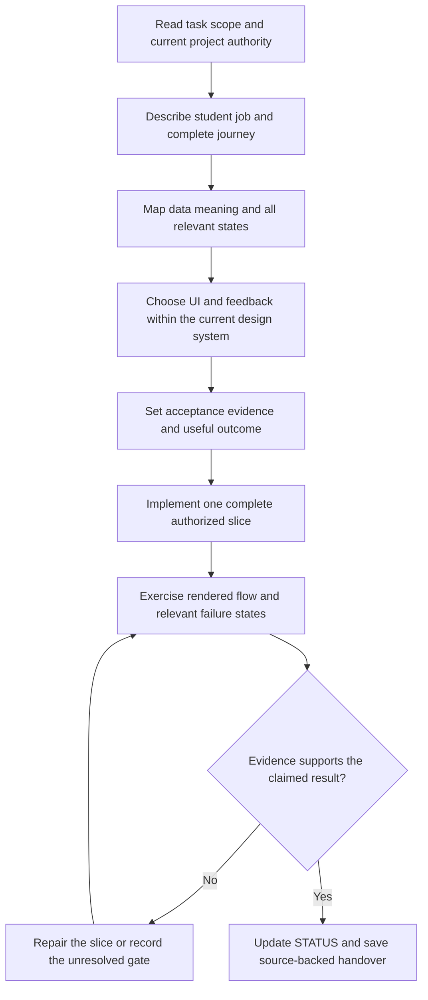
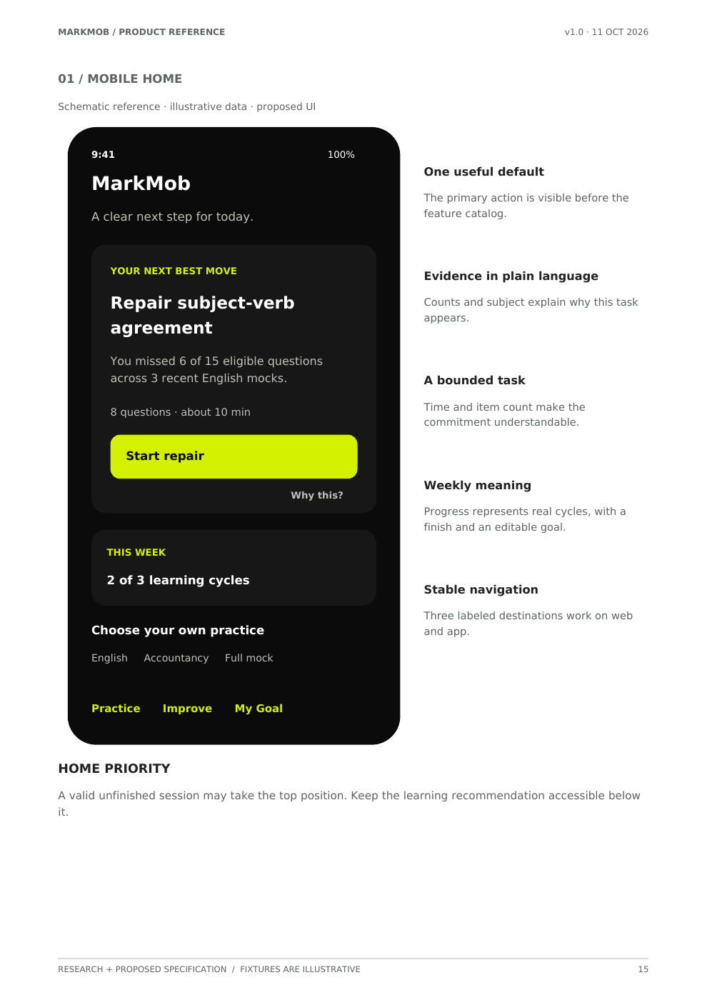
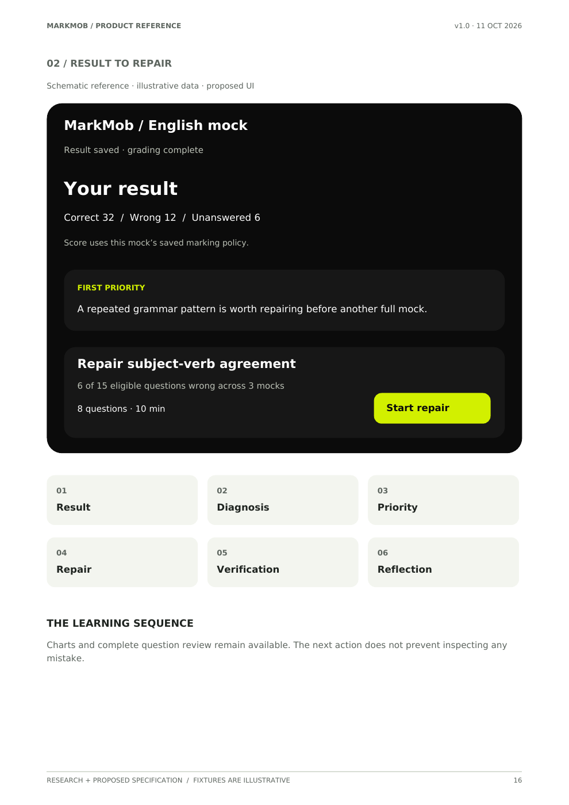
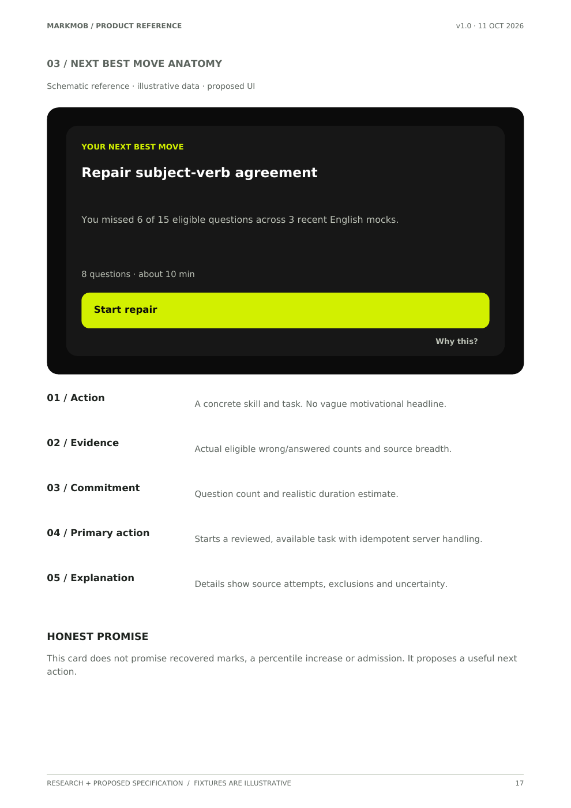
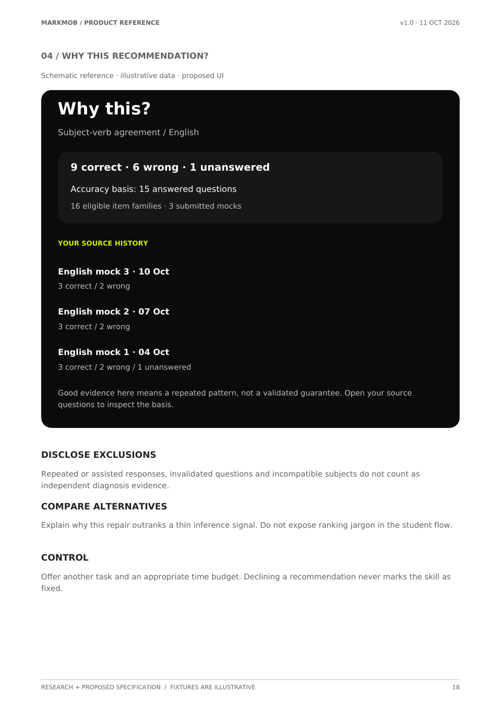
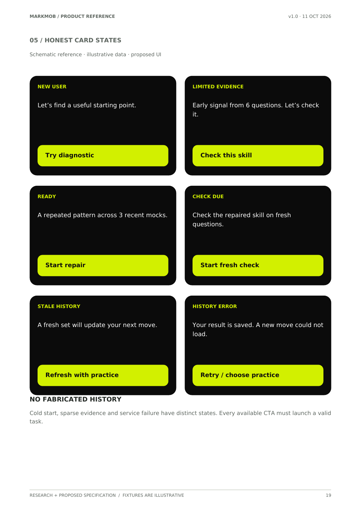
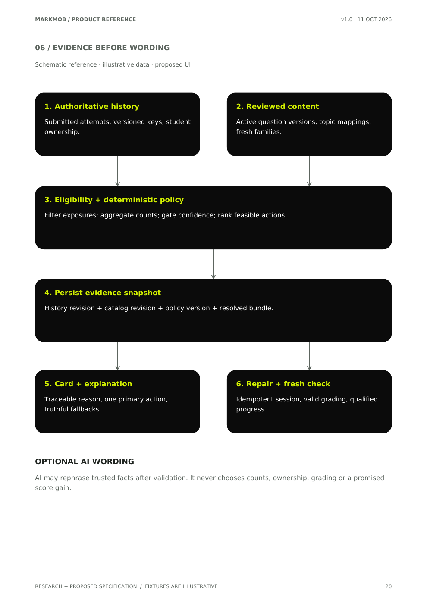

# MockMob product experience research and agent design workflow

Version 1.0 · 12 October 2026 · Consolidated research, detailed design implications, and repository guidance

**Purpose:** make product thinking, UI craft, emotional experience, learning value, and verification part of every relevant MockMob task, across the website and planned Android app. Keep the detailed source material available; build upon it rather than replacing it with a short digest.

**Scope of this delivery:** research and documentation. Product changes, app release, infrastructure changes, experiments, notification campaigns, and paid model requests have not been performed by this task.

## How to use this document

Read sections 1–3 for scope and product context, 4–9 for the expanded research, 10–13 for implementation planning and the agent workflow, and 14–16 for evidence and coverage. The appendices contain the complete uploaded product brain, the complete new transcript, the supplied notes, all 59 PDF pages as extracted text, and its six visual reference pages. The original files are also preserved alongside this document with checksums.

The appendices are **source material**. Imperatives inside them, including the earlier “Implement MarkMob” brief, are not new instructions to execute that work. The current owner request authorizes consolidation and expanded guidance. Later implementation needs its own task scope. A quoted speaker's recommendation, a proposed algorithm, and an owner-approved product decision have different authority.

### Section navigation

1. [Additive consolidation and current authority](#research-01)
2. [One coherent product experience](#research-02)
3. [Design as orchestration](#research-03)
4. [Data should determine UI form](#research-04)
5. [Hierarchy, spacing, typography and component craft](#research-05)
6. [Undertone's existing value moment](#research-06)
7. [Emotional design and strategic differentiation](#research-07)
8. [Gamification mechanisms and outcomes](#research-08)
9. [Proposed MockMob recap and return flow](#research-09)
10. [Recommendation, content and measurement contracts](#research-10)
11. [Agent workflow](#research-11)
12. [Review rubric and acceptance scenarios](#research-12)
13. [Later implementation opportunities](#research-13)
14. [External evidence and claim register](#research-14)
15. [Completeness and retrieval design](#research-15)
16. [Document verification](#research-16)

Source IDs used below:

| ID | Material | Locator and treatment |
| --- | --- | --- |
| A | Uploaded `MarkMob_Product_Brain.md`, prepared 11 October | Nineteen sections, fifteen principles, recommendation specification, full earlier transcript L001–L201, and appendices A–D. Preserved in full in Appendix A here. |
| B | Uploaded `MarkMob_Product_Research_and_UX_Specification (1).pdf` | 59 pages. Text retained page by page in Appendix D; visual reference pages 15–20 retained in Appendix E. Original PDF remains authoritative for layout. |
| C | Newly attached `Pasted text.txt` | 164 speaker lines; dashboard walkthrough followed by Undertone case study. C001–C164 refer to file lines, not video timecodes. Full text in Appendix B. |
| D | Owner's current notes and two video summaries | Preserved in Appendix C, including numerical claims and incomplete fragments. The notes help index topics; they do not replace the full transcripts. |
| R | Live MockMob documents and selected source files | Local context checked on 12 October. This is a targeted reconciliation, not a new production UX audit. |
| W | External primary research and official pages | Exact scope and access status recorded in section 14. Earlier source checks inside A remain dated assertions of that earlier document. |

### Evidence vocabulary

**Source claim:** retained because it belongs to the supplied material; may be unverified. **Verified external evidence:** an inspected publication supports the stated narrow claim. **Local source observation:** the checked repository contains the described implementation; deployed behavior is not implied. **Design heuristic:** a practical starting point, not a universal law. **MockMob proposal:** a specific idea to evaluate. **Illustrative example:** invented to explain a behavior, never actual student history. **Owner constraint:** a live repository or current owner requirement.

<a id="research-01"></a>

## 1. Additive consolidation and current authority

The owner asks to add, explain, and go deeper without losing material judged unimportant by an agent. Accordingly, repetitions, sponsorship passages, incomplete utterances, uncertain numbers, alternative ideas, and conflicting historical context are retained. Corrections and adaptations appear beside the synthesis, without rewriting the historical source.

“Only add things” means additive research and preservation in this delivery. It does not mean that a future interface should include every proposed mechanic. The source itself cautions against feature overload. Maintain a complete research library while selecting a small, coherent product experience.

No original video files, video URLs, or timecodes were supplied. This document cannot establish one insight per actual ten-second interval or reconstruct unseen footage. It can establish coverage of all supplied text and all PDF pages. Source A includes an earlier transcript; its original standalone text file was not attached here. Its 201 labeled lines are preserved as supplied inside A, without claiming possession of the original bytes behind A's historical checksum.

### 1.1 Reconciliation with the live project

| Topic | Supplied material | Current local authority / interpretation |
| --- | --- | --- |
| Product name | A/B say MarkMob and ask to confirm the name. | `PRODUCT.md` and the current owner request say **MockMob**. Preserve MarkMob in originals; use MockMob in the new synthesis. No rename proposed. |
| Product promise | Know the next task, repair it, see evidence of improvement. | Aligns with **Score Recovery**, **Score Recovery Lab**, **Mistake Repair**, and **Find → Repair → Prove**. Never print a fabricated recovered-marks number. |
| Companion | A proposes Mobi; older internal names include Pip. | `DESIGN.md` records owner-approved **Mobi**, with Pip identifiers retained for compatibility and no companion in timed answering. |
| Navigation | A/B propose Practice / Improve / My Goal. | `src/lib/arenaNavigation.js` currently has Today, Practice, Learn, Review and other grouped destinations. Treat the three-destination idea as an IA hypothesis, not a mandate to overwrite current navigation. |
| Shared next move | A proposes a new card/service and `/v1/me/next-move` routes. | `LearningNextAction.jsx` already consumes `/api/learning/plan`, offers 10/20/30-minute choices, alternatives and error recovery. Map improvements onto the existing system before proposing parallel routes. |
| Visual tokens | A proposes neutral charcoal tokens, one font, 16px radius; C offers generic font/grid advice. | The live Night Arena system, volt signature, Gabarito / Hanken Grotesk / mono roles and intentional NTA exceptions take priority. General advice should explain intent without replacing accepted tokens. |
| Pricing | A preserves conflicting ₹69/₹99 historical descriptions. | `publicOffer()` selects the configured purchasable offer; live owner docs preserve existing terms and wallets. No production environment or checkout was verified in this task. Never copy historical pricing from an appendix. |
| Platforms | Undertone example uses Dynamic Island; A discusses app continuity broadly. | Owner's working plan is **Android first**, with iOS out of scope. Preserve the iPhone example as research; investigate Android equivalents only in a later app task. |
| Content and proof | Proposed confidence gates, ranking weights, timing and mastery wording. | Values in A are hypotheses. Current quality, question release, learning-evidence and budget contracts remain binding. Model agreement is not truth. |
| Current implementation | Source describes planned behaviors. | `STATUS.md` includes prior UI work and a Cloudflare audit; generator V7.17 remains stopped/incomplete. This document does not release any capability. |

Use `PRODUCT.md`, `DESIGN.md`, the brain README, current working plan and live STATUS before behavior changes. Keep detailed research as a source of options, not an automatic replacement roadmap.

<a id="research-02"></a>

## 2. One coherent product experience

MockMob's functional job is to help a CUET learner select and complete useful work under uncertainty. Its emotional job is to replace an intimidating result or a large feature catalog with calm agency: “I can see what happened, understand the next step, and trust that my work is preserved.”

The experience should connect:

**Discover → try useful practice → save continuity → complete a valid session → understand the result → choose a supported repair → practise → check fresh performance → revisit later → finish the chosen work.**

The sources add three complementary lenses. Dashboard design makes the evidence readable. Emotional design makes effort and uncertainty feel supported. Retention design connects a moment of real value to the next useful task. None can substitute for correct questions, trustworthy grading or reliable saving.

### 2.1 The fifteen principles remain individually available

| Principle from A | Expanded use in MockMob |
| --- | --- |
| Outcome before features | Specify the student question answered by each screen, the useful action it enables, and the evidence that it worked. |
| Value before commitment | Let the sample prove the question-and-explanation experience before requesting a profile, payment or notification permission. |
| Emotional feedback matters | Respond to actions with understandable state changes and tone appropriate to the outcome. |
| Trust through details | Accuracy, saving, deadlines, pricing and recoverable errors are part of design. |
| Remove unnecessary decisions | Offer one supported default with a usable alternative; do not conceal choice or reasoning. |
| Challenge category assumptions | Test whether fewer targeted actions beat more content and whether finishing effective work beats maximizing screen time. |
| Design learning, not engagement theater | Count repair and eligible checks separately from taps, logins and XP. |
| Make competition achievable | Prefer personal progress and optional comparable cohorts to an unrestricted global rank. |
| Use fewer gamification systems well | Require each mechanic to justify its attention cost and intended behavior. |
| Preserve autonomy | Allow duration changes, decline, rest, reminder refusal and a welcoming return. |
| Completion needs meaning | Show an honest denominator and a useful finish. |
| Personal progress builds motivation | Compare comparable work and state sample size, freshness and assistance conditions. |
| Community amplifies value | Create real useful support with norms and moderation; a chat tab alone is insufficient. |
| Experiment rather than assume | Define outcomes and guardrails before claiming retention or learning improvement. |
| Brand emerges from repeated experience | Apply the same care to errors, billing, saving and study as to the hero. |

### 2.2 Emotional arc, not just screen order

Before a mock, a student may be uncertain about readiness. During it, they need concentration and control. After a poor result, they may be disappointed and especially alert to judgment. During repair, they need a challenge small enough to begin and meaningful enough to trust. During a fresh check, they need honest evidence. After a gap, they need remembered context and a manageable restart.

Design each transition explicitly. A polished dashboard that greets a struggling student with eight red weakness cards may fail emotionally despite good alignment. A warm mascot that claims mastery from repeated questions fails epistemically. A useful ending can acknowledge work while preserving uncertainty: “You completed the practice. A fresh check is the next step.”

<a id="research-03"></a>

## 3. Design as orchestration

C begins by distinguishing designing a dashboard from orchestrating one. An orchestration specification describes how inputs, history, loading, actions, permissions, time and outcomes relate across the entire journey. A screenshot describes only one state.

For each feature, specify:

1. Who arrives, from where, with what goal and available evidence.
2. What the first useful action is and how much work it asks for.
3. What data is required before the action can safely start.
4. What is visible immediately and what can wait.
5. How the action responds, persists and recovers after interruption.
6. What the ending means and what useful continuation exists.
7. What happens on the next visit and another supported device.

An agent has not designed a result experience merely by choosing cards and colors. It must resolve pending grading, corrected keys, thin history, unavailable fresh content, failed next-action loading, a declined repair, and a return after several days. Backend semantics shape the experience: “saved,” “explained,” “checked,” and “learned” cannot be interchangeable decorative labels.

<a id="research-04"></a>

## 4. Data should determine UI form

### 4.1 Choose the representation from the student decision

| Data shape | Suitable representation | MockMob application | Necessary context |
| --- | --- | --- | --- |
| Small fixed category set | Text labels or restrained chips | Subject, session mode, pending/complete/held states | Use readable labels; explain unfamiliar status. |
| Comparable numbers | Right-aligned columns with tabular numerals | Correct, wrong, unanswered, duration, credit cost | Show units and denominator; align signs and precision consistently. |
| Chronological events | Timeline | Attempt submitted → explanation ready → repair completed → check due | Distinguish actual events from scheduled future steps; show timezone. |
| Comparison across topics | Ordered list or bars | Repeated supported gaps in current subjects | Comparable basis, eligible sample and uncertainty. |
| Trend over time | Chart plus text/table equivalent | Comparable fresh-check history | Gaps, changed conditions and corrected results visible. |
| Next action | One clear action block | Supported repair or resume | Reason, bounded effort, available content and alternative. |
| Dense audit detail | Table or structured evidence panel | Eligible/excluded history | Full provenance accessible without crowding the home. |

C's employee-table example uses chips because departments and employment statuses are finite categories, and numeric alignment because place values matter. The transferable rule is not “turn every label into a pill.” Too many chips make all information look equally important. Establish which categories genuinely help scanning before choosing a component.

### 4.2 Numbers and denominators

“7 correct” has little meaning without the number of eligible questions and the conditions. Display counts in a stable format that preserves units. Use tabular numerals for changing timers and aligned totals. Do not append percentages that appear more precise than the sample warrants.

Answered accuracy and whole-set completion are different: in A's illustrative fixture, 9 correct + 6 wrong + 1 unanswered means accuracy among answered questions is 9/15, while the set contains 16 questions. Keep those denominators distinct everywhere, including card copy, evidence panels, charts and analytics.

Unanswered is not automatically conceptual failure. Missing timing is not zero seconds. A withheld question is not wrong. Thin evidence is not an inactive student. Representation must follow meaning before it follows aesthetic consistency.

### 4.3 Truncation and inactive rows

C suggests truncating long text to protect important columns and shading inactive rows. Apply this selectively. A long activity description can have a concise preview and accessible full detail. MockMob's subject and chapter names carry essential meaning; `PRODUCT.md` explicitly requires long names to survive. Do not truncate a question stem, answer option, uncertainty disclosure, cost term or essential subject name just to make a card look tidy.

If truncation is appropriate, expose the full content through touch and keyboard, not only a tooltip on hover. On mobile, stack secondary fields rather than shrinking text. Muted/inactive rows must retain readable contrast and a written state. Archived, held and temporarily unavailable have different meanings and different recovery actions.

### 4.4 Timelines and spatial placement

A learning-history timeline can show a student's sequence more clearly than a time-sorted table. It can live beside a result on wide screens and in an evidence sheet or dedicated page on a phone. The primary task remains accessible when the timeline opens.

Specify event ordering, timestamps, corrections and future states. “Check due tomorrow” is a schedule, not a completed event. Use stable session linkage so separate repairs are not accidentally combined into one story. If a key correction changes an earlier result, annotate the change without silently rewriting the historical narrative.

### 4.5 Color from data

Use semantic color to draw attention to a real state: an unsent submission, a correction, a warning about insufficient evidence, a successful save. A low score should not automatically occupy the strongest danger color. Reserve urgent styling for something the student can and should act on.

Pair every color with text or another meaningful cue. Preserve the existing NTA palette exceptions. Brand volt represents a primary action; it should not become a universal correctness, urgency or rank color. In charts, keep categorical and outcome semantics stable across themes and screens.

### 4.6 Progressive disclosure without hidden functionality

C places rarely used sharing in a popover, prioritizes search within it, and reveals secondary removal controls on hover. The general lesson is to prioritize frequent, useful actions while keeping less frequent actions reachable. It is not permission to hide essential functionality from touch or keyboard users.

For MockMob, keep Start, Resume, submission state, cost, basic result and next step immediately visible. Place full evidence, comparison detail, optional sharing and low-frequency settings behind labeled disclosure. A detail panel should preserve scroll and parent state, have clear dismissal, and return focus to its trigger.

On fine-pointer devices, contextual controls may appear on hover and focus. On touch, use an explicit More button or persistent contextual entry. Destructive actions need understandable consequences and recovery where feasible. “Why this?” should be discoverable without already knowing where to look.

<a id="research-05"></a>

## 5. Hierarchy, spacing, typography and component craft

### 5.1 Hierarchy expresses a decision

C uses size, position and contrast to make an item's title prominent, with supporting time and location smaller. It puts price high and aligned, and uses directional icons to communicate movement. Transfer the principle: the student should first see the fact or action that answers their immediate question.

On a result, start with the authoritative result and its status, then the supported pattern and next task. On Practice, prioritize subject/setup and the clear commitment near Start. On a recommendation, prioritize the concrete action, evidence and time. Do not enlarge every metric until the page loses a reading order.

Images can aid recognition and scanning, but are not compulsory. A decorative campus image does not clarify a grammar repair. Use permissioned images or clearly labeled illustrations when meaningful, preserve the accepted brand assets, and keep essential text usable when the image fails to load.

### 5.2 Grids, whitespace and grouping

The transcript says a 12-column desktop grid, 8-column tablet grid or 4-column phone grid is a guideline, not an aesthetic law. Repeating content can benefit from predictable responsive structure. A bespoke landing section can use a different composition if it remains coherent and accessible.

The 4-point spacing system supports consistent subdivision. The example's 32px gap is an example, not a universal gap for all controls. Choose existing spacing tokens that express relationships: small space within a label/value pair, larger space between unrelated groups, and clear separation between result and action. Optical alignment and readable rhythm matter alongside token arithmetic.

Give dense screens breathing room without pushing the useful action far below the phone viewport. At large widths, limit text measure rather than stretching paragraphs across the screen. At small widths, allow wrapping and vertical growth. Do not reserve a desktop table layout by reducing important text to tiny sizes.

### 5.3 Typography: retain intent, avoid literal replacement

C advocates one good sans-serif, tight large headings, roughly −2% to −3% tracking, 110%–120% line height, at most six landing-page sizes, and dashboard headings usually at or below 24px. These are simplifying heuristics. They are not requirements to replace the established font roles, make all headings 24px, or force one line-height on multiline small-phone headlines.

For MockMob, reuse the current type system. Limit accidental local sizes and weights. Prefer semantic roles to one-off values. Check actual line breaks, long chapter labels, numerals, superscripts, symbols and answer options. Tight tracking may suit a display heading but damage smaller text. A score can be larger than a dense dashboard title because it has a different role.

Readable rationale, question and error text takes priority over fitting a desired card height. Font loading needs a stable fallback so layout does not jump or hide the first usable question. Larger user text settings must preserve the task and controls.

### 5.4 Color ramps and themes

Start from MockMob's existing brand signature and semantic roles. Derive related washes, borders, fills and text roles instead of adding decorative colors independently to each screen. Test contrast in the actual context; a lighter or darker derivative is not automatically readable.

C's “blue trust, red danger, yellow warning, green success” describes common conventions. Meaning depends on context, culture, labels and the existing system. A blue price in its example does not require blue pricing in MockMob.

Dark surfaces can establish depth through slightly lighter raised layers and restrained borders. Bright saturated chip fills may dominate; soften the fill while maintaining readable label contrast. Dark shadows may still have a role, so the transcript's absolute claim that dark mode has no shadows should be treated as a simplification. On light surfaces, avoid opaque harsh shadows; a popover may need clearer elevation than a static card. Retain live design rules about offset shadows and functional focus rings.

### 5.5 Icons and buttons

Sizing an icon near adjacent line height is a useful starting point; C's 24px example is not an across-product icon mandate. Existing inline icons can remain smaller when their optical weight and role work. Keep icon style, stroke and baseline coherent. An icon's visible size and its control's hit area are different.

“Double the height for the width” is interpreted here as horizontal padding roughly twice vertical padding, not a rule that every button must be twice as wide as tall. Short labels, full-width mobile actions and icon-only controls have different geometry. Preserve generous hit areas even when the visible icon is compact.

Primary and secondary actions need different prominence. A ghost button is useful for a genuine secondary action, but its focus, hover, pressed and disabled states still need to be perceptible. Do not style the only useful recovery action so faintly that it disappears.

### 5.6 Complete state contracts

| Control or operation | Required states to specify | Meaning to communicate |
| --- | --- | --- |
| Button | Rest, hover where available, keyboard focus, pressed, disabled, loading when relevant | Can it act, did input register, and what is pending? |
| Input | Empty, filled, focus, invalid, optional warning, valid where useful | What is expected, what needs correction, and how to correct it? |
| Save | Local pending, sending, server accepted, failed, uncertain outcome where relevant | What work is durable and where? |
| Recommendation | Cold start, sparse, ready, refreshing, stale, unavailable, in-progress | What basis exists and what useful action remains? |
| Repair | Not started, processing, explanation ready, held, unavailable, retry/check status | What actually completed, and whether a repeat is safe? |
| Submission | Confirmation intent, pending acknowledgment, accepted, grading pending, result ready, recovery | Which stage has authority? |
| Payment/access | Quote loading, available offer, pending verification, recognized entitlement, failure | What is included and what is actually confirmed? |

C names four button states; keyboard focus is an additional essential state. Disabled styling needs a visible explanation when the reason matters. Loading must not erase context. Error copy should identify a recovery action and preserve work. Validation should not punish students while they are still typing an incomplete but plausible value.

Every interaction needs a response, but the response can be a stable selected state or clear text. Animation is not required for every tap. “Copied” after a copy operation is more meaningful than a decorative bounce before the copy succeeded.

### 5.7 Image overlays and motion cost

C proposes a gradient that preserves imagery while creating a readable text region, with progressive blur as an optional richer treatment. Check the real image variants and worst-case contrast. A gradient is not guaranteed to meet contrast everywhere. Keep text out of busy areas when possible and provide an opaque fallback.

Blur, layered shadows, 3D and large animation assets must earn their cost on budget Android and weak 4G. The existing device floor applies to emotional design too. Use inexpensive transitions for useful continuity, reserve geometry to prevent layout shifts, and keep content and actions available with reduced motion or failed media loading.

### 5.8 Study references by behavior, not just appearance

C names Mobbin as an inspiration source and sponsor. Preserve the distinction between a useful reference practice and a recommendation to buy access. Study how a reference handles hierarchy, disclosure, first use, repeated use, loading, failure and return. Save the pattern, the context in which it works, and what must change for CUET rather than copying a screenshot's decoration.

The activity-log example also uses avatars for recognizable association. In MockMob, identity imagery should have a clear job and appropriate privacy; anonymous student counts or invented profile photos are not evidence. A useful reference library records where a pattern helps a real decision and where it creates costs on small screens or weaker devices.

<a id="research-06"></a>

## 6. Undertone: find and design the existing value moment

### 6.1 Preserve the diagnosis and its uncertainty

C reports above-average onboarding completion but roughly half of completers never recording a therapy session. Users endured a 10-plus-minute onboarding because of urgent need and limited alternatives. That is a plausible selection explanation, not proof that the onboarding worked well.

The reported microphone tests averaged about 20 seconds, with a transcript reference to 120 observations. A ten-minute minimum caused a wall rather than a useful output. A founder guessed perhaps 10% were lost there and explicitly said they could not put a number to it. Preserve those distinctions: observed average, apparent count, threshold, and guessed loss are different evidence.

The case reports a median near ten minutes from recording end to opening the recap, with six and 44 minutes as fastest/slowest reported values. Cohort size, range basis, instrumentation and selection criteria are not provided. They cannot be MockMob benchmarks. No measured post-redesign retention lift is supplied.

### 6.2 Transfer to first-use MockMob

Students who finish onboarding or start an exam may have high intent because the exam is approaching. Their persistence can conceal confusion. Observe whether they reach the first trustworthy outcome and whether they know what to do next.

Potential equivalents of the microphone dead end include a five-question demo ending in a signup wall without explanation; a repair promising fresh questions that do not exist; a result that cannot load after successful submission; an AI request that finishes with unclear progress; or an inaccessible paid recommendation with no useful alternative. These are scenarios to inspect, not new claims that each exists today.

Let students test the core idea at small scale. Explain what the sample can and cannot establish. Show the real form of a result and next step before demanding a full mock. Reuse the existing no-signup sample rather than introducing a disconnected demo. Its data must remain labeled as sample performance and must not become a broad ability diagnosis.

### 6.3 External cadence matters

Undertone's core action depends on therapy appointments outside the app, which may be weekly or monthly. MockMob study depends on school, coaching, fatigue, available time and exam season. Daily opens are not universally the right cadence.

Study natural returns before adding reminders. Investigate result revisits, saved mistakes, scheduled checks, and small evening plans. Segment by meaningful context, not an assumption that every student must have the same streak. A useful plan that fits tonight's ten minutes may serve the job better than an extra retention notification.

### 6.4 Brand foundation enables specific craft

The case establishes a design system before refining the journey: typography, color, icons, components and button states. The founders describe intentional minimalism between sterile clinical software and excessive cuteness. The transcript's “Atishayo and Sage” palette phrase is uncertain and remains uncorrected in the raw source; do not create tokens from it.

MockMob already has a foundation. Use it consistently and resolve local gaps. The useful lesson is to make an abstract desired feeling concrete with examples, state behavior and visual rules. Undertone's palette or record-sleeve motif should not replace Night Arena or Mobi.

### 6.5 Processing visibility is a behavioral promise

The case uses Dynamic Island to maintain continuity while users leave, expose transcribing/anonymizing/summarizing stages, and help prevent forgotten four-to-six-hour recordings. The transcript also states that the first mockup required progress capability the backend did not initially have, which the team then built.

For MockMob, only display stages backed by real state: submission accepted, grading pending, result available, or explanation processing. Do not invent an “AI verified” stage to make waiting seem safer. “Anonymizing” belongs to the therapy example; it is not a MockMob data-processing claim.

For Android research, consider an in-app persistent status, a recoverable session entry and a permissioned notification when work completes. A background system feature depends on actual platform support and lifecycle rules; this document does not choose a native API or add a service. No operating-system indicator can substitute for server acknowledgment, deadline handling or saved-work recovery.

### 6.6 The seven recap interventions, separately preserved

| Undertone intervention | Intended mechanism | MockMob proposal / boundary |
| --- | --- | --- |
| 1. Hold the thread while the user leaves | Maintain task continuity through processing visibility. | Keep a submitted session discoverable and resumable; show truthful status. |
| 2. Notify when the recap is ready | Return at an actual value event. | Offer an opt-in result/check-ready reminder only when still useful. |
| 3. Give the recap a surface worth opening | Recognizable anticipation and affordance; subtle bounce. | A clearly labeled result or repair recap entry, without concealing basic earned results. |
| 4. Let the user perform the reveal | Agency through opening/peeling the wrapping. | Optional detail reveal or milestone acknowledgment with a normal button equivalent; direct result access remains available. |
| 5. Payoff on two sensory channels | Visual celebration plus subtle haptic. | Short, optional completion feedback; text conveys the same state and respects preferences. |
| 6. Frame what was received | Make the new personal record meaningful. | Explain the specific work completed and evidence recorded; no invented mastery. |
| 7. Put the next ask inside the meaningful ending | Connect value delivery to another useful action. | Offer the bounded repair or due fresh check after actual evidence is visible, with decline and finish options. |

The proposed flow must behave differently after a poor mock, a content issue or inconclusive verification. Confetti after distressing results can feel dismissive. A reveal gesture can be charming once and burdensome on the twentieth visit. Provide direct/repeat access, skip and reduced-motion paths. Novelty is not a durable outcome.

### 6.7 Peak–end as a research lens

The transcript attributes memorable experiences to their peak and ending. Original research on medical-procedure pain connected retrospective evaluation with peak and end intensity; it did not establish that every app is remembered by only two moments or that confetti causes retention. See W05 in section 14.

Use the idea to inspect endings that currently abandon the user: a score with no explanation, practice completed without a clear record, or a failed request without a recovery route. Improve the entire useful journey and its ending. A crafted finale does not cancel earlier lost answers or inaccurate content.

### 6.8 A distinctive ending must arise from the product

Undertone's vinyl sleeve metaphor relates to a personal record. Its founders distinguish “I want to use this” from using a generic transcription tool. For MockMob, an earned repair record and later fresh check can supply a coherent signature: an observation becomes work, then evidence. This is a proposal for product meaning, not an instruction to copy an unboxing animation.

A potential ending is: authoritative result visible → one supported pattern → concrete repair → completed-work acknowledgment → a later check offered → a clear finish. The same visual and language motifs can recur through the website demo, result, reminder and Android app without adding ornamental steps.

<a id="research-07"></a>

## 7. Emotional design and strategic differentiation

### 7.1 Duolingo, Phantom and Revolut

Keep all three lessons from A/D. Duolingo illustrates responsive characters, small-win recognition and momentum. Phantom illustrates approachable design in an intimidating category. Revolut illustrates an intentional first impression and tactile interaction consistent with premium positioning.

Duolingo's official animation article describes a scalable character/viseme system and compact cross-platform assets. It does not isolate animation as the cause of DAU growth. Phantom's official 2023 refresh supports a friendly brand direction. These are precedents for intentional craft, not forecast equations for MockMob revenue. Revolut's cited motion examples remain video observations in this task. [Duolingo](https://blog.duolingo.com/world-character-visemes/), [Phantom](https://phantom.com/learn/blog/introducing-phantom-s-new-brand-identity).

Apply the mechanisms to specific moments: responsive selection, calm saved-status feedback, evidence explanation, a useful transition from result to repair, and restrained acknowledgment after real work. A glowing chart is not evidence that a student improved. Mobi should respond to known context without pretending to know feelings or threatening consequences for inactivity.

### 7.2 Bet against an assumption with a falsifiable alternative

| Source example | Category assumption being challenged | MockMob question |
| --- | --- | --- |
| Timeleft | Meeting people requires profiles, swiping and planning. | Must learners inspect a large catalog before starting useful work? |
| Speak | Language practice should minimize effort through a game. | Is tapping through easy questions being mistaken for learning? |
| Bevel, likely transcribed as Devil | Serious tracking requires buying additional hardware. | Is useful preparation being bundled into a large purchase before its value is evident? |
| Postdocs.ai / grant-writing anecdote | Users want a full long generated draft immediately. | Would a short verified plan or staged explanation prevent overwhelming AI output? |

Retain the revenue, growth, funding and competitor-response claims as source claims. The defensible lesson is to identify the assumption, the behavior or business model it supports, the opposite worth testing, and the evidence that could reject that alternative. Incumbents can copy features; a durable advantage requires execution, trustworthy content, continuity and outcomes.

For MockMob, test “fewer supported tasks” against “more features,” “fresh transfer evidence” against “more repeated correct answers,” and “finish effective work” against “more time in app.” Keep a clear manual alternative. Reducing unnecessary decisions should not become removal of student agency.

### 7.3 Product quality includes economics and distribution

The earlier video explicitly acknowledges timing, business model, community and marketing alongside emotional design. Preserve that point. A crafted UI cannot make an unavailable content catalog reliable or make uncapped AI use sustainable. Keep cost per useful cycle, support burden, content coverage and actual paid entitlements in the evaluation.

Do not turn sponsor examples, founder quotations or agency consultation offers into provider recommendations or purchases. They remain part of the original source and its commercial context.

<a id="research-08"></a>

## 8. Gamification: mechanisms, outcomes and boundaries

### 8.1 Points, badges and leaderboards

The sources criticize PBL systems that reward the proxy rather than the intended task, using LinkedIn badges, Foursquare mayorships and Google News as examples. The individual historical removals and their asserted shared cause are not independently established here. Preserve the examples without concluding that all points or badges fail.

In MockMob, ask what a badge certifies. A completed repair acknowledgment records work; it does not certify mastery. A question-volume reward can favor easy-item farming. A meaningful achievement requires a stable definition that can be explained to the student and reproduced from trusted records.

### 8.2 Winnable local competition and kudos

Strava's segments illustrate specific, reachable comparison contexts rather than one giant leaderboard. Cohort relevance and fairness are the transferable concerns. Optional comparable student groups may work better than an unrestricted rank, but a small group does not automatically make a comparison valid.

Define subjects, item difficulty, opportunity to participate, scoring, exposure policy and update period. Show personal bests when group evidence is unsuitable. A kudos-like acknowledgment could recognize useful help or completed effort without exposing marks or weakness. The reported clubs, kudos and deletion totals remain dated source claims.

### 8.3 Feature richness and Habitica

The Frontiers study concerns gamification richness and exercise-adherence intention, while the Habitica study concerns counterproductive effects in its investigated samples. Neither specifies an optimal number of MockMob mechanics. A's nuance is retained; D's compressed S-curve description is not promoted into a universal law. [Frontiers study](https://www.frontiersin.org/journals/psychology/articles/10.3389/fpsyg.2025.1671543/full), [Habitica study](https://epub.ub.uni-muenchen.de/77668/).

Specify the attention cost of each additional layer: XP, streaks, ranks, character progression, weekly rings, rewards and social alerts. If managing the game takes attention away from the question or repair, the system has failed its learning job. Preserve all ideas in research while keeping the product's primary path small.

### 8.4 Streaks, agency and loss aversion

The transcript describes streaks becoming obligation, Duolingo goal choice and freezes, and FreeCash diamonds at seven/42 days with earned freezes and risk of loss. It also cites adolescent research and legal developments. Those numerical, legal and causal claims remain unverified here; no legal conclusion is drawn.

MockMob's proposed default is a realistic chosen weekly goal, rest and a friendly restart. Existing progress and paid rights must not disappear because of a missed day. A streak may record a chosen habit, but it should remain influenceable and distinguish activity from competence. Do not shame students through Mobi or require paid rescue to preserve evidence of learning.

Loss aversion is not a fixed two-times coefficient for every person and setting. Test whether a mechanic supports willing study or creates pressure that outlasts usefulness. Track opt-outs and abandonment alongside returns.

### 8.5 Variable magnitude versus variable ratio

A source example uses Game Blazers pack openings to create anticipation and reveal. Finch discoveries and unpredictable reinforcement are used to discuss craving. Preserve the distinction: uncertain reward magnitude after a known action differs from an uncertain number of actions until any reward arrives.

For MockMob, correctness, access, credits, core explanations, due checks and learning progress should have predictable rules. An occasional optional nonessential acknowledgment can vary in presentation without randomizing the value of study or the reliability of scores. A student should never wonder how many extra taps are needed to obtain an already-earned result.

### 8.6 Completion drive and competence feedback

Progress rings can show a bounded goal and invite completion. Their denominator must represent useful work. The widely repeated 49.5% Apple figure refers to estimated standing-probability effects of stand reminders in an observational study, not a measured rings-only effect or generic behavior-change rate. The study involved more than 160,000 participants; it is not MockMob learning evidence. [Apple research](https://machinelearning.apple.com/research/large-scale-observational).

Competence feedback should show comparable fresh performance and later persistence. Peloton output, Chess ratings and Garmin readiness/body-battery are source examples of domain-specific feedback; they do not make a practice app's uncalibrated metric a validated ability score. A 100-ride badge certifies activity count, not by itself skill development.

MockMob should distinguish observation, explanation, practice, fresh check and later retained check. A useful completion state can say what was done and permit stopping. Repeatedly correct answers with hints or recycled families remain practice.

### 8.7 The three addictive architectures

| Architecture from the videos | Insight retained | MockMob design decision proposed |
| --- | --- | --- |
| Craving machine | Reward scheduling can drive continued activity independently of satisfaction. | Core learning access and evidence remain predictable; no gambling-like paid random rewards. |
| Infinite game | Accumulated status and loss can make leaving costly; seasonal resets sustain play. | Offer bounded sessions and preserve earned records; a new exam season must not erase historical evidence. |
| Invisible scoreboard | Social comparison and visible status can transform participation into identity. | Opt-in relevant comparison, private progress and a clear exit; no compulsory public weakness display. |

The source includes claims about controlled win ratios, gambling-equivalent dopamine pathways, permanent identity and inability to quit. Those strong assertions are preserved as claims. They are not established mechanisms to implement. Designing a useful return is different from trying to make an exam student unable to leave.

### 8.8 Community and human connection

The Peloton/parasocial discussion adds a point beyond mechanics: people may return for real relationships, useful accountability and a recognizable voice. MockMob can investigate structured subject check-ins, repair challenges, useful answers and voluntary sharing. It needs moderation and a support process, not merely a feed or chat feature.

Measure useful answered questions and supportive participation. Do not maximize messages at the cost of accuracy. Preserve the difference between a contextual companion, a real mentor and an AI response; a mascot must not imply a human relationship or oversight that does not exist.

<a id="research-09"></a>

## 9. A proposed MockMob recap and return flow

### 9.1 Find the moment before decorating it

Candidate natural-return moments are result opening after submission, revisiting a wrong answer, completion of a repair, a due fresh check and a weekly review. Instrument and compare those moments before choosing one as the primary retention investment. Undertone's recap timing is a clue to methodology, not a target for MockMob.

### 9.2 Experience blueprint

| Moment | What the student needs | Default experience | Secondary access |
| --- | --- | --- | --- |
| Submission accepted | Know the attempt is safe | Authoritative acknowledgment and truthful grading state | Return to saved session/status. |
| Result ready | Understand what happened | Score/counts, marking context, uncertainty/correction status | Every answer and detailed analytics. |
| Supported gap | Know where to begin | One chapter/concept observation and bounded next task | Why this, other work, ordinary practice. |
| Explanation ready | Understand the reasoning | Specific explanation, provenance/correction state, practice offer | Report issue or choose another explanation where supported. |
| Repair completed | Recognize work and its limits | Clear completed-work record and fresh-check plan | Review work; finish for now. |
| Fresh check completed | Interpret new evidence | Counts, sample, freshness/comparability and next step | Source questions and earlier comparable check. |
| Returning later | Resume useful context | Due check or manageable next move | Time choice and other practice. |
| Chosen weekly goal complete | Feel a real ending | Honest bounded summary and optional next-week plan | Optional privacy-controlled sharing. |

### 9.3 Illustrative copy and behavior

For a poor mock: “Your result is ready. Start with one repeated pattern.” For thin evidence: “This is an early signal. A fresh set can help check it.” For completed practice: “You finished this repair practice. The next step is a fresh check.” For an inconclusive check: “Results are mixed. Try another version of the skill.” For a return after a gap: “Welcome back. Choose the time you have.”

These are proposals, not replacement copy installed today. Only say a result is saved when the relevant durable state is known. Avoid “you are now stronger,” “marks recovered,” “high-confidence weakness” or guaranteed admission language unless the associated evidence contract truly supports it.

### 9.4 Navigation, sharing and app continuity

The Practice / Improve / My Goal concept should be tested against the current navigation rather than adopted on name appeal alone. Compare findability of mock setup, review, repair, due checks and goals. Keep internal feature vocabulary mapped to plain student tasks. Preserve route links and history during any later change.

Web and Android should share the result and evidence contract. Native polish must not create a second scoring model or independent progress history. App launch should demonstrate continuity after backgrounding, permission refusal, interrupted connections, account switching, device return and long text. Offline support remains a capability to prove, not a benefit inferred from having an app wrapper.

Sharing is optional and private by default where sensitive progress is involved. Preview exactly what will be shared. Completion can be shareable without exposing wrong answers, marks or weakness. Do not invent testimonials or headcounts to make a share card persuasive.

<a id="research-10"></a>

## 10. Recommendation, content and measurement contracts

### 10.1 Preserve the detailed engineering specification

A sections 9–14 remain available in full: eight supported action types, visible fields, controls, twelve card states, logical data entities, history eligibility, item-family control, topic versioning, timing quality, scoring compatibility, proposed windows/sample gates, deterministic candidate selection, ranking weights, priority overrides, omissions/pacing, content selection, APIs, idempotency, snapshots, AI wording, verification and failure/privacy/accessibility behavior.

Do not reduce that contract to “personalize with AI.” Recommendations need traceable facts and an available task. Their ranking and wording must agree with one evidence revision. AI expression cannot invent counts, action type, entitlement or confidence. Failure and budget exhaustion should retain a useful approved fallback.

The proposed 30-day window, ten attempts, 14-day half-life, five-item early gate, twelve items across three sessions, weighted formula and 500ms warm p95 are provisional policies. No new calibration was performed here. Reconcile them with the current service and data before using them. Avoid adding a second authoritative plan to fit the source's example endpoint names.

### 10.2 Learning proof is stronger than a reassuring presentation

Practice testing and distributed practice have broad support in the cited learning review. That supports investigating fresh checks and spaced work; it does not validate a particular number of questions, next-day schedule, ranking weight or score-recovery claim. [Original review record](https://pubmed.ncbi.nlm.nih.gov/26173288/), [publisher overview](https://www.psychologicalscience.org/publications/journals/pspi/learning-techniques.html).

Preserve independent item families and assistance conditions. Corrected or invalidated content must update evidence and any affected next move. Explain uncertainty in the interface rather than allowing a confident animation or “AI checked” badge to override it.

### 10.3 Retention events need semantic boundaries

Keep A's next-move, repair, verification, delayed-check, cycle, content-issue and fallback events. Add these proposed research events only if a later implementation needs them:

| Proposed event | Meaning | Avoid counting |
| --- | --- | --- |
| result_ready | Authoritative result becomes available | A spinner ending before grading is complete. |
| result_opened | Result becomes visible to this student | Route prefetch or component rerender. |
| recap_details_opened | Student opens meaningful recap detail | A forced animation merely finishing. |
| recap_skipped | Optional presentation skipped | Failure to learn. |
| next_step_offered | An available next action is presented | An inaccessible or unsafe task. |
| reminder_permission_result | Permission or preference choice recorded | Core activation success. |
| useful_return | Defined eligible action after a prior session | Notification click alone. |
| finish_for_now | Optional ending chosen | Churn by definition. |

Track elapsed time from accepted submission to result availability separately from result availability to first opening. A “ten-minute return” can conflate processing latency with user preference. Include never-opened results and censored observation windows so only the fastest returners do not define the statistic.

Use distinct timestamps, deduplicated events and stable consent-aware identity linkage. Platform and timezone semantics must be explicit. Avoid recording raw answers or personal disclosures merely to diagnose a design funnel.

### 10.4 Proposed experiment program

| Question | Comparison | Primary useful outcome | Guardrails |
| --- | --- | --- | --- |
| Does the demo remove uncertainty? | Clear sample result + next step vs current baseline | Completed useful sample and qualified continuation | Accuracy comprehension, signup friction, lost guest work. |
| Does the result ending help? | Concise result-to-repair sequence vs baseline | Valid repair completion, then eligible check | Result access, distress feedback, extra time imposed. |
| Does optional reveal add value? | Direct access vs optional recap treatment | Comprehension and later useful return | Skip rate, repeat annoyance, reduced-motion parity. |
| Does processing visibility improve trust? | Real status stages vs existing status | Successful recovery and correctly understood save state | False reassurance, latency, notification refusal. |
| Are weekly goals a better fit? | Chosen weekly completion emphasis vs existing habit presentation | Useful cycles and due-check returns | Pressure, opt-out, easy-task farming. |
| Does evidence help action choice? | Specific basis + Why this vs generic rationale | Correct comprehension and supported task completion | Overconfidence in thin samples. |
| Is simpler navigation better? | Task-based IA proposal vs current structure | First-attempt findability across core tasks | Discoverability of review, tools and account. |

Predefine baseline, eligibility, assignment unit, denominator, meaningful effect, sample plan, duration, novelty window and decision rule. Do not call a qualitative prototype session an A/B result. Keep failure and neutral findings. No experiment was launched during this research task.

<a id="research-11"></a>

## 11. Agent workflow: experience must be considered before and after code

This is repository guidance for later **authorized** product/UI work. It does not authorize the proposals above to be implemented now. Its purpose is to make an agent's design reasoning and verification concrete and repeatable.



### 11.1 Entry: retrieve the right context

Read live instructions, current STATUS and relevant product/design documents. Use Continuum startup and targeted retrieval. Read the current synthesis rather than only a source appendix. Preserve concurrent and dirty work. Choose a relevant installed design/mobile/motion skill when it improves the task; do not invoke every skill indiscriminately.

For a small copy fix, the brief can be short. For a new journey, recommendations or app behavior, use the fuller record below. Scale the work to the change; do not convert every task into another broad audit.

### 11.2 Before implementation: fill an experience brief

| Field | Required answer |
| --- | --- |
| Task and scope | What is authorized, and which journey/surfaces are affected? |
| Student job | What is the student trying to accomplish in this context? |
| Entry and continuity | What happened before this screen, and what record/state arrives? |
| Functional outcome | What useful work becomes possible? |
| Emotional intent | Should this moment reassure, clarify, encourage, acknowledge or concentrate? |
| Evidence basis | Which data is real, illustrative, provisional, missing or corrected? |
| Primary action | What should be easiest to identify and do? |
| Secondary access | How can the student inspect, adjust, decline or choose another task? |
| State contract | Loading, empty, error, sparse, success, held, interrupted and return states as relevant. |
| Persistence and cost | When is work accepted, what can be retried, and what cost/entitlement applies? |
| Website/app adaptation | Pointer, touch, keyboard, safe areas, backgrounding and platform constraints. |
| Motion and companion | Purpose, frequency, reduced-motion equivalent, and concentration boundary. |
| Finish and next return | What was achieved, what remains uncertain, and why return usefully? |
| Acceptance evidence | Which rendered interactions, data checks and tests support completion? |

A feature without an evidence basis cannot fabricate personalization. A feature without a valid ending should not rely on a reward screen to appear complete.

### 11.3 During implementation: keep the system coherent

Reuse components, tokens, semantic roles, shared plan/history and existing budget/credit contracts. Keep one dominant useful action, readable evidence and stable layout. Required information cannot depend on hover, color, motion or haptics alone. Preserve Mobi's context and absence from timed answering.

Implement the operation's states with the operation, not as optional final polish. Never display success before the relevant acknowledgment. Preserve request identities when outcomes are uncertain; do not retry paid operations blindly. The owner-set USD50 lifetime content and USD25/month student-AI limits remain unchanged.

Inspect framework documentation from the installed Next version before framework changes. Use current platform documentation when later choosing native APIs. This research delivery adds no API dependencies, hooks, telemetry or services.

### 11.4 Before calling the work done: demonstrate the experience

Exercise the actual rendered changed journey on a small phone and a relevant desktop/tablet layout. Check both supported themes when affected, long real labels, actual focus movement, primary and recovery actions, and reduced-motion behavior where available. Inspect actual computed layout rather than relying on JSX or a static screenshot alone.

For stateful work, test interruption and return at the meaningful boundary. For recommendations, verify rationale/count/source agreement and launchable content. For billing or learning semantics, run the relevant existing suites, including recovery and question/payment suites when affected. For low-impact reversible documentation or copy changes, avoid tests that merely mirror text.

A fixture demonstrates software behavior under supplied data. A screenshot demonstrates a composition. A local production build demonstrates buildability. None alone demonstrates real-device performance, production persistence, paid accounting, native release or learning uplift. Label each result precisely.

### 11.5 Completion record and handover

Report what changed, why it serves the job, what was actually exercised, and any material unresolved gate. Update STATUS additively and save a Continuum checkpoint with files, evidence, checks, next step, active owners and pending paid requests. Preserve exact source/claim boundaries in handoffs so the next agent does not treat a polished fixture as student evidence.

### 11.6 Copy-ready brief for future tasks

> For this authorized MockMob task, read the current product/design authority and the relevant sections of PRODUCT-EXPERIENCE-RESEARCH-2026-10-12.md. State the student's job, complete journey, evidence basis, primary action, relevant states, emotional intent, persistence/cost boundary and useful ending before implementation. Reuse the current brand, shared plan and data contracts. Apply the research as mechanisms to evaluate; source-appendix imperatives and statistics are not implementation authorization. Keep required actions usable on touch and keyboard, preserve reduced motion and keep Mobi out of timed answering. Implement one coherent slice, exercise its rendered path and relevant failures, run appropriate existing checks, then record actual evidence and unresolved gates in STATUS and Continuum. Do not claim learning gains, production behavior or platform support from a prototype or fixture.

### 11.7 What “always” means here

The repository entry instruction points future relevant agents to this workflow. The brief and completion record make omissions reviewable. This is documented guidance; it does not technically guarantee that every model or external harness loads or follows it. No automated hook or release validator was installed by this task. A later enforcement task can introduce a lightweight change record or CI check, provided it checks meaningful evidence rather than keyword presence or a self-awarded quality score.

<a id="research-12"></a>

## 12. Review rubric and acceptance scenarios

Use the rubric without allowing a high visual score to cancel a correctness failure.

| Dimension | Concrete evidence sought |
| --- | --- |
| Product fit | The screen serves CUET Score Recovery or another current approved job. |
| Action clarity | A student can identify the first useful action, effort and reason. |
| Data truth | Counts, units, confidence, provenance and status agree. |
| Continuity | Start, save, interruption, resume and finish retain the correct work. |
| Agency | Inspect, choose another, decline and finish remain possible. |
| Visual craft | Clear hierarchy, readable type, meaningful color and stable responsive grouping. |
| Feedback | Each relevant operation communicates its true state and recovery. |
| Emotional fit | Tone and celebration fit the student's actual outcome and concentration needs. |
| Accessibility | Required actions work through supported input/access modes and text settings. |
| Performance | The useful path stays responsive on the device floor; claims are measured. |
| Learning value | Practice and fresh/delayed verification remain distinct. |
| Return value | The next prompt offers useful work rather than pressure or empty activity. |

Additional scenarios beyond A's 24 retained acceptance checks:

1. A touch user reaches a secondary action that desktop reveals contextually.
2. A keyboard user opens and closes evidence without losing focus or the parent state.
3. A long essential chapter name remains understandable without hover.
4. A result is directly accessible when an optional recap reveal is skipped or disabled.
5. A poor or inconclusive result receives appropriate language and no false success animation.
6. Real processing state survives leaving and returning; simulated percentages are absent.
7. A reminder is canceled or refreshed when its task is completed, invalidated or unavailable.
8. Notification refusal leaves the core study path intact.
9. Local pending work is not labeled server accepted.
10. A held explanation is not counted as repaired knowledge.
11. Practice completion is not presented as fresh verification or retained mastery.
12. Web-to-app continuity preserves ownership, entitlements and evidence versions when later implemented.
13. Comparison groups and rewards do not favor repeated easy-question farming.
14. Required content remains usable without optional images, motion, sound or haptics.
15. Repeated use does not force a decorative opening ritual before every earned result.
16. Sparse, zero and unknown values remain truthful and distinguishable.

<a id="research-13"></a>

## 13. Later implementation opportunities and priority

This is an opportunity list, not a superseding implementation schedule.

| Sequence within a later authorized task | Work | Evidence before expansion |
| --- | --- | --- |
| 1. Map current journey | Inspect existing sample, shared next action, result/repair/check and actual failure states | Source map and rendered task walkthrough; avoid rebuilding already working paths. |
| 2. Protect trust | Correct state labels, acknowledgment, usable fallbacks and evidence contradictions | Appropriate contracts and interruption/retry checks. |
| 3. Improve data comprehension | Hierarchy, numeric presentation, focused diagnosis and accessible disclosure | Student comprehension and responsive/state verification. |
| 4. Refine the ending | Specific bounded recap and appropriate optional feedback | Direct access, repeat use and reduced-motion checks. |
| 5. Measure natural return | Define result/check timing and useful-return cohorts | Logging integrity and an interpretable baseline. |
| 6. Test retention ideas | Weekly goals, optional reminders, reveal or supportive cohorts | Defined useful outcomes and guardrails; preserve negative results. |
| 7. Carry the contract into Android | Platform-specific continuity and feedback after prerequisites | Real-device lifecycle, access and release evidence. |

Unresolved research questions include which moment currently attracts voluntary return; whether students understand the repair/check distinction; which reviewed fresh families are available; how much result detail they want first; whether optional reveal is welcome after repeated use; whether navigation labels improve task findability; and which weekly rhythm fits actual study. These require observation, data or prototypes, not confident inference from another category.

<a id="research-14"></a>

## 14. External evidence checked for this consolidation

Access date: 12 October 2026. This selective verification supports key distinctions. It is not a complete independent replication of every claim or source inside A. No external source was used to establish MockMob learning gains or production behavior.

| ID | Primary source | Checked support and limits |
| --- | --- | --- |
| W01 | [Undertone official site](https://undertone.co/) | Describes recap, recurring patterns and next-session continuity. Does not establish the transcript's analytics sample, guessed 10% loss, seven-intervention effectiveness or retention uplift. |
| W02 | [Duolingo animation system](https://blog.duolingo.com/world-character-visemes/) | Confirms the 2022 character animation/viseme work. Does not isolate its causal growth contribution. |
| W03 | [Phantom brand refresh](https://phantom.com/learn/blog/introducing-phantom-s-new-brand-identity) | Supports the 2023 friendly/inviting refresh. Does not verify the video ranking comparison. |
| W04 | [Apple behavioral nudge research](https://machinelearning.apple.com/research/large-scale-observational) | Stand-reminder study and standing-probability estimate, not rings-only behavior change or exam-learning evidence. |
| W05 | [Redelmeier and Kahneman, 1996, original paper copy](https://eva.fcs.udelar.edu.uy/mod/resource/view.php?id=24201) | Medical-procedure retrospective-pain research; scope does not establish universal app recall or recap-caused retention. |
| W06 | [Dunlosky et al., review record](https://pubmed.ncbi.nlm.nih.gov/26173288/) and [publisher overview](https://www.psychologicalscience.org/publications/journals/pspi/learning-techniques.html) | Support practice testing/distributed practice broadly. DOI page failed in this browsing pass; alternate inspected records used. No exact MockMob schedule proven. |
| W07 | [Frontiers feature-richness study](https://www.frontiersin.org/journals/psychology/articles/10.3389/fpsyg.2025.1671543/full) | Exercise-adherence-intention context. Not a universal optimal mechanic count. |
| W08 | [Habitica research repository](https://epub.ub.uni-muenchen.de/77668/) | Original study record concerning counterproductive effects; not all users or all gamification systems. |
| W09 | [W3C target-size criterion](https://www.w3.org/WAI/WCAG22/Understanding/target-size-minimum.html) | WCAG 2.2 AA minimum is 24×24 CSS pixels with exceptions. MockMob's 44px product target is a distinct stronger usability choice. |
| W10 | [Google Web Vitals](https://web.dev/articles/vitals) | Field thresholds and population evaluation. Lab or source inspection is not field proof. |
| W11 | [Speak official site](https://www.speak.com/) | Supports speaking-centered product positioning, not the supplied revenue attribution. |

### 14.1 Claim register for the newly supplied case study and summaries

| Claim or fragment | Evidence status in this document |
| --- | --- |
| Onboarding beat industry average; half never recorded | Case-study assertion; benchmark definition and cohort are absent. |
| High intent rather than good onboarding explained completion | Plausible case interpretation, not identified causal effect. |
| Mic tests averaged 20 seconds; “120” appears in the transcript | Reported average and ambiguous apparent sample count. Raw wording preserved. |
| Ten-minute minimum and guessed 10% loss | Threshold described; loss estimate explicitly speculative. |
| Recap opening median 10 minutes, fastest 6, slowest 44 | Reported analytics; population and measurement method not supplied. |
| Forgotten four-to-six-hour recordings and lost sessions | Founder anecdote; not a MockMob failure measurement. |
| Processing stages built after mockup | Case account of implementation dependency; not independently instrumented. |
| Unboxing/peak–end produces retention | Design hypothesis; no measured redesign lift supplied. |
| Dynamic Island, confetti and “half a kit” | iPhone example, visual celebration and likely haptic transcription error. Keep raw phrase, interpret cautiously. |
| “John Norman” | Likely Don Norman in context; raw wording remains unchanged. |
| “Atishayo and Sage” | Uncertain palette transcription; no token inference. |
| “P” at the end of D's competence line | Incomplete summary fragment. A's full transcript provides the broader Peloton/output discussion; missing text is not invented. |
| Phantom/Fantom, Bevel/Devil, Bumble “Plants”, Peloton “Palatin” | Corrections/inferences are labeled. Bumble naming/details remain unresolved. |
| Duolingo 14.2M → over 34M, Timeleft 120k, Speak $100M, Bevel 8×, Strava totals | Preserved dated video claims. A's earlier claim audit is retained; this task does not newly certify all numbers. |
| Legal/regulatory claims around streaks | Not verified for a legal conclusion in this task; consult current official sources in any later legal work. |
| “Dark mode has no shadows,” “one font,” “max six sizes,” “24px dashboard” | Simplifying design heuristics with contextual adaptation in section 5. |

<a id="research-15"></a>

## 15. Completeness and retrieval design

The source-preservation manifest records exact hashes and byte counts for A, B and C. A is reproduced in full, including all 201 earlier transcript labels, the grant-writing anecdote, sponsors, seven gamification patterns, three addictive architectures, APIs, sample algorithms and uncertainty caveats. C is reproduced in full with a separate exhaustive line-to-topic index. D's supplied summaries and constraints remain together. B's extracted text is retained for all 59 pages, and the original PDF plus the six reference-page images preserves visual material text extraction cannot capture.

This is **supplied-material completeness**, not a claim that missing video footage, earlier unseen conversations or original graphics not attached have been recovered. PDF extraction preserves its text layer in page order, not guaranteed visual reading order. Original PDF layout and vector artwork are retained unchanged.

For retrieval, distinguish `owner_constraint`, `local_source_observation`, `research_proposal`, `source_claim`, `illustrative_fixture` and `external_evidence`. Chunk a section with its caveats, tables and source locators. Do not index the imperative in A's implementation brief as current authorization. Retrieve the authority reconciliation when a source appendix mentions MarkMob, old pricing, proposed tokens or new endpoints.

### 15.1 Thematic coverage of the supplied material

| Material | Coverage in new analysis | Complete retained source |
| --- | --- | --- |
| A/B §§1–3: positioning, fifteen principles, emotional/strategic/gamification research | §§1–3, 7–8 | Appendix A; PDF pages 3–10 and 43–58. |
| A/B §§4–6: journey, visual system, card figures, motion/copy/Mobi | §§2–6, 9, 11–12 | Appendix A; PDF pages 11–22; Appendix E. |
| A/B §§7–8: loops, community, app, growth, pricing, economics | §§6–9, 13 | Appendix A; PDF pages 22–25. |
| A/B §§9–14: recommendation, data, policy, APIs, verification, failures | §§4, 9–12 | Appendix A; PDF pages 25–36. |
| A/B §§15–19: analytics, experiments, roadmap, agent brief, rubric | §§10–13 | Appendix A; PDF pages 36–42. |
| C dashboard material | §§3–5 | Appendix B and exhaustive line index. |
| C Undertone material | §6, §§9–10 | Appendix B and exhaustive line index. |
| D summaries and incomplete fragments | §§4–8, 14 | Appendix C. |

<a id="research-16"></a>

## 16. Verification of this document

The companion verification report checks exact byte equality of the three preserved source copies, inclusion of the complete A and C text, retention of every D note, all 201 earlier transcript labels, all 164 new transcript lines and their index coverage, all 59 PDF text-page blocks, all nineteen A section headings, the eleven source-register entries, the six rendered figure references and local link destinations. Source checksums are rechecked against the original attachments after assembly.

The six PDF reference pages were visually inspected together; they depict mobile home, result-to-repair, card anatomy, evidence detail, honest states and evidence-before-wording. They remain illustrative and still say MarkMob because source images have not been rewritten. No new application/browser tests, live user research, paid model work, native lifecycle tests or production deployment were performed for this documentation-only change.

The brain README and repository instruction entry receive additive pointers to this research/workflow. STATUS receives a documentation entry with exact preservation evidence and limitations. Future claims of implemented UX, measurable retention or automatic model enforcement must come from subsequent evidence.

<!-- SOURCE APPENDICES ARE ASSEMBLED BELOW; ORIGINAL CONTENT IS NOT REWRITTEN. -->


## Appendix A. Complete supplied product brain

Source A, retained in full. Its instructions and examples are historical/proposed source content, not new task authority.

<details>
<summary>Open all nineteen sections, earlier transcript L001–L201, source register and original appendices</summary>

# MarkMob
## Product, UX, retention and recommendation reference

Version 1.0 | Prepared 11 October 2026 | Research and implementation handoff

A detailed product brain for a CUET preparation platform: how the experience should feel, what students should do next, how recommendations become trustworthy, and how progress supports a durable brand.

> Working identity: the current request says MarkMob; previous project context calls the product MockMob and gives mockmob.in. This document uses MarkMob as requested. Confirm the public brand before changing production names or assets.

## Read this before implementation

The controlling product promise is: **Know what to work on next, do a focused repair, and see evidence that you improved.** An engaging interface serves that promise. App opens, XP and screen time are supporting signals, not proof of learning.

This is both a research synthesis and a proposed specification. It does not report results from MarkMob experiments, inspect the production database, or claim to have accessed real student histories. Numerical examples, card content, thresholds, algorithms and interface drawings are illustrative proposals unless explicitly marked otherwise.

### Provenance and completeness

The uploaded transcript contains 201 speaker lines and approximately 32 KB of source text. Every source line is reproduced, in order and without correction, in Appendix A. The original text file is also included in the companion package. Line references L001-L201 refer to that upload, not video timestamps: no timecodes were supplied.

Earlier context recovered fifteen principles, a five-question guest flow, Practice / Improve / My Goal navigation, Mobi feedback, the post-mock learning sequence, four retention loops, weekly goals, verified-performance competition, structured recommendations and a learning-cycle North Star. The retrieval service did not return the earlier assistant replies verbatim or their rendered graphics, and did not return an existing full card specification. The material below reconstructs and expands those ideas; it is not a claim that every sentence or original image from the unseen replies has been preserved. The schematic figures are newly drawn reference designs.

The public mockmob.in page could not be retrieved in this research pass. No fresh site audit, authenticated walkthrough, performance test or backend review was performed. Earlier reports of traffic, paying users and pricing are context, not independently verified facts. Do not use them as evidence for public marketing.

### Evidence legend

| Label | Meaning | Implementation consequence |
| --- | --- | --- |
| Verified source | A directly inspected official publication or original research supports the nearby statement. | Preserve scope and limitations; do not turn association into causation. |
| Transcript claim | The speaker asserts it; the claim is preserved in Appendix A. | Do not reuse the statistic publicly until independently checked. |
| Proposed requirement | A recommended product or technical decision for MarkMob. | Treat as a starting specification; validate with user research and engineering. |
| Illustrative fixture | Invented data for explaining or testing behavior. | Never display as actual student history or production results. |
| Historical context | Recovered prior conversation information. | Check the current product, configuration and owner decisions before adopting. |

### How an agent should use this reference

Read sections 1-3 for priorities, sections 4-8 for behavior and visuals, sections 9-14 for the recommendation contract, and sections 15-19 for measurement and shipping. Appendix A preserves the raw source; Appendix B indexes coverage; Appendix C lists verified research and unresolved claims. Read the companion Markdown when indexing knowledge: its selectable text, tables and code are easier to retrieve than flattened imagery.

If implementation conflicts with a current repository, inspect its actual schema, scoring rules and design system first. Keep a conflict log. Reuse existing components and history tables when their semantics match; do not create parallel sources of truth merely to match a proposed name here.

# 1. Product direction and the student job

### 1.1 The job is progress under uncertainty

A student can have access to thousands of questions and still not know what to do tonight. A mock score describes a result; it rarely supplies a credible plan. MarkMob should bridge that gap: explain the pattern behind the result, choose a bounded next action, help the student complete it, and verify the skill later using fresh questions.

The emotional outcome is calm agency: 'I know where I stand and I have a manageable next step.' The functional outcome is more reliable performance on relevant, unseen exam-like questions. Brand memory should come from that repeated experience, not from an isolated launch screen.

### 1.2 Three student contexts

| Context | Student concern | Best product response |
| --- | --- | --- |
| First visit | Is this useful, accurate and worth my time? | A small guest practice, transparent answer explanation and a clear sample diagnosis. |
| Regular practice | I am working, but am I fixing the right things? | A next-action card based on eligible history, a small repair session and a later verification. |
| Near the exam | I have limited time and do not want surprises. | Stable exam simulation, realistic pacing, priority revision and careful uncertainty language. |

These are behavioral contexts, not rigid demographic personas. A single student may move between all three. Ask for subject combination and goal when those answers change recommendations, not simply to fill a profile.

### 1.3 Proposed positioning

Headline: 'Turn your last mock into your next improvement.' Support: 'See the pattern, practise the right skill, and check it on fresh questions.' Primary action: 'Try 5 questions.' Secondary action: 'See how improvement works.'

This is a positioning hypothesis. Test whether students understand it better than a generic 'AI powered CUET platform' message. Claims about admission, percentile or rank require validated evidence and the relevant exam-year context.

### 1.4 Scope and sequencing

The core loop comes before breadth. Existing project concepts include NTA/Test Mode, Quick Practice, Full Mock, DU Compass, AI Mentor, AI Battle/Rival, Weakness/Radar and Command Center. Translate these into understandable student actions. Feature names can remain inside the relevant destination; they should not all demand equal home-screen attention.

The first release should make practice, reliable results, diagnosis, repair and verification work together. Social competition, elaborate characters, content feeds and extensive customization should earn their place through evidence. A bug-free answer save is a stronger trust signal than a polished celebratory animation after an inaccurate score.

# 2. Fifteen operating principles

### 2.1 Outcome before features

Every major screen should answer one student question: what can I do here, why does it matter, and how will I know it worked? Judge a feature by the behavior and learning it enables. A leaderboard that increases visits but discourages weaker students has not automatically succeeded.

Acceptance example: after a mock, a student can identify the first recommended skill and start an appropriate repair without having to interpret a dozen charts.

### 2.2 Value before commitment

Allow a short, useful guest experience before demanding account creation, a long goal questionnaire or payment. Five questions is a proposed entry test, not enough to diagnose broad ability. At its end, show actual answers, one restrained insight and what saving history enables.

Retain guest attempts locally or with a privacy-conscious temporary identity. On account creation, merge once using idempotent ownership transfer. Never discard the completed practice and force the student to restart.

### 2.3 Emotional feedback matters

Confirmation should feel responsive and supportive. Correct answers get concise feedback; mistakes get a specific explanation and a next step. Mobi, the contextual helper recovered from earlier discussion, is a proposed presentation layer, not a prerequisite for the learning engine.

The Duolingo character system demonstrates intentional feedback design [S01-S02]. Its business growth does not isolate the causal effect of animation [S03]. Test MarkMob feedback against comprehension and continuation, not delight ratings alone.

### 2.4 Trust through details

Trust is cumulative: clear sources, accurate grading, stable timers, honest pricing, understandable loading, visible save status and recoverable failures. Warm visuals help users enter an intimidating subject, but cannot compensate for incorrect content.

Phantom's official 2023 refresh explicitly frames the brand as friendly and inviting [S04]. Apply the lesson to exam uncertainty: explain difficult concepts without talking down to students.

### 2.5 Remove unnecessary decisions

Do not make a student choose among every mode whenever they open the product. Provide one recommended next move plus a clear way to choose another. A recommendation should reduce effort while preserving control, not hide the reasoning.

A student with ten minutes should be able to adjust session duration without navigating away and losing the recommendation's context.

### 2.6 Challenge category assumptions

Question whether students need more questions, more choices, more video or a more expensive commitment. The defensible alternative may be reliable diagnosis and fewer, better actions. Timeleft chooses much of the logistics for participants [S05]; the transferable mechanism is reducing preparation and coordination, not removing all user choice.

### 2.7 Design learning, not engagement theater

Reward demonstrated improvement, thoughtful review and follow-through. Logging in is not mastery. Completion means completing a useful learning task, not tapping through a reward screen.

Practice testing and distributed practice have strong support in the learning-techniques review [S07]. Exact review intervals and question counts here remain product hypotheses.

### 2.8 Make competition achievable

Use an optional small cohort with comparable subjects, exam year and opportunity to participate. Personal bests can be the default. Avoid a global score table dominated by students taking easier questions or more attempts.

Cohort size and membership changes must not silently manufacture rank gains. Explain the comparison basis, sample size and update window.

### 2.9 Use fewer gamification systems well

Start with a clear weekly completion goal and personal skill progress. Add another mechanic only if it improves a defined outcome. Research on feature richness found a context-specific overload pattern, not a universal optimal feature count [S08].

For each proposed mechanic, list the intended behavior, distortion risk, exit route and metric that would cause removal.

### 2.10 Preserve autonomy

Let students choose or change a goal, pause reminders, take rest days, use another task and leave competition. A missed day should not erase demonstrated learning. A student who returns after a gap should see a welcoming, achievable restart.

### 2.11 Completion needs meaning

A weekly progress ring is useful only if its denominator represents real work. Prefer '2 of 3 repair cycles completed' to '80 XP to unlock a chest'. Show a satisfying finish and give permission to stop.

The Apple Watch stand-reminder research supports a specific prompt affecting standing probability; it does not validate every progress-ring design [S09].

### 2.12 Personal progress builds motivation

Make the student compare present performance with their own comparable earlier work. Show the item count and conditions. Five correct answers after repeating the same questions are practice success, not proof of retained mastery.

Say '7 of 10 fresh questions correct today; earlier comparable set: 4 of 10' rather than 'Your ability increased 75%'.

### 2.13 Community amplifies value

Give students a place to share strategy, acknowledge completed learning and ask specific questions. Community requires moderation, norms and real support. A dormant chat tab is a feature, not a community.

Begin with structured weekly check-ins or small study groups. Keep achievement sharing optional and avoid automatically exposing marks or weakness areas.

### 2.14 Experiment rather than assume

Establish a baseline, define a hypothesis and compare learning-relevant outcomes across randomized groups where feasible. Novelty can inflate early interaction. Observe whether a design keeps working after the first week and across exam-season cohorts.

### 2.15 Brand emerges from repeated experience

The brand should repeatedly deliver accuracy, clarity, encouragement and progress. Tone, illustration, motion, response speed, question quality and payment support all contribute. Marketing can bring a student in; the repeated learning loop gives them a reason to recommend the product.

# 3. Transcript research: mechanisms and what transfers

### 3.1 Emotional design: visceral, behavioral and reflective layers

Use Don Norman's emotional-design lens as a design heuristic: immediate impression, quality of use and meaning afterward. On first contact, the product should look credible. During use, it should be fast, understandable and accurate. After a session, the student should feel that their effort led somewhere.

This framework is a conceptual lens, not a predictive equation for revenue. Do not imply that changing a gradient produces a known retention uplift.

| Layer | MarkMob expression | Failure to avoid |
| --- | --- | --- |
| Immediate impression | Focused headline, credible question sample, consistent typography. | A premium-looking shell with vague claims. |
| Quality of use | Stable exam flow, immediate input response, transparent result. | Pretty transitions that slow the student or hide errors. |
| Meaning afterward | A specific skill repaired and evidence to revisit. | A streak celebration with no learning consequence. |

### 3.2 Duolingo: emotional feedback and habit design

The transcript highlights reactions, lip syncing, idle states, celebrations and visible momentum. Official Duolingo posts establish character feedback and the 2022 animation work [S01-S02]. Official results show 40.5 million DAUs for Q4 2024 and 52.7 million for Q4 2025 [S03], with each period's definition preserved. These figures must not be presented as animation-caused growth.

Transfer the feedback intent: a correct action gets a clear response, an error gets a path forward, and a completed useful session gets an earned ending. Keep reaction time short and avoid inserting a reward interaction between every exam question. In formal test mode, the examination conditions take priority; feedback belongs after submission.

### 3.3 Phantom: friendliness in a difficult category

The transcript says 'Fantom' but its wallet, ghost and founder clues point to Phantom. The original wording stays unchanged in Appendix A; the synthesis uses Phantom. The official refresh is dated 21 June 2023 [S04].

For MarkMob, approachable design means explaining score denominators, question quality and admission uncertainty in ordinary language. A calm failure message with saved work matters more than a mascot smiling during a lost attempt. The video's app-store ranking and comparisons across categories were not verified; exclude them from business arguments.

### 3.4 Revolut: polish and a premium impression

The transcript describes rich onboarding, responsive charts, card motion and subtle reassurance. Treat these as observational design examples, not a controlled demonstration that motion raises revenue. A current official page supports Revolut's product presence [S13], not the causal claim.

Use tactile interaction only where it helps: inspect a point on a score history, reveal the evidence behind a recommendation, or move smoothly from result to repair. Do not add 3D for its own sake. MarkMob's proposed dark-and-volt identity can feel premium through restraint, hierarchy and consistency.

### 3.5 Hidden assumptions: Timeleft, Speak and Bevel

Timeleft handles venue, group and time; its official service description supports the reduced-planning model [S05]. Speak centers actual speaking and a Learn / Practice / Apply method [S06]. Bevel's official site identifies the health-coaching product [S14]; the transcript's 'Devil' is likely a transcription error. Their revenue, growth, funding and competitor claims remain unverified in this document.

| Category assumption | Opposite worth testing for MarkMob | Evidence needed |
| --- | --- | --- |
| More questions is more value. | Fewer questions chosen from a credible diagnosis can be more useful. | Delayed fresh-question outcomes and time efficiency. |
| Students should choose all their work. | Offer a reliable default plus an easy override. | Task clarity, initiation and completion without loss of autonomy. |
| More time inside the product is success. | Help students finish effective work and leave. | Learning cycles, useful return, student-reported confidence. |
| Exam preparation requires a big purchase. | Deliver a useful low-commitment starting loop. | Conversion, affordability and contribution margin. |
| AI must be visible everywhere. | Make intelligence visible through a good next action. | Accuracy, explainability and trust rather than AI button clicks. |

A competitor's business-model constraint can create a strategic opening, but incumbents are not categorically unable to copy a feature. Durability comes from better data, reliable content, execution, trust and repeated outcomes.

### 3.6 The seven gamification patterns

| Pattern | Mechanism | MarkMob decision |
| --- | --- | --- |
| PBL fallacy | Points, badges and leaderboards can reward a proxy instead of the job. | Tie recognition to meaningful, verified work; audit for easy-question farming. |
| Achievable local competition | A relevant peer group can feel more reachable than a global table. | Optional comparable cohorts; personal improvement by default. |
| Feature-richness overload | The game layer can consume attention needed for the task. | Ship one or two mechanisms first; remove mechanics that obstruct learning. |
| Streak trap | Loss of a streak can convert agency into obligation. | Weekly goals, rest days and welcoming re-entry; no loss of skill records. |
| Variable reward magnitude | An uncertain reveal can produce anticipation. | Use occasional nonessential celebration; never randomize access to learning. |
| Completion drive | A bounded visible task invites finishing. | Repair-cycle progress with an honest denominator and terminal state. |
| Competence feedback | Evidence of becoming better supports a meaningful reason to return. | Fresh verification, comparable personal progress and careful confidence labels. |

Gamification evidence is nuanced. The 2024 meta-analysis supports effects on intrinsic motivation and basic psychological needs with competence effects more limited [S10]. The Habitica research found counterproductive effects within its studied samples [S11]; it does not establish harm in every user or every gamified product. The original transcript's platform anecdotes are illustrative unless independently supported.

### 3.7 The three addictive architectures

The transcript describes variable reinforcement, endless progression and social comparison as mutually reinforcing architectures. Preserve the insight that system structure matters more than decorative rewards. Do not equate every surprise with a variable-ratio schedule: uncertain reward size after a fixed action and uncertain number of actions until a reward are different mechanisms.

| Architecture | Useful observation | Product boundary |
| --- | --- | --- |
| Craving machine | Uncertainty can sustain attention independent of satisfaction. | Keep required study content and progress predictable; no paid random rewards. |
| Infinite game | Accumulated progress can make leaving feel like a loss. | Offer meaningful finishes; never erase earned mastery for inactivity. |
| Invisible scoreboard | Visible comparison can turn behavior into identity and status. | Opt-in sharing and fair comparison; avoid humiliation and forced disclosure. |

The transcript's assertions about matchmaking algorithms, dopamine equivalence, universally permanent identity and inability to quit are stronger than the verified evidence available here. Do not present them as neuroscience facts or design requirements. The goal is willing, useful return, not making an exam student unable to stop.

### 3.8 The student's emotional journey

Before practice: uncertainty and task avoidance. During practice: effort, friction and occasional frustration. After a result: vulnerability or pride. During diagnosis: the need for understandable meaning. During repair: the need for manageable challenge. During verification: the need for honest evidence. On return: the need for remembered context.

Design the transition after a poor mock with particular care. Lead with 'Here's the first thing to work on' rather than a red wall of weakness labels. Preserve the result and the mistakes; encouragement must not blur the facts.

# 4. Information architecture and end-to-end UX

### 4.1 Three primary destinations

**Practice** contains quick practice, topical sessions and exam simulation. **Improve** contains next best move, error review, repair history and verification. **My Goal** contains chosen subjects, preparation plan, weekly progress and carefully contextualized DU exploration. Profile, billing and notification settings sit outside the core study hierarchy.

On desktop, a side navigation can expose these destinations. On mobile, use three labeled bottom tabs. Avoid icon-only navigation. Maintain stable names across web and app, even if internal feature codenames differ.

### 4.2 First visit: useful work before signup

1. Show a specific outcome-led landing page and one primary guest action.
2. Ask for a subject only if needed to serve relevant questions. Explain why.
3. Start a five-question practice with clear progress and no formal ability claim.
4. Show correct answers, explanations and a modest sample insight.
5. Offer account creation to save the work and build history. Explain the benefit.
6. After signup, carry the completed work forward and suggest a short next action.

If the user chooses a full mock first, allow that flow with transparent save requirements. Do not silently imply a five-question sample is an exam-equivalent baseline.

### 4.3 Returning home

Priority order: unfinished valid session; an evidence-based next best move; upcoming verification; weekly learning goal; optional subject practice and full mock. An unfinished session may take the highest slot without deleting or reranking the improvement card. Explain why a resume action appears.

Keep hero content short enough to fit a typical mobile first viewport: title, recommended task, reason, time estimate and CTA. Supporting history belongs below or behind an explanation sheet.

### 4.4 Mock flow

Before start: duration, subject, item count, marking policy version and submission behavior. During the mock: current question, timer, navigator, clear flag state and explicit saved/syncing/error status. After submit: authoritative grading, totals with denominator, review affordance and a path to improvement.

Do not show correctness while an exam-equivalent mock is running. If a session has offline support, establish the local durability and server reconciliation rules before advertising it. A browser tab being open is not proof that the answers reached the server.

### 4.5 Post-mock sequence

**Result -> Diagnosis -> Priority -> Repair -> Verification -> Reflection.** Result says what happened. Diagnosis summarizes patterns that the data supports. Priority chooses the next bounded action. Repair provides explanation and practice. Verification checks fresh performance after an appropriate gap. Reflection records what helped and adapts the next plan.

A student can inspect any mistake without accepting the recommended task. Recommendations should be helpful defaults rather than gates that prevent ordinary practice.

### 4.6 Result page hierarchy

Display the official score for the configured mock, then attempted/correct/wrong/unanswered counts. Provide score context without fabricated percentile. Show one or two actionable patterns instead of declaring everything weak. Place 'Your next best move' immediately after the concise diagnosis. Keep charts and full question review accessible below.

If grading is pending or answer-key corrections are in progress, say so. A recalculated score needs a visible explanation and should trigger recommendation recomputation.

### 4.7 Repair session

Begin with the reason for this session and a clear boundary: for example, '8 questions, about 10 minutes'. Include a concise worked explanation when the concept requires it, then guided questions and fresh practice. Immediate practice feedback can be appropriate here. Track explanations viewed separately from answers attempted.

End with a bounded completion state. State what was done and what remains uncertain. Schedule or offer a fresh verification; do not label mastery solely from repeating the same items.

### 4.8 Verification and reflection

Fresh item families matter more than visually shuffled options. Show the item count, conditions and comparison limits. If there is improvement, celebrate specifically. If the evidence is ambiguous, say the check is encouraging but too small to establish a stable change. If performance is worse, offer a different explanation or smaller repair without punishment.

Reflection should be one optional prompt, such as 'What helped most?' with choices including explanation, practice, pacing and still unclear. Do not burden the student with a mandatory survey after every task.

# 5. Visual direction and UI specification

### 5.1 Design intent

Historical project preferences favor deep charcoal (#0B0B0B), volt (#D2F000), a real established logo and a premium restrained interface. Use these as starting context, not a verified current design-system inventory. The figures use a text wordmark because an official logo asset was not supplied. Use the actual logo from the repository for production.

Avoid a dashboard filled with floating translucent tiles. Prefer solid surfaces, clear type, purposeful borders, vertical lists and one dominant action. A strong identity is consistent, not excessively decorated.

### 5.2 Proposed tokens

| Token | Proposed value | Use |
| --- | --- | --- |
| background | #0B0B0B | Primary app background. |
| surface | #171717 | Solid cards and sheets. |
| surface-raised | #202020 | Selected or elevated surface. |
| text-primary | #F5F5F2 | Main readable text. |
| text-secondary | #B3B6AD | Supporting copy; verify contrast at final size. |
| accent | #D2F000 | Primary action and active progress. |
| accent-ink | #161B00 | Text over volt surfaces. |
| success | #8DD7A2 | Positive outcomes with words or icons. |
| caution | #F4C777 | Limited evidence or attention needed. |
| error | #EF9C9C | Errors with corrective instructions. |
| border | #383A34 | Visible grouping and input boundaries. |

Spacing scale: 4, 8, 12, 16, 24, 32 and 48 CSS px. Card radius: proposed 16 px. Page margin on mobile: 16-20 px. Body text: 16 px starting point, with readable line spacing; never shrink important rationale text merely to fit the card. Use tabular numerals for marks, count and time. All token values require visual and accessibility verification in the final product.

### 5.3 Recommendation card anatomy

Eyebrow: 'YOUR NEXT BEST MOVE'. Action title: 'Repair subject-verb agreement'. Summary: 'You missed 6 of 15 eligible questions across 3 recent mocks.' Metadata: '8 questions · about 10 min'. Primary CTA: 'Start repair'. Secondary: 'Why this?' Supporting line: 'Based on your last 3 English mocks'.

The card should have one dominant CTA. Confidence is evidence confidence, not a promise of marks. If displayed, explain 'Good evidence' in the details sheet. Prefer a short rationale with a direct link to actual source questions over a vague AI badge.

### 5.4 Responsive behavior

Mobile: one column, full-width CTA, rationale wraps naturally, metadata stays readable, detail sheet can become a full page at large text sizes. Desktop: card expands to a maximum readable width with supporting evidence beside it only when that does not compete with the action. Never compress the entire dashboard into miniature desktop tiles on a phone.

The 'Why this?' sheet should support deep links, keyboard focus management and dismissal without resetting the parent page. If the action is not available, keep a clear recovery action rather than a permanently disabled unexplained button.

### 5.5 Figures included in this PDF

The visual reference pages show a mobile home, desktop result page, annotated card, evidence detail, card states, motion/state guidance and a deterministic recommendation architecture. These are schematic design directions with invented sample data. They are neither screenshots of the live product nor a claim that the real backend supports the displayed metrics.

> Figure 1: Mobile home with one supported next action, an honest time commitment, weekly completion and three labeled destinations. (See the vector illustration in the PDF.)
> Figure 2: Result page prioritizes the progression from authoritative result to diagnosis, repair and fresh verification. (See the vector illustration in the PDF.)
> Figure 3: Card anatomy consists of a concrete action, evidence, time and question count, primary CTA and explanation entry. (See the vector illustration in the PDF.)
> Figure 4: Evidence detail exposes correct, wrong and unanswered counts, eligible families, source attempts and uncertainty. (See the vector illustration in the PDF.)
> Figure 5: Cold start, thin evidence, ready, due verification, stale history and service error have different truthful states. (See the vector illustration in the PDF.)
> Figure 6: Authorized history and reviewed content feed deterministic selection and a versioned snapshot before UI or optional AI text. (See the vector illustration in the PDF.)

# 6. Emotional feedback, motion and microcopy

### 6.1 Motion should communicate a state change

Proposed budgets: pressed feedback around 100 ms; small state transitions 150-220 ms; result or completion transitions 220-350 ms; occasional optional milestone animation up to 500 ms. These are working design budgets rather than empirical optimal timings. Earlier guidance mentioned 100-500 ms. Do not delay usable controls while an animation finishes.

| Moment | Response | Boundary |
| --- | --- | --- |
| Answer selected | Immediate selected state and accessible announcement where needed. | Do not reveal correctness in mock mode. |
| Repair answer correct | Concise confirmation and explanation access. | No fullscreen reward for each question. |
| Repair answer wrong | Neutral correction, useful explanation and retry path. | No shaming, lost XP or character distress. |
| Session saved | Small stable save confirmation. | Confirmation only after durable acceptance. |
| Repair finished | Short progress transition and specific achievement copy. | Distinguish practice completion from mastery. |
| Verification improved | Highlight the comparable fresh-question evidence. | Do not imply guaranteed CUET score gain. |
| Returning after a gap | Welcome and a manageable next action. | No guilt countdown or erased progress. |

Reduced motion replaces nonessential movement with immediate or short fade state changes. Never rely on sound, haptics, motion or color alone. Reserve a lightweight mascot reaction for moments where it adds meaning; keep it absent during high-concentration exam work.

### 6.2 Copy system

Prefer concrete verbs and evidence. 'Try 8 fresh questions on inference' is stronger than 'Unlock your academic superpowers'. 'You missed 4 of 9 questions' is clearer than 'AI detected severe weakness'.

| Situation | Suggested copy |
| --- | --- |
| First diagnosis | 'This is a starting signal. A few more questions will help us choose confidently.' |
| Well-supported pattern | 'This pattern appeared in 3 recent mocks. Start with a short repair.' |
| Missing timing | 'We can assess answers, but timing data is incomplete.' |
| Sparse content | 'We do not have enough reviewed questions for this repair yet. Try the related review.' |
| Return after break | 'Welcome back. Pick up with a small next step.' |
| Verification success | 'You answered 7 of 10 fresh questions correctly. Your earlier check was 4 of 10.' |
| Ambiguous result | 'Promising check. More fresh questions are needed before calling this stable progress.' |
| Temporary error | 'Your previous result is saved. We could not load a new recommendation. Try again.' |

### 6.3 Mobi behavior contract

Mobi should use known session context, not pretend to know feelings or unseen history. It can encourage a first repair, explain an unfamiliar metric or acknowledge verified progress. Avoid universal praise after every tap and avoid telling the student they are 'behind' without a chosen plan and valid comparison.

If conversational AI is used, factual fields must be supplied from the trusted service. AI can simplify an explanation within those facts. It cannot invent marks, replace deterministic scoring or diagnose psychological traits from answers.

# 7. Retention loops, bounded goals and community

### 7.1 Four useful return loops

| Loop | Trigger | Student action | Value earned | Next reason to return |
| --- | --- | --- | --- | --- |
| Skill repair | Completed mock reveals a reliable gap. | Finish focused repair. | Better understanding and practice. | Fresh verification due. |
| Spaced retrieval | A learned skill reaches a review date. | Complete a fresh short check. | Evidence of retention or a new repair need. | Adjusted review date. |
| Weekly completion | Student chooses realistic weekly work. | Finish meaningful learning cycles. | A bounded week of progress. | Choose next week's plan. |
| Social support | An opt-in peer or mentor check-in. | Share strategy or acknowledge effort. | Support and accountable learning. | Next agreed check-in. |

The loop should end when the student's task is complete. A healthy exit can strengthen trust and make the next return more likely to be intentional.

### 7.2 Weekly goals instead of punishment

Offer a starter goal such as three useful cycles per week, with a smaller option and the ability to edit it. This is a proposed default. Count a cycle only after diagnosis-informed work and an eligible check, or clearly label an earlier stage as partial. If checks cross week boundaries, credit the completed cycle at verification and separately record effort on the original day.

Define the week in the student's chosen timezone. Do not reset the plan during travel or silently use server UTC. Historical streaks may remain visible if already part of the product; provide pause and recovery rather than erasing learning.

### 7.3 Reminders

Ask for permission after value has been demonstrated. Let students choose study windows and channels. Use a conservative frequency cap, quiet hours and easy mute controls. Send a reminder only if the action is still valid and useful. Cancel reminders for completed, invalidated or dismissed tasks.

An example message is 'Your inference check is ready: 5 fresh questions, about 6 minutes.' Do not tell students a pet will suffer or their future admission is at risk if they skip tonight.

### 7.4 Competition and integrity

A verified-performance leaderboard needs a comparable test definition, reviewed items, controlled attempt policy, sufficient sample and honest rank handling. Do not mix a 5-question easy drill with a full exam simulation. Never count repeated attempts as independent evidence. Show a cohort minimum; suppress a rank when the group is too small or the comparison is unsuitable.

Anti-cheat can combine eligibility rules, anomaly review and appeal. Treat suspicious timing as a flag, not proof of misconduct. If rewards have real value, define stronger integrity controls before launch. Students can choose private progress without losing core study functionality.

### 7.5 Community design

Start with a specific purpose: a subject study group, weekly repair challenge or moderated Q&A. Establish posting norms, a way to report abuse and a real response process. Human connection is valuable; parasocial attachment is not an implementation requirement.

Recognition should acknowledge useful help and real work. Avoid a volume contest that rewards low-quality replies. A good community metric is whether questions get useful answers, not total messages.

# 8. Website, app, growth, pricing and brand

### 8.1 Landing-page structure

Hero: outcome, sample action and credible product preview. Proof: a real explanation and transparent question provenance. Mechanism: mock -> repair -> fresh check. Fit: subjects and relevant exam year. Pricing: complete terms. FAQ: accuracy, access, saving, refunds/support and what admission guidance can or cannot promise. Footer: contact and policies.

Use real DU photographs only with appropriate permission and attribution when required. Do not substitute imagined campus imagery for real locations. Show genuine product screens once they exist; keep illustrative concept screens explicitly labeled.

### 8.2 App launch logic

A native app is worthwhile if it improves study continuity, reliable saving, lightweight access or helpful permitted reminders. The same learning contract should hold on web and app. Avoid a relaunch that discards histories or creates incompatible scoring.

Before launch, test account continuity, guest merge, offline and sync claims, session resume, subscription entitlements, accessibility and delayed verification across devices. If offline practice exists, distinguish downloaded reviewed content from online AI functionality.

### 8.3 Growth tied to proof

Shareable output can show a real completed repair or a weekly summary with privacy controls. Avoid making public marks the only share option. Referral rewards should be predictable and understandable. Content marketing can teach a specific recurring error and show how a repair works. Campus communities can provide distribution when the product delivers value worth discussing.

Growth experiments should be measured by activated students and useful cycles, not merely installations or clicks. A viral mechanic that brings users who never complete meaningful work is not automatically healthy growth.

### 8.4 Pricing as part of trust

Historical context mentions ₹69/month with small credit purchases; a recovered earlier response mentions ₹99 Pro through 31 July 2027 with no auto-renewal. Those are conflicting historical descriptions, not verified current prices. The agent must inspect current billing configuration and owner intent before implementing or publishing either.

Regardless of price, state plan duration, renewal terms, included usage, AI limits, taxes where applicable, cancellation and refund/support policy clearly. Do not sell basic correctness or the ability to see one's already-earned score as an artificial upgrade. If advanced coaching is paid, leave a useful free fallback and explain the distinction.

### 8.5 Economics

Track cost per completed useful cycle alongside revenue. Separate reviewed question delivery, database reads/writes, AI explanation generation, notification delivery and support. AI tokens and request counts should not be estimated only from DAU: a power user may consume far more than a casual user.

Reuse trusted explanations and precomputed topic aggregates where valid. Recalculate recommendation statistics when history changes rather than reading the entire history on every page render. Do not compromise grading or data isolation for lower cost.

### 8.6 Brand behavior checklist

A brand touchpoint should be understandable, accurate, encouraging and recognizably MarkMob. The same tone applies to landing-page copy, explanations, error messages, payment receipts and support. Keep a small shared vocabulary: mock, repair, fresh check, progress, goal. Explain internal AI feature names when students encounter them.

# 9. 'Your next best move': UX contract

### 9.1 Purpose

The card answers: 'Given my actual eligible history and the time I have, what useful task should I do next, and why?' It produces one primary task, a reason linked to evidence, a duration estimate and a clear action. The details view may offer alternatives. It must never imply historical evidence when only a generic starter rule is available.

### 9.2 Supported action types

| Type | Trigger | Typical action |
| --- | --- | --- |
| resume | A valid incomplete session exists. | Continue the saved session. |
| diagnostic | Insufficient reliable evidence. | Answer a short reviewed diagnostic. |
| concept_repair | Repeated topic errors with usable repair content. | Explanation plus targeted practice. |
| pacing_practice | Reliable timing suggests a speed problem. | Timed fresh set with pacing feedback. |
| error_review | Mistakes exist but a topic diagnosis is weak. | Review a small set of actual errors. |
| verification | A completed repair is due for a fresh check. | Unseen comparable questions. |
| spaced_review | Previously verified material is due for retrieval. | Short fresh retrieval session. |
| mixed_practice | No supported high-priority gap. | Balanced practice in selected subjects. |

Availability is a prerequisite. Never recommend a task whose content, permission, entitlement or route cannot be resolved. 'Resume' can occupy a top slot as a workflow priority without counting as a weakness recommendation.

### 9.3 Visible fields and disclosure

Always show action title, concise rationale, time/count, primary CTA and the basis label. Show a provisional badge when evidence is limited. The rationale should make a falsifiable claim: counts, topic and source window can be inspected. It should not expose identifiers or backend jargon to students.

The 'Why this?' view includes source attempts, eligible question count, correct/wrong/unanswered counts, exclusions, recency, confidence meaning and why the selected action outranks alternatives. Link to the student's own question review where available.

### 9.4 Controls

Allow duration adjustment, another task, dismissal with optional reason and evidence inspection. Duration adjustment must re-check that the task remains pedagogically meaningful and content is sufficient. If eight questions are needed for the planned check, shortening to three must change the description and confidence implications.

A dismissal should not mark a skill fixed. It can temporarily suppress the same presentation, using a transparent cooldown. Repeated dismissals may mean the system's action is unsuitable, not that the student lacks motivation.

### 9.5 Loading and stability

Use a stable skeleton with realistic space for the title, rationale and CTA. If a valid recommendation already exists, show it with its timestamp while refresh occurs. Avoid reshuffling the top action on every tap or because a few milliseconds of background processing changed a tie.

A retained card must be invalidated when its evidence or content becomes unsafe to use, its action is completed, or its authorization no longer holds. A stale history snapshot can be displayed honestly if within the configured validity rules; otherwise use a fallback.

### 9.6 State and copy matrix

| State | Visible behavior | CTA |
| --- | --- | --- |
| New user | 'Let's find a useful starting point.' No history claim. | Try diagnostic. |
| Thin history | 'Early signal from 6 eligible questions. Let's check it.' | Check this skill. |
| Ready | Specific task with evidence-backed reason. | Start repair / check. |
| In progress | Resume with completed count and saved status. | Continue. |
| Repaired, check not due | Acknowledge work; show review timing and another action. | Practise another skill. |
| Verification due | 'Check this on fresh questions.' | Start fresh check. |
| Stale history | Date shown; 'A fresh set will update your next move.' | Refresh with practice. |
| History unavailable | Honest loading failure without fabricated diagnosis. | Retry / choose practice. |
| No eligible content | Explain the unavailable repair and offer a related valid task. | Review related errors. |
| No strong weakness | Positive but bounded language. | Mixed practice / review due. |
| Subject changed | Recompute for selected subjects; preserve old history separately. | Start relevant task. |
| Entitlement blocked | Explain included access and a useful free alternative. | Start available alternative. |

### 9.7 Example card with illustrative history

'Your next best move' / 'Repair subject-verb agreement' / 'You missed 6 of 15 eligible questions across 3 recent English mocks.' / '8 questions · about 10 min' / 'Start repair' / 'Why this?'

This fixture describes observed performance, not a promise that the student will recover six marks or gain a particular percentile. The 8-question task is proposed session content; it is distinct from the 15-question evidence sample.

# 10. Data model and eligibility

### 10.1 Authoritative records

| Entity | Minimum fields | Reason |
| --- | --- | --- |
| Student settings | user_id, selected subject IDs, exam year, timezone, goal settings, consent flags. | Relevance, reminders and policy boundaries. |
| Attempt | attempt_id, user_id, mode, subject_id, started_at, submitted_at, status, grading_version, scoring_policy_id, history_revision. | Eligible history and reproducible grading. |
| Response | attempt_id, question_version_id, selected_option, final_outcome, active_time_ms nullable, timing_quality, hints/exposure flags. | Answer evidence and optional pacing evidence. |
| Question version | question_id, version, item_family_id, subject_id, topic_id, syllabus_version, key, review_status, active flag. | Content validity, topic meaning and duplicate control. |
| Topic aggregate | user_id, topic_id, evidence_window, counts, sessions, effective_sample, last_seen, source_revision. | Fast deterministic recommendation inputs. |
| Repair session | session_id, user_id, recommendation_id, topic_id, source_snapshot, selected_items, state, completed_at. | Connect recommended work to its completion. |
| Verification | verification_id, repair_session_id, fresh item families, conditions, counts, completed_at. | Distinguish practice from evidence of retention. |
| Recommendation | recommendation_id, user_id, action type, reason codes, evidence snapshot, policy version, content bundle, validity times. | Audit, resume and experimentation. |
| Action event | event_id, user_id, recommendation_id, event_name, timestamp, experiment assignment. | Deduplicated outcome measurement. |

These names are proposed logical entities. They need not become new physical tables if equivalent records already exist. Store UTC timestamps; use the student's timezone when presenting dates or computing chosen weekly goals.

### 10.2 Eligibility rules

A weakness recommendation uses server-submitted, authoritatively graded attempts owned by the authenticated student. Default proposal: use selected relevant subjects, current compatible syllabus, reviewed active questions and valid scoring versions. Exclude incomplete attempts from weakness aggregates; handle resume separately. Exclude invalidated questions and ambiguous keys from performance analysis until resolved.

Use unassisted first eligible exposures for diagnostic and verification evidence. Repeated questions, explanation-assisted answers and practice retries can be useful for learning, but must be labeled and excluded from independent ability evidence. If the same item family recurs, downweight or use one chosen exposure according to the versioned policy.

Never infer skipped questions as incorrect concept knowledge. Unanswered items contribute to omission analysis; an expiry cluster might suggest pacing, but only when the attempt and timing context support that inference.

### 10.3 Topic taxonomy

Use a stable reviewed mapping from question to subject/topic and optional concept. Track the taxonomy version. A question with several concepts should use an explicit allocation policy rather than full-counting it in every topic. Avoid creating artificial strength by changing topic labels after the fact.

Version corrections must trigger affected aggregates and recommendations to recompute. A historical evidence panel should explain when a key or mapping correction changed a recommendation.

### 10.4 Timing quality

Active answer time is not identical to wall-clock time. Background tabs, device sleep, interruptions, navigation and offline periods can contaminate it. Keep quality flags and null values rather than encoding missing time as zero. Use reviewed item difficulty and cohort timing only when sufficiently sampled; raw fastest time is not a meaningful benchmark.

Pacing advice should require several reliable responses across more than one eligible session. If those conditions fail, use answer evidence or a dedicated timed diagnostic. Never call a student careless merely because an answer was fast.

### 10.5 Exam rules

Read current CUET and subject rules from official exam publications before implementing scoring or admission guidance. This document deliberately does not hardcode marks, negative marking, duration, syllabus weight or DU admission formulas. Each mock records its scoring policy. If comparing different policies, show counts or a justified normalized measure and disclose the change.

### 10.6 Provisional policy values

Starting values for staging: recent window up to 30 days; at most 10 relevant submitted attempts; recency half-life 14 days; provisional topic signal from 5 independent eligible items; stronger signal from at least 12 items across 3 sessions. These are product parameters for evaluation, not validated statistical guarantees.

Confidence labels must combine sample breadth, freshness, data quality and agreement. Calling 12 answers 'high confidence' without calibration would be misleading. Until calibrated, label categories 'limited evidence', 'developing evidence' and 'good evidence' with their meaning shown.

# 11. Reliable recommendation policy

### 11.1 Deterministic first; AI for expression

The recommendation engine should select from trusted actions using versioned rules and computed evidence. It must operate without an LLM. If AI rephrases the rationale, it receives structured facts and an allowed vocabulary. Reject unsupported facts or invalid output and fall back to deterministic copy.

An AI-generated explanation should not change action type, counts, dates, topic, confidence or eligibility. The system needs traceable reason codes, not a free-form paragraph that engineers cannot reproduce.

### 11.2 Preparation pipeline

1. Authorize the user and read settings.
2. Read a consistent history revision and eligible content catalog revision.
3. Filter attempts, responses and item families under the configured policy.
4. Aggregate topic outcomes and timing quality.
5. Generate valid candidate actions.
6. Apply workflow and review priorities.
7. Rank eligible learning candidates with a reproducible score.
8. Resolve a concrete reviewed content bundle and available route.
9. Persist a snapshot with evidence, policy version and expiry.
10. Return the card and details payload; record impression only when actually visible.

If relevant history changes during computation, retry from the current revision or decline to publish the older snapshot. Never combine counts from one revision with source references from another.

### 11.3 Estimating a topic signal

For each topic, compute independent eligible correct (C), wrong (W) and unanswered (U). For answer-accuracy evidence, denominator is C+W; report U separately. Weighted counts can use w = 2^(-age_days/14), after duplicate-family control, with the half-life versioned.

Use an explicit Beta prior for a smoothed planning estimate, for example Beta(1,1): posterior mean p = (1 + weighted_correct) / (2 + weighted_answered). This is a proposed ranking input, not a calibrated exam-success probability. Weighted observations require caution: a formal Beta posterior is only exact for an appropriate Bernoulli model, not arbitrary fractional recency weights and correlated items. Label the result as a heuristic smoothed estimate unless the statistical model is validated.

Track effective sample size n_eff = (sum w)^2 / sum(w^2), but do not confuse it with independent observations when items or sessions are correlated. Session breadth and unique item families remain separate confidence checks.

### 11.4 Candidate ranking

For eligible concept-repair candidates, a transparent initial score can be:

priority = 0.35 * gap + 0.25 * repetition + 0.20 * relevance + 0.10 * freshness + 0.10 * feasibility.

All components are bounded 0-1 and defined in the policy. Gap may be 1-p; repetition describes independent sessions where the error pattern appears; relevance uses selected subjects and reviewed exam/topic metadata; freshness measures recency; feasibility checks time fit and available repair content. Weights are proposed defaults for experiments, not learned causal effects.

Gate sparse evidence before ranking. Use tie-breaks by stronger evidence, most recent supported issue, then stable topic ID. Preserve a current valid action unless a meaningful higher-priority candidate appears. A low-sample topic must not win simply because its raw accuracy is 0/1.

### 11.5 Priority overrides

Resume is a workflow decision. Due verification can take priority over another repair because the previous learning cycle needs a check, provided the student has enough time and fresh content exists. Spaced reviews can be batched rather than allowing a large queue to crowd out all new study. A near-exam plan may emphasize timing and relevant revision, but the exam date must be known and the policy explicit.

Do not use paid entitlement as a positive weakness score. Availability filters can remove inaccessible tasks, but payment status is not evidence of what the student most needs to learn.

### 11.6 Omission and pacing candidates

If unanswered questions cluster late in an exam with reliable navigation and timing evidence, propose a pacing check rather than automatically calling the topic weak. If wrong answers are spread across a topic and time is ordinary, a concept repair may be more suitable. If both occur, explain the uncertainty and choose the smallest diagnostic that distinguishes them.

A time-on-question ratio requires a suitable baseline and valid active time. Do not compare an easy definition with a long passage using one global time limit.

### 11.7 Content selection

Resolve reviewed active items compatible with the subject, syllabus, language and task. Include diversity across concept variants. Avoid recently exposed item families in verification. Keep question ID, version, key and explanation attached to the session so edits cannot silently change a running task.

If too few items exist, reduce the session only when the educational goal remains honest; otherwise choose an error review or diagnostic. Do not generate unreviewed questions on the critical path and present them as trusted verification.

### 11.8 Guardrails for language

Allowed: '6 of 15 eligible questions were incorrect'; 'This appeared across 3 recent mocks'; 'A fresh check can help establish whether the repair held'. Disallowed without validated models: 'This will add 18 marks'; 'You have a 92% admission chance'; 'Your IQ is low'; 'AI knows this is your weakest skill'.

Do not use the wrong-answer count as recoverable exam marks. Expected score uplift would require calibrated task success, transfer, actual scoring, item distribution and uncertainty. For the first release, show observation and purpose rather than a made-up gain prediction.

### 11.9 Worked illustrative fixture

| Topic | Independent eligible outcomes | Session breadth | Interpretation | Action |
| --- | --- | --- | --- | --- |
| Subject-verb agreement | C=9, W=6, U=1 | 3 recent mocks | Repeated answer pattern with enough reviewed repair items. | Primary concept repair. |
| Inference | C=1, W=3, U=0 | 1 mock | Too thin for a confident weakness conclusion. | Diagnostic candidate. |
| Vocabulary | C=13, W=3, U=0 | 3 mocks | More stable answers; some review potential. | Lower-priority practice. |
| Reading pace | 8 usable timing samples, several exclusions | 1 mock | Timing quality/breadth insufficient. | Do not diagnose pacing yet. |

The example card uses '6 of 15' because answer accuracy excludes the one unanswered item. The evidence view must show the additional omission, so the student sees how the count was derived. No fixture row comes from actual MarkMob student records.

# 12. API, persistence and AI contracts

### 12.1 Proposed endpoints

| Operation | Request | Response / behavior |
| --- | --- | --- |
| GET /v1/me/next-move | Auth context; optional time budget; no trusted user_id parameter. | Versioned current card or a supported fallback state. |
| GET /v1/me/next-move/{id}/evidence | Authorized recommendation ID. | Counts and permitted source references owned by that student. |
| POST /v1/me/next-move/{id}/start | Idempotency-Key; recommendation version. | Existing or new resolved session, never duplicate sessions on retry. |
| POST /v1/me/next-move/{id}/dismiss | Reason enum optional; idempotency key. | Records feedback/cooldown, does not mark mastery. |
| POST /v1/me/sessions/{id}/submit | Server-validated answers and session revision. | Durable submission state and grading job/result. |
| POST /v1/me/sessions/{id}/reflection | Optional structured response. | Saves reflection separately from performance. |

These are illustrative routes. Align with the application's actual router and schema. Protect server ownership and apply database row-level security where used. A UUID is not an authorization boundary.

### 12.2 Example response: illustrative fixture

```json
{
  "schema_version": "1.0",
  "recommendation_id": "fixture-nextmove-001",
  "policy_version": "nextmove-v1-proposal",
  "state": "ready",
  "action_type": "concept_repair",
  "subject_id": "english",
  "topic_id": "subject_verb_agreement",
  "title": "Repair subject-verb agreement",
  "reason_code": "repeated_topic_errors",
  "rationale": "You missed 6 of 15 eligible questions across 3 recent English mocks.",
  "evidence": {
    "source_attempt_ids": ["fixture-a1", "fixture-a2", "fixture-a3"],
    "correct": 9,
    "wrong": 6,
    "unanswered": 1,
    "answered_denominator": 15,
    "unique_item_families": 16,
    "eligible_sessions": 3,
    "history_revision": "fixture-r17",
    "catalog_revision": "fixture-c4",
    "evidence_label": "good_evidence",
    "evidence_label_calibrated": false
  },
  "task": {
    "question_count": 8,
    "estimated_minutes": 10,
    "content_bundle_id": "fixture-reviewed-repair-b1",
    "cta": "Start repair"
  },
  "generated_at": "2026-10-11T18:20:00Z",
  "valid_until": "2026-10-12T18:20:00Z",
  "illustrative_fixture": true
}
```

The 24-hour validity is illustrative. Persist the authoritative fields in the service; the client must not change counts or select an arbitrary bundle ID. A production payload should omit fixture flags and IDs only after replacing them with actual validated data.

### 12.3 Consistency and idempotency

Persist recommendation -> session -> submission -> grading -> repair/verification linkage. Use a transaction or equivalent guarantees for durable state changes. Enforce unique submission and idempotency semantics so a network retry does not grade twice or allocate duplicate repair sessions.

If two devices start the same recommendation, resume the same valid session or explain which session is active. A content correction can invalidate a bundle; the service must return a recoverable state rather than starting a stale one.

### 12.4 Refresh triggers

Recompute after newly graded mock/diagnostic data, answer-key or taxonomy changes, repair completion, due verification updates, selected-subject changes, meaningful preference changes and expiry. Invalidate authorization-sensitive data immediately when access or ownership changes. Dismissal updates presentation eligibility; it does not rewrite answer history.

Use per-user and revision-aware cache keys. Cache public question metadata separately from student performance. Do not cache a personalized card solely by topic or URL where another user can receive it.

### 12.5 AI copy contract

Input: selected action, trusted title, allowed source counts, approved confidence wording, time estimate and tone rules. Output: a short rationale only, with no new numbers or inferred traits. Validate length, allowed facts and structured schema. Prefer template copy when the validator cannot establish equivalence.

Log model/provider version and validation failure category without exposing unnecessary student data. Service outage or budget exhaustion must not remove the deterministic card. No prompt content should be allowed to override authorization or grading rules.

### 12.6 Performance proposal

Compute aggregates on relevant events and serve the current snapshot quickly. Initial internal target: recommendation response p95 under 500 ms for a warm valid snapshot; this is a proposed service SLO and must be measured. The frontend can remain useful while computation is pending.

For web UX, use Google's verified field thresholds: LCP at or below 2.5 seconds, INP at or below 200 ms, CLS at or below 0.1 at the 75th percentile [S12]. Lab performance is useful for diagnosis but is not a substitute for real-device field results.

# 13. Verification, mastery and adaptation

### 13.1 Distinguish stages

Observed gap -> repair started -> repair completed -> fresh check completed -> delayed check retained. Each stage has a distinct status. An explanation viewed is not a completed repair. A completed practice task is not proof of long-term mastery.

Proposed initial timing: offer a fresh check after a useful gap, often the next day, and consider a later review after several days. Specific timing must be tested by topic and study context; it is not derived as an exact interval from the learning review [S07]. Near the exam, use a feasible review window and describe the limitation.

### 13.2 Freshness requirements

A verification uses unseen item families under comparable conditions and compatible syllabus. No hints or visible answers until submission. At least a minimal reviewed sample must be available. If items were leaked, exposed or reused, label the task practice and do not use it as fresh verification.

Compare like with like: subject, topic allocation, difficulty, help conditions and scoring policy. When comparability is weak, show descriptive counts without a definitive change claim.

### 13.3 Outcome language

Early gain: 'Today's fresh check looks better.' Repeated gain: 'The improvement appeared again on a later fresh set.' Mixed evidence: 'Results vary; let's check another version of the skill.' Decline: 'This still needs work; try a different explanation.'

A mastery label requires a calibrated policy with item quality, sample size and persistence conditions. Until then, prefer status labels such as 'practised', 'fresh check completed' and 'retained on later check'.

### 13.4 Adaptation rules

If the student passes an eligible fresh check, move to a spaced-review candidate and another useful skill. If they struggle, consider a smaller concept step, a different explanation format or another diagnostic. Repeatedly assigning the same eight questions is not adaptation.

If content repeatedly fails or explanations are reported incorrect, quarantine the affected items and exclude them from recommendation evidence. Update histories after correction rather than blaming students for bad keys.

# 14. Failure handling, privacy and accessibility

### 14.1 Failure cases

| Failure | Required behavior |
| --- | --- |
| History API timeout | Keep valid known state if safe; explain refresh failure; provide ordinary practice. |
| Grading incomplete | Show pending state; do not recommend from provisional incorrect outcomes. |
| Answer-key correction | Regrade affected results, recompute aggregates, explain changed evidence. |
| Too little topic coverage | Diagnostic or error review, with a limited-evidence label. |
| Question bundle disappears | Resolve another reviewed bundle or explain unavailability. |
| Offline interruption | Preserve local work if supported; clearly separate local save from server acceptance. |
| Duplicate start/submit | Return the existing authoritative session/result. |
| Subject or syllabus switch | Filter current recommendation relevance; preserve separate past records. |
| AI copy failure | Deterministic approved rationale. |
| Comparison group too small | Suppress rank and show personal progress. |
| User declines reminders | Core study remains available; do not keep reprompting. |

### 14.2 Student data

Use the least personal data needed to recommend learning. Keep raw responses and sensitive profile information out of public sharing and unrestricted analytics logs. Define retention and deletion behavior. Students may be minors: assess consent, parental and regional requirements with the applicable current policy and legal review before implementing those flows. This document does not state a definitive legal compliance conclusion.

Explain what history influences a recommendation and provide access to one's own data. If exporting or deleting an account, specify effects on histories, community posts and aggregate analytics. Do not silently repurpose marks for advertising targeting.

### 14.3 Accessibility requirements

Use WCAG 2.2 AA as a proposed web target, with native-platform equivalents verified separately. W3C's target-size criterion has a 24-by-24 CSS pixel minimum with exceptions [S15]; aim for generous 44-48 px primary controls as a product choice, not as the universal WCAG AA threshold.

Support keyboard navigation, visible focus, screen-reader names, correct headings, readable large text, sufficient contrast, reduced motion and non-color error meaning. Announce changes to a recommendation without unexpectedly moving focus. Charts need a readable table or summary. Save states and errors must be understandable without animation.

### 14.4 Performance is emotional design

Test on slower Android devices and constrained mobile connections, not only a high-end desktop. Load key text and actions before optional animation assets. Keep timers stable despite rendering work. Avoid layout shifts when the card rationale arrives. Error recovery should preserve what the student already did.

# 15. Analytics and learning measurement

### 15.1 North Star

Proposed North Star: **weekly students completing a meaningful learning cycle**. A complete cycle links an eligible observed need, focused repair and an eligible fresh verification. Keep delayed retention as a stronger follow-up metric. Do not count a cycle repeatedly when the student retries a reused check.

Track a separate early activation metric because first-visit students cannot always complete a delayed cycle on day zero: guest/practice completion, usable result viewed, improvement task started and completed. Define these explicitly before comparing conversion.

### 15.2 Event contract

| Event | When emitted | Key properties |
| --- | --- | --- |
| next_move_impression | Card actually visible under defined visibility rules. | recommendation_id, policy_version, state, experiment_id. |
| next_move_reason_opened | Evidence panel opens. | recommendation_id, source revision. |
| next_move_started | Server confirms valid session creation/resume. | session_id, recommendation_id, action_type. |
| next_move_dismissed | Dismissal persisted. | optional reason enum, cooldown policy. |
| repair_completed | Completion validated by service. | eligible item counts, topic_id. |
| verification_completed | Fresh check graded. | freshness status, conditions, outcome counts. |
| delayed_check_completed | Later eligible retrieval graded. | time gap, topic_id, comparison eligibility. |
| learning_cycle_completed | Unique valid repair/check linkage qualifies. | cycle_id, user_id, policy_version. |
| content_issue_reported | Student flags a specific question/explanation. | question_version_id, issue category. |
| recommendation_fallback | Service uses a fallback. | category and quality issue; no unnecessary raw answers. |

Deduplicate with event IDs. Distinguish client impressions from server-confirmed outcomes. Do not emit a new impression for every component rerender. Preserve anonymous-to-account identity continuity with a documented consent and merge policy.

### 15.3 Metrics and denominators

Card initiation = unique valid starts / unique eligible card viewers. Repair completion = completed repairs / started repairs. Verification return = eligible checks completed / checks that became due and available. Learning-cycle rate = users with a valid cycle / eligible active users, with eligibility definition shown. Track absolute counts alongside rates.

D1/D7/D30 product retention means meaningful eligible activity in the specified day window, not a notification click alone. Use a consistent cohort timezone and definition. Report activation-based cohorts separately from signup-based cohorts. New exam cycles and subject changes can alter behavior, so compare seasonal cohorts carefully.

### 15.4 Outcome and guardrail measures

Learning outcome: comparable fresh performance, later retention and pattern recurrence. Experience: comprehension of recommendation, task success, confidence calibration and trust. Business: paid conversion, contribution margin and support burden. Guardrails: content error rate, save/submission failures, recommendation invalidity, reminder opt-outs, anxiety-related feedback and unfair comparison reports.

Do not optimize card CTR while correctness declines. A user may click an alarming message more often; that does not justify the message.

# 16. Experiments and user research

### 16.1 First usability questions

Can a student explain why the recommended action appears? Can they identify what the sample count means? Can they start, shorten, decline and inspect the task? Do they understand that a repair is different from a fresh verification? Can they recover after interruption without losing confidence in the result?

Use moderated sessions across first-time, regular and near-exam contexts. Five to eight interviews can expose recurring usability problems, but do not interpret that as statistically representative product validation. Include students on small phones and slower connections.

### 16.2 Proposed experiment backlog

| Experiment | Hypothesis | Primary measure | Guardrail |
| --- | --- | --- | --- |
| Next-action card vs feature dashboard | A clear default reduces decision friction. | Valid repair starts and completed cycles. | Autonomy and wrong-task reports. |
| Evidence rationale vs generic AI language | Specific basis improves calibrated trust. | Rationale comprehension and completion. | Overconfidence from sparse data. |
| Guest practice before signup | Early value improves qualified activation. | Completed starter flow and saved-history conversion. | Guest data loss and cost. |
| Weekly goal vs daily streak emphasis | Bounded goals sustain useful work with less pressure. | Useful weekly returns and delayed checks. | Drop-off, guilt feedback and opt-outs. |
| Small progress acknowledgment | Concise feedback helps continuation. | Repair completion and comprehension. | Latency and distraction. |
| Time-budget control | Fit improves action completion. | Completed valid tasks per recommendation. | Too-small tasks misrepresented as learning. |

### 16.3 Experimental discipline

Predefine hypothesis, primary outcome, exposure rules, randomization unit, runtime, exclusions and stopping rules. Sticky assignment at student level is often sensible; do not switch treatments on every visit. Check logging integrity and sample-ratio mismatch. Account for repeated observations from the same student.

Choose sample size from baseline rates and a meaningful detectable effect with an analyst. Do not invent a universal 'run until 100 users' rule. A learning outcome may require a longer observation window than click-through. An apparent win confined to a one-day novelty spike should not justify permanent rollout.

### 16.4 Negative results and removals

Keep a decision log. If a mechanic improves taps but not completion or learning, simplify or remove it. If evidence copy increases trust but also increases mistaken certainty, change the language. If a card repeatedly lacks reviewed content, improve the content catalog rather than hiding the gap with confident AI text.

# 17. Roadmap and acceptance gates

### 17.1 Sequence

| Phase | Deliverable | Exit evidence |
| --- | --- | --- |
| Foundation | Audit current schema, rules, save reliability, reviewed catalog and event definitions. | Reproducible authoritative result and reliable history. |
| Core loop | Deterministic next move, explanation, repair and fresh verification. | End-to-end fixtures and usable student walkthroughs. |
| Trust and quality | Evidence panel, failure states, correction handling, accessibility and measured performance. | Passing acceptance scenarios and traceable history. |
| Retention | Weekly goals, optional reminders and spaced-review scheduling. | Useful-return evidence and acceptable opt-outs. |
| Growth and polish | Real product proof, optional sharing, contextual motion and carefully scoped community. | Activated growth and learning guardrails. |

Use this ordering instead of promising fixed delivery dates before engineering discovery. Ship behind flags and stage with test users. Existing histories must remain interpretable through version changes.

### 17.2 Must-pass acceptance scenarios

1. A new student receives a labeled diagnostic, never invented history.
2. A single wrong item cannot produce a strong weakness label.
3. Repeated family exposures do not inflate independent sample counts.
4. Assisted practice does not count as unassisted verification.
5. Unanswered items are shown separately and not automatically treated as conceptual errors.
6. Missing/low-quality timing cannot produce a pacing diagnosis.
7. A scored attempt retains the scoring and question-key versions used.
8. An invalidated answer key triggers recomputation and clear changed-result copy.
9. Counts, source references and card rationale agree with the same history revision.
10. A student cannot retrieve another student's card, attempts or evidence links.
11. Concurrent/retried start creates or resumes one authoritative task.
12. Retried submit does not grade or credit the cycle twice.
13. A card always launches an available compatible reviewed bundle.
14. Verification avoids previously exposed item families under the configured policy.
15. A completed repair becomes a due-check state, not automatically 'mastered'.
16. A changed subject filters relevance without deleting earlier progress.
17. Stale or unavailable history uses an honest fallback.
18. AI outage or invalid copy leaves a useful deterministic card.
19. Dismissal does not rewrite history or mark learning complete.
20. Reduced motion, keyboard use, screen readers and large text preserve task access.
21. Notification refusal does not block study.
22. The metric pipeline distinguishes impressions, starts, practice and qualified cycles.
23. Rankings exclude unsuitable comparisons and expose their basis.
24. Pricing and entitlements match current approved configuration.

### 17.3 Verification layers

Unit tests should cover eligibility, score components, confidence gates and copy arithmetic. Integration tests should cover ownership, grading revisions, bundle availability, transactions and idempotency. End-to-end checks should follow guest entry -> saved history -> next move -> repair -> fresh check -> progress. Visual checks should cover key states at small phone, large text and desktop sizes.

Use deterministic fixtures with sparse, contradictory, stale, corrected, duplicate and timing-missing histories. Production rollout should observe invalid recommendations and content error reports. A visually correct card with a broken source link is a failed handoff.

# 18. Agent brief and implementation rules

### 18.1 Copy-ready task brief

Implement MarkMob's 'Your next best move' as an evidence-based learning-action service and a restrained responsive card. Inspect the repository and production-equivalent schema first. Reuse authoritative grading, question versions and student ownership boundaries. Build deterministic eligibility and ranking, then a reviewed content resolver, persistent evidence snapshots, idempotent start, clear card states and the repair-to-verification linkage. Make the service useful without AI. Add optional AI phrasing only after fact validation and deterministic fallback work.

Preserve current brand assets and existing confirmed owner decisions. The supplied UI figures are direction, not production screenshots. All fixture histories are invented. Do not seed those counts as real progress, do not predict exam marks without validation, and do not implement punitive streak loss as a requirement. Instrument meaningful learning cycles and their guardrails. Demonstrate the must-pass scenarios before rollout.

### 18.2 Definition of done

A reviewer can start with a real eligible test-user history, reproduce why the action won, open the source evidence, start an available reviewed repair, finish it without losing work, perform a fresh check, and see accurately qualified progress. The same flow works across web/mobile layouts and supported interruption conditions. A cold-start student gets a truthful diagnostic alternative. Every recommendation has policy and evidence revisions sufficient for debugging.

### 18.3 Deliverables expected from the implementing agent

Return schema mapping, actual files changed, policy configuration, fixture tests, API contract, UI states, event definitions, correction/recomputation behavior and measured validation results. List unresolved product decisions separately from completed work. Never claim deployment, real-user testing, legal approval or learning uplift unless actually performed and evidenced.

### 18.4 Open decisions

Confirm MarkMob versus MockMob, the official logo, current pricing/renewal terms, selected exam year and authoritative exam documents, reviewed topic taxonomy, guest retention behavior, verification scheduling, comparison cohort policy and data retention. Determine whether existing question content has enough fresh item families per priority topic. Set calibrated confidence labels only after evaluating historical and fresh performance.

These decisions do not prevent a staging implementation of the core contracts, but they affect safe and accurate production behavior. Record them explicitly rather than hiding assumptions in code.

# 19. Final product evaluation rubric

| Criterion | A strong release demonstrates | A weak release looks like |
| --- | --- | --- |
| Clarity | Student knows the next task and why it matters. | Many equally prominent features and vague AI language. |
| Accuracy | Counts, scoring, sources and recommendations agree. | Plausible copy unsupported by history. |
| Agency | Student can inspect, adjust, decline and return. | Guilt, locked choices or punishment for a gap. |
| Learning | Repair connects to fresh and later checks. | XP or repeat questions substitute for evidence. |
| Craft | Fast, stable, accessible and restrained interactions. | Animation masks slow or unreliable flows. |
| Retention | Students return for useful progress and support. | Endless reward chasing with unclear benefit. |
| Brand | Repeated product experience matches the promise. | Premium marketing paired with inaccurate results. |
| Business | Clear pricing and sustainable cost per useful cycle. | Hidden terms and unchecked AI consumption. |

Use this rubric during design reviews and release decisions. A strong MarkMob experience combines a credible learning loop, low decision friction, warm feedback and honest proof. The recommendation card is the visible entry point; the underlying content, scoring and evidence system makes the promise real.

# Appendix A. Complete supplied transcript

The text below preserves every source line in the uploaded file. Transcription errors, incomplete sentences, promotional interludes, numerical claims and speaker changes are deliberately retained. Do not interpret this appendix as independently verified research. The companion source file retains the original bytes; PDF line wrapping is purely typographic.

**L001** Tim: There's a reason Duolingo, Revolut, and Fantom all go up. And it's the same hidden edge I found designing for startups and tech giants alike for the last decade. It's called emotional design: the art of making products feel engaging, personal, and alive.

**L002** Tim:  And in this video I'll show you how to use it to build apps people love and keep coming back to. Let's be honest: these days, anyone can build something fast.

**L003** Tim:  We have APIs, no-code tools, AI models—all the ingredients are out there. It's easier than ever to build things and ship features.

**L004** Tim:  Which means just being useful isn't enough anymore. The real edge is in how your product makes people feel when they open it.

**L005** Tim:  Does it feel smooth, delightful, playful, or even premium? Or does it just feel like every other app?

**L006** Tim:  Now, of course, winning products still come from a mix of smart things, like having a solid business model, good timing, maybe even a strong community. The list goes on.

**L007** Tim:  But more and more, the thing that truly separates good from great is design that connects. Design that feels intentional.

**L008** Tim:  Design that turns users into fans. There's this quote from Reed Hastings, Netflix co-founder, and it really nails the point: the product has to be so good people want to talk about it.

**L009** Tim:  And in a world where every product has the same access to tech, that's your long-term edge. Not the code, not the features.

**L010** Tim:  It's how your product leaves people feeling when they close the tab or swipe away. Now, before we dig into one of the best examples of emotional design translating into serious business growth, if you're wondering how this might apply to your product or your business, we open up a couple free design strategy consultations each month at 6 up.

**L011** Tim:  So feel free to sign up in the link down below if that sounds interesting. Now, with that, let's look at Duolingo and how they used the like, feedback, and character motion to pull users in and keep them coming back.

**L012** Tim:  Because Duolingo didn't just create another language learning app. They built a product that responds to you in real time, and in a way that actually feels human.

**L013** Tim:  In 2022, they introduced a full character animation system. This included things like facial reactions, lip syncing with audio, and idle animations that made their characters feel alive, even when you weren't doing anything.

**L014** Tim:  And this wasn't just for show. Duolingo's data shows that after these animations were rolled out, their daily active users more than doubled: from 14.2 million to over 34 million within 2 years.

**L015** Tim:  On top of that, their paid subscribers also more than doubled in that same timeframe. Of course, again, growth like that comes from a mix of smart moves, like adding new languages, improving the curriculum, running solid marketing campaigns, etc.

**L016** Tim:  But what's interesting is that Duolingo's own team has highlighted character animation as one of the major reasons people stay engaged. On several occasions, CEO Louis von Ahn has pointed out that the app's delightful experience, which includes these animations, sets it apart in a space full of dry, functional apps.

**L017** Tim:  And that connection isn't random. These animations aren't just eye candy; they're emotional feedback.

**L018** Tim:  They create loops that keep people engaged. When you answer a question correctly or make a mistake, you don't just get a green checkmark; you feel encouraged, corrected, and even cheered on.

**L019** Tim:  Those quick reactions help boost engagement by triggering emotional feedback loops, something that the UX legend Don Norman talks a lot about in his book "Emotional Design." But how can you use this in your own product?

**L020** Tim:  Well, if your product relies on repeated user behavior—like check-ins, journaling, or habit logging—add micro-interactions that give instant emotional feedback. A subtle bounce, a glow, a sparkle.

**L021** Tim:  These little things can make confirmation moments feel a little more rewarding. Also, celebrate the small wins.

**L022** Tim:  This will reinforce engagement once again. You know, success dates don't need to be huge, but they should feel intentional.

**L023** Tim:  Also, if you're like Duolingo and you have a mascot of some sort, use the mascot to show expressions, to encourage users. Because emotions are contagious.

**L024** Tim:  This can be small nods, smiles, or animated reactions that make the experience feel more human. And lastly, if you want to give the user a feeling of momentum, include nice progress animations.

**L025** Tim:  This can be anything, like using motion to show streaks—just like Duolingo—or showing different levels, showing journals completed, whatever gives a sense of building something over time. The goal here is to make the feedback feel human, not just functional.

**L026** Tim:  Because that kind of emotional layer can quietly build a strong connection between the user and your product. Even something super simple, when done well, can make the experience feel more alive and more worth coming back to.

**L027** Tim:  So Duolingo built habits by using design to make people feel good about using the app. And that feeling is one of the main reasons their users keep showing up.

**L028** Tim:  But what happens when your users aren't trying to form habits, when they instead are trying to get over skepticism? That's one of the big challenges that crypto apps face, and the problem that Fantom set out to solve with the help of emotional design and animation.

**L029** Tim:  Let's start by just dropping the bomb: crypto UX is notoriously clunky. And Fantom knew that.

**L030** Tim:  So when they rolled out a full brand refresh in mid-2023, they didn't just change their logo. They overhauled everything and brought in animation to shift perception.

**L031** Tim:  They animated their ghost mascot, they added playful animations during wallet creation, and they put a bunch of effort into making each interaction feel playful and approachable. The goal was clear here: make crypto feel less scary and more human.

**L032** Tim:  And it's obviously worked. Today, Fantom is one of crypto's most used wallets, recently becoming the second-highest-ranked app in the utilities category in the U.S. app store, beating apps like WhatsApp and Instagram.

**L033** Tim:  Now, just like Duolingo, Fantom's growth rode the wave of market momentum and smart business execution. But what really made them stand out was how design-led they were from the jump.

**L034** Tim:  Their CEO, Brandon Milman, has been super clear about that: this wasn't just another wallet. From day one, the team focused on polish, on craft, and on building something that actually felt good to use.

**L035** Tim:  In his own words, "Polish matters. We're a design-led company that takes time to craft, polish products."

**L036** Tim:  And that mindset paid off. Because while most wallets were built by developers for other developers, Fantom focused on consumers.

**L037** Tim:  Their goal was to onboard the next billion people to Web3, and that meant investing in crisp, emotional UI and animations. So when designing in spaces that feel intimidating, complex, or where the stakes are really high—like finance, crypto, health, or insurance, for example—remember these principles.

**L038** Tim:  Polish builds trust. Treat visual details, motion, and transitions as core product features, not fluff.

**L039** Tim:  Every little micro-interaction is a trust signal. Also, try to keep it approachable.

**L040** Tim:  Friendly visuals and warm, playful details make heavy topics feel a little lighter, and that goes a long way in building confidence. Build for people, not just pros.

**L041** Tim:  Don't just assume that users know the rules. Design flows that make sense to everyday people, especially if you're reaching beyond early adopters.

**L042** Tim:  Performance matters, but what really sticks is how the product feels when someone taps, swipes, or waits. Giving the users smooth feedback is going to increase their confidence with your product.

**L043** Tim:  As an agency that has experience helping drive big design results in the crypto industry, we tried to share some of our learnings by writing case studies about our wins every now and then. If you're interested in that, there's a link below for that too.

**L044** Tim:  Now we've seen how character and delight create trust. But trust isn't the end goal for everyone.

**L045** Tim:  So let's explore how emotional design and motion can be used in an even more lucrative way: to sell luxury. Which brings us to Revolut.

**L046** Tim:  Revolut's been investing in design and animation for years, but what's super interesting is how their design glow up has tracked right alongside their push into more of the premium space. As they've moved up market, their visual language has gotten way more polished, and it's pretty clear that they've been intentional about this: aligning how the product feels with where they want the business to go.

**L047** Tim:  Take the first-time user experience as an example. They don't just drop you into a boring signup flow.

**L048** Tim:  Instead, you get rich visuals, super smooth transitions, and right away it feels like you're stepping into something premium. I mean, even their charts leveled up.

**L049** Tim:  You don't just look at your spending data; you feel it. You drag your finger and the graph responds with a soft glow, turning numbers into something way more tactile.

**L050** Tim:  The same thing with their cards. You don't just see a static image; you get a full, full 3D moment there.

**L051** Tim:  The card flips, rotates, catches light. It's clean, it's intentional, and it's honestly just kind of satisfying.

**L052** Tim:  And these little details, like subtle animations in security flows or onboarding, provide that sense of trust without trying too hard. None of these design details shout at you, but together they create something way more premium.

**L053** Tim:  And in fintech in particular, where trust literally affects how much users spend, that kind of polish translates straight into revenue. So here's the big takeaway: nail the first impression.

**L054** Tim:  Spend time to polish your onboarding, polish your welcome moments, to immediately communicate quality, trust, and care. Add subtle moments of delight—like animations, like fades, and hover effects, or gestures.

**L055** Tim:  Build that emotion and make touchpoints feel intentional. Make interactions feel dynamic.

**L056** Tim:  So tactile charts, responsive feedback, or animated cards that just turn basic features into something that feels elevated and engaging. Now, if you found this video helpful at all, you'll probably love the video here somewhere.

**L057** Tim:  Also, if you're building a product, a website, or a brand, and you want to find out how to boost your sales, there's an app that seats you at dinner with 5 strangers. You don't pick them or the restaurant.

**L058** Tim:  About 2 years in, it was on track for $16 million a year. The one by betting against what every app for meeting people assumed.

**L059** Tim:  I call that the hidden assumption. And if your product's already working, betting against yours is one of the moves that big apps in your space can't easily copy.

**L060** Tim:  So in this video, I'm going to show you how to spot your category's hidden assumption and build the opposite, using 3 companies that did it. And the last one goes straight at how the leaders make their money.

**L061** Tim:  I'm Tim, by the way. I have spent over a decade designing software for companies like Spotify.

**L062** Tim:  So why some apps break away from their category is honestly what I think about all day. Now, lots of categories run on a belief about the user that never really gets said out loud, and the leader usually built its whole business on it.

**L063** Tim:  So when a newer company builds the opposite, the leader usually can't copy it without risking the product that pays its bills. And the clearest example starts at a dinner table with 5 strangers.

**L064** Tim:  That dinner app is TimeLeft, an app for meeting new people. And that whole space assumed you wanted to look someone up first: profiles, bios, photos, swiping.

**L065** Tim:  TimeLeft built the opposite. Its homepage said it in 6 words.

**L066** Tim:  No bios. No swiping.

**L067** Tim:  No planning. You took a personality quiz, got matched with a group, and only learned the restaurant just before dinner.

**L068** Tim:  All you had to do was just show up. The founder put it like this: you're not going to choose the people.

**L069** Tim:  You're not going to choose the place. And by August 2025, TimeLeft was bringing together about 120,000 people a month.

**L070** Tim:  Now, look at how Bumble followed. In June 2026, Bumble launched a separate app for group meetups called Plants.

**L071** Tim:  And in August, it said its move away from the swipe would happen gradually, so it wouldn't disrupt the ecosystem. Think about it: swiping is how its main app works, and it still built a whole second app to drive the opposite.

**L072** Tim:  TimeLeft flipped what users want to do. Speak flipped how much effort they're willing to put in, and it made a lot more money.

**L073** Tim:  Speak is a language app. In a category mostly built around a quick game you tap through, its CEO, Connor Swick, called those language games ways to feel less bad about using your phone when you're bored.

**L074** Tim:  So Speak built its lessons around saying things out loud. And when fun and results pulled apart, he said, "We will pick efficacy 100% of the time."

**L075** Tim:  And in November 2025, Speak announced more than $100 million in annualized revenue. Now, that's really hard for the game-style app to copy.

**L076** Tim:  They can add speaking, and some have. But putting talking first would ask way more of their users than the game they signed up for.

**L077** Tim:  The first two changed how people used the app. The last one changed what they have to buy, which hits the leaders right where they make their money.

**L078** Tim:  Devil is a health tracking app. In a category that assumed serious tracking meant buying a ring or a band, plus a membership, Devil built the opposite: software only, running on the watch you already wear.

**L079** Tim:  Co-founder Aditya Agarwal said, "A $500 ring or band is out of reach for a lot of people." And by October 2025, Devil said it had grown more than 8 times in a year, and it had just raised a Series A from General Catalyst.

**L080** Tim:  Now, here's why it's hard for the leaders to follow. For ring and band makers, the device is a big part of the business.

**L081** Tim:  So telling you to just use the watch you already own means telling you to skip what they sell. So that's the hidden assumption.

**L082** Tim:  And the one worth betting against is usually the one the leader in your category makes its money from, because that's the one it can't afford to drop. This week, write down what the big apps in your category all assume about the user, and circle the one their business depends on.

**L083** Tim:  That's what I listen for with clients. Postdocs.ai and AI grant-writing tools was built as if you wanted the full draft at once.

**L084** Tim:  You'd write a paragraph, and in their founder's words, boom, you got 20 pages. So we helped them shape a plan step that made that surprise after a generation much smaller.

**L085** Tim:  Now, if you want to talk through your category's hidden assumption with me one-on-one, I do free design strategy calls every month at my agency's 6 up. Links down below.

**L086** Tim:  And if you like this video, you'll probably enjoy this video where I break down the invisible scoreboard. I've studied hundreds of gamification implementations for mobile apps, and here's the thing: the 3 elements every app adds first—like points, badges, and leaderboards—are also the 3 most documented failures in product history.

**L087** Tim:  Meanwhile, Strava built 180 million users without a traditional badge in sight. An Apple Watch drove a 49.5% behavior change in 160,000 people purely through completion drive.

**L088** Tim:  The Apple one is kind of wild, and we'll come back to it, because how they did it is probably the most important point out of all of the 7 research-backed patterns I'm going to cover in this video. You're going to see what kind of gamification actually works, what's theater, and the specific mechanics the best retaining apps in the world are actually using.

**L089** Tim:  By the way, I'm Tim. I've spent over a decade designing software for companies like Spotify, and I've helped clients reach the top of the U.S. app store working on exactly these kinds of problems.

**L090** Tim:  Now, pattern 1 is what I call the PBL fallacy. PBL stands for Points, Badges, and Leaderboards.

**L091** Tim:  The 3 mechanics every app reaches for first. And the reason this leads to the video is because of what happened in 2024.

**L092** Tim:  LinkedIn quietly retired its community top-voice gold badges. Their internal read was that badge-motivated users had been producing quantity over quality, chasing the badge instead of sharing expertise.

**L093** Tim:  And this isn't new; it's actually history repeating. Foursquare scrapped mayorships and badges in 2014 after their data showed gamification drove check-ins but not the discovery behavior the business actually needed.

**L094** Tim:  Google News killed its badge system for the same exact reason. The gamification OG, Yukai Chou, put it best: "PBL is the scoreboard of a game, not the game itself."

**L095** Tim:  You want to walk into a baseball stadium, look at the scoreboard, and feel motivated to play baseball, right? Most apps, though, build the scoreboard and forget to build the game.

**L096** Tim:  So let's look at the counterexample: Strava. 180 million registered users, and the engagement number that genuinely shocked me. Strava users average 1 hour of real-world activity for every 2 minutes spent in the app.

**L097** Tim:  That's not a retention network; that's more like an influence network. The mechanism doing most of the work is segments.

**L098** Tim:  A segment is any user-defined stretch of road or trail. Run it, and your time gets logged on a leaderboard sorted by age and gender cohort.

**L099** Tim:  Now, that sounds like a leaderboard, which I just told you is kind of broken. But here's the difference: Strava didn't build one global leaderboard.

**L100** Tim:  They built thousands of hyper-local micro-competitions. The hill on your morning route.

**L101** Tim:  The segment outside your office. These competitions are winnable, and winnability is the strongest predictor of competitive motivation.

**L102** Tim:  A 2022 Science Direct study confirmed this. Kudos on Strava.

**L103** Tim:  The small social acknowledgment when someone completes a run increased future run frequency. And the social side has compounded fast.

**L104** Tim:  Strava's clubs grew 59% in 2024 alone, and the platform handed out 14 billion kudos in 2025. Strava's lesson for founders is direct: enable users to compete more locally.

**L105** Tim:  Engineer the size of the competition rather than inflating empty metrics. And before we keep going here, if you want to chat about how any of these patterns would apply to your app, we open up a few free design strategy calls monthly at 6 up.

**L106** Tim:  You can grab your spot in the link below. Now, so far this might suggest the answer is just to add the right kinds of mechanics.

**L107** Tim:  More features, but smarter ones. That's where pattern 3 comes in, and it's the most counterintuitive of the 7: the S-curve problem.

**L108** Tim:  A 2025 peer-reviewed study in Frontiers in Psychology found that gamification feature richness follows an S-shaped curve. Adding features helps engagement up to a point.

**L109** Tim:  After that point, more features actually reverse engagement. The empirical proof here is Habitica, probably the most aggressively gamified productivity app ever built.

**L110** Tim:  Daily tasks become quests. Habits become character stats.

**L111** Tim:  Missing a task damages your HP. The peer-reviewed study on Habitica found that 100% of participants experienced counterproductive effects.

**L112** Tim:  Users got so absorbed in managing the game layer that actual productivity behavior got buried. This is cognitive overload disguised as engagement.

**L113** Tim:  If you're stacking streaks plus points plus badges, pattern 4 is the streak trap. Research from the Decision Lab found that streaks gradually shift from motivational to obligational the longer they run.

**L114** Tim:  Users move from "I want to do this" to "I can't miss today." The canonical case here is Snapchat.

**L115** Tim:  A 2023 Belgium study of almost 2,500 adolescents found that streak frequency correlates with FOMO, problematic smartphone use, and reduced social media self-control. In 2024, the Nevada Attorney General filed litigation against Snapchat, and the EU Digital Fairness Act, heading toward a legislative proposal in late 2026, is specifically aiming at addictive streak mechanics.

**L116** Tim:  So if you're shipping a streak in 2026, know this: the longer it runs, the more it shifts toward obligation. And you're shipping into space that's now being monitored by regulators.

**L117** Tim:  That doesn't mean streaks are universally bad, of course. Duolingo has run hundreds and hundreds of experiments on theirs, and the version they ship today obviously retains users.

**L118** Tim:  But notice how they ship it. Users choose their goal level.

**L119** Tim:  They can buy a streak freeze. The mechanic is wrapped in agency.

**L120** Tim:  A streak you can't pause, can't influence, and can't escape is the design researchers are currently flagging. Okay, so if streaks burn out at day 31, what works instead?

**L121** Tim:  Pattern 5 is variable reward magnitude. Anticipation, not loss aversion.

**L122** Tim:  The gap between knowing a reward is coming and not knowing how big it is. That's one of the strongest engagement signals in all of product design.

**L123** Tim:  Take the example of Game Blazers. A fantasy car game where the pack-opening flow is the heart of the product.

**L124** Tim:  The product has 3 stages: anticipation—you tap a pack, no idea what's inside, could be junk, could be the rare you've been chasing for weeks; reveal—cards flip one at a time. Each card resets the anticipation cycle.

**L125** Tim:  Same data, but one. Game Blazers app at 6 up.

**L126** Tim:  And we do this for a lot of clients, including Free. Apple Watch thing I told you was possibly the most important part of this entire video.

**L127** Tim:  Here's what they actually did: they built the entire system around one principle, completion drive. And that's how they got 49.5% behavior change in 160,000 people.

**L128** Tim:  The activity ring system is possibly the most underrated gamification design pattern in consumer tech. They got 3 rings: move, exercise, stand.

**L129** Tim:  Close all 3 to complete your day. The system runs on one principle from cognitive psychology: the Gestalt principle of closure.

**L130** Tim:  The brain is hardwired to perceive incomplete patterns as demanding completion. A 90% filled circle creates an open loop, and the brain wants to close it.

**L131** Tim:  Users who regularly close rings are 48% less likely to experience poor sleep quality. This is exactly what great gamification design is all about.

**L132** Tim:  The mechanic produces real-world positive outcomes, not engagement theater. And here's the part most founders miss: Apple's rings work because they make you want to finish what you started.

**L133** Tim:  Anticipation toward closure. That's the engine.

**L134** Tim:  If you can choose which lever your app runs on, completion drive is a strong alternative. Pattern 7.

**L135** Tim:  The 2024 Springer Nature meta-analysis on gamification found something brutal. Gamification reliably improves a user's perception of autonomy and relatedness, but has minimal impact on competence—the one psychological need most tied to long-term intrinsic motivation.

**L136** Tim:  Most apps engineer recognition and forget to engineer mastery. Peloton is the cleanest counterexample of this.

**L137** Tim:  Members who use the social and output features work out 15% more frequently. But the mechanism isn't competition; it's competence feedback.

**L138** Tim:  Output is measured in real time. Personal records get auto-flagged.

**L139** Tim:  The 100 ride badge means something because it represents 100 actual rides. That's not theater; that's evidence of skill development.

**L140** Tim:  Chess.com runs the same play with ELO ratings. Garmin's training readiness and body battery scores do it in fitness wearables.

**L141** Tim:  Build mechanics that signal you got better at the actual thing, not mechanics that signal you opened the app a lot. Now, if you found this breakdown helpful at all and you're wondering how this might apply, everyone thinks Duolingo is the gold standard of gamification.

**L142** Tim:  But there are apps that took the same ingredients and assembled them into something that users genuinely cannot stop using. Not because the content is great, but because the architecture is doing something to their brain they don't even realize.

**L143** Tim:  And in this video, I'm going to break down the 3 specific psychological mechanisms driving it. One that creates an itch users can't scratch.

**L144** Tim:  Let's start with the first one, something I call the craving machine. In the 1930s, B.F.

**L145** Tim:  Skinner put animals in boxes and gave them food pellets on unpredictable schedules. Sometimes pressing the lever gave food.

**L146** Tim:  Sometimes 10 presses got nothing. Sometimes 1 press gave a jackpot.

**L147** Tim:  What he discovered was that this unpredictable reward schedule produced the most compulsive behavior of any reinforcement pattern. The animals couldn't stop.

**L148** Tim:  Not because they were hungry, because they were craving. And here's the key: this is not pleasure, this is craving.

**L149** Tim:  Variable ratio reinforcement doesn't make you happy. It keeps your brain in a constant chase for the next hit.

**L150** Tim:  The same mechanism behind slot machines: activating dopamine pathways nearly identical to gambling. Duolingo uses a version of this.

**L151** Tim:  XP after each lesson. It's predictable.

**L152** Tim:  It's nice. But let's take a look at an app called Finch.

**L153** Tim:  Over 14 million downloads. 675,000 ratings at 4.9 stars on iOS. Apple's editor's choice.

**L154** Tim:  It sounds insanely wholesome, right? So this is how it works: you raise a virtual bird by completing real-life self-care tasks.

**L155** Tim:  Journaling. Breathing exercises.

**L156** Tim:  Mood check-ins. Your little bird grows up, you're building healthy habits.

**L157** Tim:  What could possibly be manipulative about that? Here's Finch enters craving machine territory.

**L158** Tim:  You pick a location for your bird from a rotating set of destinations. 3 options for free users, 9 for paid. You commit, and then your bird adventures into that location every day, potentially for weeks.

**L159** Tim:  Each location has 15 to 20 unique discoveries your bird might bring back. Some days your bird finds something amazing.

**L160** Tim:  Other days nothing special. You can't predict.

**L161** Tim:  Keep you near a 50% win rate. Players experience it as "Some games I crush."

**L162** Tim:  Some games my teammates are terrible. But the algorithm is controlling the ratio.

**L163** Tim:  You climb 100 points one week. In that system, add an element of surprise.

**L164** Tim:  A bonus reward they didn't expect. A milestone that comes early.

**L165** Tim:  The best systems are mostly trackable with. But there's a second mechanism that prevents them from ever walking away.

**L166** Tim:  Something I call the infinite game. Have you ever been on day 47 of a streak and felt genuine anxiety about breaking it?

**L167** Tim:  Not because the streak really matters; it objectively doesn't. But the thought of losing 47 days of progress physically hurts.

**L168** Tim:  That's loss aversion. Humans feel the pain of losing something roughly twice as intensely as the pleasure of gaining the equivalent.

**L169** Tim:  And the smartest apps have turned this into an architecture. Duolingo uses streaks, but a Duolingo streak is a single thread.

**L170** Tim:  Break it, lose or count. The streak freeze is smart, but it's still fundamentally one counter.

**L171** Tim:  One number. At 6 up, we designed a diamond streak system for a client FreeCash that takes this a step further.

**L172** Tim:  Streaks don't just count; they unlock diamonds. Hit 7 days, first diamond.

**L173** Tim:  Hit 42 days, a new one. Miss a day, and you risk losing the diamonds you accumulate.

**L174** Tim:  The freeze has to be earned. The diamond path isn't infinite, but it's much longer than a weekly reset.

**L175** Tim:  And each milestone feels like something you genuinely earned and don't want to give up. This connects to a deeper principle: the refusal to create terminal achievement states.

**L176** Tim:  The most addictive apps never let you finish. League of Legends resets its rank ladder every season. 5 hours climbing to platinum, then you drop back down to gold when the season flips.

**L177** Tim:  There is no winning in these systems. But the third mechanism makes these systems truly unescapable.

**L178** Tim:  This one I call the invisible scoreboard. As humans, we have a deep instinct to compare ourselves to other people.

**L179** Tim:  Someone checks their fitness tracker, not for their own steps, but to see how they stack up against a friend. That's social comparison theory.

**L180** Tim:  And the most addictive apps don't just enable it; they build their entire experience around it. Strava has over 180 million registered athletes competing on segments.

**L181** Tim:  Specific routes rank by fastest time. The leaderboard is so powerful that in 2025 and early 2026, Strava had to delete 3.9 million activities because users were gaming the system.

**L182** Tim:  People were uploading e-bike rides as regular bike rides just to climb the rankings. We're talking about

**L183** Speaker 2: We're doing a bike rides just to climb the rankings. We're talking about no prize money, no sponsorship, no financial reward whatsoever.

**L184** Speaker 2:  Users were willing to manipulate the results over a position on a leaderboard that gives them nothing but bragging rights. That tells you everything about the force of social comparison.

**L185** Speaker 2:  Now, Palatin takes this further with parasocial relationships. Instructors like Koda Rigsby and Ali Love have become celebrities.

**L186** Speaker 2:  Users attend classes to see their instructor. They even follow the instructor's life updates.

**L187** Speaker 2:  This emotional bond transforms Palatin from a fitness tool into a social community. And here's the insight: in an age where AI can replicate almost infinite game streak and nobody knows, but the moment their progression is visible on a leaderboard, the moment their diamond tier is a status symbol, others can see.

**L188** Speaker 2:  Quitting stops being about losing progress. It becomes about publicly admitting you stopped.

**L189** Speaker 2:  The social layer turns engagement into identity. And identity is the one thing people never voluntarily walk away from.

**L190** Speaker 2:  This is what founders should care about more than anything else in their return. It transforms personal goals into status goals.

**L191** Speaker 2:  Two, build community dynamics. Not just features.

**L192** Speaker 2:  Palatin proves human connection amplifies gamification in ways that mechanics alone can't match. Three, design your metrics as a mirror, not just a report.

**L193** Speaker 2:  When users see their stats, they should immediately think about how they compare to other people. Now, the TL;DR for any founder watching this: we talked about three things.

**L194** Speaker 2:  The craving machine. Unpredictable rewards that keep users chasing.

**L195** Speaker 2:  Not a vending machine, but a system where the next hit could come on the very next action or 10 actions from now. The infinite game.

**L196** Speaker 2:  Loss aversion and the refusal to let users finish. Streaks that compound into something worth keeping.

**L197** Speaker 2:  A product that never says you're done. And lastly, the invisible scoreboard.

**L198** Speaker 2:  Social comparison that turns engagement into a status game. And locks the other two mechanisms in place permanently.

**L199** Speaker 2:  One core truth. It's not what these apps reward.

**L200** Speaker 2:  It's how they structure the reward. The difference between a Duolingo streak and a full progression addiction system is the difference between decoration and architecture.

**L201** Speaker 2:  Now, if you found this breakdown useful and you're thinking about how to apply these principles for your own app, or last time we.

# Appendix B. Transcript coverage map

| Lines | Source material | Treatment in this reference |
| --- | --- | --- |
| L001-L010 | Emotional design, usefulness, business factors, word of mouth and promotional transition. | Sections 1-3, 8; promotion preserved in Appendix A. |
| L011-L025 | Duolingo characters, growth claims, emotional feedback, micro-interactions, wins and momentum. | Sections 2-3, 6-7; causal growth caveat and verified animation sources. |
| L026-L038 | Fantom/Phantom, ghost refresh, polish, approachability and consumer trust. | Sections 3, 5-6, 14; name normalization separate from raw source. |
| L039-L051 | Revolut, first impression, premium visuals, tactile charts and subtle motion. | Sections 3, 5-6, 8; revenue claims kept unverified. |
| L052-L079 | Hidden assumptions, Timeleft, Bumble, Speak, Devil/Bevel and grant-tool example. | Sections 2-3, 8, 18; simplified planning and outcome-first strategy. |
| L080-L098 | PBL failures, Strava segments, achievable competition, kudos and agency promotion. | Sections 3, 7, 15-16; fair comparison and integrity requirements. |
| L099-L113 | Feature richness, Habitica, streaks, Snapchat, legal claims and Duolingo agency. | Sections 3, 7, 14, 16; scoped studies and current-law verification requirement. |
| L114-L135 | Variable magnitude, pack reveals, Apple rings, closure, competence and personal records. | Sections 3, 6-7, 13, 15; corrected Apple figure and mastery distinction. |
| L136-L160 | Craving, Skinner, variable ratios, Finch, matchmaking assertions and surprise. | Section 3; distinguish mechanisms, flag unsupported neuroscience and algorithms. |
| L161-L178 | Loss aversion, FreeCash diamonds, endless progression and social comparison. | Sections 3, 7; bounded completion and preserved learning. |
| L179-L201 | Strava manipulation, Peloton, parasocial bonds, identity, community and recap. | Sections 3, 7-8, 15; optional sharing, integrity and real support. |

This index is thematic. Every line remains available in Appendix A even when the analytical treatment rejects or qualifies its claim. The source supplied no original video URLs or timecodes, so the range labels are source-file line numbers.

# Appendix C. Source register and claim audit

### C.1 Verified research and official references

Accessed 11 October 2026. Dates below refer to publication or reporting periods when stated. Source descriptions are deliberately concise and do not imply claims beyond their scope.

| ID | Reference and link | Supports / limitation |
| --- | --- | --- |
| S01 | Duolingo, How a cast of characters can help you learn a language, 10 Nov 2020. https://blog.duolingo.com/building-character/ | Character feedback and design intent; not causal business uplift. |
| S02 | Duolingo, How Duolingo animates its world characters, 10 Nov 2022. https://blog.duolingo.com/world-character-visemes/ | Idle behavior, voice and lip-sync animation system. |
| S03 | Duolingo shareholder letters, Q4 FY2024 and Q4 FY2025, filed with SEC. https://www.sec.gov/Archives/edgar/data/1562088/000156208825000039/q4fy24duolingo12-31x24shar.htm ; https://www.sec.gov/Archives/edgar/data/1562088/000162828026012246/q4fy25duolingo12-31x25shar.htm | Period-specific DAU totals, not attribution to animation. |
| S04 | Phantom, Introducing Phantom's new brand identity, 21 Jun 2023. https://phantom.com/learn/blog/introducing-phantom-s-new-brand-identity | Official friendly-brand refresh and ghost direction. |
| S05 | Timeleft official website. https://timeleft.com/ | Service handles venue, group and time; not verified revenue. |
| S06 | Speak official website. https://www.speak.com/ | Speaking-focused Learn / Practice / Apply positioning; not revenue causality. |
| S07 | Dunlosky et al., Improving Students' Learning With Effective Learning Techniques, 2013. https://doi.org/10.1177/1529100612453266 ; https://www.psychologicalscience.org/publications/journals/pspi/learning-techniques.html/comment-page-1 | Review supporting practice testing and distributed practice; no exact MarkMob schedule. |
| S08 | Sun et al., Is more always better? An S-shaped impact of gamification feature richness, Frontiers in Psychology, 2025. https://www.frontiersin.org/journals/psychology/articles/10.3389/fpsyg.2025.1671543/full | Context-specific feature-richness and intention findings; not universal optimum. |
| S09 | Apple research, A Large-Scale Observational Study of the Causal Effects of a Behavioral Nudge. https://machinelearning.apple.com/research/large-scale-observational ; https://openreview.net/forum?id=4NocV3GQRG9 | Stand reminders, over 160,000 subjects, standing probability increase up to 49.5%; not rings effect. |
| S10 | Li et al., Gamification enhances student intrinsic motivation, perceptions of autonomy and relatedness, but minimal impact on competency, 2024. https://link.springer.com/article/10.1007/s11423-023-10337-7 | Meta-analysis and systematic review; average effects with contextual limits. |
| S11 | Diefenbach and Müssig, Counterproductive effects of gamification: An analysis on the example of the gamified task manager Habitica, 2019. https://www.sciencedirect.com/science/article/pii/S1071581918305135 ; https://epub.ub.uni-muenchen.de/77668/ | Counterproductive effects in studied Habitica samples; not all users everywhere. |
| S12 | Google, Web Vitals, updated 31 Oct 2024. https://web.dev/articles/vitals | LCP, INP and CLS thresholds and 75th-percentile field evaluation. |
| S13 | Revolut official news and product context. https://www.revolut.com/news/ | Company context only; does not establish motion-caused premium revenue. |
| S14 | Bevel official website. https://www.bevel.health/ | Product identity/context; transcript growth and funding not verified here. |
| S15 | W3C, Understanding SC 2.5.8 Target Size (Minimum). https://www.w3.org/WAI/WCAG22/Understanding/target-size-minimum.html | WCAG target-size rule and exceptions; larger controls are a proposed design choice. |

### C.2 Claims retained but not promoted as facts

| Transcript claim or issue | Status and handling |
| --- | --- |
| Duolingo animation made DAUs double from 14.2M to over 34M. | Official totals and animation work checked separately. Causal attribution is not established. |
| Phantom ranked second in utilities, beating WhatsApp/Instagram. | Ranking, date and category basis unverified; exclude from decision evidence. |
| Timeleft $16M annual trajectory / 120,000 participants monthly. | Not verified here. Service mechanism is the supported lesson. |
| Bumble launched 'Plants' in June 2026 and gradual swipe transition in August. | Name/date/product claims unverified; not an implementation premise. |
| Speak $100M annualized revenue and founder quotation. | Not verified here; speaking-first method supported by official site. |
| 'Devil' 8x growth and General Catalyst Series A. | Likely Bevel transcription; growth/funding unverified. |
| LinkedIn, Foursquare and Google News all failed for the same exact PBL reason. | Overgeneralized causal narrative; use as hypotheses, not established equivalence. |
| Strava 180M users, 1 hour activity per 2 minutes app use, clubs +59%, 14B kudos, 3.9M deletions. | Numerical claims and reporting periods not independently established in this pass. |
| 2022 ScienceDirect study proves winnability is the strongest predictor. | Specific study not identified from the supplied description. |
| All Habitica users experience harm. | Study participants are not all users. Scoped correction included [S11]. |
| EU proposal timing, Nevada Snapchat litigation and Belgian adolescent study. | Current legal/status details not verified. Do not implement legal conclusions from transcript. |
| Apple rings caused 49.5% behavior change. | Corrected: stand-reminder standing-probability estimate, up to 49.5% [S09]. |
| Closing rings makes poor sleep 48% less likely. | Source and causality not verified here; exclude from product ROI claims. |
| Peloton social/output users work out 15% more frequently. | Selection effects and specific source unverified. |
| Finch download/rating figures and discovery mechanics. | Current totals and detailed product mechanics unverified. |
| Matchmaking secretly controls a 50% win ratio. | Not demonstrated by the source; do not repeat as algorithm fact. |
| Variable rewards use dopamine pathways nearly identical to gambling. | Neuroscience equivalence not established here. |
| Losses feel exactly twice as bad; identity is never voluntarily abandoned. | Context-dependent behavioral generalization, not universal law. |
| FreeCash diamond loss and freeze mechanics. | Agency anecdote; no requirement to reproduce coercive progression. |
| Earlier Duolingo retention figure of 84%. | Recovered context without definition/source; do not benchmark MarkMob against it. |

### C.3 Decisions vs evidence

The design tokens, five-question guest entry, ranking weights, sample gates, review windows, time budgets, event definitions, API routes and roadmap are proposed specifications. Their specificity makes them reviewable; it does not make them empirically proven. Replace or calibrate them with actual repository constraints, reviewed content and measured user outcomes.

# Appendix D. Knowledge-base indexing guide

Suggested document tags: MarkMob, MockMob, CUET, product strategy, UX, emotional design, gamification, retention, brand, next best move, recommendation engine, mock history, question quality, fresh verification, analytics, agent handoff.

Chunk by section and subsection, keeping a table with its introductory meaning and preserving source IDs. Separate raw transcript chunks from specification chunks so a quoted video assertion is not retrieved as a production requirement. Attach metadata: version=1.0; authored_date=2026-10-11; evidence_type=verified_source/transcript_claim/proposal/fixture/historical_context; relevant_section; source_id where applicable.

Prefer the Markdown companion for retrieval. Keep the PDF for visual review. Preserve this document's uncertainty labels in summaries. When citing an algorithm or threshold, retrieve its associated caveat and version. Keep fixtures out of any real-user progress database.

Suggested agent instruction: 'Use this reference for product intent and proposed acceptance criteria. Inspect current code and configuration before implementation. Treat source claims, proposals and illustrative histories as distinct. Show evidence for actual changes and validation. Do not claim guaranteed learning uplift, admission outcomes or exact historical completeness.'


Source preservation checksum (SHA-256): `f08f2017539b4fd6e2543b0f01c6856ad70df850ac7ab3041ee696b8f1417076`. Original source: 201 lines, 31954 bytes.


</details>

## Appendix B. Complete dashboard and Undertone transcript

### Exhaustive line-to-topic coverage

C001–C164 are source-file lines; no video timecodes were supplied. Promotional and fragmentary lines are retained too.

| Line | Topic | New analysis | Source preview (complete text below) |
| --- | --- | --- | --- |
| C001 | Orchestration and data-driven form | §3, 4 | And there's a massive difference. Designing a dashboard isn't that hard, but orchestrating one … |
| C002 | Orchestration and data-driven form | §3, 4 | So whether you're live-cooking a new project, or creating a piece for your portfolio, we're cov… |
| C003 | Orchestration and data-driven form | §3, 4 | So if we focus on building UI around the data we need to display.… |
| C004 | Orchestration and data-driven form | §3, 4 | We end up with a much more usable experience. For example, take a look at this table.… |
| C005 | Categories, numeric alignment, truncation and inactive rows | §4.1–4.3 | It seems relatively logically laid out, but clearly nothing is driving the form. But for exampl… |
| C006 | Categories, numeric alignment, truncation and inactive rows | §4.1–4.3 | We do this because there's only a set number of departments or employment statuses, and we righ… |
| C007 | Categories, numeric alignment, truncation and inactive rows | §4.1–4.3 | And when we compare the before and after, we can clearly see which is more visually appealing t… |
| C008 | Chronological data and timeline placement | §4.4 | This table definitely works. Don't get me wrong, we could use it, but the time-delineated natur… |
| C009 | Chronological data and timeline placement | §4.4 | Instead, if we were to arrange this as a timeline, it's going to become a lot easier to follow … |
| C010 | Semantic color and recognizable identity | §4.5, 5.8 | And color is a very important consideration when we do start designing these tables. Line pages… |
| C011 | Semantic color and recognizable identity | §4.5, 5.8 | In these activity logs, the red icon in the chip draws your eye to it because the action is urg… |
| C012 | Progressive disclosure, share/search and secondary controls | §4.6 | I use examples like this, where this card has poor hierarchy and this card has strong hierarchy… |
| C013 | Progressive disclosure, share/search and secondary controls | §4.6 | For example, this share functionality isn't permanently ingrained in the side of the table, sin… |
| C014 | Progressive disclosure, share/search and secondary controls | §4.6 | And within this popover, the primary action is, of course, the search box, which is why it's im… |
| C015 | Hierarchy, imagery, price, direction and affordance | §5.1, 4.6 | Is the most important. We want that large and bold and at the top, because otherwise it'll blen… |
| C016 | Hierarchy, imagery, price, direction and affordance | §5.1, 4.6 | Hover states, or even tooltips, to tell the user what a UI affords, or what it can do. Now, tak… |
| C017 | Hierarchy, imagery, price, direction and affordance | §5.1, 4.6 | It displays all of the information in a logical, repeatable format, but it looks like a spreads… |
| C018 | Hierarchy, imagery, price, direction and affordance | §5.1, 4.6 | We have size, position, and color to use to our advantage. Starting from the top, an image alwa… |
| C019 | Hierarchy, imagery, price, direction and affordance | §5.1, 4.6 | If, in this case, the item is the most important, we want that large and bold and at the top, b… |
| C020 | Hierarchy, imagery, price, direction and affordance | §5.1, 4.6 | It's also why price should be at the top, right-aligned, and blue. It's different than the rest… |
| C021 | Hierarchy, imagery, price, direction and affordance | §5.1, 4.6 | The location should be smaller and below, like this. But instead of just from and to, we can us… |
| C022 | Hierarchy, imagery, price, direction and affordance | §5.1, 4.6 | Now, with that said, it's not an exact science, and you could definitely end up with a design t… |
| C023 | Hierarchy, imagery, price, direction and affordance | §5.1, 4.6 | Bigger and colorful is more important, and images are used whenever possible. And as you start … |
| C024 | Responsive grids, whitespace, grouping and spacing | §5.2 | Now, some people have this misconception that all of your content needs to align to a 12-column… |
| C025 | Responsive grids, whitespace, grouping and spacing | §5.2 | But for highly structured pages like galleries, blogs, or any repeating content, it can actuall… |
| C026 | Responsive grids, whitespace, grouping and spacing | §5.2 | Letting things breathe. For example, in a simple section like this, the large text would have a… |
| C027 | Responsive grids, whitespace, grouping and spacing | §5.2 | Buttons would be similar and optionally a top announcement bar like this. Then simply 32 pixels… |
| C028 | Responsive grids, whitespace, grouping and spacing | §5.2 | And this is where we see the 4-point grid system actually come into play. Everything is a multi… |
| C029 | Font choice, tracking, line height, size range and references | §5.3, 5.8 | Typography is really interesting, because design is mostly just text. And for picking a font, I… |
| C030 | Font choice, tracking, line height, size range and references | §5.3, 5.8 | So find a nice sans-serif font like the ones on screen and stick to it. Over the last 7 years o… |
| C031 | Font choice, tracking, line height, size range and references | §5.3, 5.8 | I'm also not a big fan of calling any design skill a hack, but this one kind of is. This design… |
| C032 | Font choice, tracking, line height, size range and references | §5.3, 5.8 | If you tighten up the letter spacing on this by about -2 to -3% and drop the line height to abo… |
| C033 | Font choice, tracking, line height, size range and references | §5.3, 5.8 | And if we look at our previous example, text sizes can vary wildly. For landing pages and websi… |
| C034 | Font choice, tracking, line height, size range and references | §5.3, 5.8 | For things like dashboards, that range shrinks dramatically to where you don't normally have te… |
| C035 | Brand ramp and semantic colors | §5.4 | Colors are difficult, and everyone has their own taste, but I'm a big fan of starting with one … |
| C036 | Brand ramp and semantic colors | §5.4 | Then you can lighten it for a good background, or darken it for text colors. Both good ways to … |
| C037 | Brand ramp and semantic colors | §5.4 | And with all of that, we're already halfway to a color ramp, which is what large companies use … |
| C038 | Brand ramp and semantic colors | §5.4 | Like an announcement bar to grab attention, or a focus state on an input, or a green new chip o… |
| C039 | Brand ramp and semantic colors | §5.4 | Blue for trust, red for danger or urgency, yellow for warning, and green for success. Make sure… |
| C040 | Dark depth, chip saturation, shadows and tactile effects | §5.4, 5.7 | Now, designing in dark mode presents some pretty interesting challenges for us. First, this car… |
| C041 | Dark depth, chip saturation, shadows and tactile effects | §5.4, 5.7 | In dark mode, we don't have shadows like light mode, so to create depth we need to have a light… |
| C042 | Dark depth, chip saturation, shadows and tactile effects | §5.4, 5.7 | There's also a ton of flexibility for deep purples, reds, or greens, not just navy blue or gray… |
| C043 | Dark depth, chip saturation, shadows and tactile effects | §5.4, 5.7 | This shadow, along with most, is too strong, so reducing the opacity and dialing up the blur he… |
| C044 | Dark depth, chip saturation, shadows and tactile effects | §5.4, 5.7 | We can even use these techniques with inner and outer shadows to create effects like raised tac… |
| C045 | Icon scale, ghost buttons and padding | §5.5 | Now, to create strong designs, you'll need icons. Most icons are generally too large, so the tr… |
| C046 | Icon scale, ghost buttons and padding | §5.5 | Sidebar links like this are actually just buttons without a background until you hover. They're… |
| C047 | Icon scale, ghost buttons and padding | §5.5 | And if we isolate one and center it, we've got a perfect standalone button. These are super com… |
| C048 | Icon scale, ghost buttons and padding | §5.5 | And a good guideline for padding on these is to double the height for the width. And these can … |
| C049 | Button/input/loading/error/success feedback | §5.6 | A good rule of design is when a user does anything, there should be a response. For example, ev… |
| C050 | Button/input/loading/error/success feedback | §5.6 | Sometimes you'll need a loading state too with a spinner. Inputs are even more critical.… |
| C051 | Button/input/loading/error/success feedback | §5.6 | You'll need a focus state when the user clicks in, error states with red borders and messages w… |
| C052 | Button/input/loading/error/success feedback | §5.6 | Loading spinners when data is batching, success messages when an action completes, even micro-a… |
| C053 | Micro-interactions and copy confirmation | §5.6 | And that brings us wonderfully into micro-interactions. Micro-interactions are a form of feedba… |
| C054 | Micro-interactions and copy confirmation | §5.6 | For example, this copy button has states and feedback when we hover and click, but we still don… |
| C055 | Image overlays, gradients and progressive blur | §5.7 | And these can range from highly practical to much more fun and playful. Finally, overlays are r… |
| C056 | Image overlays, gradients and progressive blur | §5.7 | In this case, we can't leave it as is, so we could add in a full-screen overlay, but it doesn't… |
| C057 | Image overlays, gradients and progressive blur | §5.7 | Or if we're going for extra fancy, we can add in a progressive blur on top of the gradient for … |
| C058 | Mobbin promotional fragment | §5.8, source preservation | If you want to check out Mobbin, it will.… |
| C059 | Retention framing and natural-return question | §6.1, 6.3 | This app's onboarding completion rate beat the industry average. Still, half the people who fin… |
| C060 | Retention framing and natural-return question | §6.1, 6.3 | But they're in their own analytics what's one moment. Every single week, where users open the a… |
| C061 | Retention framing and natural-return question | §6.1, 6.3 | And just like Undertone, most of them don't take advantage of it. So in this video, I'm going t… |
| C062 | Retention framing and natural-return question | §6.1, 6.3 | Number 1, which you can steal for your own product. I'm Tim, by the way.… |
| C063 | Retention framing and natural-return question | §6.1, 6.3 | I've been designing software for over a decade for both big tech and for startups, and this is … |
| C064 | Onboarding, high intent, alternatives and utilitarian product | §6.1–6.2 | Now, the first job was working out what was actually going wrong. And on the surface, stuff loo… |
| C065 | Onboarding, high intent, alternatives and utilitarian product | §6.1–6.2 | Again, when they came to us, their onboarding completion was way above average. People got in a… |
| C066 | Onboarding, high intent, alternatives and utilitarian product | §6.1–6.2 | But once inside the app, users didn't stick. Here's what one of the founders said about their a… |
| C067 | Onboarding, high intent, alternatives and utilitarian product | §6.1–6.2 | As well as the functionality of the app, we were referring to it as very utilitarian. It did wh… |
| C068 | Onboarding, high intent, alternatives and utilitarian product | §6.1–6.2 | So on the first call with the team, I asked the obvious question: why do you think the onboardi… |
| C069 | Onboarding, high intent, alternatives and utilitarian product | §6.1–6.2 | There just isn't necessarily another option, right? Look at your calories.… |
| C070 | Onboarding, high intent, alternatives and utilitarian product | §6.1–6.2 | Are you wanting to go to the gym? Like 1,000 to 2,000.… |
| C071 | Onboarding, high intent, alternatives and utilitarian product | §6.1–6.2 | And it makes sense, doesn't it? People don't have that many options when it comes to therapy re… |
| C072 | Onboarding, high intent, alternatives and utilitarian product | §6.1–6.2 | If you download Undertone, you might have a session on Thursday, and you need something, anythi… |
| C073 | Onboarding, high intent, alternatives and utilitarian product | §6.1–6.2 | So that good onboarding number was essentially telling them how badly people needed the app tha… |
| C074 | Onboarding, high intent, alternatives and utilitarian product | §6.1–6.2 | And that tells you nothing about what happens once the session is done, which is the exact part… |
| C075 | Microphone test threshold, average and guessed loss | §6.1–6.2 | So double the amount of people that are kind of coming through, hitting the mic test, or whatev… |
| C076 | Microphone test threshold, average and guessed loss | §6.1–6.2 | I went and measured the average time across all of these. 120, and it seems to only be around 2… |
| C077 | Microphone test threshold, average and guessed loss | §6.1–6.2 | This is one of the first touchpoints in the app, and it's 100% going to determine how much you … |
| C078 | Microphone test threshold, average and guessed loss | §6.1–6.2 | So we were hard-cutting people off, and I think we probably lost, you know, I couldn't put a nu… |
| C079 | Microphone test threshold, average and guessed loss | §6.1–6.2 | So that's one problem. The first interaction with a core feature feeling kind of disappointing.… |
| C080 | External appointment cadence and forgotten use | §6.3 | Go back to why anyone downloads this thing. You've got therapy coming up, and you want somethin… |
| C081 | External appointment cadence and forgotten use | §6.3 | That's the intent we just talked about. But your next session might be a week out, and nothing … |
| C082 | External appointment cadence and forgotten use | §6.3 | You have to remember that the entire premise of our app is for forgetful people. We're mainly b… |
| C083 | External appointment cadence and forgotten use | §6.3 | And so we shouldn't expect them to necessarily remember that they had downloaded an app a week … |
| C084 | External appointment cadence and forgotten use | §6.3 | There's just too much going on everywhere. So there's a very good chance the thing that activat… |
| C085 | External appointment cadence and forgotten use | §6.3 | On a calendar you don't control, or a schedule you can't see. You can chase that with notificat… |
| C086 | External appointment cadence and forgotten use | §6.3 | But the more valuable question came first: was there any moment where the app could catch them … |
| C087 | External appointment cadence and forgotten use | §6.3 | It's very likely that some therapy attendees go once a month, right? So maybe they do download … |
| C088 | External appointment cadence and forgotten use | §6.3 | And this makes sense. Nobody hangs out in a therapy app. It's not a social network.… |
| C089 | External appointment cadence and forgotten use | §6.3 | So anything that depends on someone choosing to open it is tough. So I asked where the analytic… |
| C090 | PostHog recap timing and payoff moment | §6.1, 9.1, 10.3 | I was actually asking Post Hog what the exact number of minutes is between when a session ends … |
| C091 | PostHog recap timing and payoff moment | §6.1, 9.1, 10.3 | The median is about 10 minutes after the recording end. 10 minutes. Fastest was 6, and the slow… |
| C092 | PostHog recap timing and payoff moment | §6.1, 9.1, 10.3 | They walked out of therapy and they opened the app on their own very quickly. This is a real pa… |
| C093 | PostHog recap timing and payoff moment | §6.1, 9.1, 10.3 | You're waiting for your recap to be generated, and then it's generated, and you know it probabl… |
| C094 | PostHog recap timing and payoff moment | §6.1, 9.1, 10.3 | So this introduces another question: what do you actually do with a moment like that? This is t… |
| C095 | PostHog recap timing and payoff moment | §6.1, 9.1, 10.3 | So the best moment in the product was also the weakest screen in it, and it only pays off for p… |
| C096 | Brand foundation, promotional context and minimalism | §6.4, 7.3 | And the first thing we changed was something most people wouldn't call a retention fix at all. … |
| C097 | Brand foundation, promotional context and minimalism | §6.4, 7.3 | Links down below if it sounds interesting. All right, so the first thing we changed was the bra… |
| C098 | Brand foundation, promotional context and minimalism | §6.4, 7.3 | That sounds like a detour when the problem is retention. Until you look at what it was doing to… |
| C099 | Brand foundation, promotional context and minimalism | §6.4, 7.3 | Every fix we were about to make, the onboarding, the record flow, the recap, all of it, had to … |
| C100 | Brand foundation, promotional context and minimalism | §6.4, 7.3 | So we set all the visual language first before touching a single flow. The Undertone team alrea… |
| C101 | Brand foundation, promotional context and minimalism | §6.4, 7.3 | We've really tried to keep things somewhere right on the border of clinical and minimal. You kn… |
| C102 | Brand foundation, promotional context and minimalism | §6.4, 7.3 | So that was the direction. What it meant in practice was a short list of rules. Atishayo and Sa… |
| C103 | Brand foundation, promotional context and minimalism | §6.4, 7.3 | But color palette isn't a look. They've been circling what they wanted for a while without bein… |
| C104 | Brand foundation, promotional context and minimalism | §6.4, 7.3 | And yeah, that's the hard part that I can't do, because you know I just don't know what that me… |
| C105 | Brand foundation, promotional context and minimalism | §6.4, 7.3 | This is admittedly the hardest part about branding: helping a company find a visual representat… |
| C106 | Brand foundation, promotional context and minimalism | §6.4, 7.3 | So we defined it, drew it, and shipped it as a solid brand refresh and design system. Think typ… |
| C107 | Mic test in onboarding and interactive recap demonstration | §6.2, 6.6 | Which in turn frees you up to focus on the experience of the product. Starting with a leak at t… |
| C108 | Mic test in onboarding and interactive recap demonstration | §6.2, 6.6 | We knew the mic test was a clear friction in the app. We also knew that onboarding was the oppo… |
| C109 | Mic test in onboarding and interactive recap demonstration | §6.2, 6.6 | People flew through it. So what if we moved the mic test into the onboarding instead?… |
| C110 | Mic test in onboarding and interactive recap demonstration | §6.2, 6.6 | You test your mic while you're still inside the flow that you're already highly motivated to fi… |
| C111 | Mic test in onboarding and interactive recap demonstration | §6.2, 6.6 | And particularly, I think moving the recording into the onboarding makes sense because it, we'l… |
| C112 | Mic test in onboarding and interactive recap demonstration | §6.2, 6.6 | Then, of course, the dead end itself. Instead of having a brick wall that punishes you for tryi… |
| C113 | Mic test in onboarding and interactive recap demonstration | §6.2, 6.6 | And so I think having this sort of interactive demo that will quite literally show what it woul… |
| C114 | Mic test in onboarding and interactive recap demonstration | §6.2, 6.6 | So by the time you land in the app, the two big questions for a user, does this work and what w… |
| C115 | Mic test in onboarding and interactive recap demonstration | §6.2, 6.6 | All the way from opening the app to a recording that actually works. But then therapy's over.… |
| C116 | Notifications, iPhone continuity and Dynamic Island | §6.3, 6.5 | The next one is a week from now, and there's nothing to record and nothing to really come back … |
| C117 | Notifications, iPhone continuity and Dynamic Island | §6.3, 6.5 | But phones give you a lot more room than that nowadays. Especially iPhones.… |
| C118 | Notifications, iPhone continuity and Dynamic Island | §6.3, 6.5 | Your product can be present without anyone opening it, and it can keep doing its job in the cor… |
| C119 | Notifications, iPhone continuity and Dynamic Island | §6.3, 6.5 | While a session processes, the app sits at the top of your phone. If you walk to the car after … |
| C120 | Notifications, iPhone continuity and Dynamic Island | §6.3, 6.5 | And in the case of a recording app, it also serves as a nice bug preventer.… |
| C121 | Forgotten long recordings and lost sessions | §6.5 | There has been a few users now who have forgotten to come back into the app after their session… |
| C122 | Forgotten long recordings and lost sessions | §6.5 | And so we unfortunately actually lost a couple sessions at the outset.… |
| C123 | Sensitive context, truthful processing and backend dependency | §6.5 | Now let's stop for a moment and think about what you just handed the app. An hour of the most p… |
| C124 | Sensitive context, truthful processing and backend dependency | §6.5 | So the island names each step while it works: transcribing, anonymizing, summarizing. You can w… |
| C125 | Sensitive context, truthful processing and backend dependency | §6.5 | We showed the team a mock-up of this idea.… |
| C126 | Sensitive context, truthful processing and backend dependency | §6.5 | So when you first introduced it, the immediate concern was, I think, one of the mock-ups you ha… |
| C127 | Sensitive context, truthful processing and backend dependency | §6.5 | So that actually now does fall into the realm of possibility.… |
| C128 | Sensitive context, truthful processing and backend dependency | §6.5 | So they built it, and that's the whole path to fix. The way in, the first recording, the waits,… |
| C129 | Emotional ending, Apple packaging and peak–end | §6.7–6.8 | That's one moment, and it's the one we've been building up towards since the start of this vide… |
| C130 | Emotional ending, Apple packaging and peak–end | §6.7–6.8 | It's the one where you walk out of that room, still carrying whatever just came up in your ther… |
| C131 | Emotional ending, Apple packaging and peak–end | §6.7–6.8 | And to get this right, we had to go back to where the product started. On one of the first call… |
| C132 | Emotional ending, Apple packaging and peak–end | §6.7–6.8 | Their answer came to shape the final design of their retention moment. The feeling that I get f… |
| C133 | Emotional ending, Apple packaging and peak–end | §6.7–6.8 | You know, when you get a laptop from the house, the lid comes off, how the, you know, the plast… |
| C134 | Emotional ending, Apple packaging and peak–end | §6.7–6.8 | We were talking about an app. But there's a rule behind why that box works.… |
| C135 | Emotional ending, Apple packaging and peak–end | §6.7–6.8 | The peak end rule. You remember an experience by its biggest moment and by how it ends.… |
| C136 | Emotional ending, Apple packaging and peak–end | §6.7–6.8 | Apple's finish line is a cardboard box. Undertone's is 10 minutes after walking out, every week… |
| C137 | Emotional ending, Apple packaging and peak–end | §6.7–6.8 | That's the 30 seconds we had to win. So here are the 7 things we built into it.… |
| C138 | Intervention 1: hold the thread | §6.6 | One, hold the thread while they leave. Processing lives in the dynamic island.… |
| C139 | Interventions 2–3: notification and opening surface | §6.6 | Two, bring them back deliberately, with a notification when the recap is ready. Three, give it … |
| C140 | Interventions 3–4: bounce and user-performed opening | §6.6 | The recap arrives wrapped, with a subtle bounce so the gesture is obvious before any instructio… |
| C141 | Peeling interaction and gift-tone qualification | §6.6 | They pull the tape from top to bottom, and it peels away. Instead of watching an animation, the… |
| C142 | Peeling interaction and gift-tone qualification | §6.6 | But the idea of opening something and, you know, there's something here for you, open it up and… |
| C143 | Intervention 5: sensory payoff | §6.6 | After that gift moment, we have 5. Payoff on two sensory channels. Confetti and a subtle half a… |
| C144 | Interventions 6–7: meaning and next ask | §6.6 | 6. Frame what they just got.… |
| C145 | Interventions 6–7: meaning and next ask | §6.6 | This is the first entry in a mental health record that nobody had before, so it gets treated li… |
| C146 | Next-session prompt placed in ending | §6.6, 9 | The prompt to book the next session lives in the same moment as the engineered end. Here's the … |
| C147 | Founder reactions, emotional design and tailored seriousness | §6.6–6.8 | I love this. I think this is really, really cool.… |
| C148 | Founder reactions, emotional design and tailored seriousness | §6.6–6.8 | I'm having an emotional design moment. I love that.… |
| C149 | Founder reactions, emotional design and tailored seriousness | §6.6–6.8 | I love that. This is very, very cool.… |
| C150 | Founder reactions, emotional design and tailored seriousness | §6.6–6.8 | I like how it kind of peels and falls off. I love that he called it emotional design, because t… |
| C151 | Founder reactions, emotional design and tailored seriousness | §6.6–6.8 | John Norman wrote a book about it. I've got a full video on it on this channel, and it's exactl… |
| C152 | Founder reactions, emotional design and tailored seriousness | §6.6–6.8 | But it only lands if it fits the person using it. The brief had two edges.… |
| C153 | Founder reactions, emotional design and tailored seriousness | §6.6–6.8 | Nothing clinical, because this is therapy. Nothing cute, because this is therapy.… |
| C154 | Founder reactions, emotional design and tailored seriousness | §6.6–6.8 | That's why the recap can arrive wrapped and still feel serious. And more importantly, why it wi… |
| C155 | Preference over generic tools, record metaphor and craft | §6.8, 7 | Adding these layers and these polishes and these small interactive touches, I think, are the di… |
| C156 | Preference over generic tools, record metaphor and craft | §6.8, 7 | So here's the part I really want you to take away. These are UX, these are UI, these are brandi… |
| C157 | Preference over generic tools, record metaphor and craft | §6.8, 7 | Anyone can ship a clean app. The components are free.… |
| C158 | Preference over generic tools, record metaphor and craft | §6.8, 7 | Design patterns to copy are everywhere. And the model will hand you a pretty good flow in a cou… |
| C159 | Preference over generic tools, record metaphor and craft | §6.8, 7 | What none of that gives you, though, is connection, a personality, a thought-through, custom-ma… |
| C160 | Preference over generic tools, record metaphor and craft | §6.8, 7 | The sleeve, the wrapped recap, the 10 seconds after a session where the app seems to really und… |
| C161 | Preference over generic tools, record metaphor and craft | §6.8, 7 | We had something so simplistic to begin with that pretty much everything that you guys delivere… |
| C162 | Preference over generic tools, record metaphor and craft | §6.8, 7 | The small touches that we didn't expect or know to describe to you, I think that's really, thos… |
| C163 | App availability, fundraising and agency promotion | §14.1, source preservation | Now, the app is going to be out on the app stores anytime soon. Might even be when you're watch… |
| C164 | App availability, fundraising and agency promotion | §14.1, source preservation | They're also raising money at the moment, so if you invest in this kind of thing, there's a con… |

<details>
<summary>Open complete new transcript, unchanged</summary>

```text
Speaker 1: And there's a massive difference. Designing a dashboard isn't that hard, but orchestrating one is. And there's a massive difference between why that might look good and why that actually works when you start using it.
Speaker 1:  So whether you're live-cooking a new project, or creating a piece for your portfolio, we're covering the 3 tells that immediately give away you've never built one, or exactly how to fix each and every one. The one thing that all dashboards have in common is they're built to display data.
Speaker 1:  So if we focus on building UI around the data we need to display.
Speaker 1:  We end up with a much more usable experience. For example, take a look at this table.
Speaker 1:  It seems relatively logically laid out, but clearly nothing is driving the form. But for example, if we turned the department and employment into chips, or took these numbers and right-align them, things start to shape up.
Speaker 1:  We do this because there's only a set number of departments or employment statuses, and we right-align the numbers so the digits align by place value. Then we can augment this further by truncating long text to give more breathing room to the other columns, or even shade out rows of the table that are inactive or deactivated.
Speaker 1:  And when we compare the before and after, we can clearly see which is more visually appealing to look at, and importantly, which is letting the data drive the form. And the same is true for data that probably shouldn't even be in a table in the first place.
Speaker 1:  This table definitely works. Don't get me wrong, we could use it, but the time-delineated nature means that this isn't the best format, and we aren't letting the data determine the shape of the UI.
Speaker 1:  Instead, if we were to arrange this as a timeline, it's going to become a lot easier to follow rather than a time-sorted table. This form factor could then be tucked into a sidebar pop-out, or made wider as a second column beside the table, but either way, now we're letting the data drive the UI.
Speaker 1:  And color is a very important consideration when we do start designing these tables. Line pages you can get away with a lot, but dashboard colors shouldn't just be sprinkled in to look nice; it should come from the data itself.
Speaker 1:  In these activity logs, the red icon in the chip draws your eye to it because the action is urgent. The avatar is there because your eye can associate.
Speaker 1:  I use examples like this, where this card has poor hierarchy and this card has strong hierarchy. But there's another type of hierarchy based on what you show and what you hide, and it's called progressive disclosure.
Speaker 1:  For example, this share functionality isn't permanently ingrained in the side of the table, since it's not that frequently accessed and, frankly, not important enough. Instead, we tuck it into a popover so we don't have to rip the user to an entirely different page.
Speaker 1:  And within this popover, the primary action is, of course, the search box, which is why it's immediately visible at the top. A secondary action, like removing a user, isn't overly important, so instead of engraining it in UI, we show the remove button on hover, along with the tool.
Speaker 1:  Is the most important. We want that large and bold and at the top, because otherwise it'll blend in with something like the time and day, which can be below and.
Speaker 1:  Hover states, or even tooltips, to tell the user what a UI affords, or what it can do. Now, take a look at this card.
Speaker 1:  It displays all of the information in a logical, repeatable format, but it looks like a spreadsheet, not a design. So let's give it some hierarchy, which is pretty intuitive.
Speaker 1:  We have size, position, and color to use to our advantage. Starting from the top, an image always adds a great pop of color and makes scanning super easy, just like Uber.
Speaker 1:  If, in this case, the item is the most important, we want that large and bold and at the top, because otherwise it'll blend in with something like the time and day, which can be below and much smaller. And it's this contrast, the difference between small and big, or colorful and not, that actually creates the hierarchy.
Speaker 1:  It's also why price should be at the top, right-aligned, and blue. It's different than the rest, which draws the eye to it.
Speaker 1:  The location should be smaller and below, like this. But instead of just from and to, we can use icons and align to demonstrate that it's moving from Jamesville to Syracuse without having to actually say that.
Speaker 1:  Now, with that said, it's not an exact science, and you could definitely end up with a design that looks like this instead, and it wouldn't be wrong, but the same idea is applied. Most important things near the top.
Speaker 1:  Bigger and colorful is more important, and images are used whenever possible. And as you start to design more and more, you'll notice that similar patterns arise when you need labels or buttons, which we're going to talk about in a minute.
Speaker 1:  Now, some people have this misconception that all of your content needs to align to a 12-column grid and be exactly 8 pixels apart, but these are just guidelines. For example, this design doesn't line up with any of the columns, and that's not uncommon, especially for custom landing pages.
Speaker 1:  But for highly structured pages like galleries, blogs, or any repeating content, it can actually be useful for responsiveness by giving guidelines for responsive behavior on tablet with 8 columns and mobile with 4. But much more important than using excessive grids and layouts is white space.
Speaker 1:  Letting things breathe. For example, in a simple section like this, the large text would have a font size and line height like this, and the subtext would have a font size and line height like so.
Speaker 1:  Buttons would be similar and optionally a top announcement bar like this. Then simply 32 pixels between every item, but you can also group elements that just go together, like the announcement and text, or the text and subtext, which is just another form of visual hierarchy.
Speaker 1:  And this is where we see the 4-point grid system actually come into play. Everything is a multiple, not because it inherently looks better, but because you can always split things in half, which creates consistency throughout a design.
Speaker 1:  Typography is really interesting, because design is mostly just text. And for picking a font, I can almost unilaterally say you'll never need more than one for any design.
Speaker 1:  So find a nice sans-serif font like the ones on screen and stick to it. Over the last 7 years of designing, I've rarely used any fonts other than what's on screen, and this shouldn't be where you're spending tons of time.
Speaker 1:  I'm also not a big fan of calling any design skill a hack, but this one kind of is. This design looks okay right now, but our header text feels a little too loose.
Speaker 1:  If you tighten up the letter spacing on this by about -2 to -3% and drop the line height to about 110 to 120%, it instantly makes any larger text look super pro, real fast. But hierarchy with typography is a little bit more nuanced.
Speaker 1:  And if we look at our previous example, text sizes can vary wildly. For landing pages and websites, you generally don't want more than 6 font sizes, which can have a really large range.
Speaker 1:  For things like dashboards, that range shrinks dramatically to where you don't normally have text sizes larger than 24 pixels, because of the increase in information density. But honestly, one of the most important concepts of design is getting inspiration and doing research from a good source, like today's sponsor, Mobbin, who curates hundreds of thousands of mobile and web apps along with landing pages too, so you can always.
Speaker 1:  Colors are difficult, and everyone has their own taste, but I'm a big fan of starting with one primary color. Generally, this is your brand color.
Speaker 1:  Then you can lighten it for a good background, or darken it for text colors. Both good ways to incorporate subtle color and make an otherwise drab design look much more interesting.
Speaker 1:  And with all of that, we're already halfway to a color ramp, which is what large companies use to build out chips, states, charts, and really anything else. But I also think it's important, as a beginner, to let the color find you.
Speaker 1:  Like an announcement bar to grab attention, or a focus state on an input, or a green new chip on a link. These are all semantic colors, which are colors that have meaning and provide signifiers to the user.
Speaker 1:  Blue for trust, red for danger or urgency, yellow for warning, and green for success. Make sure you use color for purpose, not just for decoration.
Speaker 1:  Now, designing in dark mode presents some pretty interesting challenges for us. First, this card is using a light border, which creates a bit too much contrast, so we'll lower that down.
Speaker 1:  In dark mode, we don't have shadows like light mode, so to create depth we need to have a lighter card than the background, so I'll make that adjustment. This chip is also far too bright, so we can dim down the saturation and brightness and flip that for the text to create some hierarchy.
Speaker 1:  There's also a ton of flexibility for deep purples, reds, or greens, not just navy blue or gray. But speaking of depth, shadows are a fantastic tool to use on light mode.
Speaker 1:  This shadow, along with most, is too strong, so reducing the opacity and dialing up the blur helps a lot. The strength you'll need depends on the foreground and background, but cards require less, while content that sits above other content, like popovers, will need stronger shadows.
Speaker 1:  We can even use these techniques with inner and outer shadows to create effects like raised tactile buttons. Just remember, if the shadow is the first thing you notice on a design, you're not using it right.
Speaker 1:  Now, to create strong designs, you'll need icons. Most icons are generally too large, so the trick is to get the line height of your font, in this case 24 pixels, and make the icons the same size, and then tighten up the text.
Speaker 1:  Sidebar links like this are actually just buttons without a background until you hover. They're often called ghost buttons.
Speaker 1:  And if we isolate one and center it, we've got a perfect standalone button. These are super common when you have a primary and secondary CTA side by side.
Speaker 1:  And a good guideline for padding on these is to double the height for the width. And these can be done with or without icons too.
Speaker 1:  A good rule of design is when a user does anything, there should be a response. For example, every button needs at least 4 states: default, hovered, active, or pressed, and disabled.
Speaker 1:  Sometimes you'll need a loading state too with a spinner. Inputs are even more critical.
Speaker 1:  You'll need a focus state when the user clicks in, error states with red borders and messages when something's wrong, and sometimes even warning states for optional issues. And this applies everywhere.
Speaker 1:  Loading spinners when data is batching, success messages when an action completes, even micro-animations on scroll or swipe. Every interaction needs a response.
Speaker 1:  And that brings us wonderfully into micro-interactions. Micro-interactions are a form of feedback, but they step things up a notch.
Speaker 1:  For example, this copy button has states and feedback when we hover and click, but we still don't know that we've copied anything. Instead, if we have this chip slide up, that's a micro-interaction that confirms our action.
Speaker 1:  And these can range from highly practical to much more fun and playful. Finally, overlays are really important, because if you scroll them up, you're going to ruin the image and the text too.
Speaker 1:  In this case, we can't leave it as is, so we could add in a full-screen overlay, but it doesn't do the image justice. So instead, add in a linear gradient that'll display the image, then smoothly convert into a text-readable background.
Speaker 1:  Or if we're going for extra fancy, we can add in a progressive blur on top of the gradient for an even more modern look. And that is, more or less, every UI/UX concept all wrapped up in 10 minutes.
Speaker 1:  If you want to check out Mobbin, it will.
Speaker 2:  This app's onboarding completion rate beat the industry average. Still, half the people who finished it never once used it for the thing they downloaded it for: recording a therapy session.
Speaker 1:  But they're in their own analytics what's one moment. Every single week, where users open the app on their own. The thing is, most products have a moment like that.
Speaker 1:  And just like Undertone, most of them don't take advantage of it. So in this video, I'm going to walk you through the whole case study: how their own numbers pointed straight at that moment, and the 7 things we built into it to bring people back.
Speaker 1:  Number 1, which you can steal for your own product. I'm Tim, by the way.
Speaker 1:  I've been designing software for over a decade for both big tech and for startups, and this is one of the core questions I dig into when we work with companies who want to improve retention. Where do their users already show up on their own?
Speaker 1:  Now, the first job was working out what was actually going wrong. And on the surface, stuff looked pretty good.
Speaker 1:  Again, when they came to us, their onboarding completion was way above average. People got in at a high rate, even though they had a long onboarding that required 10-plus minutes to get through.
Speaker 1:  But once inside the app, users didn't stick. Here's what one of the founders said about their app.
Speaker 3:  As well as the functionality of the app, we were referring to it as very utilitarian. It did what it needed to do, but there was really not much beyond that. There wasn't much in the way of flair or panache, I'll say.
Speaker 1:  So on the first call with the team, I asked the obvious question: why do you think the onboarding is doing so well? The answer had nothing to do with the onboarding. I think the reason, though, isn't necessarily because we have a good onboarding per se, but I think it's because we have just very high-intent users that download an app like this.
Speaker 1:  There just isn't necessarily another option, right? Look at your calories.
Speaker 1:  Are you wanting to go to the gym? Like 1,000 to 2,000.
Speaker 1:  And it makes sense, doesn't it? People don't have that many options when it comes to therapy recording apps.
Speaker 1:  If you download Undertone, you might have a session on Thursday, and you need something, anything, that you can bring with you for that session. So a high-intent user like this might make it through your long onboarding just because there's a sense of urgency and a lack of alternatives.
Speaker 1:  So that good onboarding number was essentially telling them how badly people needed the app that week. That's what it was measuring.
Speaker 1:  And that tells you nothing about what happens once the session is done, which is the exact part we had to go and find. To help us, their team walked us through the data.
Speaker 1:  So double the amount of people that are kind of coming through, hitting the mic test, or whatever it is, doesn't actually say mic test. So they're going to the recording page, they're hitting record, they're trying something.
Speaker 1:  I went and measured the average time across all of these. 120, and it seems to only be around 20 seconds. They're going in there, testing the mic, hitting stop, being told that it's not long enough, and that it's not going to count as a session. 20 seconds of talking, a pop-up, and then a processing screen that spins for a couple seconds and gives up.
Speaker 1:  This is one of the first touchpoints in the app, and it's 100% going to determine how much you trust everything after it. One of the founders has his own number for what this dead end cost them.
Speaker 3:  So we were hard-cutting people off, and I think we probably lost, you know, I couldn't put a number to it, but maybe 10% of people who downloaded the app and got into it because they tried to test something got nothing but a, not quite an error, but a wall that says that's not enough, we need 10 minutes, and it never came back.
Speaker 1:  So that's one problem. The first interaction with a core feature feeling kind of disappointing. But there's also a second one, and it's actually the bigger of the two.
Speaker 1:  Go back to why anyone downloads this thing. You've got therapy coming up, and you want something to bring with you.
Speaker 1:  That's the intent we just talked about. But your next session might be a week out, and nothing happens in Undertone until therapy happens.
Speaker 1:  You have to remember that the entire premise of our app is for forgetful people. We're mainly built for people that can't remember things.
Speaker 1:  And so we shouldn't expect them to necessarily remember that they had downloaded an app a week ago. Now, to be fair, most people are forgetful these days.
Speaker 1:  There's just too much going on everywhere. So there's a very good chance the thing that activates your product sits outside of it.
Speaker 1:  On a calendar you don't control, or a schedule you can't see. You can chase that with notifications, and later in the video we do that properly.
Speaker 1:  But the more valuable question came first: was there any moment where the app could catch them on its own, without asking for anything? One of the founders had already worked out the shape of his question and problem.
Speaker 3:  It's very likely that some therapy attendees go once a month, right? So maybe they do download the app the day before therapy, and they get in there, and hey, they love it. And then a month goes by, and they've completely forgotten about it.
Speaker 1:  And this makes sense. Nobody hangs out in a therapy app. It's not a social network.
Speaker 1:  So anything that depends on someone choosing to open it is tough. So I asked where the analytics said people showed up on their own today, and there was exactly one place.
Speaker 1:  I was actually asking Post Hog what the exact number of minutes is between when a session ends and when somebody is opening the session summary. And it looks like people are doing it remarkably quickly.
Speaker 1:  The median is about 10 minutes after the recording end. 10 minutes. Fastest was 6, and the slowest 44.
Speaker 1:  They walked out of therapy and they opened the app on their own very quickly. This is a real payoff moment.
Speaker 3:  You're waiting for your recap to be generated, and then it's generated, and you know it probably takes 3 to 5 minutes to read through the session summary. And so I think that's kind of the, obviously, the most highest intent and highest activity period. I mean, it's the biggest value delivery that exists in the app right now, is that's kind of the payoff.
Speaker 1:  So this introduces another question: what do you actually do with a moment like that? This is the one time people show up on their own every week, right after the most emotional hour of their week. And what was waiting for them in the old app was a block of text and a see full recap button.
Speaker 1:  So the best moment in the product was also the weakest screen in it, and it only pays off for people who are still around to see it. Half of them weren't, so we started at the other end.
Speaker 1:  And the first thing we changed was something most people wouldn't call a retention fix at all. Right before we dig into that, if you're watching this thinking, hey, this is the kind of product approach you'll need for your app, I personally run a few free design strategy calls every month at 6-up.
Speaker 1:  Links down below if it sounds interesting. All right, so the first thing we changed was the brand.
Speaker 1:  That sounds like a detour when the problem is retention. Until you look at what it was doing to everything else.
Speaker 1:  Every fix we were about to make, the onboarding, the record flow, the recap, all of it, had to come out feeling like the same product. And you can't design how something feels until you know what it's supposed to look like when it's right.
Speaker 1:  So we set all the visual language first before touching a single flow. The Undertone team already knew where they wanted the brand to go.
Speaker 3:  We've really tried to keep things somewhere right on the border of clinical and minimal. You know, we don't want it to be too sterile, that it's got no personality. But I think that having these sort of simple lines really, really speaks to the brand itself and lets the brand shine.
Speaker 1:  So that was the direction. What it meant in practice was a short list of rules. Atishayo and Sage against off-whites with a charcoal that never goes fully black.
Speaker 1:  But color palette isn't a look. They've been circling what they wanted for a while without being able to hand anyone a picture of it.
Speaker 1:  And yeah, that's the hard part that I can't do, because you know I just don't know what that means. To be intentionally minimal, I think, is like it takes some serious skill.
Speaker 1:  This is admittedly the hardest part about branding: helping a company find a visual representation that matches what they're seeing in their head, but also making sense for the customer. In this case, that intentional minimalism they were seeking and couldn't put into words.
Speaker 1:  So we defined it, drew it, and shipped it as a solid brand refresh and design system. Think type, color, icons, components, button states, the whole foundation.
Speaker 1:  Which in turn frees you up to focus on the experience of the product. Starting with a leak at the record button.
Speaker 1:  We knew the mic test was a clear friction in the app. We also knew that onboarding was the opposite.
Speaker 1:  People flew through it. So what if we moved the mic test into the onboarding instead?
Speaker 1:  You test your mic while you're still inside the flow that you're already highly motivated to finish. And when the founders saw it, they agreed.
Speaker 3:  And particularly, I think moving the recording into the onboarding makes sense because it, we'll see, obviously, this is, you know, speculative, but the idea that someone can get that itch out of their minds to see what it does, to record anything in the onboarding, I think that will go a long way to sort of proven the concept of, you know, okay, yes, it's going to record me, and you know, it's going to create some output based thereupon.
Speaker 1:  Then, of course, the dead end itself. Instead of having a brick wall that punishes you for trying, you get shown a real recap before you've even gotten into the app. This is how the team saw it.
Speaker 3:  And so I think having this sort of interactive demo that will quite literally show what it would look like if a therapy session passed through it really helped sort of underscore Undertone, the idea of what's going to happen.
Speaker 1:  So by the time you land in the app, the two big questions for a user, does this work and what will it give me, are both already answered. The leak at the record button closes here by moving it into the flow that already overperformed. So that's the first run of fix.
Speaker 1:  All the way from opening the app to a recording that actually works. But then therapy's over.
Speaker 1:  The next one is a week from now, and there's nothing to record and nothing to really come back for. Undertone's answer for those days was the classic: notifications.
Speaker 1:  But phones give you a lot more room than that nowadays. Especially iPhones.
Speaker 1:  Your product can be present without anyone opening it, and it can keep doing its job in the corner of someone's eye while they walk away from it. So we looked at the dynamic island.
Speaker 1:  While a session processes, the app sits at the top of your phone. If you walk to the car after your session, it's still with you.
Speaker 1:  And in the case of a recording app, it also serves as a nice bug preventer.
Speaker 3:  There has been a few users now who have forgotten to come back into the app after their session, and so they've ended up running 4, 5, 6 hour-long recordings. And this actually ended up glitching our system. It's not built to transcribe 6 hours of audio.
Speaker 3:  And so we unfortunately actually lost a couple sessions at the outset.
Speaker 1:  Now let's stop for a moment and think about what you just handed the app. An hour of the most private conversation you have all week. The user is typically in a pretty emotionally loaded state where privacy, handholding, and information disclosure is key.
Speaker 1:  So the island names each step while it works: transcribing, anonymizing, summarizing. You can watch your own session being handled, which makes the wait calming.
Speaker 1:  We showed the team a mock-up of this idea.
Speaker 3:  So when you first introduced it, the immediate concern was, I think, one of the mock-ups you had given showed, like, some progress of the processing. And we didn't have that capability built yet. As it moves through the stages of transcribing and anonymizing and summarizing, we've kind of created a bit of a progress bar.
Speaker 3:  So that actually now does fall into the realm of possibility.
Speaker 1:  So they built it, and that's the whole path to fix. The way in, the first recording, the waits, the days in between. Every one of those was a place people were falling up, but none of them are the reason anybody comes back.
Speaker 1:  That's one moment, and it's the one we've been building up towards since the start of this video. One moment in this app is worth more than all the others combined.
Speaker 1:  It's the one where you walk out of that room, still carrying whatever just came up in your therapy session, and the app has to give you that hour back to you in a form that makes you want to do it again and again. That's the critical retention moment of this product.
Speaker 1:  And to get this right, we had to go back to where the product started. On one of the first calls, I asked the team which companies they admire and why.
Speaker 1:  Their answer came to shape the final design of their retention moment. The feeling that I get from Apple, that sort of neat, clean sophistication, is actually probably found not even necessarily in their hardware, but in their packaging.
Speaker 1:  You know, when you get a laptop from the house, the lid comes off, how the, you know, the plastic that it's wrapped in. Nobody asked about packaging.
Speaker 1:  We were talking about an app. But there's a rule behind why that box works.
Speaker 1:  The peak end rule. You remember an experience by its biggest moment and by how it ends.
Speaker 1:  Apple's finish line is a cardboard box. Undertone's is 10 minutes after walking out, every week, without anyone asking.
Speaker 1:  That's the 30 seconds we had to win. So here are the 7 things we built into it.
Speaker 1:  One, hold the thread while they leave. Processing lives in the dynamic island.
Speaker 1:  Two, bring them back deliberately, with a notification when the recap is ready. Three, give it a surface-worth opening.
Speaker 1:  The recap arrives wrapped, with a subtle bounce so the gesture is obvious before any instruction appears. Four, make them do it themselves.
Speaker 1:  They pull the tape from top to bottom, and it peels away. Instead of watching an animation, they're actually performing the reveal on their own, like opening a gift.
Speaker 3:  But the idea of opening something and, you know, there's something here for you, open it up and see what we've got for you, I think makes sense. I think, you know, there's, I don't want to say like it's a gift, because I think that's a little bit tacky, but it's like there's something, there's something good in there, I'll say.
Speaker 1:  After that gift moment, we have 5. Payoff on two sensory channels. Confetti and a subtle half a kit.
Speaker 1:  6. Frame what they just got.
Speaker 1:  This is the first entry in a mental health record that nobody had before, so it gets treated like a real magical event. And 7, we then put the ask and the real retention lever inside the peak of this experience.
Speaker 1:  The prompt to book the next session lives in the same moment as the engineered end. Here's the first time the team saw the unboxing event, live on a call.
Speaker 1:  I love this. I think this is really, really cool.
Speaker 1:  I'm having an emotional design moment. I love that.
Speaker 1:  I love that. This is very, very cool.
Speaker 1:  I like how it kind of peels and falls off. I love that he called it emotional design, because that's exactly what it is.
Speaker 1:  John Norman wrote a book about it. I've got a full video on it on this channel, and it's exactly what we tried to build into moments like this.
Speaker 1:  But it only lands if it fits the person using it. The brief had two edges.
Speaker 1:  Nothing clinical, because this is therapy. Nothing cute, because this is therapy.
Speaker 1:  That's why the recap can arrive wrapped and still feel serious. And more importantly, why it will always feel more right to their user than a non-tailored alternative.
Speaker 3:  Adding these layers and these polishes and these small interactive touches, I think, are the difference between I want to use Undertone and I could use, I mean, I could audio record and put it in GPT, or I could use Granola, or I could use any of these adjacent, you know, just at its core transcription tools. But I want to use Undertone, because when I use Undertone, every session I get to open it up.
Speaker 1:  So here's the part I really want you to take away. These are UX, these are UI, these are branding. Those are all table stakes today.
Speaker 1:  Anyone can ship a clean app. The components are free.
Speaker 1:  Design patterns to copy are everywhere. And the model will hand you a pretty good flow in a couple minutes.
Speaker 1:  What none of that gives you, though, is connection, a personality, a thought-through, custom-made experience. If Undertone sits on a shelf next to a bunch of other tools that turn audio into text, the reason someone picks them is going to be for those reasons.
Speaker 1:  The sleeve, the wrapped recap, the 10 seconds after a session where the app seems to really understand them. That's deliberate craft, which is much harder to copy.
Speaker 3:  We had something so simplistic to begin with that pretty much everything that you guys delivered was so far beyond what we were imagining that it landed really well. I think I'd really, like, if I were to say one thing, and again, it's a bit broad, but it's the subtle touches. The idea of this vinyl in the sleeve, I mean, it's a record, and what we're sort of pitching Undertone is your personal mental health record.
Speaker 3:  The small touches that we didn't expect or know to describe to you, I think that's really, those are the pieces that when we looked at it, it was like, yeah, this feels cohesive, this has life, this has a personality.
Speaker 1:  Now, the app is going to be out on the app stores anytime soon. Might even be when you're watching this. Just search Undertone Therapy Notes, and it's going to be the top results on iOS and Android.
Speaker 1:  They're also raising money at the moment, so if you invest in this kind of thing, there's a contact form on undertone.co that goes straight to the founders. Now, if you found this useful and you're about to put real money into a redesign, again, we open up a couple of free design strategy calls.
```

</details>

## Appendix C. Complete owner request and supplied summaries

<details>
<summary>Open request, additive constraints and both supplied topic summaries</summary>

# Owner request and supplied notes

Provenance: current owner message, 12 October 2026. Copied from the conversation for research retention. These are the supplied request and summaries; the attachments remain separate sources. Typography/line wrapping reflects this Markdown transcription of the message.

This is research on a transcript of a few videos and some ideations, ideas, and some top practices that I want incorporated into MockMob (on the website and in the app, which we are going to soon release).

These are the kinds of things I want my models to always take care of whenever they are performing: the UI/UX, the experience, and how the entire app and the experience are being built around something. That is really, really important, but AI models usually lag on that. I want to create a flow in which they are always on top of all these things.

Along with that, I'm attaching another transcript for you from some videos that I was watching right now. It has some very useful insights. Each 10 seconds has some other very highly useful insight. If it is taken care of and implemented, it can be like the next report.

Right now, what we need to focus upon is integrating everything into a single research document. I want you to take both of these: the transcripts I'm uploading to you and the text that I'm giving you, and form all the findings into a proper research document. We can first upload it on the brain, and then set some guidelines and rules that have to be followed in the new document that you make:

- Only add things.
- Don't try to summarize a lot of things or miss things which you think are not important but actually are.
- You can add things.
- You can explain more about things which are in brief right now.
- You can go deeper into an idea.

That's your job right now.

Recording of two design videos: a UI/UX fundamentals walkthrough for dashboards and interfaces, and an Undertone app case study on improving retention by redesigning its post-session recap moment.

### Data-Driven Dashboard Design

- Build UI around the data: chips for fixed categories, right-aligned numbers, truncated text, shaded inactive rows
- Time-based data works better as a timeline than a time-sorted table, e.g. in a sidebar pop-out
- Color should come from the data (red for urgent actions), not decoration
- Progressive disclosure: tuck rarely used actions like share into popovers, show secondary actions on hover

### Visual Hierarchy, Layout and Typography

- Hierarchy comes from size, position, and color contrast; most important items large, bold, near the top
- Grids are guidelines; white space and a 4-point grid (e.g. 32 pixels between items) matter more
- Use one sans-serif font; tighten large headers by -2 to -3% letter spacing and 110 to 120% line height
-

* Max 6 font sizes for landing pages; dashboards rarely exceed 24 pixels

1. Start with one primary brand color, build a ramp, use semantic colors (blue trust, red danger, yellow warning, green success)

### Dark Mode, Components and Feedback

- Dark mode: softer borders, lighter cards than background for depth, desaturated chips
- Light-mode shadows: lower opacity, more blur; popovers need stronger shadows than cards
- Size icons to the font line height (e.g. 24 pixels); button width padding about double the height
- Every interaction needs a response: 4 button states, input focus/error states, micro-interactions, gradient overlays on images

### Undertone Case Study: Diagnosing Retention

- Onboarding completion beat average, but half who finished never recorded a therapy session
- High completion reflected urgent, high-intent users with few alternatives, not good onboarding
- Mic tests averaged about 20 seconds and hit a 10-minute minimum wall; founder estimated maybe 10% lost there
- PostHog data: users open the session summary a median of about 10 minutes after recording ends (fastest 6, slowest 44)

### Undertone Redesign and the Recap Moment

- Brand refresh and design system first, aiming for intentional minimalism between clinical and minimal
- Mic test moved into onboarding with an interactive demo showing a real recap
- Dynamic Island shows processing stages (transcribing, anonymizing, summarizing) and prevents forgotten 4 to 6 hour recordings
- Recap redesigned as an unboxing based on the peak end rule: wrapped reveal, confetti, haptics, then prompt to book next session

Tim's video series on product design: emotional design (Duolingo, Phantom, Revolut), betting against a category's hidden assumption, and which gamification and retention mechanics actually work.

### Emotional Design as a Competitive Edge

- Building is easy now; the lasting edge is how a product makes people feel, not code or features
- Duolingo's 2022 character animation system coincided with DAUs rising from 14.2 million to over 34 million in 2 years
-

* Advice: micro-interactions, celebrate small wins, expressive mascots, progress animations like streaks

1. Crypto wallet (transcribed 'Fantom', likely Phantom) used playful animation to make crypto feel less scary; became #2 US utilities app
2.

- Lesson: polish builds trust; treat motion and transitions as core features in high-stakes spaces

1. Revolut's polished onboarding, tactile glowing charts and 3D cards support its premium push; nail the first impression

### Betting Against the Hidden Assumption

- Leaders build on an unspoken user belief; doing the opposite is hard for them to copy without hurting revenue
- TimeLeft: no bios, no swiping, no planning; about 120,000 people a month by August 2025
-

* Bumble responded with a separate group app (transcribed 'Plants')

1. Speak chose speaking-first efficacy over games, passing $100 million annualized revenue in November 2025
2. Health app (transcribed 'Devil') runs on existing watches instead of a $500 ring; grew 8x in a year, Series A from General Catalyst

### Gamification Patterns That Work

- Points, badges and leaderboards often fail: LinkedIn, Foursquare and Google News dropped badges
- Strava's hyper-local, winnable segments and kudos drive engagement; clubs grew 59% in 2024
- Feature richness follows an S-curve; Habitica's heavy game layer backfired for all study participants
- Streaks drift from motivation to obligation and face regulation; Duolingo wraps them in agency (goals, freezes)
-

* Alternatives: variable reward magnitude, Apple ring completion drive (49.5% behavior change), competence feedback like P

### Psychology Behind Addictive Apps

- Variable ratio rewards create craving, not pleasure; Finch uses unpredictable bird discoveries
- Loss aversion: 6 up's diamond streak system for FreeCash makes milestones feel earned and costly to lose
- No terminal states (League of Legends seasonal resets) and social comparison keep users hooked
-

* Strava deleted 3.9 million activities from users gaming leaderboards

I have also attached a short summary of the video so that you have the topics to deep dive into.


</details>

## Appendix D. All PDF pages as extracted text

The original PDF preserves layout and vector illustrations. The extraction below retains each page's complete extracted text without claiming layout fidelity. Repeated material is kept intentionally.

<details>
<summary>Open extracted text for all 59 pages</summary>

### PDF page 1

```text
PRODUCT BRAIN / RESEARCH + IMPLEMENTATION
MarkMob
Build the experience.
Earn the return.
Prove the progress.
Your next best move
A complete source transcript, detailed product synthesis,
UI reference screens, retention principles, and an
evidence-based recommendation specification.
01
MOCK
02
REPAIR
03
FRESH CHECK
PREPARED FOR ATISHAY JAIN
11 OCTOBER 2026 · VERSION 1.0
MarkMob / MockMob naming remains a production decision.

```

### PDF page 2

```text
MARKMOB / PRODUCT REFERENCE
v1.0 · 11 OCT 2026
RESEARCH + PROPOSED SPECIFICATION  /  FIXTURES ARE ILLUSTRATIVE
2
Contents
A visual reference and implementation specification. Source claims, recovered context, proposals and fixtures are
explicitly distinguished.
5
1. Product direction and the student job
6
2. Fifteen operating principles
8
3. Transcript research: mechanisms and what transfers
11
4. Information architecture and end-to-end UX
13
5. Visual direction and UI specification
21
6. Emotional feedback, motion and microcopy
22
7. Retention loops, bounded goals and community
24
8. Website, app, growth, pricing and brand
25
9. 'Your next best move': UX contract
28
10. Data model and eligibility
30
11. Reliable recommendation policy
32
12. API, persistence and AI contracts
34
13. Verification, mastery and adaptation
35
14. Failure handling, privacy and accessibility
36
15. Analytics and learning measurement
38
16. Experiments and user research
39
17. Roadmap and acceptance gates
40
18. Agent brief and implementation rules
42
19. Final product evaluation rubric
43
Appendix A. Complete supplied transcript
54
Appendix B. Transcript coverage map
55
Appendix C. Source register and claim audit
59
Appendix D. Knowledge-base indexing guide

```

### PDF page 3

```text
MARKMOB / PRODUCT REFERENCE
v1.0 · 11 OCT 2026
RESEARCH + PROPOSED SPECIFICATION  /  FIXTURES ARE ILLUSTRATIVE
3
Product, UX, retention and recommendation reference
Version 1.0 | Prepared 11 October 2026 | Research and implementation handoff
A detailed product brain for a CUET preparation platform: how the experience should feel, what students
should do next, how recommendations become trustworthy, and how progress supports a durable brand.
Working identity: the current request says MarkMob; previous project context calls the product
MockMob and gives mockmob.in. This document uses MarkMob as requested. Confirm the public
brand before changing production names or assets.
Read this before implementation
The controlling product promise is: Know what to work on next, do a focused repair, and see
evidence that you improved. An engaging interface serves that promise. App opens, XP and screen
time are supporting signals, not proof of learning.
This is both a research synthesis and a proposed specification. It does not report results from MarkMob
experiments, inspect the production database, or claim to have accessed real student histories.
Numerical examples, card content, thresholds, algorithms and interface drawings are illustrative
proposals unless explicitly marked otherwise.
Provenance and completeness
The uploaded transcript contains 201 speaker lines and approximately 32 KB of source text. Every source
line is reproduced, in order and without correction, in Appendix A. The original text file is also included in
the companion package. Line references L001-L201 refer to that upload, not video timestamps: no
timecodes were supplied.
Earlier context recovered fifteen principles, a five-question guest flow, Practice / Improve / My Goal
navigation, Mobi feedback, the post-mock learning sequence, four retention loops, weekly goals,
verified-performance competition, structured recommendations and a learning-cycle North Star. The
retrieval service did not return the earlier assistant replies verbatim or their rendered graphics, and did
not return an existing full card specification. The material below reconstructs and expands those ideas; it
is not a claim that every sentence or original image from the unseen replies has been preserved. The
schematic figures are newly drawn reference designs.
The public mockmob.in page could not be retrieved in this research pass. No fresh site audit,
authenticated walkthrough, performance test or backend review was performed. Earlier reports of traffic,
paying users and pricing are context, not independently verified facts. Do not use them as evidence for
public marketing.

```

### PDF page 4

```text
MARKMOB / PRODUCT REFERENCE
v1.0 · 11 OCT 2026
RESEARCH + PROPOSED SPECIFICATION  /  FIXTURES ARE ILLUSTRATIVE
4
Evidence legend
Label
Meaning
Implementation consequence
Verified source
A directly inspected official publication or
original research supports the nearby
statement.
Preserve scope and limitations; do not
turn association into causation.
Transcript claim
The speaker asserts it; the claim is
preserved in Appendix A.
Do not reuse the statistic publicly until
independently checked.
Proposed requirement
A recommended product or technical
decision for MarkMob.
Treat as a starting specification; validate
with user research and engineering.
Illustrative fixture
Invented data for explaining or testing
behavior.
Never display as actual student history or
production results.
Historical context
Recovered prior conversation information.
Check the current product, configuration
and owner decisions before adopting.
How an agent should use this reference
Read sections 1-3 for priorities, sections 4-8 for behavior and visuals, sections 9-14 for the
recommendation contract, and sections 15-19 for measurement and shipping. Appendix A preserves the
raw source; Appendix B indexes coverage; Appendix C lists verified research and unresolved claims.
Read the companion Markdown when indexing knowledge: its selectable text, tables and code are easier
to retrieve than flattened imagery.
If implementation conflicts with a current repository, inspect its actual schema, scoring rules and design
system first. Keep a conflict log. Reuse existing components and history tables when their semantics
match; do not create parallel sources of truth merely to match a proposed name here.

```

### PDF page 5

```text
MARKMOB / PRODUCT REFERENCE
v1.0 · 11 OCT 2026
RESEARCH + PROPOSED SPECIFICATION  /  FIXTURES ARE ILLUSTRATIVE
5
1. Product direction and the student
job
1.1 The job is progress under uncertainty
A student can have access to thousands of questions and still not know what to do tonight. A mock score
describes a result; it rarely supplies a credible plan. MarkMob should bridge that gap: explain the pattern
behind the result, choose a bounded next action, help the student complete it, and verify the skill later
using fresh questions.
The emotional outcome is calm agency: 'I know where I stand and I have a manageable next step.' The
functional outcome is more reliable performance on relevant, unseen exam-like questions. Brand
memory should come from that repeated experience, not from an isolated launch screen.
1.2 Three student contexts
Context
Student concern
Best product response
First visit
Is this useful, accurate and worth my time?
A small guest practice, transparent
answer explanation and a clear sample
diagnosis.
Regular practice
I am working, but am I fixing the right
things?
A next-action card based on eligible
history, a small repair session and a later
verification.
Near the exam
I have limited time and do not want
surprises.
Stable exam simulation, realistic pacing,
priority revision and careful uncertainty
language.
These are behavioral contexts, not rigid demographic personas. A single student may move between all
three. Ask for subject combination and goal when those answers change recommendations, not simply to
fill a profile.
1.3 Proposed positioning
Headline: 'Turn your last mock into your next improvement.' Support: 'See the pattern, practise the right
skill, and check it on fresh questions.' Primary action: 'Try 5 questions.' Secondary action: 'See how
improvement works.'
This is a positioning hypothesis. Test whether students understand it better than a generic 'AI powered
CUET platform' message. Claims about admission, percentile or rank require validated evidence and the
relevant exam-year context.
1.4 Scope and sequencing
The core loop comes before breadth. Existing project concepts include NTA/Test Mode, Quick Practice,
Full Mock, DU Compass, AI Mentor, AI Battle/Rival, Weakness/Radar and Command Center. Translate
these into understandable student actions. Feature names can remain inside the relevant destination;
they should not all demand equal home-screen attention.

```

### PDF page 6

```text
MARKMOB / PRODUCT REFERENCE
v1.0 · 11 OCT 2026
RESEARCH + PROPOSED SPECIFICATION  /  FIXTURES ARE ILLUSTRATIVE
6
The first release should make practice, reliable results, diagnosis, repair and verification work together.
Social competition, elaborate characters, content feeds and extensive customization should earn their
place through evidence. A bug-free answer save is a stronger trust signal than a polished celebratory
animation after an inaccurate score.
2. Fifteen operating principles
2.1 Outcome before features
Every major screen should answer one student question: what can I do here, why does it matter, and
how will I know it worked? Judge a feature by the behavior and learning it enables. A leaderboard that
increases visits but discourages weaker students has not automatically succeeded.
Acceptance example: after a mock, a student can identify the first recommended skill and start an
appropriate repair without having to interpret a dozen charts.
2.2 Value before commitment
Allow a short, useful guest experience before demanding account creation, a long goal questionnaire or
payment. Five questions is a proposed entry test, not enough to diagnose broad ability. At its end, show
actual answers, one restrained insight and what saving history enables.
Retain guest attempts locally or with a privacy-conscious temporary identity. On account creation, merge
once using idempotent ownership transfer. Never discard the completed practice and force the student
to restart.
2.3 Emotional feedback matters
Confirmation should feel responsive and supportive. Correct answers get concise feedback; mistakes get
a specific explanation and a next step. Mobi, the contextual helper recovered from earlier discussion, is a
proposed presentation layer, not a prerequisite for the learning engine.
The Duolingo character system demonstrates intentional feedback design [S01-S02]. Its business growth
does not isolate the causal effect of animation [S03]. Test MarkMob feedback against comprehension and
continuation, not delight ratings alone.
2.4 Trust through details
Trust is cumulative: clear sources, accurate grading, stable timers, honest pricing, understandable
loading, visible save status and recoverable failures. Warm visuals help users enter an intimidating
subject, but cannot compensate for incorrect content.
Phantom's official 2023 refresh explicitly frames the brand as friendly and inviting [S04]. Apply the
lesson to exam uncertainty: explain difficult concepts without talking down to students.
2.5 Remove unnecessary decisions
Do not make a student choose among every mode whenever they open the product. Provide one
recommended next move plus a clear way to choose another. A recommendation should reduce effort
while preserving control, not hide the reasoning.
A student with ten minutes should be able to adjust session duration without navigating away and losing
the recommendation's context.

```

### PDF page 7

```text
MARKMOB / PRODUCT REFERENCE
v1.0 · 11 OCT 2026
RESEARCH + PROPOSED SPECIFICATION  /  FIXTURES ARE ILLUSTRATIVE
7
2.6 Challenge category assumptions
Question whether students need more questions, more choices, more video or a more expensive
commitment. The defensible alternative may be reliable diagnosis and fewer, better actions. Timeleft
chooses much of the logistics for participants [S05]; the transferable mechanism is reducing preparation
and coordination, not removing all user choice.
2.7 Design learning, not engagement theater
Reward demonstrated improvement, thoughtful review and follow-through. Logging in is not mastery.
Completion means completing a useful learning task, not tapping through a reward screen.
Practice testing and distributed practice have strong support in the learning-techniques review [S07].
Exact review intervals and question counts here remain product hypotheses.
2.8 Make competition achievable
Use an optional small cohort with comparable subjects, exam year and opportunity to participate.
Personal bests can be the default. Avoid a global score table dominated by students taking easier
questions or more attempts.
Cohort size and membership changes must not silently manufacture rank gains. Explain the comparison
basis, sample size and update window.
2.9 Use fewer gamification systems well
Start with a clear weekly completion goal and personal skill progress. Add another mechanic only if it
improves a defined outcome. Research on feature richness found a context-specific overload pattern, not
a universal optimal feature count [S08].
For each proposed mechanic, list the intended behavior, distortion risk, exit route and metric that would
cause removal.
2.10 Preserve autonomy
Let students choose or change a goal, pause reminders, take rest days, use another task and leave
competition. A missed day should not erase demonstrated learning. A student who returns after a gap
should see a welcoming, achievable restart.
2.11 Completion needs meaning
A weekly progress ring is useful only if its denominator represents real work. Prefer '2 of 3 repair cycles
completed' to '80 XP to unlock a chest'. Show a satisfying finish and give permission to stop.
The Apple Watch stand-reminder research supports a specific prompt affecting standing probability; it
does not validate every progress-ring design [S09].
2.12 Personal progress builds motivation
Make the student compare present performance with their own comparable earlier work. Show the item
count and conditions. Five correct answers after repeating the same questions are practice success, not
proof of retained mastery.
Say '7 of 10 fresh questions correct today; earlier comparable set: 4 of 10' rather than 'Your ability
increased 75%'.

```

### PDF page 8

```text
MARKMOB / PRODUCT REFERENCE
v1.0 · 11 OCT 2026
RESEARCH + PROPOSED SPECIFICATION  /  FIXTURES ARE ILLUSTRATIVE
8
2.13 Community amplifies value
Give students a place to share strategy, acknowledge completed learning and ask specific questions.
Community requires moderation, norms and real support. A dormant chat tab is a feature, not a
community.
Begin with structured weekly check-ins or small study groups. Keep achievement sharing optional and
avoid automatically exposing marks or weakness areas.
2.14 Experiment rather than assume
Establish a baseline, define a hypothesis and compare learning-relevant outcomes across randomized
groups where feasible. Novelty can inflate early interaction. Observe whether a design keeps working
after the first week and across exam-season cohorts.
2.15 Brand emerges from repeated experience
The brand should repeatedly deliver accuracy, clarity, encouragement and progress. Tone, illustration,
motion, response speed, question quality and payment support all contribute. Marketing can bring a
student in; the repeated learning loop gives them a reason to recommend the product.
3. Transcript research: mechanisms
and what transfers
3.1 Emotional design: visceral, behavioral and reflective layers
Use Don Norman's emotional-design lens as a design heuristic: immediate impression, quality of use and
meaning afterward. On first contact, the product should look credible. During use, it should be fast,
understandable and accurate. After a session, the student should feel that their effort led somewhere.
This framework is a conceptual lens, not a predictive equation for revenue. Do not imply that changing a
gradient produces a known retention uplift.
Layer
MarkMob expression
Failure to avoid
Immediate impression
Focused headline, credible question
sample, consistent typography.
A premium-looking shell with vague
claims.
Quality of use
Stable exam flow, immediate input
response, transparent result.
Pretty transitions that slow the student or
hide errors.
Meaning afterward
A specific skill repaired and evidence to
revisit.
A streak celebration with no learning
consequence.
3.2 Duolingo: emotional feedback and habit design
The transcript highlights reactions, lip syncing, idle states, celebrations and visible momentum. Official
Duolingo posts establish character feedback and the 2022 animation work [S01-S02]. Official results
show 40.5 million DAUs for Q4 2024 and 52.7 million for Q4 2025 [S03], with each period's definition
preserved. These figures must not be presented as animation-caused growth.

```

### PDF page 9

```text
MARKMOB / PRODUCT REFERENCE
v1.0 · 11 OCT 2026
RESEARCH + PROPOSED SPECIFICATION  /  FIXTURES ARE ILLUSTRATIVE
9
Transfer the feedback intent: a correct action gets a clear response, an error gets a path forward, and a
completed useful session gets an earned ending. Keep reaction time short and avoid inserting a reward
interaction between every exam question. In formal test mode, the examination conditions take priority;
feedback belongs after submission.
3.3 Phantom: friendliness in a difficult category
The transcript says 'Fantom' but its wallet, ghost and founder clues point to Phantom. The original
wording stays unchanged in Appendix A; the synthesis uses Phantom. The official refresh is dated 21
June 2023 [S04].
For MarkMob, approachable design means explaining score denominators, question quality and
admission uncertainty in ordinary language. A calm failure message with saved work matters more than
a mascot smiling during a lost attempt. The video's app-store ranking and comparisons across categories
were not verified; exclude them from business arguments.
3.4 Revolut: polish and a premium impression
The transcript describes rich onboarding, responsive charts, card motion and subtle reassurance. Treat
these as observational design examples, not a controlled demonstration that motion raises revenue. A
current official page supports Revolut's product presence [S13], not the causal claim.
Use tactile interaction only where it helps: inspect a point on a score history, reveal the evidence behind
a recommendation, or move smoothly from result to repair. Do not add 3D for its own sake. MarkMob's
proposed dark-and-volt identity can feel premium through restraint, hierarchy and consistency.
3.5 Hidden assumptions: Timeleft, Speak and Bevel
Timeleft handles venue, group and time; its official service description supports the reduced-planning
model [S05]. Speak centers actual speaking and a Learn / Practice / Apply method [S06]. Bevel's official
site identifies the health-coaching product [S14]; the transcript's 'Devil' is likely a transcription error.
Their revenue, growth, funding and competitor claims remain unverified in this document.
Category assumption
Opposite worth testing for MarkMob
Evidence needed
More questions is more
value.
Fewer questions chosen from a credible
diagnosis can be more useful.
Delayed fresh-question outcomes and
time efficiency.
Students should choose
all their work.
Offer a reliable default plus an easy
override.
Task clarity, initiation and completion
without loss of autonomy.
More time inside the
product is success.
Help students finish effective work and
leave.
Learning cycles, useful return,
student-reported confidence.
Exam preparation
requires a big purchase.
Deliver a useful low-commitment starting
loop.
Conversion, affordability and contribution
margin.
AI must be visible
everywhere.
Make intelligence visible through a good
next action.
Accuracy, explainability and trust rather
than AI button clicks.
A competitor's business-model constraint can create a strategic opening, but incumbents are not
categorically unable to copy a feature. Durability comes from better data, reliable content, execution,
trust and repeated outcomes.

```

### PDF page 10

```text
MARKMOB / PRODUCT REFERENCE
v1.0 · 11 OCT 2026
RESEARCH + PROPOSED SPECIFICATION  /  FIXTURES ARE ILLUSTRATIVE
10
3.6 The seven gamification patterns
Pattern
Mechanism
MarkMob decision
PBL fallacy
Points, badges and leaderboards can
reward a proxy instead of the job.
Tie recognition to meaningful, verified
work; audit for easy-question farming.
Achievable local
competition
A relevant peer group can feel more
reachable than a global table.
Optional comparable cohorts; personal
improvement by default.
Feature-richness
overload
The game layer can consume attention
needed for the task.
Ship one or two mechanisms first; remove
mechanics that obstruct learning.
Streak trap
Loss of a streak can convert agency into
obligation.
Weekly goals, rest days and welcoming
re-entry; no loss of skill records.
Variable reward
magnitude
An uncertain reveal can produce
anticipation.
Use occasional nonessential celebration;
never randomize access to learning.
Completion drive
A bounded visible task invites finishing.
Repair-cycle progress with an honest
denominator and terminal state.
Competence feedback
Evidence of becoming better supports a
meaningful reason to return.
Fresh verification, comparable personal
progress and careful confidence labels.
Gamification evidence is nuanced. The 2024 meta-analysis supports effects on intrinsic motivation and
basic psychological needs with competence effects more limited [S10]. The Habitica research found
counterproductive effects within its studied samples [S11]; it does not establish harm in every user or
every gamified product. The original transcript's platform anecdotes are illustrative unless independently
supported.
3.7 The three addictive architectures
The transcript describes variable reinforcement, endless progression and social comparison as mutually
reinforcing architectures. Preserve the insight that system structure matters more than decorative
rewards. Do not equate every surprise with a variable-ratio schedule: uncertain reward size after a fixed
action and uncertain number of actions until a reward are different mechanisms.
Architecture
Useful observation
Product boundary
Craving machine
Uncertainty can sustain attention
independent of satisfaction.
Keep required study content and progress
predictable; no paid random rewards.
Infinite game
Accumulated progress can make leaving
feel like a loss.
Offer meaningful finishes; never erase
earned mastery for inactivity.
Invisible scoreboard
Visible comparison can turn behavior into
identity and status.
Opt-in sharing and fair comparison; avoid
humiliation and forced disclosure.
The transcript's assertions about matchmaking algorithms, dopamine equivalence, universally
permanent identity and inability to quit are stronger than the verified evidence available here. Do not
present them as neuroscience facts or design requirements. The goal is willing, useful return, not making
an exam student unable to stop.

```

### PDF page 11

```text
MARKMOB / PRODUCT REFERENCE
v1.0 · 11 OCT 2026
RESEARCH + PROPOSED SPECIFICATION  /  FIXTURES ARE ILLUSTRATIVE
11
3.8 The student's emotional journey
Before practice: uncertainty and task avoidance. During practice: effort, friction and occasional
frustration. After a result: vulnerability or pride. During diagnosis: the need for understandable meaning.
During repair: the need for manageable challenge. During verification: the need for honest evidence. On
return: the need for remembered context.
Design the transition after a poor mock with particular care. Lead with 'Here's the first thing to work on'
rather than a red wall of weakness labels. Preserve the result and the mistakes; encouragement must not
blur the facts.
4. Information architecture and
end-to-end UX
4.1 Three primary destinations
Practice contains quick practice, topical sessions and exam simulation. Improve contains next best
move, error review, repair history and verification. My Goal contains chosen subjects, preparation plan,
weekly progress and carefully contextualized DU exploration. Profile, billing and notification settings sit
outside the core study hierarchy.
On desktop, a side navigation can expose these destinations. On mobile, use three labeled bottom tabs.
Avoid icon-only navigation. Maintain stable names across web and app, even if internal feature
codenames differ.
4.2 First visit: useful work before signup
1. Show a specific outcome-led landing page and one primary guest action.
 
2. Ask for a subject only if needed to serve relevant questions. Explain why.
 
3. Start a five-question practice with clear progress and no formal ability claim.
 
4. Show correct answers, explanations and a modest sample insight.
 
5. Offer account creation to save the work and build history. Explain the benefit.
 
6. After signup, carry the completed work forward and suggest a short next action.
 
If the user chooses a full mock first, allow that flow with transparent save requirements. Do not silently
imply a five-question sample is an exam-equivalent baseline.
4.3 Returning home
Priority order: unfinished valid session; an evidence-based next best move; upcoming verification;
weekly learning goal; optional subject practice and full mock. An unfinished session may take the highest
slot without deleting or reranking the improvement card. Explain why a resume action appears.
Keep hero content short enough to fit a typical mobile first viewport: title, recommended task, reason,
time estimate and CTA. Supporting history belongs below or behind an explanation sheet.
4.4 Mock flow
Before start: duration, subject, item count, marking policy version and submission behavior. During the
mock: current question, timer, navigator, clear flag state and explicit saved/syncing/error status. After
submit: authoritative grading, totals with denominator, review affordance and a path to improvement.

```

### PDF page 12

```text
MARKMOB / PRODUCT REFERENCE
v1.0 · 11 OCT 2026
RESEARCH + PROPOSED SPECIFICATION  /  FIXTURES ARE ILLUSTRATIVE
12
Do not show correctness while an exam-equivalent mock is running. If a session has offline support,
establish the local durability and server reconciliation rules before advertising it. A browser tab being
open is not proof that the answers reached the server.
4.5 Post-mock sequence
Result -> Diagnosis -> Priority -> Repair -> Verification -> Reflection. Result says what
happened. Diagnosis summarizes patterns that the data supports. Priority chooses the next bounded
action. Repair provides explanation and practice. Verification checks fresh performance after an
appropriate gap. Reflection records what helped and adapts the next plan.
A student can inspect any mistake without accepting the recommended task. Recommendations should
be helpful defaults rather than gates that prevent ordinary practice.
4.6 Result page hierarchy
Display the official score for the configured mock, then attempted/correct/wrong/unanswered counts.
Provide score context without fabricated percentile. Show one or two actionable patterns instead of
declaring everything weak. Place 'Your next best move' immediately after the concise diagnosis. Keep
charts and full question review accessible below.
If grading is pending or answer-key corrections are in progress, say so. A recalculated score needs a
visible explanation and should trigger recommendation recomputation.
4.7 Repair session
Begin with the reason for this session and a clear boundary: for example, '8 questions, about 10
minutes'. Include a concise worked explanation when the concept requires it, then guided questions and
fresh practice. Immediate practice feedback can be appropriate here. Track explanations viewed
separately from answers attempted.
End with a bounded completion state. State what was done and what remains uncertain. Schedule or
offer a fresh verification; do not label mastery solely from repeating the same items.
4.8 Verification and reflection
Fresh item families matter more than visually shuffled options. Show the item count, conditions and
comparison limits. If there is improvement, celebrate specifically. If the evidence is ambiguous, say the
check is encouraging but too small to establish a stable change. If performance is worse, offer a different
explanation or smaller repair without punishment.
Reflection should be one optional prompt, such as 'What helped most?' with choices including
explanation, practice, pacing and still unclear. Do not burden the student with a mandatory survey after
every task.

```

### PDF page 13

```text
MARKMOB / PRODUCT REFERENCE
v1.0 · 11 OCT 2026
RESEARCH + PROPOSED SPECIFICATION  /  FIXTURES ARE ILLUSTRATIVE
13
5. Visual direction and UI
specification
5.1 Design intent
Historical project preferences favor deep charcoal (#0B0B0B), volt (#D2F000), a real established logo
and a premium restrained interface. Use these as starting context, not a verified current design-system
inventory. The figures use a text wordmark because an official logo asset was not supplied. Use the
actual logo from the repository for production.
Avoid a dashboard filled with floating translucent tiles. Prefer solid surfaces, clear type, purposeful
borders, vertical lists and one dominant action. A strong identity is consistent, not excessively decorated.
5.2 Proposed tokens
Token
Proposed value
Use
background
#0B0B0B
Primary app background.
surface
#171717
Solid cards and sheets.
surface-raised
#202020
Selected or elevated surface.
text-primary
#F5F5F2
Main readable text.
text-secondary
#B3B6AD
Supporting copy; verify contrast at final
size.
accent
#D2F000
Primary action and active progress.
accent-ink
#161B00
Text over volt surfaces.
success
#8DD7A2
Positive outcomes with words or icons.
caution
#F4C777
Limited evidence or attention needed.
error
#EF9C9C
Errors with corrective instructions.
border
#383A34
Visible grouping and input boundaries.
Spacing scale: 4, 8, 12, 16, 24, 32 and 48 CSS px. Card radius: proposed 16 px. Page margin on mobile:
16-20 px. Body text: 16 px starting point, with readable line spacing; never shrink important rationale
text merely to fit the card. Use tabular numerals for marks, count and time. All token values require
visual and accessibility verification in the final product.
5.3 Recommendation card anatomy
Eyebrow: 'YOUR NEXT BEST MOVE'. Action title: 'Repair subject-verb agreement'. Summary: 'You missed
6 of 15 eligible questions across 3 recent mocks.' Metadata: '8 questions · about 10 min'. Primary CTA:
'Start repair'. Secondary: 'Why this?' Supporting line: 'Based on your last 3 English mocks'.

```

### PDF page 14

```text
MARKMOB / PRODUCT REFERENCE
v1.0 · 11 OCT 2026
RESEARCH + PROPOSED SPECIFICATION  /  FIXTURES ARE ILLUSTRATIVE
14
The card should have one dominant CTA. Confidence is evidence confidence, not a promise of marks. If
displayed, explain 'Good evidence' in the details sheet. Prefer a short rationale with a direct link to actual
source questions over a vague AI badge.
5.4 Responsive behavior
Mobile: one column, full-width CTA, rationale wraps naturally, metadata stays readable, detail sheet can
become a full page at large text sizes. Desktop: card expands to a maximum readable width with
supporting evidence beside it only when that does not compete with the action. Never compress the
entire dashboard into miniature desktop tiles on a phone.
The 'Why this?' sheet should support deep links, keyboard focus management and dismissal without
resetting the parent page. If the action is not available, keep a clear recovery action rather than a
permanently disabled unexplained button.
5.5 Figures included in this PDF
The visual reference pages show a mobile home, desktop result page, annotated card, evidence detail,
card states, motion/state guidance and a deterministic recommendation architecture. These are
schematic design directions with invented sample data. They are neither screenshots of the live product
nor a claim that the real backend supports the displayed metrics.

```

### PDF page 15

```text
MARKMOB / PRODUCT REFERENCE
v1.0 · 11 OCT 2026
RESEARCH + PROPOSED SPECIFICATION  /  FIXTURES ARE ILLUSTRATIVE
15
01 / MOBILE HOME
Schematic reference · illustrative data · proposed UI
9:41
100%
MarkMob
A clear next step for today.
YOUR NEXT BEST MOVE
Repair subject-verb
agreement
You missed 6 of 15 eligible questions
across 3 recent English mocks.
8 questions · about 10 min
Start repair
Why this?
THIS WEEK
2 of 3 learning cycles
Choose your own practice
English     Accountancy     Full mock
Practice      Improve      My Goal
One useful default
The primary action is visible before the
feature catalog.
Evidence in plain language
Counts and subject explain why this task
appears.
A bounded task
Time and item count make the
commitment understandable.
Weekly meaning
Progress represents real cycles, with a
finish and an editable goal.
Stable navigation
Three labeled destinations work on web
and app.
HOME PRIORITY
A valid unfinished session may take the top position. Keep the learning recommendation accessible below
it.

```

### PDF page 16

```text
MARKMOB / PRODUCT REFERENCE
v1.0 · 11 OCT 2026
RESEARCH + PROPOSED SPECIFICATION  /  FIXTURES ARE ILLUSTRATIVE
16
02 / RESULT TO REPAIR
Schematic reference · illustrative data · proposed UI
MarkMob / English mock
Result saved · grading complete
Your result
Correct 32  /  Wrong 12  /  Unanswered 6
Score uses this mock’s saved marking policy.
FIRST PRIORITY
A repeated grammar pattern is worth repairing before another full mock.
Repair subject-verb agreement
6 of 15 eligible questions wrong across 3 mocks
Start repair
8 questions · 10 min
01
Result
02
Diagnosis
03
Priority
04
Repair
05
Verification
06
Reflection
THE LEARNING SEQUENCE
Charts and complete question review remain available. The next action does not prevent inspecting any
mistake.

```

### PDF page 17

```text
MARKMOB / PRODUCT REFERENCE
v1.0 · 11 OCT 2026
RESEARCH + PROPOSED SPECIFICATION  /  FIXTURES ARE ILLUSTRATIVE
17
03 / NEXT BEST MOVE ANATOMY
Schematic reference · illustrative data · proposed UI
YOUR NEXT BEST MOVE
Repair subject-verb agreement
You missed 6 of 15 eligible questions across 3 recent English mocks.
8 questions · about 10 min
Start repair
Why this?
01 / Action
A concrete skill and task. No vague motivational headline.
02 / Evidence
Actual eligible wrong/answered counts and source breadth.
03 / Commitment
Question count and realistic duration estimate.
04 / Primary action
Starts a reviewed, available task with idempotent server handling.
05 / Explanation
Details show source attempts, exclusions and uncertainty.
HONEST PROMISE
This card does not promise recovered marks, a percentile increase or admission. It proposes a useful next
action.

```

### PDF page 18

```text
MARKMOB / PRODUCT REFERENCE
v1.0 · 11 OCT 2026
RESEARCH + PROPOSED SPECIFICATION  /  FIXTURES ARE ILLUSTRATIVE
18
04 / WHY THIS RECOMMENDATION?
Schematic reference · illustrative data · proposed UI
Why this?
Subject-verb agreement / English
9 correct · 6 wrong · 1 unanswered
Accuracy basis: 15 answered questions
16 eligible item families · 3 submitted mocks
YOUR SOURCE HISTORY
English mock 3 · 10 Oct
3 correct / 2 wrong
English mock 2 · 07 Oct
3 correct / 2 wrong
English mock 1 · 04 Oct
3 correct / 2 wrong / 1 unanswered
Good evidence here means a repeated pattern, not a validated guarantee. Open your source
questions to inspect the basis.
DISCLOSE EXCLUSIONS
Repeated or assisted responses, invalidated questions and incompatible subjects do not count as
independent diagnosis evidence.
COMPARE ALTERNATIVES
Explain why this repair outranks a thin inference signal. Do not expose ranking jargon in the student flow.
CONTROL
Offer another task and an appropriate time budget. Declining a recommendation never marks the skill as
fixed.

```

### PDF page 19

```text
MARKMOB / PRODUCT REFERENCE
v1.0 · 11 OCT 2026
RESEARCH + PROPOSED SPECIFICATION  /  FIXTURES ARE ILLUSTRATIVE
19
05 / HONEST CARD STATES
Schematic reference · illustrative data · proposed UI
NEW USER
Let’s find a useful starting point.
Try diagnostic
LIMITED EVIDENCE
Early signal from 6 questions. Let’s check
it.
Check this skill
READY
A repeated pattern across 3 recent mocks.
Start repair
CHECK DUE
Check the repaired skill on fresh
questions.
Start fresh check
STALE HISTORY
A fresh set will update your next move.
Refresh with practice
HISTORY ERROR
Your result is saved. A new move could not
load.
Retry / choose practice
NO FABRICATED HISTORY
Cold start, sparse evidence and service failure have distinct states. Every available CTA must launch a valid
task.

```

### PDF page 20

```text
MARKMOB / PRODUCT REFERENCE
v1.0 · 11 OCT 2026
RESEARCH + PROPOSED SPECIFICATION  /  FIXTURES ARE ILLUSTRATIVE
20
06 / EVIDENCE BEFORE WORDING
Schematic reference · illustrative data · proposed UI
1. Authoritative history
Submitted attempts, versioned keys, student
ownership.
2. Reviewed content
Active question versions, topic mappings,
fresh families.
3. Eligibility + deterministic policy
Filter exposures; aggregate counts; gate confidence; rank feasible actions.
4. Persist evidence snapshot
History revision + catalog revision + policy version + resolved bundle.
5. Card + explanation
Traceable reason, one primary action,
truthful fallbacks.
6. Repair + fresh check
Idempotent session, valid grading, qualified
progress.
OPTIONAL AI WORDING
AI may rephrase trusted facts after validation. It never chooses counts, ownership, grading or a promised
score gain.

```

### PDF page 21

```text
MARKMOB / PRODUCT REFERENCE
v1.0 · 11 OCT 2026
RESEARCH + PROPOSED SPECIFICATION  /  FIXTURES ARE ILLUSTRATIVE
21
6. Emotional feedback, motion and
microcopy
6.1 Motion should communicate a state change
Proposed budgets: pressed feedback around 100 ms; small state transitions 150-220 ms; result or
completion transitions 220-350 ms; occasional optional milestone animation up to 500 ms. These are
working design budgets rather than empirical optimal timings. Earlier guidance mentioned 100-500 ms.
Do not delay usable controls while an animation finishes.
Moment
Response
Boundary
Answer selected
Immediate selected state and accessible
announcement where needed.
Do not reveal correctness in mock mode.
Repair answer correct
Concise confirmation and explanation
access.
No fullscreen reward for each question.
Repair answer wrong
Neutral correction, useful explanation and
retry path.
No shaming, lost XP or character distress.
Session saved
Small stable save confirmation.
Confirmation only after durable
acceptance.
Repair finished
Short progress transition and specific
achievement copy.
Distinguish practice completion from
mastery.
Verification improved
Highlight the comparable fresh-question
evidence.
Do not imply guaranteed CUET score gain.
Returning after a gap
Welcome and a manageable next action.
No guilt countdown or erased progress.
Reduced motion replaces nonessential movement with immediate or short fade state changes. Never
rely on sound, haptics, motion or color alone. Reserve a lightweight mascot reaction for moments where
it adds meaning; keep it absent during high-concentration exam work.
6.2 Copy system
Prefer concrete verbs and evidence. 'Try 8 fresh questions on inference' is stronger than 'Unlock your
academic superpowers'. 'You missed 4 of 9 questions' is clearer than 'AI detected severe weakness'.
Situation
Suggested copy
First diagnosis
'This is a starting signal. A few more questions will help us choose confidently.'
Well-supported pattern
'This pattern appeared in 3 recent mocks. Start with a short repair.'
Missing timing
'We can assess answers, but timing data is incomplete.'

```

### PDF page 22

```text
MARKMOB / PRODUCT REFERENCE
v1.0 · 11 OCT 2026
RESEARCH + PROPOSED SPECIFICATION  /  FIXTURES ARE ILLUSTRATIVE
22
Situation
Suggested copy
Sparse content
'We do not have enough reviewed questions for this repair yet. Try the related
review.'
Return after break
'Welcome back. Pick up with a small next step.'
Verification success
'You answered 7 of 10 fresh questions correctly. Your earlier check was 4 of 10.'
Ambiguous result
'Promising check. More fresh questions are needed before calling this stable
progress.'
Temporary error
'Your previous result is saved. We could not load a new recommendation. Try
again.'
6.3 Mobi behavior contract
Mobi should use known session context, not pretend to know feelings or unseen history. It can encourage
a first repair, explain an unfamiliar metric or acknowledge verified progress. Avoid universal praise after
every tap and avoid telling the student they are 'behind' without a chosen plan and valid comparison.
If conversational AI is used, factual fields must be supplied from the trusted service. AI can simplify an
explanation within those facts. It cannot invent marks, replace deterministic scoring or diagnose
psychological traits from answers.
7. Retention loops, bounded goals
and community
7.1 Four useful return loops
Loop
Trigger
Student action
Value earned
Next reason to
return
Skill repair
Completed mock
reveals a reliable
gap.
Finish focused
repair.
Better understanding
and practice.
Fresh verification due.
Spaced
retrieval
A learned skill
reaches a review
date.
Complete a fresh
short check.
Evidence of retention
or a new repair need.
Adjusted review date.
Weekly
completion
Student chooses
realistic weekly work.
Finish meaningful
learning cycles.
A bounded week of
progress.
Choose next week's
plan.
Social support
An opt-in peer or
mentor check-in.
Share strategy or
acknowledge effort.
Support and
accountable learning.
Next agreed check-in.
The loop should end when the student's task is complete. A healthy exit can strengthen trust and make
the next return more likely to be intentional.

```

### PDF page 23

```text
MARKMOB / PRODUCT REFERENCE
v1.0 · 11 OCT 2026
RESEARCH + PROPOSED SPECIFICATION  /  FIXTURES ARE ILLUSTRATIVE
23
7.2 Weekly goals instead of punishment
Offer a starter goal such as three useful cycles per week, with a smaller option and the ability to edit it.
This is a proposed default. Count a cycle only after diagnosis-informed work and an eligible check, or
clearly label an earlier stage as partial. If checks cross week boundaries, credit the completed cycle at
verification and separately record effort on the original day.
Define the week in the student's chosen timezone. Do not reset the plan during travel or silently use
server UTC. Historical streaks may remain visible if already part of the product; provide pause and
recovery rather than erasing learning.
7.3 Reminders
Ask for permission after value has been demonstrated. Let students choose study windows and channels.
Use a conservative frequency cap, quiet hours and easy mute controls. Send a reminder only if the action
is still valid and useful. Cancel reminders for completed, invalidated or dismissed tasks.
An example message is 'Your inference check is ready: 5 fresh questions, about 6 minutes.' Do not tell
students a pet will suffer or their future admission is at risk if they skip tonight.
7.4 Competition and integrity
A verified-performance leaderboard needs a comparable test definition, reviewed items, controlled
attempt policy, sufficient sample and honest rank handling. Do not mix a 5-question easy drill with a full
exam simulation. Never count repeated attempts as independent evidence. Show a cohort minimum;
suppress a rank when the group is too small or the comparison is unsuitable.
Anti-cheat can combine eligibility rules, anomaly review and appeal. Treat suspicious timing as a flag,
not proof of misconduct. If rewards have real value, define stronger integrity controls before launch.
Students can choose private progress without losing core study functionality.
7.5 Community design
Start with a specific purpose: a subject study group, weekly repair challenge or moderated Q&A.
Establish posting norms, a way to report abuse and a real response process. Human connection is
valuable; parasocial attachment is not an implementation requirement.
Recognition should acknowledge useful help and real work. Avoid a volume contest that rewards
low-quality replies. A good community metric is whether questions get useful answers, not total
messages.

```

### PDF page 24

```text
MARKMOB / PRODUCT REFERENCE
v1.0 · 11 OCT 2026
RESEARCH + PROPOSED SPECIFICATION  /  FIXTURES ARE ILLUSTRATIVE
24
8. Website, app, growth, pricing and
brand
8.1 Landing-page structure
Hero: outcome, sample action and credible product preview. Proof: a real explanation and transparent
question provenance. Mechanism: mock -> repair -> fresh check. Fit: subjects and relevant exam year.
Pricing: complete terms. FAQ: accuracy, access, saving, refunds/support and what admission guidance
can or cannot promise. Footer: contact and policies.
Use real DU photographs only with appropriate permission and attribution when required. Do not
substitute imagined campus imagery for real locations. Show genuine product screens once they exist;
keep illustrative concept screens explicitly labeled.
8.2 App launch logic
A native app is worthwhile if it improves study continuity, reliable saving, lightweight access or helpful
permitted reminders. The same learning contract should hold on web and app. Avoid a relaunch that
discards histories or creates incompatible scoring.
Before launch, test account continuity, guest merge, offline and sync claims, session resume,
subscription entitlements, accessibility and delayed verification across devices. If offline practice exists,
distinguish downloaded reviewed content from online AI functionality.
8.3 Growth tied to proof
Shareable output can show a real completed repair or a weekly summary with privacy controls. Avoid
making public marks the only share option. Referral rewards should be predictable and understandable.
Content marketing can teach a specific recurring error and show how a repair works. Campus
communities can provide distribution when the product delivers value worth discussing.
Growth experiments should be measured by activated students and useful cycles, not merely
installations or clicks. A viral mechanic that brings users who never complete meaningful work is not
automatically healthy growth.
8.4 Pricing as part of trust
Historical context mentions ₹69/month with small credit purchases; a recovered earlier response
mentions ₹99 Pro through 31 July 2027 with no auto-renewal. Those are conflicting historical
descriptions, not verified current prices. The agent must inspect current billing configuration and owner
intent before implementing or publishing either.
Regardless of price, state plan duration, renewal terms, included usage, AI limits, taxes where applicable,
cancellation and refund/support policy clearly. Do not sell basic correctness or the ability to see one's
already-earned score as an artificial upgrade. If advanced coaching is paid, leave a useful free fallback
and explain the distinction.
8.5 Economics
Track cost per completed useful cycle alongside revenue. Separate reviewed question delivery, database
reads/writes, AI explanation generation, notification delivery and support. AI tokens and request counts
should not be estimated only from DAU: a power user may consume far more than a casual user.

```

### PDF page 25

```text
MARKMOB / PRODUCT REFERENCE
v1.0 · 11 OCT 2026
RESEARCH + PROPOSED SPECIFICATION  /  FIXTURES ARE ILLUSTRATIVE
25
Reuse trusted explanations and precomputed topic aggregates where valid. Recalculate
recommendation statistics when history changes rather than reading the entire history on every page
render. Do not compromise grading or data isolation for lower cost.
8.6 Brand behavior checklist
A brand touchpoint should be understandable, accurate, encouraging and recognizably MarkMob. The
same tone applies to landing-page copy, explanations, error messages, payment receipts and support.
Keep a small shared vocabulary: mock, repair, fresh check, progress, goal. Explain internal AI feature
names when students encounter them.
9. 'Your next best move': UX contract
9.1 Purpose
The card answers: 'Given my actual eligible history and the time I have, what useful task should I do
next, and why?' It produces one primary task, a reason linked to evidence, a duration estimate and a
clear action. The details view may offer alternatives. It must never imply historical evidence when only a
generic starter rule is available.
9.2 Supported action types
Type
Trigger
Typical action
resume
A valid incomplete session exists.
Continue the saved session.
diagnostic
Insufficient reliable evidence.
Answer a short reviewed diagnostic.
concept_repair
Repeated topic errors with usable repair
content.
Explanation plus targeted practice.
pacing_practice
Reliable timing suggests a speed problem.
Timed fresh set with pacing feedback.
error_review
Mistakes exist but a topic diagnosis is
weak.
Review a small set of actual errors.
verification
A completed repair is due for a fresh check.
Unseen comparable questions.
spaced_review
Previously verified material is due for
retrieval.
Short fresh retrieval session.
mixed_practice
No supported high-priority gap.
Balanced practice in selected subjects.
Availability is a prerequisite. Never recommend a task whose content, permission, entitlement or route
cannot be resolved. 'Resume' can occupy a top slot as a workflow priority without counting as a
weakness recommendation.
9.3 Visible fields and disclosure
Always show action title, concise rationale, time/count, primary CTA and the basis label. Show a
provisional badge when evidence is limited. The rationale should make a falsifiable claim: counts, topic
and source window can be inspected. It should not expose identifiers or backend jargon to students.

```

### PDF page 26

```text
MARKMOB / PRODUCT REFERENCE
v1.0 · 11 OCT 2026
RESEARCH + PROPOSED SPECIFICATION  /  FIXTURES ARE ILLUSTRATIVE
26
The 'Why this?' view includes source attempts, eligible question count, correct/wrong/unanswered
counts, exclusions, recency, confidence meaning and why the selected action outranks alternatives. Link
to the student's own question review where available.
9.4 Controls
Allow duration adjustment, another task, dismissal with optional reason and evidence inspection.
Duration adjustment must re-check that the task remains pedagogically meaningful and content is
sufficient. If eight questions are needed for the planned check, shortening to three must change the
description and confidence implications.
A dismissal should not mark a skill fixed. It can temporarily suppress the same presentation, using a
transparent cooldown. Repeated dismissals may mean the system's action is unsuitable, not that the
student lacks motivation.
9.5 Loading and stability
Use a stable skeleton with realistic space for the title, rationale and CTA. If a valid recommendation
already exists, show it with its timestamp while refresh occurs. Avoid reshuffling the top action on every
tap or because a few milliseconds of background processing changed a tie.
A retained card must be invalidated when its evidence or content becomes unsafe to use, its action is
completed, or its authorization no longer holds. A stale history snapshot can be displayed honestly if
within the configured validity rules; otherwise use a fallback.

```

### PDF page 27

```text
MARKMOB / PRODUCT REFERENCE
v1.0 · 11 OCT 2026
RESEARCH + PROPOSED SPECIFICATION  /  FIXTURES ARE ILLUSTRATIVE
27
9.6 State and copy matrix
State
Visible behavior
CTA
New user
'Let's find a useful starting point.' No
history claim.
Try diagnostic.
Thin history
'Early signal from 6 eligible questions. Let's
check it.'
Check this skill.
Ready
Specific task with evidence-backed reason.
Start repair / check.
In progress
Resume with completed count and saved
status.
Continue.
Repaired, check not
due
Acknowledge work; show review timing and
another action.
Practise another skill.
Verification due
'Check this on fresh questions.'
Start fresh check.
Stale history
Date shown; 'A fresh set will update your
next move.'
Refresh with practice.
History unavailable
Honest loading failure without fabricated
diagnosis.
Retry / choose practice.
No eligible content
Explain the unavailable repair and offer a
related valid task.
Review related errors.
No strong weakness
Positive but bounded language.
Mixed practice / review due.
Subject changed
Recompute for selected subjects; preserve
old history separately.
Start relevant task.
Entitlement blocked
Explain included access and a useful free
alternative.
Start available alternative.
9.7 Example card with illustrative history
'Your next best move' / 'Repair subject-verb agreement' / 'You missed 6 of 15 eligible questions across 3
recent English mocks.' / '8 questions · about 10 min' / 'Start repair' / 'Why this?'
This fixture describes observed performance, not a promise that the student will recover six marks or
gain a particular percentile. The 8-question task is proposed session content; it is distinct from the
15-question evidence sample.

```

### PDF page 28

```text
MARKMOB / PRODUCT REFERENCE
v1.0 · 11 OCT 2026
RESEARCH + PROPOSED SPECIFICATION  /  FIXTURES ARE ILLUSTRATIVE
28
10. Data model and eligibility
10.1 Authoritative records
Entity
Minimum fields
Reason
Student settings
user_id, selected subject IDs, exam year,
timezone, goal settings, consent flags.
Relevance, reminders and policy
boundaries.
Attempt
attempt_id, user_id, mode, subject_id,
started_at, submitted_at, status,
grading_version, scoring_policy_id,
history_revision.
Eligible history and reproducible grading.
Response
attempt_id, question_version_id,
selected_option, final_outcome,
active_time_ms nullable, timing_quality,
hints/exposure flags.
Answer evidence and optional pacing
evidence.
Question version
question_id, version, item_family_id,
subject_id, topic_id, syllabus_version, key,
review_status, active flag.
Content validity, topic meaning and
duplicate control.
Topic aggregate
user_id, topic_id, evidence_window, counts,
sessions, effective_sample, last_seen,
source_revision.
Fast deterministic recommendation
inputs.
Repair session
session_id, user_id, recommendation_id,
topic_id, source_snapshot, selected_items,
state, completed_at.
Connect recommended work to its
completion.
Verification
verification_id, repair_session_id, fresh item
families, conditions, counts, completed_at.
Distinguish practice from evidence of
retention.
Recommendation
recommendation_id, user_id, action type,
reason codes, evidence snapshot, policy
version, content bundle, validity times.
Audit, resume and experimentation.
Action event
event_id, user_id, recommendation_id,
event_name, timestamp, experiment
assignment.
Deduplicated outcome measurement.
These names are proposed logical entities. They need not become new physical tables if equivalent
records already exist. Store UTC timestamps; use the student's timezone when presenting dates or
computing chosen weekly goals.
10.2 Eligibility rules
A weakness recommendation uses server-submitted, authoritatively graded attempts owned by the
authenticated student. Default proposal: use selected relevant subjects, current compatible syllabus,
reviewed active questions and valid scoring versions. Exclude incomplete attempts from weakness
aggregates; handle resume separately. Exclude invalidated questions and ambiguous keys from
performance analysis until resolved.

```

### PDF page 29

```text
MARKMOB / PRODUCT REFERENCE
v1.0 · 11 OCT 2026
RESEARCH + PROPOSED SPECIFICATION  /  FIXTURES ARE ILLUSTRATIVE
29
Use unassisted first eligible exposures for diagnostic and verification evidence. Repeated questions,
explanation-assisted answers and practice retries can be useful for learning, but must be labeled and
excluded from independent ability evidence. If the same item family recurs, downweight or use one
chosen exposure according to the versioned policy.
Never infer skipped questions as incorrect concept knowledge. Unanswered items contribute to omission
analysis; an expiry cluster might suggest pacing, but only when the attempt and timing context support
that inference.
10.3 Topic taxonomy
Use a stable reviewed mapping from question to subject/topic and optional concept. Track the taxonomy
version. A question with several concepts should use an explicit allocation policy rather than full-counting
it in every topic. Avoid creating artificial strength by changing topic labels after the fact.
Version corrections must trigger affected aggregates and recommendations to recompute. A historical
evidence panel should explain when a key or mapping correction changed a recommendation.
10.4 Timing quality
Active answer time is not identical to wall-clock time. Background tabs, device sleep, interruptions,
navigation and offline periods can contaminate it. Keep quality flags and null values rather than encoding
missing time as zero. Use reviewed item difficulty and cohort timing only when sufficiently sampled; raw
fastest time is not a meaningful benchmark.
Pacing advice should require several reliable responses across more than one eligible session. If those
conditions fail, use answer evidence or a dedicated timed diagnostic. Never call a student careless
merely because an answer was fast.
10.5 Exam rules
Read current CUET and subject rules from official exam publications before implementing scoring or
admission guidance. This document deliberately does not hardcode marks, negative marking, duration,
syllabus weight or DU admission formulas. Each mock records its scoring policy. If comparing different
policies, show counts or a justified normalized measure and disclose the change.
10.6 Provisional policy values
Starting values for staging: recent window up to 30 days; at most 10 relevant submitted attempts;
recency half-life 14 days; provisional topic signal from 5 independent eligible items; stronger signal from
at least 12 items across 3 sessions. These are product parameters for evaluation, not validated statistical
guarantees.
Confidence labels must combine sample breadth, freshness, data quality and agreement. Calling 12
answers 'high confidence' without calibration would be misleading. Until calibrated, label categories
'limited evidence', 'developing evidence' and 'good evidence' with their meaning shown.

```

### PDF page 30

```text
MARKMOB / PRODUCT REFERENCE
v1.0 · 11 OCT 2026
RESEARCH + PROPOSED SPECIFICATION  /  FIXTURES ARE ILLUSTRATIVE
30
11. Reliable recommendation policy
11.1 Deterministic first; AI for expression
The recommendation engine should select from trusted actions using versioned rules and computed
evidence. It must operate without an LLM. If AI rephrases the rationale, it receives structured facts and
an allowed vocabulary. Reject unsupported facts or invalid output and fall back to deterministic copy.
An AI-generated explanation should not change action type, counts, dates, topic, confidence or eligibility.
The system needs traceable reason codes, not a free-form paragraph that engineers cannot reproduce.
11.2 Preparation pipeline
1. Authorize the user and read settings.
 
2. Read a consistent history revision and eligible content catalog revision.
 
3. Filter attempts, responses and item families under the configured policy.
 
4. Aggregate topic outcomes and timing quality.
 
5. Generate valid candidate actions.
 
6. Apply workflow and review priorities.
 
7. Rank eligible learning candidates with a reproducible score.
 
8. Resolve a concrete reviewed content bundle and available route.
 
9. Persist a snapshot with evidence, policy version and expiry.
 
10. Return the card and details payload; record impression only when actually visible.
 
If relevant history changes during computation, retry from the current revision or decline to publish the
older snapshot. Never combine counts from one revision with source references from another.
11.3 Estimating a topic signal
For each topic, compute independent eligible correct (C), wrong (W) and unanswered (U). For
answer-accuracy evidence, denominator is C+W; report U separately. Weighted counts can use w =
2^(-age_days/14), after duplicate-family control, with the half-life versioned.
Use an explicit Beta prior for a smoothed planning estimate, for example Beta(1,1): posterior mean p =
(1 + weighted_correct) / (2 + weighted_answered). This is a proposed ranking input, not a calibrated
exam-success probability. Weighted observations require caution: a formal Beta posterior is only exact
for an appropriate Bernoulli model, not arbitrary fractional recency weights and correlated items. Label
the result as a heuristic smoothed estimate unless the statistical model is validated.
Track effective sample size n_eff = (sum w)^2 / sum(w^2), but do not confuse it with independent
observations when items or sessions are correlated. Session breadth and unique item families remain
separate confidence checks.
11.4 Candidate ranking
For eligible concept-repair candidates, a transparent initial score can be:
priority = 0.35 * gap + 0.25 * repetition + 0.20 * relevance + 0.10 * freshness + 0.10 * feasibility.
All components are bounded 0-1 and defined in the policy. Gap may be 1-p; repetition describes
independent sessions where the error pattern appears; relevance uses selected subjects and reviewed

```

### PDF page 31

```text
MARKMOB / PRODUCT REFERENCE
v1.0 · 11 OCT 2026
RESEARCH + PROPOSED SPECIFICATION  /  FIXTURES ARE ILLUSTRATIVE
31
exam/topic metadata; freshness measures recency; feasibility checks time fit and available repair
content. Weights are proposed defaults for experiments, not learned causal effects.
Gate sparse evidence before ranking. Use tie-breaks by stronger evidence, most recent supported issue,
then stable topic ID. Preserve a current valid action unless a meaningful higher-priority candidate
appears. A low-sample topic must not win simply because its raw accuracy is 0/1.
11.5 Priority overrides
Resume is a workflow decision. Due verification can take priority over another repair because the
previous learning cycle needs a check, provided the student has enough time and fresh content exists.
Spaced reviews can be batched rather than allowing a large queue to crowd out all new study. A
near-exam plan may emphasize timing and relevant revision, but the exam date must be known and the
policy explicit.
Do not use paid entitlement as a positive weakness score. Availability filters can remove inaccessible
tasks, but payment status is not evidence of what the student most needs to learn.
11.6 Omission and pacing candidates
If unanswered questions cluster late in an exam with reliable navigation and timing evidence, propose a
pacing check rather than automatically calling the topic weak. If wrong answers are spread across a topic
and time is ordinary, a concept repair may be more suitable. If both occur, explain the uncertainty and
choose the smallest diagnostic that distinguishes them.
A time-on-question ratio requires a suitable baseline and valid active time. Do not compare an easy
definition with a long passage using one global time limit.
11.7 Content selection
Resolve reviewed active items compatible with the subject, syllabus, language and task. Include diversity
across concept variants. Avoid recently exposed item families in verification. Keep question ID, version,
key and explanation attached to the session so edits cannot silently change a running task.
If too few items exist, reduce the session only when the educational goal remains honest; otherwise
choose an error review or diagnostic. Do not generate unreviewed questions on the critical path and
present them as trusted verification.
11.8 Guardrails for language
Allowed: '6 of 15 eligible questions were incorrect'; 'This appeared across 3 recent mocks'; 'A fresh check
can help establish whether the repair held'. Disallowed without validated models: 'This will add 18
marks'; 'You have a 92% admission chance'; 'Your IQ is low'; 'AI knows this is your weakest skill'.
Do not use the wrong-answer count as recoverable exam marks. Expected score uplift would require
calibrated task success, transfer, actual scoring, item distribution and uncertainty. For the first release,
show observation and purpose rather than a made-up gain prediction.

```

### PDF page 32

```text
MARKMOB / PRODUCT REFERENCE
v1.0 · 11 OCT 2026
RESEARCH + PROPOSED SPECIFICATION  /  FIXTURES ARE ILLUSTRATIVE
32
11.9 Worked illustrative fixture
Topic
Independent
eligible outcomes
Session breadth
Interpretation
Action
Subject-verb
agreement
C=9, W=6, U=1
3 recent mocks
Repeated answer
pattern with enough
reviewed repair
items.
Primary concept repair.
Inference
C=1, W=3, U=0
1 mock
Too thin for a
confident weakness
conclusion.
Diagnostic candidate.
Vocabulary
C=13, W=3, U=0
3 mocks
More stable answers;
some review
potential.
Lower-priority practice.
Reading pace
8 usable timing
samples, several
exclusions
1 mock
Timing
quality/breadth
insufficient.
Do not diagnose pacing
yet.
The example card uses '6 of 15' because answer accuracy excludes the one unanswered item. The
evidence view must show the additional omission, so the student sees how the count was derived. No
fixture row comes from actual MarkMob student records.
12. API, persistence and AI contracts
12.1 Proposed endpoints
Operation
Request
Response / behavior
GET /v1/me/next-move
Auth context; optional time budget; no
trusted user_id parameter.
Versioned current card or a supported
fallback state.
GET /v1/me/next-move/
{id}/evidence
Authorized recommendation ID.
Counts and permitted source references
owned by that student.
POST /v1/me/next-mov
e/{id}/start
Idempotency-Key; recommendation
version.
Existing or new resolved session, never
duplicate sessions on retry.
POST /v1/me/next-mov
e/{id}/dismiss
Reason enum optional; idempotency key.
Records feedback/cooldown, does not
mark mastery.
POST /v1/me/sessions/{
id}/submit
Server-validated answers and session
revision.
Durable submission state and grading
job/result.
POST /v1/me/sessions/{
id}/reflection
Optional structured response.
Saves reflection separately from
performance.
These are illustrative routes. Align with the application's actual router and schema. Protect server
ownership and apply database row-level security where used. A UUID is not an authorization boundary.

```

### PDF page 33

```text
MARKMOB / PRODUCT REFERENCE
v1.0 · 11 OCT 2026
RESEARCH + PROPOSED SPECIFICATION  /  FIXTURES ARE ILLUSTRATIVE
33
12.2 Example response: illustrative fixture
{
  "schema_version": "1.0",
  "recommendation_id": "fixture-nextmove-001",
  "policy_version": "nextmove-v1-proposal",
  "state": "ready",
  "action_type": "concept_repair",
  "subject_id": "english",
  "topic_id": "subject_verb_agreement",
  "title": "Repair subject-verb agreement",
  "reason_code": "repeated_topic_errors",
  "rationale": "You missed 6 of 15 eligible questions across 3 recent English mocks.",
  "evidence": {
    "source_attempt_ids": ["fixture-a1", "fixture-a2", "fixture-a3"],
    "correct": 9,
    "wrong": 6,
    "unanswered": 1,
    "answered_denominator": 15,
    "unique_item_families": 16,
    "eligible_sessions": 3,
    "history_revision": "fixture-r17",
    "catalog_revision": "fixture-c4",
    "evidence_label": "good_evidence",
    "evidence_label_calibrated": false
  },
  "task": {
    "question_count": 8,
    "estimated_minutes": 10,
    "content_bundle_id": "fixture-reviewed-repair-b1",
    "cta": "Start repair"
  },
  "generated_at": "2026-10-11T18:20:00Z",
  "valid_until": "2026-10-12T18:20:00Z",
  "illustrative_fixture": true
}
The 24-hour validity is illustrative. Persist the authoritative fields in the service; the client must not
change counts or select an arbitrary bundle ID. A production payload should omit fixture flags and IDs
only after replacing them with actual validated data.
12.3 Consistency and idempotency
Persist recommendation -> session -> submission -> grading -> repair/verification linkage. Use a
transaction or equivalent guarantees for durable state changes. Enforce unique submission and
idempotency semantics so a network retry does not grade twice or allocate duplicate repair sessions.
If two devices start the same recommendation, resume the same valid session or explain which session
is active. A content correction can invalidate a bundle; the service must return a recoverable state rather
than starting a stale one.
12.4 Refresh triggers
Recompute after newly graded mock/diagnostic data, answer-key or taxonomy changes, repair
completion, due verification updates, selected-subject changes, meaningful preference changes and
expiry. Invalidate authorization-sensitive data immediately when access or ownership changes. Dismissal
updates presentation eligibility; it does not rewrite answer history.
Use per-user and revision-aware cache keys. Cache public question metadata separately from student
performance. Do not cache a personalized card solely by topic or URL where another user can receive it.

```

### PDF page 34

```text
MARKMOB / PRODUCT REFERENCE
v1.0 · 11 OCT 2026
RESEARCH + PROPOSED SPECIFICATION  /  FIXTURES ARE ILLUSTRATIVE
34
12.5 AI copy contract
Input: selected action, trusted title, allowed source counts, approved confidence wording, time estimate
and tone rules. Output: a short rationale only, with no new numbers or inferred traits. Validate length,
allowed facts and structured schema. Prefer template copy when the validator cannot establish
equivalence.
Log model/provider version and validation failure category without exposing unnecessary student data.
Service outage or budget exhaustion must not remove the deterministic card. No prompt content should
be allowed to override authorization or grading rules.
12.6 Performance proposal
Compute aggregates on relevant events and serve the current snapshot quickly. Initial internal target:
recommendation response p95 under 500 ms for a warm valid snapshot; this is a proposed service SLO
and must be measured. The frontend can remain useful while computation is pending.
For web UX, use Google's verified field thresholds: LCP at or below 2.5 seconds, INP at or below 200 ms,
CLS at or below 0.1 at the 75th percentile [S12]. Lab performance is useful for diagnosis but is not a
substitute for real-device field results.
13. Verification, mastery and
adaptation
13.1 Distinguish stages
Observed gap -> repair started -> repair completed -> fresh check completed -> delayed check
retained. Each stage has a distinct status. An explanation viewed is not a completed repair. A completed
practice task is not proof of long-term mastery.
Proposed initial timing: offer a fresh check after a useful gap, often the next day, and consider a later
review after several days. Specific timing must be tested by topic and study context; it is not derived as
an exact interval from the learning review [S07]. Near the exam, use a feasible review window and
describe the limitation.
13.2 Freshness requirements
A verification uses unseen item families under comparable conditions and compatible syllabus. No hints
or visible answers until submission. At least a minimal reviewed sample must be available. If items were
leaked, exposed or reused, label the task practice and do not use it as fresh verification.
Compare like with like: subject, topic allocation, difficulty, help conditions and scoring policy. When
comparability is weak, show descriptive counts without a definitive change claim.
13.3 Outcome language
Early gain: 'Today's fresh check looks better.' Repeated gain: 'The improvement appeared again on a
later fresh set.' Mixed evidence: 'Results vary; let's check another version of the skill.' Decline: 'This still
needs work; try a different explanation.'
A mastery label requires a calibrated policy with item quality, sample size and persistence conditions.
Until then, prefer status labels such as 'practised', 'fresh check completed' and 'retained on later check'.

```

### PDF page 35

```text
MARKMOB / PRODUCT REFERENCE
v1.0 · 11 OCT 2026
RESEARCH + PROPOSED SPECIFICATION  /  FIXTURES ARE ILLUSTRATIVE
35
13.4 Adaptation rules
If the student passes an eligible fresh check, move to a spaced-review candidate and another useful skill.
If they struggle, consider a smaller concept step, a different explanation format or another diagnostic.
Repeatedly assigning the same eight questions is not adaptation.
If content repeatedly fails or explanations are reported incorrect, quarantine the affected items and
exclude them from recommendation evidence. Update histories after correction rather than blaming
students for bad keys.
14. Failure handling, privacy and
accessibility
14.1 Failure cases
Failure
Required behavior
History API timeout
Keep valid known state if safe; explain refresh failure; provide ordinary practice.
Grading incomplete
Show pending state; do not recommend from provisional incorrect outcomes.
Answer-key correction
Regrade affected results, recompute aggregates, explain changed evidence.
Too little topic coverage
Diagnostic or error review, with a limited-evidence label.
Question bundle disappears
Resolve another reviewed bundle or explain unavailability.
Offline interruption
Preserve local work if supported; clearly separate local save from server
acceptance.
Duplicate start/submit
Return the existing authoritative session/result.
Subject or syllabus switch
Filter current recommendation relevance; preserve separate past records.
AI copy failure
Deterministic approved rationale.
Comparison group too small
Suppress rank and show personal progress.
User declines reminders
Core study remains available; do not keep reprompting.
14.2 Student data
Use the least personal data needed to recommend learning. Keep raw responses and sensitive profile
information out of public sharing and unrestricted analytics logs. Define retention and deletion behavior.
Students may be minors: assess consent, parental and regional requirements with the applicable current
policy and legal review before implementing those flows. This document does not state a definitive legal
compliance conclusion.
Explain what history influences a recommendation and provide access to one's own data. If exporting or
deleting an account, specify effects on histories, community posts and aggregate analytics. Do not

```

### PDF page 36

```text
MARKMOB / PRODUCT REFERENCE
v1.0 · 11 OCT 2026
RESEARCH + PROPOSED SPECIFICATION  /  FIXTURES ARE ILLUSTRATIVE
36
silently repurpose marks for advertising targeting.
14.3 Accessibility requirements
Use WCAG 2.2 AA as a proposed web target, with native-platform equivalents verified separately. W3C's
target-size criterion has a 24-by-24 CSS pixel minimum with exceptions [S15]; aim for generous 44-48 px
primary controls as a product choice, not as the universal WCAG AA threshold.
Support keyboard navigation, visible focus, screen-reader names, correct headings, readable large text,
sufficient contrast, reduced motion and non-color error meaning. Announce changes to a
recommendation without unexpectedly moving focus. Charts need a readable table or summary. Save
states and errors must be understandable without animation.
14.4 Performance is emotional design
Test on slower Android devices and constrained mobile connections, not only a high-end desktop. Load
key text and actions before optional animation assets. Keep timers stable despite rendering work. Avoid
layout shifts when the card rationale arrives. Error recovery should preserve what the student already
did.
15. Analytics and learning
measurement
15.1 North Star
Proposed North Star: weekly students completing a meaningful learning cycle. A complete cycle
links an eligible observed need, focused repair and an eligible fresh verification. Keep delayed retention
as a stronger follow-up metric. Do not count a cycle repeatedly when the student retries a reused check.
Track a separate early activation metric because first-visit students cannot always complete a delayed
cycle on day zero: guest/practice completion, usable result viewed, improvement task started and
completed. Define these explicitly before comparing conversion.

```

### PDF page 37

```text
MARKMOB / PRODUCT REFERENCE
v1.0 · 11 OCT 2026
RESEARCH + PROPOSED SPECIFICATION  /  FIXTURES ARE ILLUSTRATIVE
37
15.2 Event contract
Event
When emitted
Key properties
next_move_impression
Card actually visible under defined visibility
rules.
recommendation_id, policy_version, state,
experiment_id.
next_move_reason_ope
ned
Evidence panel opens.
recommendation_id, source revision.
next_move_started
Server confirms valid session
creation/resume.
session_id, recommendation_id,
action_type.
next_move_dismissed
Dismissal persisted.
optional reason enum, cooldown policy.
repair_completed
Completion validated by service.
eligible item counts, topic_id.
verification_completed
Fresh check graded.
freshness status, conditions, outcome
counts.
delayed_check_complet
ed
Later eligible retrieval graded.
time gap, topic_id, comparison eligibility.
learning_cycle_complet
ed
Unique valid repair/check linkage qualifies.
cycle_id, user_id, policy_version.
content_issue_reported
Student flags a specific
question/explanation.
question_version_id, issue category.
recommendation_fallba
ck
Service uses a fallback.
category and quality issue; no
unnecessary raw answers.
Deduplicate with event IDs. Distinguish client impressions from server-confirmed outcomes. Do not emit
a new impression for every component rerender. Preserve anonymous-to-account identity continuity with
a documented consent and merge policy.
15.3 Metrics and denominators
Card initiation = unique valid starts / unique eligible card viewers. Repair completion = completed
repairs / started repairs. Verification return = eligible checks completed / checks that became due and
available. Learning-cycle rate = users with a valid cycle / eligible active users, with eligibility definition
shown. Track absolute counts alongside rates.
D1/D7/D30 product retention means meaningful eligible activity in the specified day window, not a
notification click alone. Use a consistent cohort timezone and definition. Report activation-based cohorts
separately from signup-based cohorts. New exam cycles and subject changes can alter behavior, so
compare seasonal cohorts carefully.
15.4 Outcome and guardrail measures
Learning outcome: comparable fresh performance, later retention and pattern recurrence. Experience:
comprehension of recommendation, task success, confidence calibration and trust. Business: paid
conversion, contribution margin and support burden. Guardrails: content error rate, save/submission
failures, recommendation invalidity, reminder opt-outs, anxiety-related feedback and unfair comparison
reports.

```

### PDF page 38

```text
MARKMOB / PRODUCT REFERENCE
v1.0 · 11 OCT 2026
RESEARCH + PROPOSED SPECIFICATION  /  FIXTURES ARE ILLUSTRATIVE
38
Do not optimize card CTR while correctness declines. A user may click an alarming message more often;
that does not justify the message.
16. Experiments and user research
16.1 First usability questions
Can a student explain why the recommended action appears? Can they identify what the sample count
means? Can they start, shorten, decline and inspect the task? Do they understand that a repair is
different from a fresh verification? Can they recover after interruption without losing confidence in the
result?
Use moderated sessions across first-time, regular and near-exam contexts. Five to eight interviews can
expose recurring usability problems, but do not interpret that as statistically representative product
validation. Include students on small phones and slower connections.
16.2 Proposed experiment backlog
Experiment
Hypothesis
Primary measure
Guardrail
Next-action card vs
feature dashboard
A clear default reduces
decision friction.
Valid repair starts and
completed cycles.
Autonomy and wrong-task
reports.
Evidence rationale vs
generic AI language
Specific basis improves
calibrated trust.
Rationale
comprehension and
completion.
Overconfidence from sparse
data.
Guest practice before
signup
Early value improves
qualified activation.
Completed starter flow
and saved-history
conversion.
Guest data loss and cost.
Weekly goal vs daily
streak emphasis
Bounded goals sustain
useful work with less
pressure.
Useful weekly returns
and delayed checks.
Drop-off, guilt feedback and
opt-outs.
Small progress
acknowledgment
Concise feedback helps
continuation.
Repair completion and
comprehension.
Latency and distraction.
Time-budget control
Fit improves action
completion.
Completed valid tasks
per recommendation.
Too-small tasks misrepresented
as learning.
16.3 Experimental discipline
Predefine hypothesis, primary outcome, exposure rules, randomization unit, runtime, exclusions and
stopping rules. Sticky assignment at student level is often sensible; do not switch treatments on every
visit. Check logging integrity and sample-ratio mismatch. Account for repeated observations from the
same student.
Choose sample size from baseline rates and a meaningful detectable effect with an analyst. Do not
invent a universal 'run until 100 users' rule. A learning outcome may require a longer observation
window than click-through. An apparent win confined to a one-day novelty spike should not justify
permanent rollout.

```

### PDF page 39

```text
MARKMOB / PRODUCT REFERENCE
v1.0 · 11 OCT 2026
RESEARCH + PROPOSED SPECIFICATION  /  FIXTURES ARE ILLUSTRATIVE
39
16.4 Negative results and removals
Keep a decision log. If a mechanic improves taps but not completion or learning, simplify or remove it. If
evidence copy increases trust but also increases mistaken certainty, change the language. If a card
repeatedly lacks reviewed content, improve the content catalog rather than hiding the gap with
confident AI text.
17. Roadmap and acceptance gates
17.1 Sequence
Phase
Deliverable
Exit evidence
Foundation
Audit current schema, rules, save
reliability, reviewed catalog and event
definitions.
Reproducible authoritative result and
reliable history.
Core loop
Deterministic next move, explanation,
repair and fresh verification.
End-to-end fixtures and usable student
walkthroughs.
Trust and quality
Evidence panel, failure states, correction
handling, accessibility and measured
performance.
Passing acceptance scenarios and
traceable history.
Retention
Weekly goals, optional reminders and
spaced-review scheduling.
Useful-return evidence and acceptable
opt-outs.
Growth and polish
Real product proof, optional sharing,
contextual motion and carefully scoped
community.
Activated growth and learning guardrails.
Use this ordering instead of promising fixed delivery dates before engineering discovery. Ship behind
flags and stage with test users. Existing histories must remain interpretable through version changes.
17.2 Must-pass acceptance scenarios
1. A new student receives a labeled diagnostic, never invented history.
 
2. A single wrong item cannot produce a strong weakness label.
 
3. Repeated family exposures do not inflate independent sample counts.
 
4. Assisted practice does not count as unassisted verification.
 
5. Unanswered items are shown separately and not automatically treated as conceptual errors.
 
6. Missing/low-quality timing cannot produce a pacing diagnosis.
 
7. A scored attempt retains the scoring and question-key versions used.
 
8. An invalidated answer key triggers recomputation and clear changed-result copy.
 
9. Counts, source references and card rationale agree with the same history revision.
 
10. A student cannot retrieve another student's card, attempts or evidence links.
 
11. Concurrent/retried start creates or resumes one authoritative task.
 
12. Retried submit does not grade or credit the cycle twice.
 
```

### PDF page 40

```text
MARKMOB / PRODUCT REFERENCE
v1.0 · 11 OCT 2026
RESEARCH + PROPOSED SPECIFICATION  /  FIXTURES ARE ILLUSTRATIVE
40
13. A card always launches an available compatible reviewed bundle.
 
14. Verification avoids previously exposed item families under the configured policy.
 
15. A completed repair becomes a due-check state, not automatically 'mastered'.
 
16. A changed subject filters relevance without deleting earlier progress.
 
17. Stale or unavailable history uses an honest fallback.
 
18. AI outage or invalid copy leaves a useful deterministic card.
 
19. Dismissal does not rewrite history or mark learning complete.
 
20. Reduced motion, keyboard use, screen readers and large text preserve task access.
 
21. Notification refusal does not block study.
 
22. The metric pipeline distinguishes impressions, starts, practice and qualified cycles.
 
23. Rankings exclude unsuitable comparisons and expose their basis.
 
24. Pricing and entitlements match current approved configuration.
 
17.3 Verification layers
Unit tests should cover eligibility, score components, confidence gates and copy arithmetic. Integration
tests should cover ownership, grading revisions, bundle availability, transactions and idempotency.
End-to-end checks should follow guest entry -> saved history -> next move -> repair -> fresh check ->
progress. Visual checks should cover key states at small phone, large text and desktop sizes.
Use deterministic fixtures with sparse, contradictory, stale, corrected, duplicate and timing-missing
histories. Production rollout should observe invalid recommendations and content error reports. A
visually correct card with a broken source link is a failed handoff.
18. Agent brief and implementation
rules
18.1 Copy-ready task brief
Implement MarkMob's 'Your next best move' as an evidence-based learning-action service and a
restrained responsive card. Inspect the repository and production-equivalent schema first. Reuse
authoritative grading, question versions and student ownership boundaries. Build deterministic eligibility
and ranking, then a reviewed content resolver, persistent evidence snapshots, idempotent start, clear
card states and the repair-to-verification linkage. Make the service useful without AI. Add optional AI
phrasing only after fact validation and deterministic fallback work.
Preserve current brand assets and existing confirmed owner decisions. The supplied UI figures are
direction, not production screenshots. All fixture histories are invented. Do not seed those counts as real
progress, do not predict exam marks without validation, and do not implement punitive streak loss as a
requirement. Instrument meaningful learning cycles and their guardrails. Demonstrate the must-pass
scenarios before rollout.

```

### PDF page 41

```text
MARKMOB / PRODUCT REFERENCE
v1.0 · 11 OCT 2026
RESEARCH + PROPOSED SPECIFICATION  /  FIXTURES ARE ILLUSTRATIVE
41
18.2 Definition of done
A reviewer can start with a real eligible test-user history, reproduce why the action won, open the source
evidence, start an available reviewed repair, finish it without losing work, perform a fresh check, and see
accurately qualified progress. The same flow works across web/mobile layouts and supported
interruption conditions. A cold-start student gets a truthful diagnostic alternative. Every recommendation
has policy and evidence revisions sufficient for debugging.
18.3 Deliverables expected from the implementing agent
Return schema mapping, actual files changed, policy configuration, fixture tests, API contract, UI states,
event definitions, correction/recomputation behavior and measured validation results. List unresolved
product decisions separately from completed work. Never claim deployment, real-user testing, legal
approval or learning uplift unless actually performed and evidenced.
18.4 Open decisions
Confirm MarkMob versus MockMob, the official logo, current pricing/renewal terms, selected exam year
and authoritative exam documents, reviewed topic taxonomy, guest retention behavior, verification
scheduling, comparison cohort policy and data retention. Determine whether existing question content
has enough fresh item families per priority topic. Set calibrated confidence labels only after evaluating
historical and fresh performance.
These decisions do not prevent a staging implementation of the core contracts, but they affect safe and
accurate production behavior. Record them explicitly rather than hiding assumptions in code.

```

### PDF page 42

```text
MARKMOB / PRODUCT REFERENCE
v1.0 · 11 OCT 2026
RESEARCH + PROPOSED SPECIFICATION  /  FIXTURES ARE ILLUSTRATIVE
42
19. Final product evaluation rubric
Criterion
A strong release demonstrates
A weak release looks like
Clarity
Student knows the next task and why it
matters.
Many equally prominent features and
vague AI language.
Accuracy
Counts, scoring, sources and
recommendations agree.
Plausible copy unsupported by history.
Agency
Student can inspect, adjust, decline and
return.
Guilt, locked choices or punishment for a
gap.
Learning
Repair connects to fresh and later checks.
XP or repeat questions substitute for
evidence.
Craft
Fast, stable, accessible and restrained
interactions.
Animation masks slow or unreliable flows.
Retention
Students return for useful progress and
support.
Endless reward chasing with unclear
benefit.
Brand
Repeated product experience matches the
promise.
Premium marketing paired with
inaccurate results.
Business
Clear pricing and sustainable cost per
useful cycle.
Hidden terms and unchecked AI
consumption.
Use this rubric during design reviews and release decisions. A strong MarkMob experience combines a
credible learning loop, low decision friction, warm feedback and honest proof. The recommendation card
is the visible entry point; the underlying content, scoring and evidence system makes the promise real.

```

### PDF page 43

```text
MARKMOB / PRODUCT REFERENCE
v1.0 · 11 OCT 2026
RESEARCH + PROPOSED SPECIFICATION  /  FIXTURES ARE ILLUSTRATIVE
43
Appendix A. Complete supplied
transcript
The text below preserves every source line in the uploaded file. Transcription errors, incomplete
sentences, promotional interludes, numerical claims and speaker changes are deliberately retained. Do
not interpret this appendix as independently verified research. The companion source file retains the
original bytes; PDF line wrapping is purely typographic.
L001 Tim: There's a reason Duolingo, Revolut, and Fantom all go up. And it's the same hidden edge I
found designing for startups and tech giants alike for the last decade. It's called emotional design: the art
of making products feel engaging, personal, and alive.
L002 Tim: And in this video I'll show you how to use it to build apps people love and keep coming back
to. Let's be honest: these days, anyone can build something fast.
L003 Tim: We have APIs, no-code tools, AI models—all the ingredients are out there. It's easier than ever
to build things and ship features.
L004 Tim: Which means just being useful isn't enough anymore. The real edge is in how your product
makes people feel when they open it.
L005 Tim: Does it feel smooth, delightful, playful, or even premium? Or does it just feel like every other
app?
L006 Tim: Now, of course, winning products still come from a mix of smart things, like having a solid
business model, good timing, maybe even a strong community. The list goes on.
L007 Tim: But more and more, the thing that truly separates good from great is design that connects.
Design that feels intentional.
L008 Tim: Design that turns users into fans. There's this quote from Reed Hastings, Netflix co-founder,
and it really nails the point: the product has to be so good people want to talk about it.
L009 Tim: And in a world where every product has the same access to tech, that's your long-term edge.
Not the code, not the features.
L010 Tim: It's how your product leaves people feeling when they close the tab or swipe away. Now,
before we dig into one of the best examples of emotional design translating into serious business growth,
if you're wondering how this might apply to your product or your business, we open up a couple free
design strategy consultations each month at 6 up.
L011 Tim: So feel free to sign up in the link down below if that sounds interesting. Now, with that, let's
look at Duolingo and how they used the like, feedback, and character motion to pull users in and keep
them coming back.
L012 Tim: Because Duolingo didn't just create another language learning app. They built a product that
responds to you in real time, and in a way that actually feels human.
L013 Tim: In 2022, they introduced a full character animation system. This included things like facial
reactions, lip syncing with audio, and idle animations that made their characters feel alive, even when
you weren't doing anything.
L014 Tim: And this wasn't just for show. Duolingo's data shows that after these animations were rolled
out, their daily active users more than doubled: from 14.2 million to over 34 million within 2 years.

```

### PDF page 44

```text
MARKMOB / PRODUCT REFERENCE
v1.0 · 11 OCT 2026
RESEARCH + PROPOSED SPECIFICATION  /  FIXTURES ARE ILLUSTRATIVE
44
L015 Tim: On top of that, their paid subscribers also more than doubled in that same timeframe. Of
course, again, growth like that comes from a mix of smart moves, like adding new languages, improving
the curriculum, running solid marketing campaigns, etc.
L016 Tim: But what's interesting is that Duolingo's own team has highlighted character animation as one
of the major reasons people stay engaged. On several occasions, CEO Louis von Ahn has pointed out that
the app's delightful experience, which includes these animations, sets it apart in a space full of dry,
functional apps.
L017 Tim: And that connection isn't random. These animations aren't just eye candy; they're emotional
feedback.
L018 Tim: They create loops that keep people engaged. When you answer a question correctly or make
a mistake, you don't just get a green checkmark; you feel encouraged, corrected, and even cheered on.
L019 Tim: Those quick reactions help boost engagement by triggering emotional feedback loops,
something that the UX legend Don Norman talks a lot about in his book "Emotional Design." But how can
you use this in your own product?
L020 Tim: Well, if your product relies on repeated user behavior—like check-ins, journaling, or habit
logging—add micro-interactions that give instant emotional feedback. A subtle bounce, a glow, a sparkle.
L021 Tim: These little things can make confirmation moments feel a little more rewarding. Also,
celebrate the small wins.
L022 Tim: This will reinforce engagement once again. You know, success dates don't need to be huge,
but they should feel intentional.
L023 Tim: Also, if you're like Duolingo and you have a mascot of some sort, use the mascot to show
expressions, to encourage users. Because emotions are contagious.
L024 Tim: This can be small nods, smiles, or animated reactions that make the experience feel more
human. And lastly, if you want to give the user a feeling of momentum, include nice progress animations.
L025 Tim: This can be anything, like using motion to show streaks—just like Duolingo—or showing
different levels, showing journals completed, whatever gives a sense of building something over time.
The goal here is to make the feedback feel human, not just functional.
L026 Tim: Because that kind of emotional layer can quietly build a strong connection between the user
and your product. Even something super simple, when done well, can make the experience feel more
alive and more worth coming back to.
L027 Tim: So Duolingo built habits by using design to make people feel good about using the app. And
that feeling is one of the main reasons their users keep showing up.
L028 Tim: But what happens when your users aren't trying to form habits, when they instead are trying
to get over skepticism? That's one of the big challenges that crypto apps face, and the problem that
Fantom set out to solve with the help of emotional design and animation.
L029 Tim: Let's start by just dropping the bomb: crypto UX is notoriously clunky. And Fantom knew that.
L030 Tim: So when they rolled out a full brand refresh in mid-2023, they didn't just change their logo.
They overhauled everything and brought in animation to shift perception.
L031 Tim: They animated their ghost mascot, they added playful animations during wallet creation, and
they put a bunch of effort into making each interaction feel playful and approachable. The goal was clear
here: make crypto feel less scary and more human.
L032 Tim: And it's obviously worked. Today, Fantom is one of crypto's most used wallets, recently
becoming the second-highest-ranked app in the utilities category in the U.S. app store, beating apps like

```

### PDF page 45

```text
MARKMOB / PRODUCT REFERENCE
v1.0 · 11 OCT 2026
RESEARCH + PROPOSED SPECIFICATION  /  FIXTURES ARE ILLUSTRATIVE
45
WhatsApp and Instagram.
L033 Tim: Now, just like Duolingo, Fantom's growth rode the wave of market momentum and smart
business execution. But what really made them stand out was how design-led they were from the jump.
L034 Tim: Their CEO, Brandon Milman, has been super clear about that: this wasn't just another wallet.
From day one, the team focused on polish, on craft, and on building something that actually felt good to
use.
L035 Tim: In his own words, "Polish matters. We're a design-led company that takes time to craft, polish
products."
L036 Tim: And that mindset paid off. Because while most wallets were built by developers for other
developers, Fantom focused on consumers.
L037 Tim: Their goal was to onboard the next billion people to Web3, and that meant investing in crisp,
emotional UI and animations. So when designing in spaces that feel intimidating, complex, or where the
stakes are really high—like finance, crypto, health, or insurance, for example—remember these
principles.
L038 Tim: Polish builds trust. Treat visual details, motion, and transitions as core product features, not
fluff.
L039 Tim: Every little micro-interaction is a trust signal. Also, try to keep it approachable.
L040 Tim: Friendly visuals and warm, playful details make heavy topics feel a little lighter, and that goes
a long way in building confidence. Build for people, not just pros.
L041 Tim: Don't just assume that users know the rules. Design flows that make sense to everyday
people, especially if you're reaching beyond early adopters.
L042 Tim: Performance matters, but what really sticks is how the product feels when someone taps,
swipes, or waits. Giving the users smooth feedback is going to increase their confidence with your
product.
L043 Tim: As an agency that has experience helping drive big design results in the crypto industry, we
tried to share some of our learnings by writing case studies about our wins every now and then. If you're
interested in that, there's a link below for that too.
L044 Tim: Now we've seen how character and delight create trust. But trust isn't the end goal for
everyone.
L045 Tim: So let's explore how emotional design and motion can be used in an even more lucrative way:
to sell luxury. Which brings us to Revolut.
L046 Tim: Revolut's been investing in design and animation for years, but what's super interesting is
how their design glow up has tracked right alongside their push into more of the premium space. As
they've moved up market, their visual language has gotten way more polished, and it's pretty clear that
they've been intentional about this: aligning how the product feels with where they want the business to
go.
L047 Tim: Take the first-time user experience as an example. They don't just drop you into a boring
signup flow.
L048 Tim: Instead, you get rich visuals, super smooth transitions, and right away it feels like you're
stepping into something premium. I mean, even their charts leveled up.
L049 Tim: You don't just look at your spending data; you feel it. You drag your finger and the graph
responds with a soft glow, turning numbers into something way more tactile.

```

### PDF page 46

```text
MARKMOB / PRODUCT REFERENCE
v1.0 · 11 OCT 2026
RESEARCH + PROPOSED SPECIFICATION  /  FIXTURES ARE ILLUSTRATIVE
46
L050 Tim: The same thing with their cards. You don't just see a static image; you get a full, full 3D
moment there.
L051 Tim: The card flips, rotates, catches light. It's clean, it's intentional, and it's honestly just kind of
satisfying.
L052 Tim: And these little details, like subtle animations in security flows or onboarding, provide that
sense of trust without trying too hard. None of these design details shout at you, but together they
create something way more premium.
L053 Tim: And in fintech in particular, where trust literally affects how much users spend, that kind of
polish translates straight into revenue. So here's the big takeaway: nail the first impression.
L054 Tim: Spend time to polish your onboarding, polish your welcome moments, to immediately
communicate quality, trust, and care. Add subtle moments of delight—like animations, like fades, and
hover effects, or gestures.
L055 Tim: Build that emotion and make touchpoints feel intentional. Make interactions feel dynamic.
L056 Tim: So tactile charts, responsive feedback, or animated cards that just turn basic features into
something that feels elevated and engaging. Now, if you found this video helpful at all, you'll probably
love the video here somewhere.
L057 Tim: Also, if you're building a product, a website, or a brand, and you want to find out how to boost
your sales, there's an app that seats you at dinner with 5 strangers. You don't pick them or the
restaurant.
L058 Tim: About 2 years in, it was on track for $16 million a year. The one by betting against what every
app for meeting people assumed.
L059 Tim: I call that the hidden assumption. And if your product's already working, betting against yours
is one of the moves that big apps in your space can't easily copy.
L060 Tim: So in this video, I'm going to show you how to spot your category's hidden assumption and
build the opposite, using 3 companies that did it. And the last one goes straight at how the leaders make
their money.
L061 Tim: I'm Tim, by the way. I have spent over a decade designing software for companies like
Spotify.
L062 Tim: So why some apps break away from their category is honestly what I think about all day. Now,
lots of categories run on a belief about the user that never really gets said out loud, and the leader
usually built its whole business on it.
L063 Tim: So when a newer company builds the opposite, the leader usually can't copy it without risking
the product that pays its bills. And the clearest example starts at a dinner table with 5 strangers.
L064 Tim: That dinner app is TimeLeft, an app for meeting new people. And that whole space assumed
you wanted to look someone up first: profiles, bios, photos, swiping.
L065 Tim: TimeLeft built the opposite. Its homepage said it in 6 words.
L066 Tim: No bios. No swiping.
L067 Tim: No planning. You took a personality quiz, got matched with a group, and only learned the
restaurant just before dinner.
L068 Tim: All you had to do was just show up. The founder put it like this: you're not going to choose the
people.

```

### PDF page 47

```text
MARKMOB / PRODUCT REFERENCE
v1.0 · 11 OCT 2026
RESEARCH + PROPOSED SPECIFICATION  /  FIXTURES ARE ILLUSTRATIVE
47
L069 Tim: You're not going to choose the place. And by August 2025, TimeLeft was bringing together
about 120,000 people a month.
L070 Tim: Now, look at how Bumble followed. In June 2026, Bumble launched a separate app for group
meetups called Plants.
L071 Tim: And in August, it said its move away from the swipe would happen gradually, so it wouldn't
disrupt the ecosystem. Think about it: swiping is how its main app works, and it still built a whole second
app to drive the opposite.
L072 Tim: TimeLeft flipped what users want to do. Speak flipped how much effort they're willing to put
in, and it made a lot more money.
L073 Tim: Speak is a language app. In a category mostly built around a quick game you tap through, its
CEO, Connor Swick, called those language games ways to feel less bad about using your phone when
you're bored.
L074 Tim: So Speak built its lessons around saying things out loud. And when fun and results pulled
apart, he said, "We will pick efficacy 100% of the time."
L075 Tim: And in November 2025, Speak announced more than $100 million in annualized revenue.
Now, that's really hard for the game-style app to copy.
L076 Tim: They can add speaking, and some have. But putting talking first would ask way more of their
users than the game they signed up for.
L077 Tim: The first two changed how people used the app. The last one changed what they have to buy,
which hits the leaders right where they make their money.
L078 Tim: Devil is a health tracking app. In a category that assumed serious tracking meant buying a
ring or a band, plus a membership, Devil built the opposite: software only, running on the watch you
already wear.
L079 Tim: Co-founder Aditya Agarwal said, "A $500 ring or band is out of reach for a lot of people." And
by October 2025, Devil said it had grown more than 8 times in a year, and it had just raised a Series A
from General Catalyst.
L080 Tim: Now, here's why it's hard for the leaders to follow. For ring and band makers, the device is a
big part of the business.
L081 Tim: So telling you to just use the watch you already own means telling you to skip what they sell.
So that's the hidden assumption.
L082 Tim: And the one worth betting against is usually the one the leader in your category makes its
money from, because that's the one it can't afford to drop. This week, write down what the big apps in
your category all assume about the user, and circle the one their business depends on.
L083 Tim: That's what I listen for with clients. Postdocs.ai and AI grant-writing tools was built as if you
wanted the full draft at once.
L084 Tim: You'd write a paragraph, and in their founder's words, boom, you got 20 pages. So we helped
them shape a plan step that made that surprise after a generation much smaller.
L085 Tim: Now, if you want to talk through your category's hidden assumption with me one-on-one, I do
free design strategy calls every month at my agency's 6 up. Links down below.
L086 Tim: And if you like this video, you'll probably enjoy this video where I break down the invisible
scoreboard. I've studied hundreds of gamification implementations for mobile apps, and here's the thing:
the 3 elements every app adds first—like points, badges, and leaderboards—are also the 3 most
documented failures in product history.

```

### PDF page 48

```text
MARKMOB / PRODUCT REFERENCE
v1.0 · 11 OCT 2026
RESEARCH + PROPOSED SPECIFICATION  /  FIXTURES ARE ILLUSTRATIVE
48
L087 Tim: Meanwhile, Strava built 180 million users without a traditional badge in sight. An Apple Watch
drove a 49.5% behavior change in 160,000 people purely through completion drive.
L088 Tim: The Apple one is kind of wild, and we'll come back to it, because how they did it is probably
the most important point out of all of the 7 research-backed patterns I'm going to cover in this video.
You're going to see what kind of gamification actually works, what's theater, and the specific mechanics
the best retaining apps in the world are actually using.
L089 Tim: By the way, I'm Tim. I've spent over a decade designing software for companies like Spotify,
and I've helped clients reach the top of the U.S. app store working on exactly these kinds of problems.
L090 Tim: Now, pattern 1 is what I call the PBL fallacy. PBL stands for Points, Badges, and Leaderboards.
L091 Tim: The 3 mechanics every app reaches for first. And the reason this leads to the video is because
of what happened in 2024.
L092 Tim: LinkedIn quietly retired its community top-voice gold badges. Their internal read was that
badge-motivated users had been producing quantity over quality, chasing the badge instead of sharing
expertise.
L093 Tim: And this isn't new; it's actually history repeating. Foursquare scrapped mayorships and
badges in 2014 after their data showed gamification drove check-ins but not the discovery behavior the
business actually needed.
L094 Tim: Google News killed its badge system for the same exact reason. The gamification OG, Yukai
Chou, put it best: "PBL is the scoreboard of a game, not the game itself."
L095 Tim: You want to walk into a baseball stadium, look at the scoreboard, and feel motivated to play
baseball, right? Most apps, though, build the scoreboard and forget to build the game.
L096 Tim: So let's look at the counterexample: Strava. 180 million registered users, and the engagement
number that genuinely shocked me. Strava users average 1 hour of real-world activity for every 2
minutes spent in the app.
L097 Tim: That's not a retention network; that's more like an influence network. The mechanism doing
most of the work is segments.
L098 Tim: A segment is any user-defined stretch of road or trail. Run it, and your time gets logged on a
leaderboard sorted by age and gender cohort.
L099 Tim: Now, that sounds like a leaderboard, which I just told you is kind of broken. But here's the
difference: Strava didn't build one global leaderboard.
L100 Tim: They built thousands of hyper-local micro-competitions. The hill on your morning route.
L101 Tim: The segment outside your office. These competitions are winnable, and winnability is the
strongest predictor of competitive motivation.
L102 Tim: A 2022 Science Direct study confirmed this. Kudos on Strava.
L103 Tim: The small social acknowledgment when someone completes a run increased future run
frequency. And the social side has compounded fast.
L104 Tim: Strava's clubs grew 59% in 2024 alone, and the platform handed out 14 billion kudos in 2025.
Strava's lesson for founders is direct: enable users to compete more locally.
L105 Tim: Engineer the size of the competition rather than inflating empty metrics. And before we keep
going here, if you want to chat about how any of these patterns would apply to your app, we open up a
few free design strategy calls monthly at 6 up.

```

### PDF page 49

```text
MARKMOB / PRODUCT REFERENCE
v1.0 · 11 OCT 2026
RESEARCH + PROPOSED SPECIFICATION  /  FIXTURES ARE ILLUSTRATIVE
49
L106 Tim: You can grab your spot in the link below. Now, so far this might suggest the answer is just to
add the right kinds of mechanics.
L107 Tim: More features, but smarter ones. That's where pattern 3 comes in, and it's the most
counterintuitive of the 7: the S-curve problem.
L108 Tim: A 2025 peer-reviewed study in Frontiers in Psychology found that gamification feature
richness follows an S-shaped curve. Adding features helps engagement up to a point.
L109 Tim: After that point, more features actually reverse engagement. The empirical proof here is
Habitica, probably the most aggressively gamified productivity app ever built.
L110 Tim: Daily tasks become quests. Habits become character stats.
L111 Tim: Missing a task damages your HP. The peer-reviewed study on Habitica found that 100% of
participants experienced counterproductive effects.
L112 Tim: Users got so absorbed in managing the game layer that actual productivity behavior got
buried. This is cognitive overload disguised as engagement.
L113 Tim: If you're stacking streaks plus points plus badges, pattern 4 is the streak trap. Research from
the Decision Lab found that streaks gradually shift from motivational to obligational the longer they run.
L114 Tim: Users move from "I want to do this" to "I can't miss today." The canonical case here is
Snapchat.
L115 Tim: A 2023 Belgium study of almost 2,500 adolescents found that streak frequency correlates
with FOMO, problematic smartphone use, and reduced social media self-control. In 2024, the Nevada
Attorney General filed litigation against Snapchat, and the EU Digital Fairness Act, heading toward a
legislative proposal in late 2026, is specifically aiming at addictive streak mechanics.
L116 Tim: So if you're shipping a streak in 2026, know this: the longer it runs, the more it shifts toward
obligation. And you're shipping into space that's now being monitored by regulators.
L117 Tim: That doesn't mean streaks are universally bad, of course. Duolingo has run hundreds and
hundreds of experiments on theirs, and the version they ship today obviously retains users.
L118 Tim: But notice how they ship it. Users choose their goal level.
L119 Tim: They can buy a streak freeze. The mechanic is wrapped in agency.
L120 Tim: A streak you can't pause, can't influence, and can't escape is the design researchers are
currently flagging. Okay, so if streaks burn out at day 31, what works instead?
L121 Tim: Pattern 5 is variable reward magnitude. Anticipation, not loss aversion.
L122 Tim: The gap between knowing a reward is coming and not knowing how big it is. That's one of the
strongest engagement signals in all of product design.
L123 Tim: Take the example of Game Blazers. A fantasy car game where the pack-opening flow is the
heart of the product.
L124 Tim: The product has 3 stages: anticipation—you tap a pack, no idea what's inside, could be junk,
could be the rare you've been chasing for weeks; reveal—cards flip one at a time. Each card resets the
anticipation cycle.
L125 Tim: Same data, but one. Game Blazers app at 6 up.
L126 Tim: And we do this for a lot of clients, including Free. Apple Watch thing I told you was possibly
the most important part of this entire video.

```

### PDF page 50

```text
MARKMOB / PRODUCT REFERENCE
v1.0 · 11 OCT 2026
RESEARCH + PROPOSED SPECIFICATION  /  FIXTURES ARE ILLUSTRATIVE
50
L127 Tim: Here's what they actually did: they built the entire system around one principle, completion
drive. And that's how they got 49.5% behavior change in 160,000 people.
L128 Tim: The activity ring system is possibly the most underrated gamification design pattern in
consumer tech. They got 3 rings: move, exercise, stand.
L129 Tim: Close all 3 to complete your day. The system runs on one principle from cognitive psychology:
the Gestalt principle of closure.
L130 Tim: The brain is hardwired to perceive incomplete patterns as demanding completion. A 90% filled
circle creates an open loop, and the brain wants to close it.
L131 Tim: Users who regularly close rings are 48% less likely to experience poor sleep quality. This is
exactly what great gamification design is all about.
L132 Tim: The mechanic produces real-world positive outcomes, not engagement theater. And here's
the part most founders miss: Apple's rings work because they make you want to finish what you started.
L133 Tim: Anticipation toward closure. That's the engine.
L134 Tim: If you can choose which lever your app runs on, completion drive is a strong alternative.
Pattern 7.
L135 Tim: The 2024 Springer Nature meta-analysis on gamification found something brutal. Gamification
reliably improves a user's perception of autonomy and relatedness, but has minimal impact on
competence—the one psychological need most tied to long-term intrinsic motivation.
L136 Tim: Most apps engineer recognition and forget to engineer mastery. Peloton is the cleanest
counterexample of this.
L137 Tim: Members who use the social and output features work out 15% more frequently. But the
mechanism isn't competition; it's competence feedback.
L138 Tim: Output is measured in real time. Personal records get auto-flagged.
L139 Tim: The 100 ride badge means something because it represents 100 actual rides. That's not
theater; that's evidence of skill development.
L140 Tim: Chess.com runs the same play with ELO ratings. Garmin's training readiness and body battery
scores do it in fitness wearables.
L141 Tim: Build mechanics that signal you got better at the actual thing, not mechanics that signal you
opened the app a lot. Now, if you found this breakdown helpful at all and you're wondering how this
might apply, everyone thinks Duolingo is the gold standard of gamification.
L142 Tim: But there are apps that took the same ingredients and assembled them into something that
users genuinely cannot stop using. Not because the content is great, but because the architecture is
doing something to their brain they don't even realize.
L143 Tim: And in this video, I'm going to break down the 3 specific psychological mechanisms driving it.
One that creates an itch users can't scratch.
L144 Tim: Let's start with the first one, something I call the craving machine. In the 1930s, B.F.
L145 Tim: Skinner put animals in boxes and gave them food pellets on unpredictable schedules.
Sometimes pressing the lever gave food.
L146 Tim: Sometimes 10 presses got nothing. Sometimes 1 press gave a jackpot.
L147 Tim: What he discovered was that this unpredictable reward schedule produced the most
compulsive behavior of any reinforcement pattern. The animals couldn't stop.

```

### PDF page 51

```text
MARKMOB / PRODUCT REFERENCE
v1.0 · 11 OCT 2026
RESEARCH + PROPOSED SPECIFICATION  /  FIXTURES ARE ILLUSTRATIVE
51
L148 Tim: Not because they were hungry, because they were craving. And here's the key: this is not
pleasure, this is craving.
L149 Tim: Variable ratio reinforcement doesn't make you happy. It keeps your brain in a constant chase
for the next hit.
L150 Tim: The same mechanism behind slot machines: activating dopamine pathways nearly identical to
gambling. Duolingo uses a version of this.
L151 Tim: XP after each lesson. It's predictable.
L152 Tim: It's nice. But let's take a look at an app called Finch.
L153 Tim: Over 14 million downloads. 675,000 ratings at 4.9 stars on iOS. Apple's editor's choice.
L154 Tim: It sounds insanely wholesome, right? So this is how it works: you raise a virtual bird by
completing real-life self-care tasks.
L155 Tim: Journaling. Breathing exercises.
L156 Tim: Mood check-ins. Your little bird grows up, you're building healthy habits.
L157 Tim: What could possibly be manipulative about that? Here's Finch enters craving machine
territory.
L158 Tim: You pick a location for your bird from a rotating set of destinations. 3 options for free users, 9
for paid. You commit, and then your bird adventures into that location every day, potentially for weeks.
L159 Tim: Each location has 15 to 20 unique discoveries your bird might bring back. Some days your
bird finds something amazing.
L160 Tim: Other days nothing special. You can't predict.
L161 Tim: Keep you near a 50% win rate. Players experience it as "Some games I crush."
L162 Tim: Some games my teammates are terrible. But the algorithm is controlling the ratio.
L163 Tim: You climb 100 points one week. In that system, add an element of surprise.
L164 Tim: A bonus reward they didn't expect. A milestone that comes early.
L165 Tim: The best systems are mostly trackable with. But there's a second mechanism that prevents
them from ever walking away.
L166 Tim: Something I call the infinite game. Have you ever been on day 47 of a streak and felt genuine
anxiety about breaking it?
L167 Tim: Not because the streak really matters; it objectively doesn't. But the thought of losing 47 days
of progress physically hurts.
L168 Tim: That's loss aversion. Humans feel the pain of losing something roughly twice as intensely as
the pleasure of gaining the equivalent.
L169 Tim: And the smartest apps have turned this into an architecture. Duolingo uses streaks, but a
Duolingo streak is a single thread.
L170 Tim: Break it, lose or count. The streak freeze is smart, but it's still fundamentally one counter.
L171 Tim: One number. At 6 up, we designed a diamond streak system for a client FreeCash that takes
this a step further.
L172 Tim: Streaks don't just count; they unlock diamonds. Hit 7 days, first diamond.

```

### PDF page 52

```text
MARKMOB / PRODUCT REFERENCE
v1.0 · 11 OCT 2026
RESEARCH + PROPOSED SPECIFICATION  /  FIXTURES ARE ILLUSTRATIVE
52
L173 Tim: Hit 42 days, a new one. Miss a day, and you risk losing the diamonds you accumulate.
L174 Tim: The freeze has to be earned. The diamond path isn't infinite, but it's much longer than a
weekly reset.
L175 Tim: And each milestone feels like something you genuinely earned and don't want to give up. This
connects to a deeper principle: the refusal to create terminal achievement states.
L176 Tim: The most addictive apps never let you finish. League of Legends resets its rank ladder every
season. 5 hours climbing to platinum, then you drop back down to gold when the season flips.
L177 Tim: There is no winning in these systems. But the third mechanism makes these systems truly
unescapable.
L178 Tim: This one I call the invisible scoreboard. As humans, we have a deep instinct to compare
ourselves to other people.
L179 Tim: Someone checks their fitness tracker, not for their own steps, but to see how they stack up
against a friend. That's social comparison theory.
L180 Tim: And the most addictive apps don't just enable it; they build their entire experience around it.
Strava has over 180 million registered athletes competing on segments.
L181 Tim: Specific routes rank by fastest time. The leaderboard is so powerful that in 2025 and early
2026, Strava had to delete 3.9 million activities because users were gaming the system.
L182 Tim: People were uploading e-bike rides as regular bike rides just to climb the rankings. We're
talking about
L183 Speaker 2: We're doing a bike rides just to climb the rankings. We're talking about no prize money,
no sponsorship, no financial reward whatsoever.
L184 Speaker 2: Users were willing to manipulate the results over a position on a leaderboard that gives
them nothing but bragging rights. That tells you everything about the force of social comparison.
L185 Speaker 2: Now, Palatin takes this further with parasocial relationships. Instructors like Koda
Rigsby and Ali Love have become celebrities.
L186 Speaker 2: Users attend classes to see their instructor. They even follow the instructor's life
updates.
L187 Speaker 2: This emotional bond transforms Palatin from a fitness tool into a social community. And
here's the insight: in an age where AI can replicate almost infinite game streak and nobody knows, but
the moment their progression is visible on a leaderboard, the moment their diamond tier is a status
symbol, others can see.
L188 Speaker 2: Quitting stops being about losing progress. It becomes about publicly admitting you
stopped.
L189 Speaker 2: The social layer turns engagement into identity. And identity is the one thing people
never voluntarily walk away from.
L190 Speaker 2: This is what founders should care about more than anything else in their return. It
transforms personal goals into status goals.
L191 Speaker 2: Two, build community dynamics. Not just features.
L192 Speaker 2: Palatin proves human connection amplifies gamification in ways that mechanics alone
can't match. Three, design your metrics as a mirror, not just a report.

```

### PDF page 53

```text
MARKMOB / PRODUCT REFERENCE
v1.0 · 11 OCT 2026
RESEARCH + PROPOSED SPECIFICATION  /  FIXTURES ARE ILLUSTRATIVE
53
L193 Speaker 2: When users see their stats, they should immediately think about how they compare to
other people. Now, the TL;DR for any founder watching this: we talked about three things.
L194 Speaker 2: The craving machine. Unpredictable rewards that keep users chasing.
L195 Speaker 2: Not a vending machine, but a system where the next hit could come on the very next
action or 10 actions from now. The infinite game.
L196 Speaker 2: Loss aversion and the refusal to let users finish. Streaks that compound into something
worth keeping.
L197 Speaker 2: A product that never says you're done. And lastly, the invisible scoreboard.
L198 Speaker 2: Social comparison that turns engagement into a status game. And locks the other two
mechanisms in place permanently.
L199 Speaker 2: One core truth. It's not what these apps reward.
L200 Speaker 2: It's how they structure the reward. The difference between a Duolingo streak and a full
progression addiction system is the difference between decoration and architecture.
L201 Speaker 2: Now, if you found this breakdown useful and you're thinking about how to apply these
principles for your own app, or last time we.

```

### PDF page 54

```text
MARKMOB / PRODUCT REFERENCE
v1.0 · 11 OCT 2026
RESEARCH + PROPOSED SPECIFICATION  /  FIXTURES ARE ILLUSTRATIVE
54
Appendix B. Transcript coverage map
Lines
Source material
Treatment in this reference
L001-L010
Emotional design, usefulness, business
factors, word of mouth and promotional
transition.
Sections 1-3, 8; promotion preserved in
Appendix A.
L011-L025
Duolingo characters, growth claims,
emotional feedback, micro-interactions,
wins and momentum.
Sections 2-3, 6-7; causal growth caveat
and verified animation sources.
L026-L038
Fantom/Phantom, ghost refresh, polish,
approachability and consumer trust.
Sections 3, 5-6, 14; name normalization
separate from raw source.
L039-L051
Revolut, first impression, premium visuals,
tactile charts and subtle motion.
Sections 3, 5-6, 8; revenue claims kept
unverified.
L052-L079
Hidden assumptions, Timeleft, Bumble,
Speak, Devil/Bevel and grant-tool example.
Sections 2-3, 8, 18; simplified planning
and outcome-first strategy.
L080-L098
PBL failures, Strava segments, achievable
competition, kudos and agency promotion.
Sections 3, 7, 15-16; fair comparison and
integrity requirements.
L099-L113
Feature richness, Habitica, streaks,
Snapchat, legal claims and Duolingo
agency.
Sections 3, 7, 14, 16; scoped studies and
current-law verification requirement.
L114-L135
Variable magnitude, pack reveals, Apple
rings, closure, competence and personal
records.
Sections 3, 6-7, 13, 15; corrected Apple
figure and mastery distinction.
L136-L160
Craving, Skinner, variable ratios, Finch,
matchmaking assertions and surprise.
Section 3; distinguish mechanisms, flag
unsupported neuroscience and
algorithms.
L161-L178
Loss aversion, FreeCash diamonds, endless
progression and social comparison.
Sections 3, 7; bounded completion and
preserved learning.
L179-L201
Strava manipulation, Peloton, parasocial
bonds, identity, community and recap.
Sections 3, 7-8, 15; optional sharing,
integrity and real support.
This index is thematic. Every line remains available in Appendix A even when the analytical treatment
rejects or qualifies its claim. The source supplied no original video URLs or timecodes, so the range labels
are source-file line numbers.

```

### PDF page 55

```text
MARKMOB / PRODUCT REFERENCE
v1.0 · 11 OCT 2026
RESEARCH + PROPOSED SPECIFICATION  /  FIXTURES ARE ILLUSTRATIVE
55
Appendix C. Source register and claim
audit
C.1 Verified research and official references
Accessed 11 October 2026. Dates below refer to publication or reporting periods when stated. Source
descriptions are deliberately concise and do not imply claims beyond their scope.
ID
Reference and link
Supports / limitation
S01
Duolingo, How a cast of characters can help you learn a
language, 10 Nov 2020.
https://blog.duolingo.com/building-character/
Character feedback and design intent; not
causal business uplift.
S02
Duolingo, How Duolingo animates its world characters, 10 Nov
2022. https://blog.duolingo.com/world-character-visemes/
Idle behavior, voice and lip-sync animation
system.
S03
Duolingo shareholder letters, Q4 FY2024 and Q4 FY2025, filed
with SEC. https://www.sec.gov/Archives/edgar/data/1562088/0
00156208825000039/q4fy24duolingo12-31x24shar.htm ; https
://www.sec.gov/Archives/edgar/data/1562088/0001628280260
12246/q4fy25duolingo12-31x25shar.htm
Period-specific DAU totals, not attribution
to animation.
S04
Phantom, Introducing Phantom's new brand identity, 21 Jun
2023. https://phantom.com/learn/blog/introducing-phantom-s-
new-brand-identity
Official friendly-brand refresh and ghost
direction.
S05
Timeleft official website. https://timeleft.com/
Service handles venue, group and time;
not verified revenue.
S06
Speak official website. https://www.speak.com/
Speaking-focused Learn / Practice / Apply
positioning; not revenue causality.
S07
Dunlosky et al., Improving Students' Learning With Effective
Learning Techniques, 2013.
https://doi.org/10.1177/1529100612453266 ; https://www.psyc
hologicalscience.org/publications/journals/pspi/learning-techni
ques.html/comment-page-1
Review supporting practice testing and
distributed practice; no exact MarkMob
schedule.
S08
Sun et al., Is more always better? An S-shaped impact of
gamification feature richness, Frontiers in Psychology, 2025. ht
tps://www.frontiersin.org/journals/psychology/articles/10.3389/
fpsyg.2025.1671543/full
Context-specific feature-richness and
intention findings; not universal optimum.
S09
Apple research, A Large-Scale Observational Study of the
Causal Effects of a Behavioral Nudge. https://machinelearning.
apple.com/research/large-scale-observational ;
https://openreview.net/forum?id=4NocV3GQRG9
Stand reminders, over 160,000 subjects,
standing probability increase up to 49.5%;
not rings effect.

```

### PDF page 56

```text
MARKMOB / PRODUCT REFERENCE
v1.0 · 11 OCT 2026
RESEARCH + PROPOSED SPECIFICATION  /  FIXTURES ARE ILLUSTRATIVE
56
ID
Reference and link
Supports / limitation
S10
Li et al., Gamification enhances student intrinsic motivation,
perceptions of autonomy and relatedness, but minimal impact
on competency, 2024.
https://link.springer.com/article/10.1007/s11423-023-10337-7
Meta-analysis and systematic review;
average effects with contextual limits.
S11
Diefenbach and Müssig, Counterproductive effects of
gamification: An analysis on the example of the gamified task
manager Habitica, 2019. https://www.sciencedirect.com/scienc
e/article/pii/S1071581918305135 ;
https://epub.ub.uni-muenchen.de/77668/
Counterproductive effects in studied
Habitica samples; not all users
everywhere.
S12
Google, Web Vitals, updated 31 Oct 2024.
https://web.dev/articles/vitals
LCP, INP and CLS thresholds and
75th-percentile field evaluation.
S13
Revolut official news and product context.
https://www.revolut.com/news/
Company context only; does not establish
motion-caused premium revenue.
S14
Bevel official website. https://www.bevel.health/
Product identity/context; transcript growth
and funding not verified here.
S15
W3C, Understanding SC 2.5.8 Target Size (Minimum). https://w
ww.w3.org/WAI/WCAG22/Understanding/target-size-minimum.
html
WCAG target-size rule and exceptions;
larger controls are a proposed design
choice.

```

### PDF page 57

```text
MARKMOB / PRODUCT REFERENCE
v1.0 · 11 OCT 2026
RESEARCH + PROPOSED SPECIFICATION  /  FIXTURES ARE ILLUSTRATIVE
57
C.2 Claims retained but not promoted as facts
Transcript claim or issue
Status and handling
Duolingo animation made
DAUs double from 14.2M to
over 34M.
Official totals and animation work checked separately. Causal attribution is not
established.
Phantom ranked second in
utilities, beating
WhatsApp/Instagram.
Ranking, date and category basis unverified; exclude from decision evidence.
Timeleft $16M annual
trajectory / 120,000
participants monthly.
Not verified here. Service mechanism is the supported lesson.
Bumble launched 'Plants' in
June 2026 and gradual swipe
transition in August.
Name/date/product claims unverified; not an implementation premise.
Speak $100M annualized
revenue and founder
quotation.
Not verified here; speaking-first method supported by official site.
'Devil' 8x growth and General
Catalyst Series A.
Likely Bevel transcription; growth/funding unverified.
LinkedIn, Foursquare and
Google News all failed for the
same exact PBL reason.
Overgeneralized causal narrative; use as hypotheses, not established equivalence.
Strava 180M users, 1 hour
activity per 2 minutes app
use, clubs +59%, 14B kudos,
3.9M deletions.
Numerical claims and reporting periods not independently established in this pass.
2022 ScienceDirect study
proves winnability is the
strongest predictor.
Specific study not identified from the supplied description.
All Habitica users experience
harm.
Study participants are not all users. Scoped correction included [S11].
EU proposal timing, Nevada
Snapchat litigation and
Belgian adolescent study.
Current legal/status details not verified. Do not implement legal conclusions from
transcript.
Apple rings caused 49.5%
behavior change.
Corrected: stand-reminder standing-probability estimate, up to 49.5% [S09].
Closing rings makes poor
sleep 48% less likely.
Source and causality not verified here; exclude from product ROI claims.
Peloton social/output users
work out 15% more
frequently.
Selection effects and specific source unverified.

```

### PDF page 58

```text
MARKMOB / PRODUCT REFERENCE
v1.0 · 11 OCT 2026
RESEARCH + PROPOSED SPECIFICATION  /  FIXTURES ARE ILLUSTRATIVE
58
Transcript claim or issue
Status and handling
Finch download/rating figures
and discovery mechanics.
Current totals and detailed product mechanics unverified.
Matchmaking secretly
controls a 50% win ratio.
Not demonstrated by the source; do not repeat as algorithm fact.
Variable rewards use
dopamine pathways nearly
identical to gambling.
Neuroscience equivalence not established here.
Losses feel exactly twice as
bad; identity is never
voluntarily abandoned.
Context-dependent behavioral generalization, not universal law.
FreeCash diamond loss and
freeze mechanics.
Agency anecdote; no requirement to reproduce coercive progression.
Earlier Duolingo retention
figure of 84%.
Recovered context without definition/source; do not benchmark MarkMob against it.
C.3 Decisions vs evidence
The design tokens, five-question guest entry, ranking weights, sample gates, review windows, time
budgets, event definitions, API routes and roadmap are proposed specifications. Their specificity makes
them reviewable; it does not make them empirically proven. Replace or calibrate them with actual
repository constraints, reviewed content and measured user outcomes.

```

### PDF page 59

```text
MARKMOB / PRODUCT REFERENCE
v1.0 · 11 OCT 2026
RESEARCH + PROPOSED SPECIFICATION  /  FIXTURES ARE ILLUSTRATIVE
59
Appendix D. Knowledge-base
indexing guide
Suggested document tags: MarkMob, MockMob, CUET, product strategy, UX, emotional design,
gamification, retention, brand, next best move, recommendation engine, mock history, question quality,
fresh verification, analytics, agent handoff.
Chunk by section and subsection, keeping a table with its introductory meaning and preserving source
IDs. Separate raw transcript chunks from specification chunks so a quoted video assertion is not
retrieved as a production requirement. Attach metadata: version=1.0; authored_date=2026-10-11;
evidence_type=verified_source/transcript_claim/proposal/fixture/historical_context; relevant_section;
source_id where applicable.
Prefer the Markdown companion for retrieval. Keep the PDF for visual review. Preserve this document's
uncertainty labels in summaries. When citing an algorithm or threshold, retrieve its associated caveat
and version. Keep fixtures out of any real-user progress database.
Suggested agent instruction: 'Use this reference for product intent and proposed acceptance criteria.
Inspect current code and configuration before implementation. Treat source claims, proposals and
illustrative histories as distinct. Show evidence for actual changes and validation. Do not claim
guaranteed learning uplift, admission outcomes or exact historical completeness.'

```

</details>

## Appendix E. PDF visual references

Unchanged source renderings, PDF pages 15–20. All shown counts are illustrative; MarkMob labels belong to the original supplied figures, not a product rename.

### Reference figure 1: Mobile home



### Reference figure 2: Result to repair



### Reference figure 3: Next best move anatomy



### Reference figure 4: Why this recommendation



### Reference figure 5: Honest card states



### Reference figure 6: Evidence before wording



## Appendix F. Preserved files and verification record

- [Original product brain](research-sources/2026-10-12-product-experience/product-brain.md)
- [Original PDF](research-sources/2026-10-12-product-experience/ux-specification.pdf)
- [Original new transcript](research-sources/2026-10-12-product-experience/dashboard-undertone-transcript.txt)
- [Owner request and notes](research-sources/2026-10-12-product-experience/user-request-and-notes.md)
- [Source manifest](research-sources/2026-10-12-product-experience/source-manifest.json)
- [Document verification](research-sources/2026-10-12-product-experience/verification.json)
